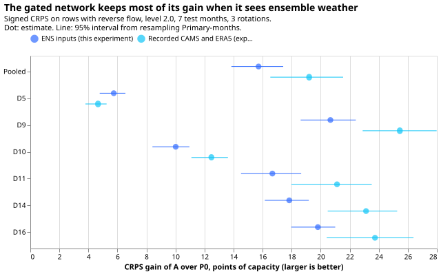
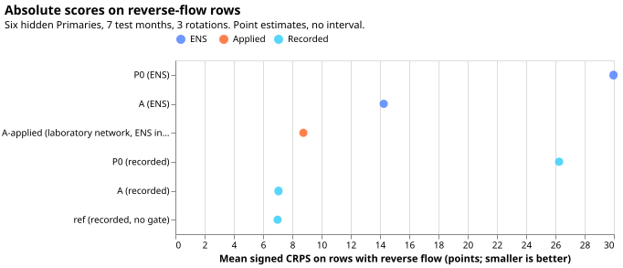
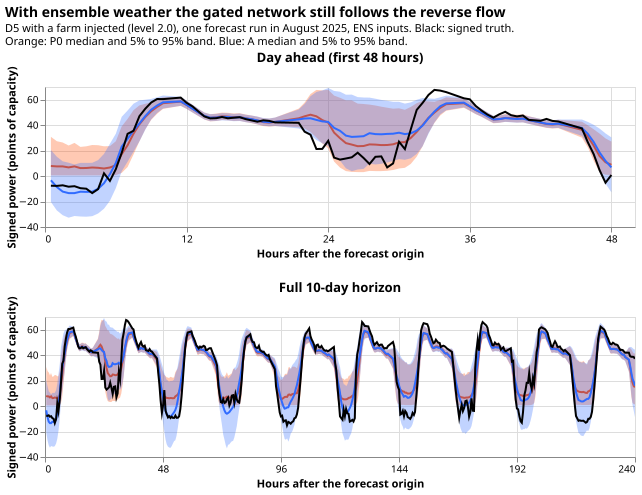

**Take-home: with ensemble weather forecasts in place of recorded weather, the neural network with
an
export gate still forecasts signed power on reverse-flow half-hours much better than the same neural
network with the gate shut, although the ensemble forecasts make it less accurate.** Signed power is
positive for demand and negative for reverse flow, where solar generation exports power up the
electricity network. The score is the continuous ranked probability score (CRPS), in points of
effective capacity (1 point is 1% of a substation's effective capacity), and lower is better. The
gate-shut network scores 29.97 and the export-gated network 14.26, a gain of 15.7 points (95%
interval 13.8 to 17.4), against 19.2 with recorded weather. The test covers six primary substations
with one real solar farm's output added, in spring, summer, and autumn months only.

**An unplanned finding:** the neural network trained on recorded weather and applied unchanged to
ensemble weather scored 5.5 points better (95% interval 4.4 to 6.6) than the neural network
retrained
on ensemble weather. The pass bars written down before scoring did not test this comparison, and no
prediction covered it.

**This experiment asks whether the signed forecast of the export-gated neural network survives the
step from recorded weather to ensemble weather forecasts.** Eight primary substations (the
"MVA-only"
eight) report only the size of the power that flows, not its direction.
[Experiment 420](../00420-neural-mva-export-gated-signed-final/result.md) hid the direction at six
primary substations where it is known (D5, D9, D10, D11, D14, and D16 are anonymised labels) and
added
a real solar farm's recorded output to some of them. It found that a neural network with an export
gate, set once per substation to open or shut from a statistic of the substation's readings,
forecasts the signed power far better than the same neural network with the gate shut (7.1 against
26.3 points on reverse-flow half-hours). The weather in that test was recorded CAMS irradiance and
ERA5 temperature, which a live service does not have at forecast time. This experiment repeats the
test with the ensemble (ENS) forecast of the European Centre for Medium-Range Weather Forecasts: the
mean and spread across its 51 members of the same weather variables. It trains the neural network on
them and scores it on the same rows, in three rotations of which two substations are hidden at a
time. The gate still helps a great deal, though less than with recorded weather.

## Results

**S1, S2, and S3 pass for A, and the pooled floor is met.** All 105 fits and 42 forecast-only runs
finished. Values are points of effective capacity (1 point is 1% of a substation's effective
capacity) of the signed continuous ranked probability score (CRPS), level 2.0 unless stated, with
95% Primary-month block intervals; A is the mean of two seeds and the other arms use seed 0. The
minimum detectable effect, written before scoring, was 1.735. All scores are in
`work/scores_full.json`. "Hidden" substations are the six whose direction of flow was hidden from
the neural network, and "no-injection" is the setting with no farm added.

| Bar | Result | Passes? |
|---|---|---|
| S1, gain of A over P0 on reverse-flow rows, pooled | 15.72 (13.85 to 17.41), floor 10 | Yes |
| S1 by substation | D5 5.75, D9 20.67, D10 10.01, D11 16.67, D14 17.84, D16 19.80; every interval excludes zero and clears 1.735 | Yes |
| S2, harm at the no-injection substations, pooled | +0.009 (-0.003 to 0.023); D9 +0.051, others -0.004 to +0.003 | Yes (limits +0.05 pooled, +0.20 single) |
| S3, reading harm at the MVA-only eight, pooled | -0.005 (-0.036 to 0.020) | Yes (limit +0.05) |

The prediction was met on every clause: pooled floors, every hidden substation's interval, S2, S3,
and the gate decisions. The label scope in the decision rule gives "inferred, ensemble-tested,
gated" at D8 and D12. That label rests on the gate opening in all 21 fits and on the reading check
(S3), because those two substations have no signed truth to score.

**Unplanned: the network trained on recorded weather and applied to ensemble inputs beat the
retrained network.** A-applied scored 5.50 points better than A (4.35 to 6.61; 8.76 against 14.26,
A as the mean of two seeds), and 21.22 better than P0 (18.42 to 23.77). The plan called A-applied a
diagnostic. No bar or prediction covered it, and it contradicts the plan's reason for retraining
(a network that has seen ensemble inputs should cope with their bias). A likely explanation, which
the stored fits support but no test confirms, is noise in the ensemble inputs. Noise in an input
shrinks the fitted coefficient on it. The fitted solar coefficient (the multiple of the unit shape
subtracted from demand) was lower and less stable when trained on ensemble inputs: at D9 in seed 0
it ran from 39 to 88 points of capacity across the seven fits, against 98 to 107 with recorded
weather. The two seeds of A differ by 2.09 points (0.88 to 3.29) on average, so seed noise is large
next to every contrast except S1.

- **Absolute scores on reverse-flow rows:** P0 29.97, A 14.26, and for reference the
  recorded-weather
  arms of experiment 420: P0 26.26, A 7.05, ref (no gate) 6.99. A-applied scored 8.76.
- **Lead bands (gain of A over P0):** days 1 to 2 16.18 (14.25 to 17.90), days 3 to 6 15.86 (13.97
  to
  17.61), days 7 to 10 15.35 (13.50 to 17.03). The point estimates fall by 0.8 points from the first
  band to the last, less than the minimum detectable effect, and the intervals overlap. No paired
  lead-band contrast was computed.
- **Ensemble against recorded weather for A:** worse by 7.20 (5.85 to 8.54).
- **Primary-level gates:** open at D8 and D12 in all 21 fits and shut at D2, D3, D4, D19, D21, and
  D22 in all 21, as with recorded weather. The six hidden substations' gates opened in all seven of
  their fits each.
- **Rotation r1 (stage 1) before the full run:** gain 7.79 (6.39 to 9.12) against 8.29 with recorded
  weather at D5 and D10, floor 4, minimum detectable effect 0.907. Stage 1 passed.
- **Cleaned data:** each refit drops 57,531 to 94,724 training rows (summed over the 16 trial-area
  substations: the six hidden, the eight MVA-only, D15, and D18) that have no usable power reading,
  including the half-hours the `substation_zero` rule flags; the counts per fit are in each fit's
  JSON file. No training row has a missing ensemble unit shape.

**With ensemble inputs the sign is called much less well, and the lower tail is too narrow.** The
numbers are descriptive, level 2.0, seed 0, on the half-hours with the recorded CAMS unit shape at
least 0.3 and clear-sky index at least 0.7 (115,040 rows), for every arm.

| Measure | A (ensemble) | A-applied | A (recorded weather, experiment 420) |
|---|---|---|---|
| Balanced accuracy at `P(X < 0) > 0.5` | 0.600 | 0.781 | 0.852 |
| Recall of reverse flow | 0.235 | 0.676 | 0.859 |
| False-reverse rate, every non-reverse slice row | 3.6% | 11.5% | 15.5% |
| Area under the receiver operating characteristic curve | 0.876 | 0.891 | 0.930 |
| q01 coverage on reverse-flow rows (nominal 0.01) | 0.091 | 0.118 | 0.062 |
| q05 coverage (nominal 0.05) | 0.308 | 0.254 | not recorded here |
| q95 coverage (nominal 0.95) | 1.000 | 0.987 | not recorded here |
| q99 coverage (nominal 0.99) | 1.000 | 0.998 | 0.998 |

- **Tail pinball losses (A, ensemble):** q01 0.82, q05 3.37, q95 3.11, q99 0.74; P0: 19.20, 20.20,
  3.40, 0.79.

## Checks

- **Median forecast minus the mean implied by the quantiles, on reverse-flow rows, pooled**
  (trapezoid
  integration of the 11 quantiles, a rough check): P0 -1.87 points (negative at every substation), A
  +0.04 (-1.31 at D5 to +0.95 at D11), A-applied -0.10, recorded-weather A -0.14. The spread does
  not shift A's forecast.
- **Error of the median forecast beside the CRPS contrast** (mean absolute error of the median on
  reverse-flow rows): P0 39.83, A 26.99, A-applied 15.05, recorded-weather A 12.24. The error of the
  median forecast points the same way as every CRPS contrast, so audit trigger 3 (the two disagree)
  did not fire.
- **Leave-one-substation-out for A-applied against A:** A-applied stays better when any one of the
  six hidden substations is left out (4.55 when D9 is left out, up to 6.31 when D5 is). D9 carries
  the most weight. Trigger 4 (leaving one site out flips a contrast) did not fire.
- **Triggers that fired.** Trigger 2 (a result contradicts its own plan) fired in part: A-applied
  contradicts the plan's reason for retraining, and the explanation is descriptive, not tested. No
  audit was run, because the S1 to S3 verdicts do not depend on A-applied and the page states the
  cause as untested. Trigger 5 (a nested arm beats its container) does not apply, because A-applied
  is not nested in A. Trigger 7 (a later design depends on an unreplicated headline) is met: a
  live-service port would depend on the 15.7-point headline, which replicates the recorded-weather
  result on the same injected series. The placebo control held (S2).
- **Mixed seed counts.** A is the mean of two seeds in S1, S3, and the A-applied contrast; P0 and
  A-applied use seed 0. Against seed 0 of A alone the A-applied gain is 6.54 (5.09 to 8.00), and
  against seed 1 alone 4.45, so the size depends on which seed is read and the sign never changes.
- **S2 pooled excludes D10** (real reverse flow); D10's A-minus-P0 harm is -0.043.
- **Caveats.** The reverse-flow rows come from six substations in one rotation each, so rotation and
  substation are confounded, with 42 blocks. The injected farm is real recorded output added to real
  demand. The test months are 2025-07 to 2025-09 and 2026-03 to 2026-06, so no winter month is
  scored. The scored lead range is 0 to 240 hours (days 1 to 10). The 2025-07 refit trains on 15
  months, not 24. NGED says load-shift events may be missing from its logs, so unlogged events may
  sit in the readings.
- **Not done.** Avoidable-curtailment cost (see Departures), a climatology row, a winter example
  forecast, and a pretrain-then-fine-tune arm (experiment 418's recipe).

## Plan as registered

The sections below were written before any fit or score, and the two minimum-detectable-effect
sections were committed before the matching contrasts were read.

## Evidence the plan follows

- **Experiment 420 (merged, pull request 77) found a laboratory gain of 19.2 points (16.5 to 21.5)**
  of the gated network over the gate-shut network, and said most of it comes from allowing negative
  values, because the ungated reference scored the same as A on reverse-flow rows. The gate matters
  at the no-injection Primary D5. This plan keeps those caveats.
- **Experiment 418 (merged) found that pretraining on recorded weather and then fitting on the ENS
  archive helps** (about 0.06 points at the six signed-MW Primaries and 0.16 at the eight, over 12
  test months), and that an ENS-only fit degrades badly when the archive covers only 6 months. The
  ENS archive used here covers 2024-04 to 2026-06, so each refit has 15 to 24 months, as in
  experiment 420. A pretrain-then-fine-tune arm would add a design question, so this plan leaves it
  as a named next step.
- **Experiments 419 and 423 (merged) found no input change that beats seed noise** for the pooled
  neural network. This plan adds ENS spread columns as inputs, so seed noise is measured here (a
  second seed of A) before any contrast is read.
- **The data-processing page says ENS irradiance needs calibration against CAMS** (shifts of up to
  20% in irradiance and 2 K in temperature) **and is a 6-hour mean after lead 144 hours.** Both
  facts are why the preferred arm is retrained on ENS inputs, so the network learns the bias, and
  why an applied-only network is reported as a diagnostic with no bar.
- **Standing practices applied:** monthly refits; cleaned data with the dropped count stored per
  fit (experiment 417's fold drops the flagged half-hours); D15 and D18 cut before 2025-03-01;
  every network saved as a state file; tails and examples reported; draft pull request. Departures
  are listed below. Earlier advice followed: score a signed forecast against the ungated network as
  well as the gate-shut network (reference rows below); label the signed output by what was tested.
  Advice departed from: none.

## Design

**The preferred arm is retrained on ENS inputs, and the weather it sees at training time and at
inference time is the same ENS mean and spread.** Training on realised weather and serving ENS
weather would put the network in a distribution it never saw, and the ENS forecast carries known
biases. A network applied without retraining is reported as a diagnostic (arm A-applied).

| Arm | What it is | Role |
|---|---|---|
| P0 | Experiment 420's P0 (gate forced shut, plain reading read as signed), trained on ENS inputs | Benchmark |
| A | Experiment 420's arm A (Primary-level export gate), trained on ENS inputs | Candidate |
| A-applied | Experiment 420's saved arm A networks (trained on CAMS and ERA5, seed 0), applied to ENS inputs with no refit | Diagnostic, reported only, zero fits |
| lab A, lab ref, lab P0 | Experiment 420's stored forecasts on CAMS and ERA5 inputs | Reported only |

**What changes in the inputs.** Experiment 417's fold is reused unchanged except for three series:

- **PV term and Primary gate.** The scaled CAMS unit shape `u` and clear-sky index `k` become the
  ENS-mean unit shape (from the ENS mean shortwave irradiance, divided by the same `u99`) and the
ENS
  clearness index, taken from experiment 405's `extras` arrays row by row.
- **Temperature.** ERA5 temperature becomes the ENS mean temperature.
- **Spread.** Three standardised input columns are added to the demand module: the temperature
  spread (standard deviation across the 51 members), the unit-shape spread, and the mean temperature
  itself. The columns are computed once per run, so the network is passed once per row, with no
  member loop.

Everything else is as in experiment 420: injected farm and reactive floor Q = 2 points at power
factor 1, rotations r1 (D5, D10 hidden), r2 (D9, D14), and r3 (D11, D16), the seven test months
2025-07, 2025-08, 2025-09, 2026-03, 2026-04, 2026-05, and 2026-06, 730-day training windows, monthly
refits, the same early-stopping weeks, and scoring on leads up to 240 hours (days 1 to 10). Rows are
the same rows as experiment 420's, so experiment 420's stored forecasts pair with these row by row.

**Settings.** Level 2.0 (main) and the no-injection placebo. Level 1.0 is not run, because the
question is whether the main result survives ensemble weather.

**Weather availability at forecast time.** ENS runs are usable 9 hours after their start time (the
`NWP_PUBLICATION_DELAY_HOURS` constant), and each row's ENS values come from the 00Z-run summary
that
experiment 397 attaches to the row's forecast origin, so no lag-time weather is recorded weather.
Before 2025-07-01 experiment 397 builds the ENS mean and spread from the archive (only the control
member is stored); from 2025-07-01 it uses the stored 51-member frames. Both arms see this source
change, and the month-by-month table shows whether it matters. Rows with missing ENS values stay in
both arms with the missing inputs set to zero after standardisation, so the rows match experiment
420's; the count of such rows per fit is stored. The lags in the demand module are power lags, as in
experiment 420.

## Scoring and pass bars

**The primary contrast is signed CRPS in points of effective capacity, days 1 to 10, on the
hidden-sign rows with reverse flow, A against P0, both on ENS inputs, pooled over the six hidden
Primaries.** Intervals come from a paired month-block bootstrap (resample whole Primary-months,
20,000 resamples), because each half-hour appears in about 15 runs.

**The minimum detectable effect is written down before any arm-against-arm score is read.** It is
2.8 times the month-block bootstrap standard deviation of the null difference between A's two seeds
(ENS inputs) on reverse-flow rows. Stage 1 fits A's second seed at level 2.0 on rotation r1 so that
the figure exists first; the full-run figure uses all three rotations. Each figure is committed to
this page before the matching contrast is read. A figure above 0.5 points marks the contrast as
underpowered.

- **S1 (gain over P0).** A's reverse-row CRPS is below P0's by at least the minimum detectable
  effect,
  with the interval excluding zero, pooled and at each hidden Primary at level 2.0. On rotation r1,
  stage 1 pools D5 and D10 and reads each of the two. S1 also needs a pooled floor, 10 points over
  the three rotations and 4 points on rotation r1, because experiment 420's minimum detectable
  effect (0.27 to 0.40 points) is far below every laboratory gain and cannot fail alone. The floors
  are about half the laboratory gains. A gain above the minimum detectable effect but below its
floor
  is a small gain, not a pass. The minimum detectable effect governs only the contrasts it can
  resolve (A against A-applied, and A on ENS against A on laboratory inputs); a figure above 0.5
  points marks those contrasts, and S1 if it is that large, as underpowered.
- **S2 (no harm where there is no export).** Read on the point estimate, with the interval end
  reported. In the placebo setting, signed CRPS on all rows of D5,
  D9, D11, D14, and D16 is within +0.05 points of P0 pooled, with no single Primary above +0.20.
  D10 is left out because it has real reverse flow.
- **S3 (the MVA-only eight).** Read on the point estimate. At a Primary whose gate is shut, A's
  reading forecast equals P0's by construction, so S3 can fail only through the Primaries whose gate
  opens. Reading CRPS at the eight, from the same fits, is within +0.05 points
  of P0 pooled.

**Reported with no bar:** the gain by lead band (days 1 to 2, days 3 to 6 up to a lead of 144 hours,
and days 7 to 10 above
144 hours, where the ENS stamps change from 3-hourly to 6-hourly; headline days 1 to 10); experiment
420's laboratory A, ref, and P0 beside the ENS arms, and the paired difference of A
on ENS inputs against A on laboratory inputs; A-applied against P0 and against A; q01 and q99
coverage and pinball loss on reverse-flow rows; sign balanced accuracy, recall, ROC area, and the
false-reverse rate at `P(X < 0) > 0.5` on both denominators of experiment 420; each Primary-level
gate decision with its Spearman statistic, with the decisions at the eight set beside experiment
420's (open at D8 and D12, shut at D2, D3, D4, D19, D21, and D22); the dropped half-hours per fit.
Experiment 420's caveat is kept in the write-up: most of the gain over P0 is being allowed to go
below zero, and the gate matters at the D5 placebo.

**Observation made before scoring, and a correction to the gate input.** Building the stage-1
training
fold for the 2025-07 refit (no fit, no score) first gave a gate shut at D8 and D12. The cause was
experiment 417's gate code, which keeps the first row of each valid time. With CAMS every row of a
valid time has the same weather, but each ENS row has its own run, and the first row is the
longest-lead one (mean lead 333 hours at D5), whose irradiance is a blurred 6-hour mean. The plan
therefore computes the Primary-level gate on each valid time's shortest-lead row
(`e00424_inputs.primary_gates`), which is a design choice made before any score. On those rows the
gate opens at D5, D8, D10, and D12 in that fold, as in experiment 420. The ENS clearness index is
the
ENS mean shortwave over `1000 * cos(zenith)`, not a CAMS clear-sky index, so the gate's `k >= 0.7`
selects a different, sparser set of rows; the number of rows behind each gate decision is stored.

## Fits, compute, and stop rule

| Batch | Fits |
|---|---|
| Stage 1: P0 and A at level 2.0 and the placebo, seed 0, rotation r1, 7 months (28), plus A seed 1 at level 2.0 (7) | 35 |
| Full run: all three rotations, P0 and A at both settings (84) plus A seed 1 at level 2.0 (21) | 105 |
| A-applied: forecast only, 3 rotations × 7 months × 2 settings | 0 fits, 42 forecasts |

**Stage 1 runs rotation r1 only.** If A fails S1 on r1, stop. Otherwise tell the manager and run the
remaining rotations (70 fits). Experiment 420 timed a fit at 26 to 83 seconds including the fold
build, so stage 1 takes about 30 to 60 minutes and the full run about 1.5 to 3 hours, on one GPU
process using about 1.4 GB of GPU memory, one CPU core, `systemd-run --user --scope -p
MemoryMax=8G -p OOMPolicy=continue`, with `OMP_NUM_THREADS=1`. The fit script reads `MemAvailable`
before every fold and every fit and stops if it falls below 12 GiB (the `available` column of
`free -g`). A fit is skipped when its JSON file exists, so a stopped run resumes. Experiment 420's
fits are not repeated: its stored forecasts are the laboratory reference rows. Outputs go to
`work/fits/<arm>/`, state files to `work/models/<arm>/`, in this experiment's private folder.

## Code

All code is in `ml-experiments/00424-neural-mva-export-gated-signed-ens-serving-test/`.

- `e00424_inputs.py` builds experiment 417's fold with ENS inputs (`build_fold`) and the ENS model
  inputs.
- `e00424_fit.py` defines the jobs, fits P0 and A, forecasts the hidden pair and the eight, and runs
  A-applied from experiment 420's state files. It imports experiment 420's arms, gates, training
  loop, and forecast helpers.
- `e00424_score.py` scores S1 to S3, the minimum detectable effect, the lead bands, and the
  descriptive tables, importing experiment 420's scoring functions.

## Departures

- **Level 1.0 and the shuffled-sky arm are not run.** Experiment 420 already showed the shuffled sky
  is far worse than A on recorded weather, and the serving question needs the main setting only.
- **Avoidable-curtailment cost is not computed,** for the reason experiment 420 gives: the injected
  series have no node and generator tables. The q01 coverage and pinball loss on reverse-flow rows
  stand in.
- **Seed asymmetry.** A has two seeds and P0 one, so A's mean over two seeds meets P0's single seed,
  which lowers A's noise without biasing the contrast. The minimum detectable effect comes from
  single seeds, so it is conservative for the two-seed mean.
- **No climatology row.** The target is a signed series with an injected farm, for which no
  month-by-half-hour climatology forecaster exists in this repository; experiment 420 had none.
- **No multiplicity correction.** S1 to S3 are conjunctive pass bars, each read at 95%; the decision
  rule needs all three, so the family-wise error of a joint pass is below the level of any one.
- **Figures.** The write-up carries a day-ahead example and a 10-day example at D5 with a farm
  injected, from experiment 420's figure script adapted to these files, and q01, q05, q95, and q99
  coverage and pinball loss on reverse-flow rows.

## Risks

- **The injected farm is real recorded output and the weather inputs are ENS, so the test is still
  a laboratory test of the sign question,** although the weather side is now what a live service
  holds.
- **A wrong Primary-level gate decision makes a whole Primary's forecast wrong.** The gate decisions
  are stored for every fit and reported.
- **ENS irradiance after lead 144 hours is a 6-hour mean,** so the unit shape is blurred at days 6
  to 10. Experiment 397's summaries do not treat the two stamp spacings differently, and this plan
  does not change that. The lead-band table, split at 144 hours, shows whether the gain falls there.
- **The scale constant `u99` is fixed on one Primary's daylight rows over the whole record,** so it
  also covers the test months. Both arms share the scalar, and it is accepted as negligible.
- **ENS forecast errors that differ by season, lead band, and hour band** (experiment 111) may
  exceed what
  one retrained network with a lead input learns. The lead-band and month tables show it.
- **Unlogged load-shift events** may sit in the readings, as NGED says its logs are incomplete.

## Minimum detectable effect, stage 1 (written before any arm-against-arm score)

**On rotation r1 the minimum detectable effect is 0.907 points of effective capacity.** The null
difference between A's two seeds (ENS inputs) on reverse-flow rows at level 2.0 has a mean of -0.024
(95% interval -0.725 to 0.549; 14 Primary-month blocks, 22,443 rows) and a bootstrap standard
deviation of 0.324; 2.8 times 0.324 is 0.907. The figure is above the 0.5-point limit, so contrasts
of that size or smaller (A against A-applied, A on ENS against A on laboratory inputs) are reported
as underpowered. The figure does not weaken S1, because its floors (4 and 10 points) sit far above
it. The figure is in `work/mde_stage1.json`, which the script refuses to overwrite.

## Minimum detectable effect, full run (written before the full scoring)

**Over all three rotations the minimum detectable effect is 1.735 points of effective capacity.**
All 105 fits and 42 forecast-only runs finished. The null difference between A's two seeds on
reverse-flow rows at level 2.0 has a mean of 2.09 (95% interval 0.88 to 3.29; 42 Primary-month
blocks, 79,399 rows) and a bootstrap standard deviation of 0.620; 2.8 times 0.620 is 1.735. The two
seeds of A therefore differ by a mean of 2.09 points on these rows, and contrasts under about 2
points are underpowered. The 10-point S1 floor is far above that noise. The figure is in
`work/mde_full.json`.

## Problems caused by the move

- **The docstrings of experiments 412, 417, and 420 tell the reader to source an `env.sh`, which
  does
  not exist in this repository.** `PYTHONPATH` and `DATA_PATH_INTERNAL` were assembled by hand; the
  header of `e00424_fit.py` lists them. Command that showed it: `ls env.sh`.

## Review log

**Plan review (fresh Sonnet agent, before any fit).** The review gave 12 findings. Accepted: a
numeric S1 floor and an outcome for a gain between the minimum detectable effect and the floor; the
label covers only the substations whose gate opened; S2 and S3 read on point estimates, with stage 1
testing S2 at D5 only; missing-ensemble rows kept and counted; the 9-hour delay, the archive switch
on 2025-07-01, the `u99` constant, and the 6-hour-mean limit stated; lead bands split at 144 hours;
departures for the climatology row and multiplicity. Not changed: the draft-PR timing, because the
brief asks for a draft plan PR.

**Code review (fresh Sonnet agent, before any fit).** No leakage and no crash on first use. One
important finding, accepted and fixed: experiment 417's gate keeps each valid time's longest-lead
row,
which gave a gate shut at D8 and D12 with ensemble inputs; the gate now uses the shortest-lead row.
Minor, accepted: the S1 code was stricter than the plan; the ensemble-minus-recorded interval was
dropped; the ensemble clearness index is not a clear-sky index (stated). Not changed: the
applied-only
fold is rebuilt per job (efficiency only).

**Results review (fresh Sonnet agent, from the stored forecasts).** Every headline number was
reproduced. One discrepancy, accepted: the A-applied contrast used A's seed 0 (6.54) while every
other figure used A's two-seed mean (5.50); the page and the scoring script now use the two-seed
mean. The Checks above come from this review.

**Write-up numbers review (fresh Sonnet agent, against the stored scores).** Accepted: four interval
ends and one rounding corrected, the claim that the gain "does not fall" across lead bands replaced
by the measured 0.8-point fall, "at least 5.7" scoped as a point estimate, the learned-coefficient
ranges put on one basis (seed 0), a truncated sentence in the prediction repaired, and a statement
that the prediction was met added.

**Prose review (fresh Sonnet agent).** Accepted: terms defined at first use (primary substation,
points of effective capacity, CRPS, hidden, no-injection), the take-home rewritten to be
self-contained and scoped, "costs accuracy" replaced, the seed-noise sentence corrected, the lead
bands renamed to days 7 to 10, "feeder core" replaced, the results moved above the plan, the
audit triggers described, first-person and process-history lines removed from the move section.
Not changed: duplication between the headline, lessons, and advice (each must stand alone in the
generated tables), the registered-form plan prose, and a split of the long registered sentences in
the plan, which would alter the pre-registered wording.
