**Take-home message: pretraining the pooled mixture density network on ERA5-and-CAMS rows before
fine-tuning it on ensemble rows lowered the CRPS at both metering groups, by 0.050 points of
capacity at the six signed-MW Primaries and 0.124 at the eight MVA-only Primaries, and the Primary
embedding mattered far more than pretraining (removing it raised the CRPS by about 0.85).** The
gain at the eight clears the registered bar. The gain at the six is probable, but its interval ends
at -0.021, short of -0.03. The assembled network scored lower CRPS than the monthly XGBoost recipe
and than BG2 at both groups, and higher than BG2 at D15 and D18. The verdict is `partly
supported`, and pretraining is a candidate for a model release.

We asked whether combining every component that earlier experiments supported in one pooled neural
network gives a better demand forecast than leaving a component out, and than the reference
forecasts. The network predicts 11 quantiles of Primary substation demand for the next 14 days from
the weather ensemble. The components are one network shared by all Primaries with an 8-wide
embedding per Primary, summaries of the ensemble's mean and spread, hand-made calendar columns,
monthly refits, and a final widening of the bands by 1.15. The one component added here is
pretraining, an idea first tested in [experiment 418](../00418-mdn-pretrain-on-era5-and-cams-then-fine-tune-on-ens/result.md).
The network first learns from ERA5 and CAMS estimates of past weather, and then every weight is
fine-tuned on ensemble rows.

We refitted three networks at 12 monthly folds (forecast origins from 2025-07 to 2026-06, each
network trained only on data before its month) with five random seeds each, and compared them with
four references on the half-hours that all of them forecast. The three networks are `R`, trained on
ensemble rows only; `A`, pretrained then fine-tuned; and `A-noemb`, the same as `A` without the
Primary embedding. The references are the monthly XGBoost recipe (`S0M`), BG2 (weekly XGBoost
models), `manual_heuristic`, and `climatology`. Scores are the continuous ranked probability score
(CRPS) at days 1 to 10, in points of effective capacity (smaller is better), averaged over the
Primaries of each group with equal weight. The signed-MW six are the Primaries whose meters record
the direction of flow, the MVA-only eight are the Primaries whose meters record apparent power
without a sign, and D15 and D18 are reported separately.

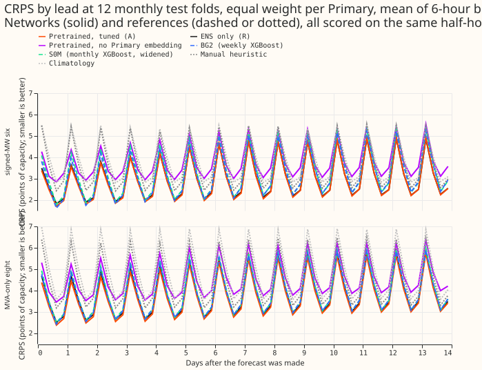

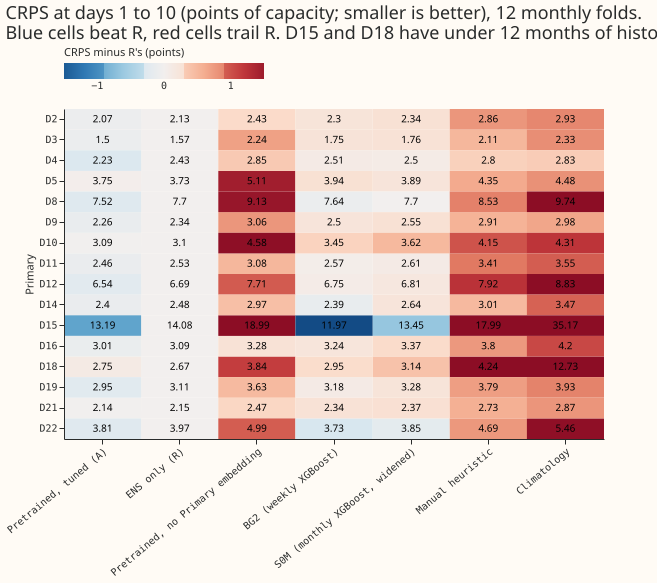

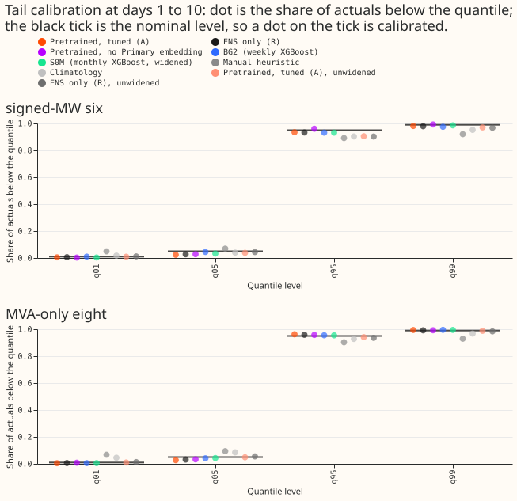

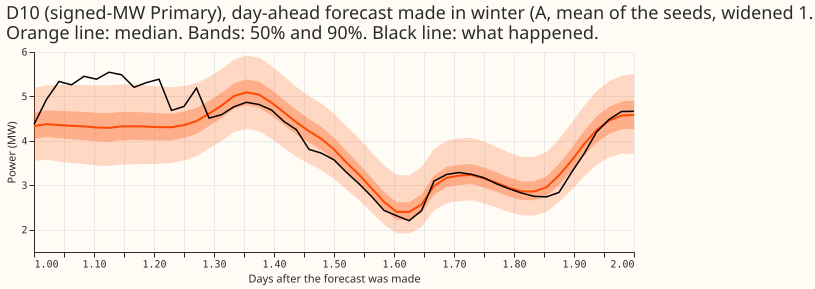

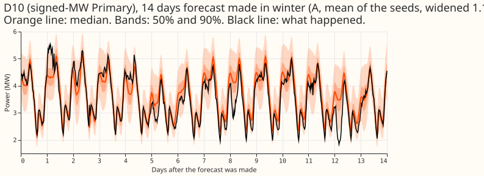

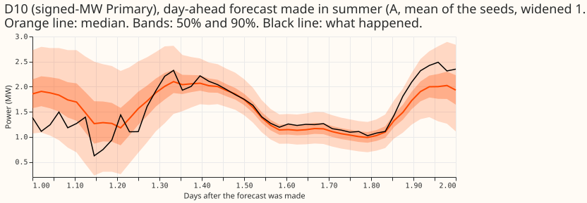

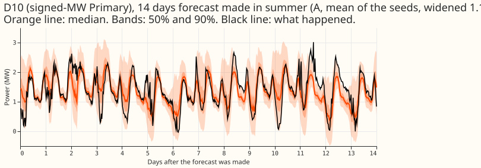

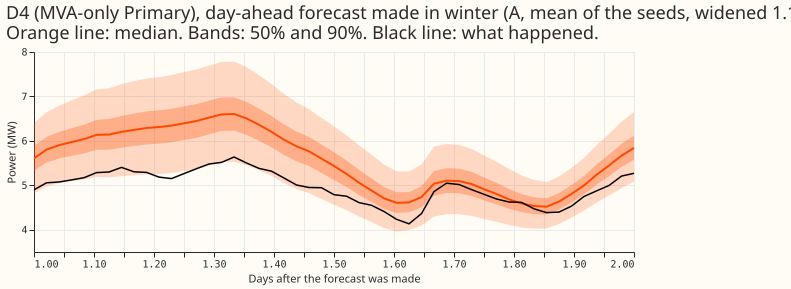

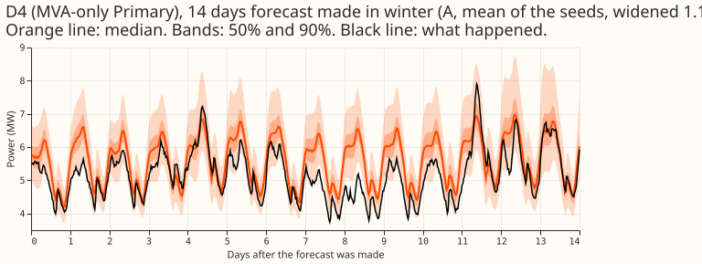

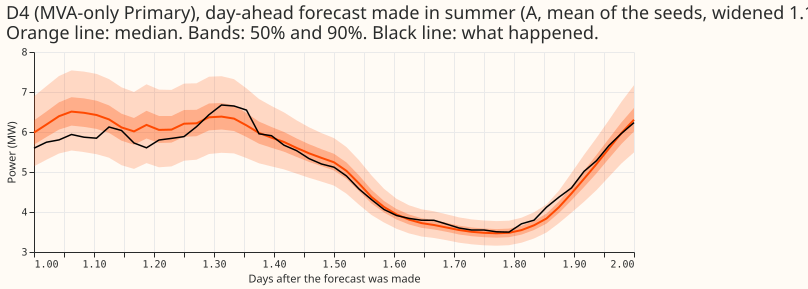

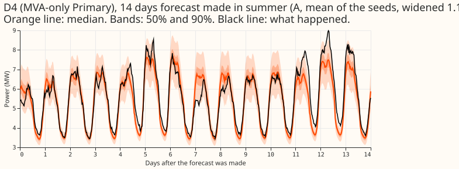

## Results

### Arms

- **`R` (reference network).** Pooled plain network with the Primary embedding, trained on ensemble
  rows only, widened by 1.15.
- **`A` (assembly).** `R` after pretraining on ERA5-and-CAMS rows, with every weight fine-tuned on
  ensemble rows at a learning rate of 2e-4, widened by 1.15. `A_raw` is the same forecast without
  the widening.
- **`A-noemb`.** `A` built on [experiment 406](../00406-pooled-mixture-density-network-without-embedding-and-with-short-history/result.md)'s
  network with no Primary embedding, in both the pretraining and the fine-tuning stage.
- **`S0M`.** The monthly XGBoost recipe, arm `S0M` of
  [experiment 389](../00389-xgboost-tail-calibration-and-ensemble-spread-columns/result.md), read
  through [experiment 397](../00397-plain-and-attention-mixture-density-network-for-primary-demand/result.md)'s
  references and scored both raw and widened by 1.15.
- **`BG2`.** The weekly XGBoost models of
  [experiment 87](../00087-bg2-best-guess-assembled-with-drop-one-ablations/result.md).
- **`manual_heuristic` and `climatology`.** The two naive forecasts from the project's evaluation
  code.

Every network was refitted with the D15 and D18 start cut and the flagged exact-zero drop. Seeds are
0 to 4 for every fitted arm.

### Absolute scores

**`A` has the lowest CRPS of the seven at the signed-MW six and the MVA-only eight, and BG2 has the
lowest at D15 and D18.** The table gives the CRPS at days 1 to 10 with the widening of 1.15, on the
2,922,247 half-hours that every arm and reference forecasts. Of these, 826,396 sit at the six,
1,103,553 at the eight, and 169,766 at D15 and D18.

| Arm | Signed-MW six | MVA-only eight | D15 and D18 |
|---|---|---|---|
| `R` | 2.878 | 3.719 | 8.373 |
| **`A`** | **2.828** | **3.594** | 7.970 |
| `A-noemb` | 3.680 | 4.431 | 11.413 |
| `S0M` (widened) | 3.115 | 3.826 | 8.291 |
| BG2 | 3.016 | 3.774 | **7.457** |
| `manual_heuristic` | 3.605 | 4.429 | 11.112 |
| `climatology` | 3.831 | 4.866 | 23.951 |

The unwidened `S0M` scores 3.111, 3.818, and 8.309. Figure 2 gives the CRPS per Primary.

### Minimum detectable effect

**The minimum detectable effect is 0.0368 points.** It is the standard deviation over the 12 folds
of the difference in signed-MW six CRPS between the mean of `R` seeds 0 to 2 and the mean of `R`
seeds 3 and 4 (0.0520), divided by the square root of two. The value is a lower bound. A contrast
smaller than 0.0368 is inside the noise.

### Contrasts

**Pretraining lowered the CRPS at both groups, the Primary embedding is worth far more, and the
assembly beat the monthly XGBoost recipe.** The table gives treatment minus reference, at days 1 to
10, with the month-block bootstrap interval (20,000 resamples, level 98.75%, a Bonferroni correction
over four contrasts). D15 and D18 are report-only.

| Contrast | Signed-MW six | MVA-only eight | D15 and D18 (report-only) |
|---|---|---|---|
| C1: `A` minus `R` | -0.050 (-0.078 to -0.021) | -0.124 (-0.219 to -0.048) | -0.368 (-0.567 to -0.004) |
| C2: `A-noemb` minus `A` | +0.851 (+0.723 to +0.999) | +0.837 (+0.731 to +0.944) | +3.272 (+1.191 to +5.527) |
| C3: `A_raw` minus `A` | +0.004 (-0.009 to +0.025) | -0.011 (-0.016 to -0.006) | -0.003 (-0.074 to +0.097) |
| C4: `A` minus `S0M` (both widened) | -0.287 (-0.402 to -0.171) | -0.232 (-0.376 to -0.115) | -0.326 (-0.724 to +0.047) |

- **C1 is negative in 11 of 12 folds at both groups.** The per-fold differences at the six run from
  -0.102 to +0.018. At the eight they run from -0.409 to +0.011.
- **C2 is positive in all 12 folds at both groups.** The smallest per-fold difference is +0.571 at
  the six and +0.557 at the eight.
- **The contrasts are pooled over half-hours.** Their intervals resample months and do not include
  the variation between seeds.

### Predictions

- **P1 held.** `A` beat `R` by 0.050 at the six (predicted 0.03 to 0.10) and by 0.124 at the eight
  (predicted 0.08 to 0.20).
- **P2 held.** `A-noemb` was worse than `A` by +0.851 at the six and +0.837 at the eight, within
  the predicted 0.5 to 1.0 points.
- **P3 failed on its direction, and the effect is small.** Widening the bands by 1.15 was
  predicted to lower the CRPS by less than 0.03 points and to move q95 coverage towards 0.95. At the
  six the widening lowered the CRPS by 0.004, inside the noise. At the eight the widening raised
  the CRPS by 0.011 (C3 is -0.011 because it is unwidened minus widened). That contradicts the
  predicted direction, and the size is small: a third of the 0.03 bound. The q95
  coverage moved towards 0.95 at
  the six (0.905 to 0.935) and past it at the eight (0.941 to 0.963).
- **P4 held.** `A` scored lower than `S0M` by 0.287 at the six and 0.232 at the eight, both
  intervals wholly below zero.

### Tails

**Widening by 1.15 fixes q95 and q99 coverage at the cost of q01 and q05 coverage, and `A` has
better coverage and lower pinball loss than `R` at the same widening.** The tables give coverage
(nominal 0.95 and 0.99) and pinball loss at q95 and q99, days 1 to 10, mean over the Primaries of
each group. The q01 and q05 coverage of `A_raw` at the six is 0.009 and 0.038, and of `A` is 0.005
and 0.023, so the widening pushes the lower tail further under its nominal level.

Signed-MW six (826,396 half-hours):

| Arm | Cov q95 | Cov q99 | Pin q95 | Pin q99 |
|---|---|---|---|---|
| `A_raw` | 0.905 | 0.970 | 0.809 | 0.279 |
| `A` | 0.935 | 0.981 | 0.779 | 0.260 |
| `R_raw` | 0.903 | 0.967 | 0.822 | 0.290 |
| `R` | 0.933 | 0.979 | 0.795 | 0.269 |
| `S0M_raw` | 0.909 | 0.980 | 0.948 | 0.386 |
| `S0M` | 0.932 | 0.986 | 0.928 | 0.392 |

MVA-only eight (1,103,553 half-hours):

| Arm | Cov q95 | Cov q99 | Pin q95 | Pin q99 |
|---|---|---|---|---|
| `A_raw` | 0.941 | 0.988 | 0.911 | 0.243 |
| `A` | 0.963 | 0.994 | 0.932 | 0.253 |
| `R_raw` | 0.936 | 0.984 | 0.946 | 0.256 |
| `R` | 0.959 | 0.992 | 0.961 | 0.258 |
| `S0M_raw` | 0.934 | 0.991 | 0.977 | 0.332 |
| `S0M` | 0.955 | 0.995 | 0.987 | 0.358 |

D15 and D18 (169,766 half-hours):

| Arm | Cov q95 | Cov q99 | Pin q95 | Pin q99 |
|---|---|---|---|---|
| `A_raw` | 0.904 | 0.976 | 2.231 | 0.868 |
| `A` | 0.938 | 0.984 | 2.126 | 0.808 |
| `R_raw` | 0.877 | 0.963 | 2.630 | 0.987 |
| `R` | 0.913 | 0.977 | 2.427 | 0.862 |
| `S0M_raw` | 0.866 | 0.986 | 2.768 | 0.717 |
| `S0M` | 0.896 | 0.990 | 2.535 | 0.689 |

- **At the six, the widening lowered the q95 and q99 pinball loss of `A`** (0.809 to 0.779 and
  0.279 to 0.260). **At the eight it raised both** (0.911 to 0.932 and 0.243 to 0.253), because the
  unwidened q95 coverage was already 0.941.
- **On sunny low-demand half-hours the bands are too wide.** The q95 coverage of `A` is 0.995 at the
  six (35,283 half-hours) and 0.987 at the eight (46,541 half-hours).

### Cold winter nights, sunny half-hours, and Economy 7

**`A` has lower CRPS than `R` in all three slices at all three groups.** The table gives the CRPS at
days 1 to 10 with the widening of 1.15 for `A`, `R`, `S0M`, BG2, and `manual_heuristic`. Cold nights
are the half-hours the evaluation code flags as cold nights, sunny half-hours are those it flags as
sunny, and the Economy 7 step is the overnight cheap-rate tariff switch.

| Slice and group | `A` | `R` | `S0M` | BG2 | `manual_heuristic` |
|---|---|---|---|---|---|
| Cold nights, signed-MW six | 4.290 | 4.446 | 4.953 | 4.714 | 6.177 |
| Cold nights, MVA-only eight | 3.213 | 3.315 | 3.756 | 3.662 | 5.022 |
| Cold nights, D15 and D18 | 5.850 | 5.934 | 7.226 | 5.936 | 9.291 |
| Sunny half-hours, signed-MW six | 3.814 | 3.831 | 4.183 | 4.157 | 4.824 |
| Sunny half-hours, MVA-only eight | 4.979 | 5.155 | 5.198 | 5.158 | 6.167 |
| Sunny half-hours, D15 and D18 | 8.966 | 9.410 | 9.492 | 8.611 | 12.235 |
| Economy 7 step, signed-MW six | 2.056 | 2.115 | 2.171 | 2.098 | 2.552 |
| Economy 7 step, MVA-only eight | 2.552 | 2.622 | 2.637 | 2.666 | 3.036 |
| Economy 7 step, D15 and D18 | 7.404 | 7.965 | 7.654 | 6.780 | 10.184 |

- **On cold nights `A` is the best of the five at the six and the eight.** At D15 and D18 it is
  0.086 lower than BG2 (5.850 against 5.936).
- **On sunny half-hours the margin of `A` over `R` at the six is 0.017**, inside the noise.
  BG2 is lower than `A` at D15 and D18 in the sunny and Economy 7 slices.

### Avoidable curtailment cost

**At the headline limit, `A` has the lowest avoidable curtailment cost of the arms with a printed
total, about 37% below `manual_heuristic`.** The cost is defined only for the signed-MW six.
It is the cost of a forecast minus the cost of a perfect forecast on the same half-hours, at leads
of 12 to 36 hours, scored per Primary as its own node at a price of £2000 per MWh for curtailed
energy. The limit is a fraction of each Primary's maximum flow in the 12 or more months before the
scored period. The printed totals below are for the six Primaries together, in millions of pounds
over the 12 folds.

| Limit as a fraction of earlier maximum | `A` | `A_raw` | `R_raw` | `S0M` | BG2 | `manual_heuristic` | `climatology` |
|---|---|---|---|---|---|---|---|
| 0.5 (headline) | 66.5 | 70.8 | 75.4 | 84.6 | 72.9 | 104.9 | 112.5 |
| 0.75 | 22.1 | 25.3 | 27.7 | 32.0 | 24.3 | 37.4 | 41.7 |
| 0.9 | 7.62 | 8.39 | 9.59 | 10.2 | 7.31 | 10.4 | 11.1 |

- **The ranking changes with the limit.** At 0.9 BG2 (7.31) is below `A` (7.62), and `A-noemb`
  is lower still (6.37 widened), despite its CRPS being 0.85 worse.
- **The cost of `R` widened is not in the printed report**, which prints `R_raw` only.

### Checks

- **Median forecast minus mean forecast per site, and the median-forecast error beside the
  contrasts, are not printed in the score report**, so this page does not report them.
- **Audit triggers.** C2's interval does not reach zero, so that trigger did not fire. C3 reverses
  sign at the MVA-only eight, so that trigger fired there: the page does not claim that the
  widening lowers the CRPS. No other trigger of the seven fired.
- **The 11 of 12 negative folds in C1 are not a second test**, because the folds make up the
  bootstrap's resampling units.

### Caveats

- **`S0M` has no D15 and D18 cut and no flagged-zero drop**, and comes from experiment 389. Its
  gap to `A` is partly a difference in training rows.
- **Flagged zeros among the origin lags still reach the network at inference**, as in
  [experiment 407](../00407-pooled-mixture-density-network-tail-arms-and-recency-weights/result.md).
  The scoring dropped 1,179 actuals that were flagged exact zeros.
- **The contrast intervals pool half-hours, and the tables average over Primaries**, so a table
  difference and a contrast can differ slightly.
- **The 12 monthly folds (2025-07 to 2026-06) refit every month.** The intervals therefore are
  not interim as the five-month screens were, but the monthly schedule is not the weekly schedule of
  production.
- **The lead range of 0.5 to 336 hours covers NGED's range of 1 to 10 days.**
- **Training rows dropped per fold.** Every fold drops 68,680 fine-tuning rows and 22,769
  pretraining rows for a short history at the start. The flagged exact zeros dropped rise from 808
  (2025-07) to 2,929 (2026-04) for fine-tuning and from 257 to 1,087 for pretraining.
- **The cut cross-check was not run.** No fit without the D15 and D18 cut exists, so the effect of
  the cut is not sized, and experiment 418's numbers are a guide only.

### What to try next

- **The maintainer has paused the assembly until more isolated improvements report.** Candidates
  to join `A` then are those that beat `R` on the same 12 folds.
- **Origin-hour training (experiment 422) is a candidate robustness variant and was not run.**
- **The export gate of [experiment 420](../00420-neural-mva-export-gated-signed-final/result.md)
  was not tested here.**

### Data used and where it lives

- **Data.** The cleaned NGED Primary-substation power series, ECMWF ensemble forecasts for the
  fine-tuning and the scoring, and ERA5 and CAMS estimates of past weather for the pretraining.
- **Schedule.** Monthly refits at 12 folds (2025-07 to 2026-06).
- **Code.** `ml-experiments/00425-best-mdn-architecture-assembly-with-ablations/` in this
  repository.
- **Saved networks.** The experiment's data folder, `work/models/` (fine-tuned networks) and
  `work/pretrained/` (pretrained networks), under
  `$DATA_PATH_INTERNAL/ml-experiments/00425-best-mdn-architecture-assembly-with-ablations/`.
