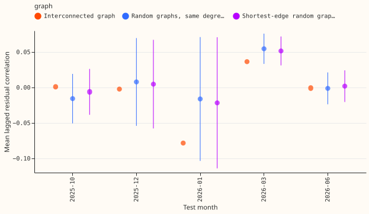
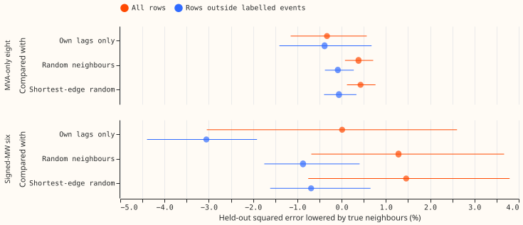
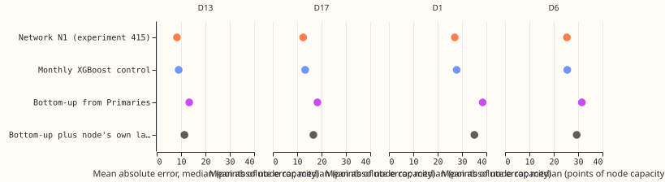

**Take-home message: in these tests, the recent forecast errors of a Primary's interconnected
neighbours predicted none of its day-ahead forecast error.** A graph network over the Primaries
therefore has no lagged-error signal to pass along, and none was fitted. A scaled sum of the
forecasts of the Primaries beneath a bulk supply point also scored worse than a network that sees
the node's own readings.

We asked whether three ideas for using neighbouring substations are worth a neural-network fit. The
ideas are a graph network over the 16 Primaries, a forecast for a bulk supply point (BSP) built from
the Primaries beneath it, and spotting outliers and load-shift events by comparing neighbours. A
Primary is a primary substation of the distribution network, and a neighbour is a Primary that
NGED's interconnection file joins to it (25 pairs among the 16 Primaries). The first stage fitted
no network. It took the stored day-ahead forecasts of the pooled neural network of [experiment
397](../00397-plain-and-attention-mixture-density-network-for-primary-demand/result.md) and asked
whether a neighbour's recent forecast error predicts a Primary's own error. It did not. The second
stage would have fitted a graph network at 75 fits, and it did not run, so the verdict is `not
supported`. Experiment 404 (plan in draft PR 58) has the arms that test neighbour inputs inside
load-shift events (idea 3).

## Results

CRPS is not used here, because stage 0 fits no network. The residual is the actual minus the median
forecast, divided by the Primary's effective capacity. The signed-MW six are the Primaries D5, D9,
D10, D11, D14, and D16, whose meters record the sign of the flow. The MVA-only eight (D2, D3, D4,
D8, D12, D19, D21, and D22) record only its magnitude, and D15 and D18 are report-only. D13 and D17
are bulk supply points, and D1 and D6 are grid supply points. Stage 0a and 0b use the five test
months of experiment 397 (2025-10, 2025-12, 2026-01, 2026-03, and 2026-06), and 0c uses the four
months for which the node network of [experiment
415](../00415-pooled-mixture-density-network-at-bulk-and-grid-supply-points/result.md) stored
forecasts (2025-12 is absent there). Intervals resample the test months (2,000 draws), so they are
coarse. "Reduction" below is the percentage fall in held-out squared error, so a negative reduction
is a rise in error.

- **Gate 0a (lagged correlation, signed-MW six, lead 12 to 36 hours).** The gate required the
  interconnected graph's mean correlation to exceed random graphs' by 0.10 and shortest-edge random
  graphs' by 0.05, in 3 of 5 months. The graph's mean correlation, over the newest reading before
  the origin and the same time yesterday, is 0.001, -0.002, -0.078, 0.036, and -0.001 in the five
  months. Random graphs with the same degrees give -0.016, 0.008, -0.016, 0.055, and -0.001. The
  excess over random graphs is +0.017, -0.010, -0.062, -0.018, and 0.000, so 0 of 5 months pass.
  At leads 120 to 240 hours the excess lies between -0.031 and +0.011. At the MVA-only eight the
  graph's means (0.008 to 0.045) are within 0.06 of random graphs' (not gated).
- **Gate 0b (ridge on neighbour lags, signed-MW six).** The gate required a reduction of at least
  2% against own lags only and at least 1% against each control, on all rows and outside labelled
  events. On all rows the reduction is 0.01% (-3.05 to +2.61) against own lags only, 1.28% (-0.68
  to +3.67) against random neighbours, and 1.46% (-0.75 to +3.79) against shortest-edge random
  neighbours. Outside labelled events the three reductions are -3.06% (-4.40 to -1.91), -0.87%
  (-1.75 to +0.41), and -0.69% (-1.61 to +0.65), so the neighbour features raise the error on
  ordinary rows. The gate failed. At the MVA-only eight the all-rows reductions are -0.33% (-1.15 to
  +0.57) against own lags, +0.38% (+0.08 to +0.71) against random neighbours, and +0.43% (+0.12 to
  +0.77) against shortest-edge neighbours; the last two are positive but below the 1% gate. Outside
  events the eight's three reductions are -0.39%, -0.09%, and -0.06%. D15 and D18 are within 0.3%
  of zero.
- **0c (bottom-up bulk supply point, median only).** The modelled Primaries beneath D13 and D17 sum
  to 128% and 171% of the node's mean demand (the node's net flow includes embedded generation,
  which this experiment did not test), with a half-hourly correlation of 0.73 and 0.71. At D6 the
  sum is 20% of the node's mean and the correlation is 0.18, and at D1 the sum is 11 times the
  node's mean and the correlation is -0.23. The 27% and 35% in the registered prediction came from
  a preliminary look that scaled the cleaned readings by capacity twice, and its rationale was
  wrong; the 0.7 correlation was right. The mean absolute error of the median (points of node
  capacity, average of 4 months) is 8.32 (D13), 12.45 (D17), 27.03 (D1), and 25.43 (D6) for the
  network of experiment 415; 9.02, 13.30, 27.80, and 25.56 for the monthly XGBoost control; 13.35,
  18.33, 38.47, and 31.54 for the bottom-up median; and 11.39, 16.64, 35.08, and 29.42 for the
  bottom-up median plus the node's own three lags. The bottom-up medians are worse than the network
  in every month at D13, D17, and D1, and in 3 of 4 months at D6. They beat the XGBoost control in
  2 of the 16 node-months (D13 and D17 in 2026-01).
- **Idea 3.** The label table names one Primary in 31 of its 112 rows, so a neighbour comparison
  cannot see the other 81 events directly. This experiment did not measure whether neighbours help
  inside load-shift events. On ordinary rows the neighbour regression found no gain.
- **Predictions.** P1 held: the interconnected graph's excess over random graphs was under 0.10
  (and under 0.05 against shortest-edge graphs) at lead 12 to 36 hours. P2's first clause held: the
  reduction against own lags (0.01%) was under 2%. P2's second clause failed on all rows (1.28%
  and 1.46% against the two controls, above 1%) and held outside events (a loss). P3 held in its
  first clause (the first bottom-up variant was 60% and 47% above N1 at D13 and D17) and failed in
  its second: the variant with the node's own lags was 37% and 34% above N1, not within 10%. P4
  was not tested.

## Checks

- **Median minus mean forecast.** Not computed, because the stored forecasts hold quantiles only.
- **Mean-forecast error.** Not applicable: stage 0 scores the median residual and its squared error.
- **Triggers fired.** One: the second clause of P3 failed. A likely reason is that the variant was
  fitted on the children's actual sums and applied to their forecast sums, which makes the child
  term look more reliable than it is. The reason was not tested. No other trigger fired, and no audit
  was run.
- **Cleaned data.** Forecast rows with no cleaned actual, per fold (2025-10, 2025-12, 2026-01,
  2026-03, 2026-06): 1,520, 719, 0, 248, and 1,349 of about 348,000, of which 1,520, 629, 0, 28,
  and 264 are D15 and D18 rows before 2025-03-01 or other missing readings. Target rows (lead 12 to
  36 hours) lacking one of the two own lag residuals, because the lag falls in a month with no stored
  forecast: 1,337, 1,314, 496, 1,267, and 1,304 of about 23,700.

## Setup and caveats

- **Design.** Lagged residuals come from the stored forecast with the shortest lead (under 24 hours)
  for the lag time. Controls are 1,000 degree-preserving random graphs (swap chain, 10 discarded
  draws, 100 swap attempts between draws) and 1,000 shortest-edge random graphs, chosen from 20,000
  draws as the closest in mean edge length. The shortest-edge graphs still have edges up to 1.77
  times as long as the interconnected graph's (random graphs: 2.05 times), so the distance control
  is only partial. Gate 0b used 30 evenly spaced draws of each control and a ridge penalty chosen by
  leave-one-month-out inside the four training months. The ridge is fitted on four test months and
  scored on the fifth, so it may use later months to predict an earlier one. Event rows are
  excluded when the target or a lag time falls inside a labelled event that names the Primary.
- **0c fitting.** The scale, offset, and ridge of the bottom-up variants are fitted on actual
  readings before the scored month, because no earlier child forecasts exist.
- **Code.** `ml-experiments/00426-*/e00426_stage0.py` and `e00426_figures.py`. Tables are in this
  experiment's private data folder, `stage0/`. A fresh Sonnet agent reviewed the code before the run
  and found three blockers (a unit mismatch, an integer-type mismatch in a join, and an unmixed
  graph sampler), all fixed before the run.
- **Not covered.** No network was fitted, so there are no CRPS, tail, curtailment, or example
  forecast results. Only lagged residuals of one median forecast, a linear ridge, five test months,
  and the 16 Primaries were tested, so neighbour inputs of other kinds and nonlinear models remain
  untested.

## What to try next

- Read experiment 404's B1 minus B1-nn and B1 minus B1-rw if its batch 2 runs: they test neighbour
  information inside injected load-shift events, the one place the signal appeared.
- A regional weather-error input (not a graph) is the other way a neighbour's recent error could
  help, and stage 0a gives it no support at the day-ahead lead.

## Problems caused by the move

None.
