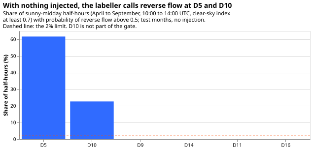

**Take-home: a whole-day sign labeller ranks reverse-flow half-hours about as well as experiment
420's export-gated network (arm A) but no better, and it invents reverse flow at D5, so the
network stage did not run. The result is not supported.** The labeller marks 61.7% of D5's sunny-
midday
half-hours as reverse flow when nothing was added (64.1% of the rows that arm A is scored on,
because the row set repeats each half-hour once per forecast run), against 0% at D9, D11, D14, and
D16. Its recall at a 5%
false-reverse rate is 0.22 pooled and 0.52 macro-averaged, against a bar of 0.60 and arm A's 0.21
and 0.46. D5 and D10 have a mean sunny-midday reading of 12 to 16 points of capacity against 38 to
53
at the four Primaries the labeller trained on, which is the likely cause (not tested by a retrained
labeller).

**This experiment asks whether the export-gated neural network of experiment 420 can be improved
where it is weakest.** Eight Primary substations report only the size of the power that flows, not
its direction (signed power is positive for demand and negative for reverse flow, where embedded
solar generation exports power up the electricity network). [Experiment
420](../00420-neural-mva-export-gated-signed-final/result.md) hid the direction at six Primaries
where it is known, added a real solar farm's recorded output to some of them, and found that a
neural network with a Primary-level export gate (arm A) forecast reverse-flow half-hours much better
than the same network with the gate shut. Arm A has three weaknesses: it finds only 52.4% of
reverse-flow half-hours when the injected farm is the size of the Primary's typical sunny midday
reading (level 1.0), its lower tail is too narrow (the 1% quantile covers 6.2% of reverse-flow
rows),
and it calls reverse flow on 66.8% of non-reverse sunny summer middays. This experiment tests two
ideas against arm A: a labeller that reads a whole day of readings and gives each half-hour a
probability of reverse flow, and separate input channels for measured MW and for MVA.

## Evidence behind the plan

- **The 0.70 area belongs to the hand-made day-flip diagnostic, not to arm A.** The day-flip
  diagnostic scored 0.702 in step 0 of experiment 420 and 0.73 in experiment 417. Arm A's own
  row-level ranking area is 0.930 on the sunny slice. The bar for step 0 (an area of 0.85 and a
  recall of 0.60 at a 5% false-reverse rate) is therefore set against arm A's 0.930 and 0.623, and
  the labeller can add value mainly through calibration and the level-1.0 recall, not through
  ranking.
- **[Experiment
  424](https://github.com/openclimatefix/nged-ml-research/pull/81) found that arm A survives
  ensemble weather** (a gain of 15.7 points over the gate-shut network, against 19.2 in the
  laboratory test), and that the network trained on recorded weather and applied to ensemble weather
  scored 5.5 points better than the network retrained on ensemble weather. This experiment keeps
  recorded CAMS and ERA5 inputs, so that every contrast is against experiment 420's stored arm A.
  A serving test of TDL on ensemble weather follows only if C2 passes, and that test must also
  score the laboratory-trained network applied to ensemble inputs.
- **[Experiment
  422](../00422-mdn-train-with-varied-origin-hour-and-age-inputs-stale-input-step-2/result.md)
  found that training at several origin hours removes most of the loss from late readings.** The
  network stage keeps experiment 420's origin hour, so the comparison with A stays paired. Only the
  labeller trains on days cut at a random hour, so it can read a lag day that ends at the newest
  usable observation. The advice not to add age inputs is followed.
- **Experiments 408, 412, and 417 set the history.** [Experiment
  417](../00417-hidden-sign-mva-export-gate-zero-crossing-labels/result.md) counted eight earlier
  treatments of the hidden-sign problem that failed. Its hand-built zero-crossing labeller scored
  0.96 on injected against placebo days at level 2.0 and 0.58 at level 1.0, and its hard labels did
  not lift the fits. The registered bar here is a probability on every gate-open row, not hard
  labels.
- **Standing rules followed:** monthly refits, cleaned data, the D15 and D18 cut on 2025-03-01 (not
  used here: both are report-only), saved models, stored predictions reused (P0 and A from
  experiment
  420 after a row-key identity check), tails reported beside CRPS, example forecasts plotted, draft
  pull request. Advice from experiments 417 and 420 that the plan follows: score a gate where it
  opens, score against the ungated network as well as the shut one, add no shared PV-proportional
  variance.

## Design

- **Step 0: the labeller (105 fits, no mixture density network).** One labeller per rotation, test
  month, and left-out visible Primary: five per rotation and month (one trained on the four visible
  Primaries, four each leaving one visible Primary out). It reads 48 half-hours of a UTC day:
  reading `r`, `y' = sqrt(max(r^2 - 4, 0))`, CAMS `u` and `k`, ERA5 temperature, a demand reference
  (median reading by half-hour over overcast days of the same 28-day block and day type), the day
  type, and a mask. It outputs the logit of `P' < 0` and an estimate of `P'`. The architecture is a
  width-5 convolution feeding a two-layer bidirectional GRU of 32 units, or a dilated convolution
  stack of the same width; a pilot on the left-out visible Primaries (rotation r1, test months
  2025-09 and 2026-06, level 1.0) picks the one with the higher pooled area, and the choice is
  written down before the 105 run. If the GRU fit takes over 5 minutes, the dilated stack is used.
  If step 0 passes, the first network stage runs L and TDL on rotation r1 only, and TDL-perm and the
  supplementary runs wait for a positive C2 there.
- **Training copies.** Each visible Primary-day is copied with a farm injected at power factor 1, at
  a level drawn from 0 to 2.5 (15% of copies at 0, the placebo days), with `Q` drawn from 0, 2, and
  4 points, capped at 70% of the farm's peak on 30% of copies, and cut at a random hour on 50% of
  copies. Loss: cross-entropy on the sign (weight 0.25 where `|P'| < 2`) plus a Huber loss on `P'`.
  Every eighth week is held out for early stopping.
- **No leakage from the hidden pair.** Each rotation injects only the farms its hidden pair does not
  use (r1: B and D; r2: A, C, and D; r3: B and D). A leave-one-out labeller also drops the left-out
  Primary's own farm, so its level-1.0 score is clean. The hidden pair's signed truth is used only
  to
  score. Farms in one region share a sky, so the exclusion protects less than it appears to; the
  page reports the labeller's area against the correlation between injected and training farms.
  The pilot's test months overlap the network's, but the pilot uses visible Primaries only.
- **Step 0 gate.** L1 and L2 above, measured on the hidden pair's test-month rows (the same rows as
  arm A) and, as a second report, on its training-window days. Values are pooled over rotations and
  months, with the Primary-month macro-average printed beside each. Rows are counted, not unique
  half-hours. Leave-one-out scores of visible Primaries never enter L1. The page also reports the
  day-level area (a day's score is its largest `pi`
  on the sunny slice) beside design I's 0.702 and design C's 0.58, the area against the number of
  training Primaries and clean farms in a supplementary run, and the fit time.
- **Network stage (338 fits, after the manager confirms).** Arms: P0 and A (stored, plus two refits
  of A), T (A with two channels and a measured flag), TD (T with pseudo-Primaries and MW masking), L
  (A with the labeller's soft labels in the likelihood and its probabilities as inputs), TDL (the
  candidate, two seeds), and TDL-perm (TDL with `pi` permuted across days within a Primary-month, at
  level 1.0). The soft-label likelihood is `log[pi f(-y') + (1 - pi) f(y')]` with `pi` clipped to
  0.02 to 0.98, and `pi = 0.5` recovers the folded density, so A is nested. `pi` as a network input
  comes only from lag days that end at or before the run's newest usable observation, asserted as
  `origin_lags` asserts its lags, with a trailing-days demand reference. On visible Primaries the
  network always receives the leave-one-out `pi`, never the in-sample one. In the likelihood, the
  soft label of a training row may use that row's own day, because it acts as a label.
- **Compute.** One GPU process (about 1.4 GB of GPU memory), one feeder core, `MemoryMax=8G`,
  `OOMPolicy=continue`, `OMP_NUM_THREADS=1`; stop below 12 GiB in the `available` column of `free
  -g`. Each fit writes its own file atomically and the runs are resumable.

## Pilot choice, written before the 105 labellers ran

On the left-out visible Primaries of rotation r1 (test months 2025-09 and 2026-06, level 1.0, 8
labellers per architecture), the GRU labeller scored an area of 0.945 and a recall of 0.633 at a 5%
false-reverse rate; the dilated convolution scored 0.937 and 0.576. The GRU fit takes about 4
seconds, so the GRU is the architecture for the 105 labellers. Both ran all 25 epochs without early
stopping, so the labellers may be under-trained; the epoch count is not changed after the pilot.

## Step 0 result: the gate failed

All 105 GRU labellers ran (about 4 seconds each). Rows are counted, not unique half-hours; areas and
recalls are on the sunny slice of the hidden pair's test-month rows at level 1.0, with arm A scored
on the identical rows. No interval is given: step 0 pools 21 labellers and the macro-average over
Primary-months is the spread measure.

| Measure | Labeller, pooled | Arm A, pooled | Labeller, macro | Arm A, macro |
|---|---|---|---|---|
| Area | 0.887 | 0.880 | 0.897 | 0.880 |
| Recall at 5% false reverse | 0.223 | 0.211 | 0.517 | 0.457 |
| Expected calibration error | 0.072 | 0.050 | 0.108 | 0.095 |

- **L1 fails on recall.** The area (0.887) passes its bar and is no worse than arm A's. The recall
at
  5% false reverse is 0.223 pooled and 0.517 macro-averaged, both under the 0.60 bar. The pooled
  figure is low because pooling Primaries with different base rates sets one threshold for all.
- **L2 fails at D5.** With nothing injected, `pi > 0.5` falls on 64.1% of D5's sunny-midday rows
  (61.7% of its unique half-hours; the rows repeat each half-hour once per forecast run), and on 0%
  at D9, D11, D14, and D16 (arm A: 0% at all five). The labeller, trained on
  D9, D11, D14, and D16, invents reverse flow at D5.
- **Day-level area:** 0.903 for injected against placebo days at level 1.0 (325 and 1,001 days),
against 0.702 for
  design I and 0.58 for design C. The labeller reads a whole day better than the hand-made
  diagnostics, but ranks rows no better than arm A.
- **Decision (registered rule):** the labeller networks (L, TDL, TDL-perm) do not run. The manager
  also decided not to run T, TD, and the two refits of A (128 fits).

## Checks

- **Median minus mean forecast:** not applicable; step 0 fitted no forecast.
- **Mean-forecast error beside the quantile score:** not applicable, for the same reason.
- **Triggers fired:** trigger 1 (a placebo control fails: D5 at no injection) and trigger 2 (the
  result contradicts the prediction that L1 and L2 would pass). A fresh Sonnet audit re-derived
  every table figure from the stored tables (within 0.005, except the D5 and D10 shares quoted
  earlier in the draft, which used a wider slice and are corrected). It found no leakage and no join
  or window artefact: D5 has no real reverse flow, and its rate is 63.0% in the training window and
  61.7% in the test window. Without D5 the pooled recall is 0.656, so D5 causes both failures, but
  D5
  is a hidden test Primary and L2 needs all five.

## What the next experiment should answer

Train the sign labeller on a mix of Primaries that spans the demand levels of the hidden ones, and
test that against arm A first on D5 and D10 with nothing injected. If that also fails, keep arm A as
the candidate and run its ensemble-weather test with the laboratory-trained network applied to
ensemble inputs beside the retrained one.
