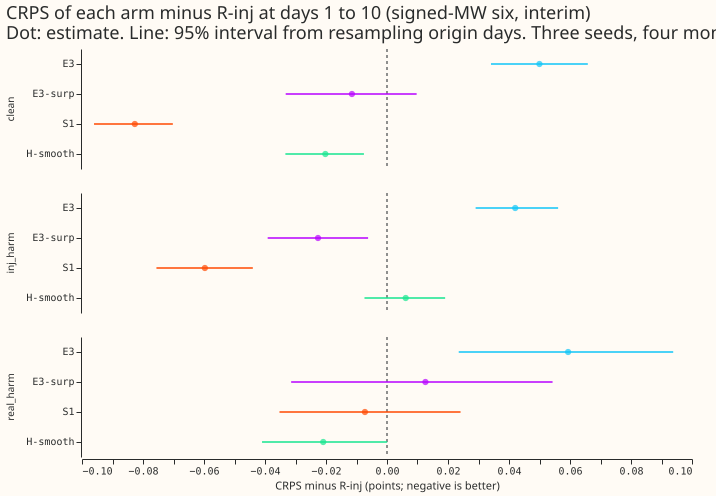
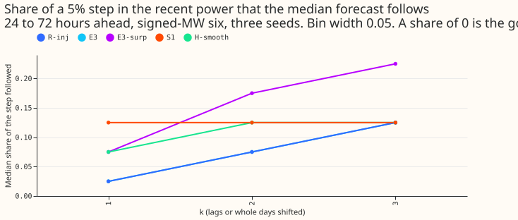
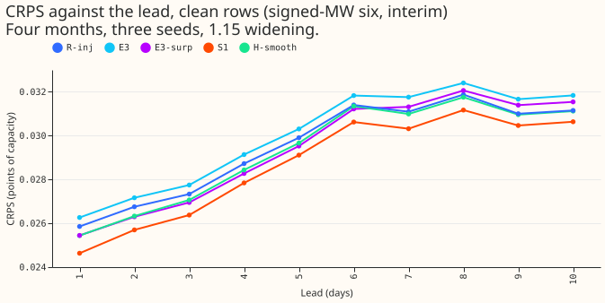
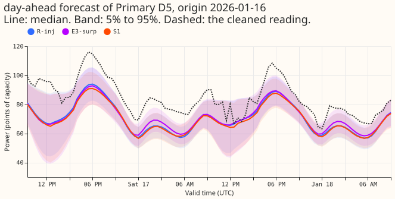
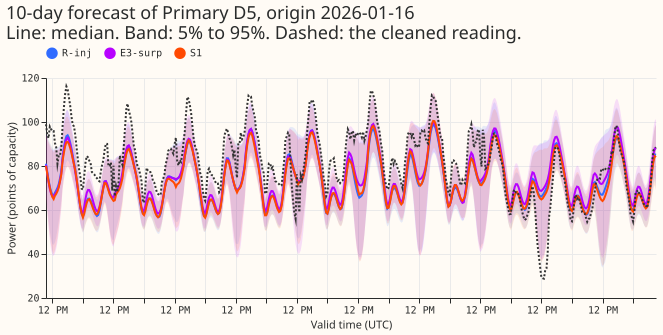
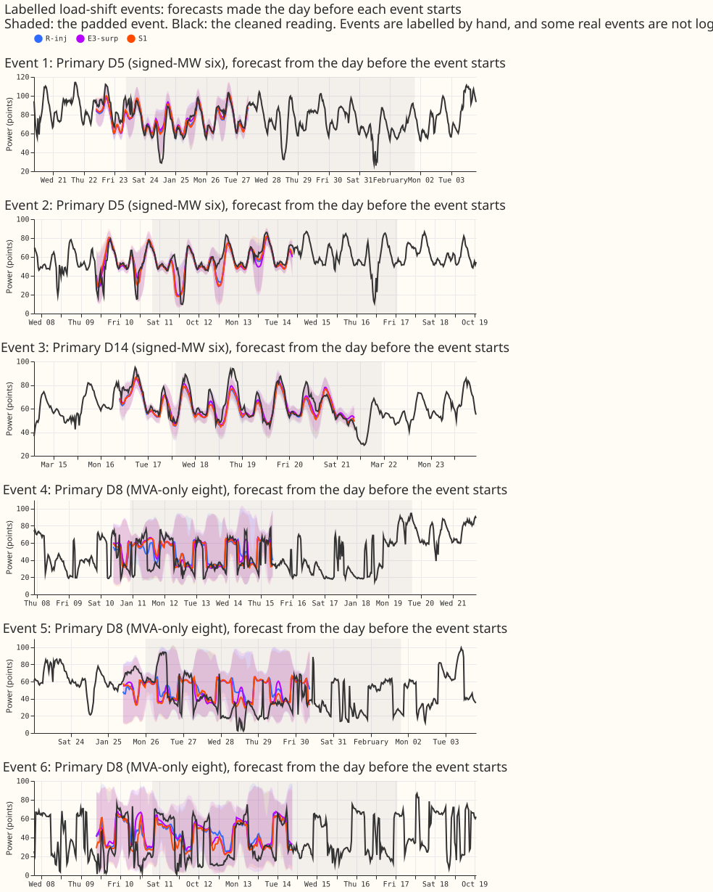

**Take-home message: reading whole days of raw power did not stop the forecast following load-shift
events, but giving the lagged inputs a "surprise" lowered the error on clean, injected harm, and
real event rows, and that change is the one to carry forward.**

A load-shift event moves demand between neighbouring Primary substations for hours or weeks, so
the power an hour, a day, or a week ago can be abnormal, and a forecast that copies it goes wrong.
This experiment asked whether a small neural network that reads the raw half-hourly power of whole
recent days could learn how far to trust it, in place of the three hand-made lagged readings that
today's mixture density network takes. It could not. Every number is the continuous ranked
probability score (CRPS) in points of capacity at days 1 to 10 (smaller is better), pooled over
four test months (2025-10, 2026-01, 2026-03, 2026-06), three seeds, and the six Primaries measured
in signed megawatts, and so is interim. R-inj (the plain network with the three lags, trained on
clean and injected power) is the reference; it scores 2.947 on clean rows and 2.956 on injected
harm rows. A "harm row" is a row whose target is outside every event but whose recent power is
inside one. The minimum detectable effect (twice the seed-to-seed spread) is 0.077 on clean rows
and 0.071 on injected harm rows.

**The day-window network (E3) is worse than the lagged network on every row set.** E3 minus R-inj
is +0.050 (+0.034 to +0.066) on clean rows (2.997 against 2.947) and +0.042 (+0.029 to +0.056) on
injected harm rows (2.998 against 2.956). The experiment predicted a gain of 0.10 to 0.30 on harm
rows, so the hypothesis is not supported.

**No arm learned to follow a step in the recent power by less, or to widen its bands.** In the
encroachment sweep (a step of 5% of capacity added to the recent power, 24 to 72 hours ahead, raw
bands), R-inj and E3 both followed a median 0.125 of the step at three lags or days (bin width
0.05), and every arm's 5%-95% band was 1.00 to 1.01 times as wide after the step as before. E3-surp
(E3 plus the surprise channel) followed more, 0.225. The lag-masked control moved no forecast.
A path that could only widen the bands (E3-surp-w) learned nothing under the clean-target
objective (band ratio 1.019 against 1.018 for E3-surp). A diagnostic arm trained on the injected
value did widen after a step (1.069) but widened every band, so its 95% quantile covered 0.957 of
clean readings and its clean CRPS rose by 0.055; it is not a release candidate.

**The surprise at the lags (S1) is the useful result.** The surprise of a power reading is its
difference from the median of the lagless forecast for the same half-hour (experiment 404's
cross-fitted table), divided by half the width of that forecast's 5%-95% band. S1 is R-inj plus the
surprise at each of its three lags. S1 minus R-inj is -0.083 (-0.096 to -0.070) on clean rows
(2.865 against 2.947), -0.060 (-0.076 to -0.044) on injected harm rows (2.897 against 2.956),
-0.170 (-0.267 to -0.059) on real event rows (5.687 against 5.857), and -0.007 (-0.035 to +0.024)
on real harm rows. The clean gain is only just above the minimum detectable effect of 0.077, and the
harm gain is below 0.071, so both are interim. S1 follows the step no less than R-inj (0.125 in both
at three lags), and its quantile coverage and tail pinball loss match R-inj's (clean 95% quantile
covers 0.915 against 0.914). The S1 variant of the sweep moves the newest lag and the daily lag at
k = 1 where R-inj's moves one, so its k = 1 and k = 2 shares are not like for like.

**E3-surp, the same lagless table entering the encoder as a channel, ties R-inj.** E3-surp minus
R-inj is -0.011 (-0.033 to +0.010) on clean rows and -0.023 (-0.039 to -0.006) on injected harm
rows, and +0.260 (+0.178 to +0.340) on real event rows (6.118 against 5.857). S1 and E3-surp are
the headline pair of this experiment: the same surprise, entering as three lagged scalars or as a
channel of three day windows.

**Smoothing the surprise over 14 days (H-smooth) did not beat S1.** H-smooth minus S1 is +0.062
(+0.044 to +0.082) on clean rows and +0.066 (+0.046 to +0.088) on injected harm rows. H-smooth
minus R-inj is -0.020 (-0.033 to -0.008) on clean rows, so the arm is documented as refuted.

**The 14-day convolutional line stopped.** On the 2026-01 fold the validation negative
log-likelihood of H14-s (a convolutional encoder over 14 days with attention, no lags) was 0.5498
against 0.4777 for R-inj, and three diagnostic fits (position dropout 0.1, 0.3, 0.5) ended at 0.5347,
0.5399, and 0.5650. The pre-registered rule stopped the line. The diagnosis does not separate
memorising each Primary's history from slow training.

**Not done.** The avoidable-curtailment cost is not computed, because the injected-world harm rows
have no node table. The absolute-skill references (the monthly XGBoost recipe, BG2,
`manual_heuristic`, and `climatology`) are not drawn. The real-event rows are few, and NGED may have
events missing from its logs, so the real-event contrasts undercount.

## Plan, as registered before any fit

*The sections below are the plan and the dated design iterations, kept as written.*

## Question

CRPS is the continuous ranked probability score. The signed-MW six and the MVA-only eight are
the two groups of Primary substations by metering (signed megawatt readings, or unsigned
megavolt-ampere magnitudes); D15 and D18 are two short-history Primaries.

**We test whether a network that reads whole days of raw power can learn how much to trust them.**
A load-shift event moves demand between neighbouring Primary substations for hours or weeks, so
the power an hour, a day, or a week ago can be abnormal. Today's networks take three hand-made
lagged readings. Experiment 392 found an XGBoost model follows about 1%, 15% to 20%, and 38% to 41%
of a step added to the first one, two, and three lags, with no band widening. This experiment
replaces the lags (and every window or surprise statistic built from them) with a small
one-dimensional convolutional network over whole days, followed by attention. The idea is the
maintainer's (2026-10-31). The attention design follows [Bahdanau et al.
(2015)](https://arxiv.org/abs/1409.0473) (a query scores each position of a sequence) and the
convolution follows [Bai et al. (2018)](https://arxiv.org/abs/1803.01271) (a stack of convolutions
as a sequence encoder).

## Review against the latest evidence

**The brief was checked against the pages merged since it was written** (experiments 392, 397, 402,
403, 421, 422, 424 and 426, and the open plans of experiments 404, 425, and 427, read on 2026-10-31).

- **The reference is the pooled plain network.** Experiment 425's plan names the ENS-only pooled
  plain network (R) as the reference; and this plan uses the same recipe.
- **Experiment 404's harness has not merged.** Its injected-event generator is in the draft PR 58. This
  plan uses experiment 402's generator (`e00402_inject.inject`), which is merged and which 404's
  generator follows. The scripts of experiment 404 are not imported.
- **The sweep's k is defined for whole days** (manager, 2026-10-31); see "Encroachment sweep".
- **Standing practices followed.** Monthly refits; cleaned data with the flagged and start-cut
  half-hours dropped (experiment 422's `cleaned_arrays`), reported per fold; the D15 and D18 cut at
  2025-03-01; every network saved in the data folder; stored forecasts reused as references; tails
  and the avoidable-curtailment cost beside CRPS; example forecasts and event plots; draft PR.

## Design

**Inputs.** The network sees the same weather (ensemble mean and spread, once), solar, calendar,
holiday, lead-time, and Primary-embedding inputs as R, and no lag column of any kind. Its only view
of recent power is up to three day windows of 48 half-hours:

- **D1, the day before the origin:** the 48 half-hours ending at the newest usable reading (the
  origin minus 3.5 hours, the rule of `common.origin_lags`).
- **D2, the matching day of week:** 48 half-hours centred on the most recent earlier half-hour with
  the target's day of week and time of day that is at least 3.5 hours before the origin (the
  weekly lag of R), the half-hours after the newest usable reading masked as unobserved.
- **D3, two weeks earlier:** the window of D2 shifted back by 336 half-hours.

Each window position carries five channels: the power over effective capacity (standardised with
the training rows' mean and standard deviation, clipped at 5 standard deviations, 0 where
unobserved), an observed flag, sin and cos of the position's UTC time of day, and its age before the
origin divided by 336 hours. Missing, flagged, and start-cut half-hours are unobserved.

**Encoder.** Three one-dimensional convolutions (kernel 5, padding 2, widths 16, 32, and 32, GELU)
applied to each window with shared weights, giving 48 position vectors of width 32 per window. No
pooling, so position survives. A learned day-type embedding (3 vectors) is added to each position
vector, so attention knows which window a position is from.

**Attention.** One head. The query is a linear map of the lead features, the solar, calendar, and
holiday columns, the ensemble weather summary, and the Primary embedding. Keys and values are linear
maps of the position vectors. A learned "no day" key and value token is always present, so a
window set that is entirely unobserved, or distrusted, can be ignored; the softmax runs over all
positions of all windows shown plus the token. The context vector (width 32) is concatenated with
the query inputs and passed to the same head as R (two hidden layers of 64, dropout 0.1, three
Gaussians, g09), so the head is unchanged and only the input route differs. About 13,000 more
parameters than R's 8,400.

**Training.** Experiment 397's loop: weighted negative log-likelihood, AdamW, early stopping on a
held-out week in every twelve (experiment 422's purge), monthly refits on the 24 months before the
test month. Every arm except R and L0 is trained on injected power: in every epoch each training row
draws, with equal probability, the clean series or one of three injected worlds (seeds 100 to 102)
for the power in its windows (and for R-inj's lags); the target is always the clean series. Worlds
come from `e00402_inject.inject` over 2024-05-01 to 2026-07-01 at 10% coverage (the generator of
experiment 402 with `FIRST_DAY` moved earlier), with the label table's padded real events excluded as
base periods. The event pool uses all labelled events including those after a fold's refit, and
each depth is a fraction of the donor's mean absolute power over its whole series; the pool
supplies only depths and durations, and both are listed as caveats. Three quarters of the
training rows are injected, which is more than real events, so clean-row contrasts partly measure
that training mix. Power windows are gathered on the GPU from dense per-Primary arrays, so no
window is stored.

## Arms

| Arm | Recent-power input | Trained on |
|---|---|---|
| R | the three origin lags | clean power |
| R-inj | the three origin lags | clean and injected power |
| L0 | none (lagless) | clean power |
| B-mix | fixed 50/50 mixture of R-inj and L0 distributions (not an average of quantiles) | no fit |
| E1 | encoder over D1 | clean and injected |
| E2 | encoder over D1 and D2 | clean and injected |
| E3 | encoder over D1, D2, and D3 | clean and injected |
| E3-trust | E3 plus experiment 404's trust inputs as extra tokens | only if the advance rule is met |

## Encroachment sweep

**Prediction-only, on saved networks, on the screen's clean rows.** A row is clean when its target is
finite and outside the padded real-event mask and the 48 hours after an event, every observed
half-hour of its three windows is outside the padded mask, and R's three lags are finite (experiment
392's `clean_rows`, extended to whole days). Every arm is swept on the same rows: every third daily
origin of each test month, leads 0.5 to 240 hours.

- **Steps.** Add a step D to the affected half-hours, both signs, of 2.5% and 5% of effective
  capacity, and of 10% of the Primary's trailing 30-day mean power before the origin. MVA-only
  readings are clipped at zero after the step, and rows where the clip changed any shifted value are
  dropped from the share (for all arms alike).
- **k for R, as in experiment 392.** k = 1 shifts `lag_origin`; k = 2 also `lag_same_time_latest_day`;
  k = 3 also `lag_same_time_latest_week`.
- **k for the encoders, two variants.** Variant 1 shifts single half-hours, in R's order: k = 1 the
  newest observed half-hour of D1 (R's `lag_origin`); k = 2 also the half-hour of D1 at the
  target's time of day (R's day lag); k = 3 also the centre half-hour of D2 (R's week lag); k = 4
  (E3 only) also the centre half-hour of D3. Variant 1 is the like-for-like counterpart of R's three
  single lags, and k up to 3 is compared with R. Variant 2 shifts every observed half-hour of whole
  windows: k = 1 shifts D1; k = 2 also D2; k = 3 also D3. Variant 2 is the event that fills a day,
  and R has no counterpart, so the comparison of variant 2 with R is harsher on the encoders.
- **Raw and widened.** The headline is raw (experiment 392's headline); the same table is repeated
  with the 1.15 widening about the median.
- **Lead bands.** 0-24, 24-72, 72-168, and 168-240 hours; the 24-72 hour band is the headline.
- **Reported.** The median shift of q50 as a share of the step (+1 is the full step, whichever the
  sign); the ratio of the 5%-95% band width after the step to the width before; coverage of the
  clean reading and of the event-level reading (actual plus step) by the 5%-95% band; the attention
  mass on D1, D2, D3, and the "no day" token, for every k and variant. Three seeds per fold.
- **Lag-masked control.** Every arm is also evaluated in evaluation mode (dropout off) with all
  its recent-power inputs masked, the step added, and the mask applied after the step; the
  forecast must equal the unshifted masked forecast to within 1e-6 (share 0). A larger difference
  is a bug.

## Evaluation rows

- **Clean rows (real data, no injection).** The scored months' rows whose recent days are outside
  every padded real event; the benchmark for loss outside events.
- **Harm rows (injected worlds).** Test-month rows from three held-out injected worlds (seeds 200
  to 202, never seen in training) whose target is outside every event and whose windows contain an
  injected event; clean rows of the same worlds are reported beside them.
- **Event rows (real).** Rows whose target is inside a padded labelled event of the corrected label
  table, and real harm rows (target outside, windows inside). The unlogged-event caveat applies:
  NGED may have events missing from its logs, so the clean-lag rows may hold events no label
  covers and the real-event slices undercount.

## Compute

**The fits are 6 arms by 4 folds by 3 seeds, 72 fits, plus a fifth fold if the screen advances.**
Experiment 397 timed the plain network at about a minute. The encoder is heavier because it reads
up to 144 positions per row. A first timing of E3 on the GPU took about 3 minutes per pass over the
4.7 million training rows of the 2026-01 fold, so every arm trains on a random 20% of the training
rows in each epoch (up to 60 epochs, patience 8), and early stopping reads a fixed random 200,000
of the held-out rows. A single CPU core was not timed, because the GPU epoch is already the
cheaper route. One GPU process under 8 GB with one feeder core, `MemoryMax=8G`,
`OMP_NUM_THREADS=1`, `free -g` checked before each launch (stop line 12 GB available). Fitted
networks are saved under the experiment's data folder. No stored fit is reused, because R's recipe
differs (the cut, the injected data). Stored forecasts of experiments 389, 87, and the baselines
are read as references only.

## Second screen: a surprise channel

**Arm E3-surp gives the encoder a sixth channel, the surprise.** The surprise of a half-hour is
its observed power minus the median of the cross-fitted lagless forecast for the same half-hour
(experiment 404's table, K = 6 blocks, never an in-sample lagless forecast), divided by the width
of that forecast's 5%-95% band, clipped at 5, and 0 where either is unobserved. The windows
otherwise match E3. It runs as a second screen when experiment 404's table exists, on the same
four folds, rows, and seeds, with the prediction written before any score is read: E3-surp minus
E3 on harm rows at the signed-MW six lies between -0.20 and -0.03 CRPS points, and E3-surp follows
at most half of E3's share of the step in the sweep at k = 3. The table must cover each refit
without the scored month; if it does not, the arm waits.

## Design iterations

The maintainer wants at least two design iterations of the tokens and the attention after the first
screen, before any separate lag-trust evaluation runs on the saved networks. Each iteration is a
change to the encoder (for example a second head, a window of a different length, a learned
position code, or the trust inputs of experiment 404 as extra tokens), registered with its own
prediction before its scores are read, and scored on the same folds and rows. This page records
the first screen only; each iteration adds an arm and a dated section.

### Design iteration 1 (2026-10-31): a widening-only path, then a 14-day history window

**First-screen and second-screen findings set the target of this iteration.** In the sweep at step
c050 (24 to 72 hours, signed-MW six, raw bands) no arm widens its 5%-95% band after a step in the
recent power: the width ratio is 1.00 for every arm except E3-surp (1.018 at c050, 1.026 at m10).
E3-surp, whose surprise channel moves with the shifted power, follows more of the step (median share
0.225 at k = 3, against 0.125 for E3 and R-inj). The goal of the programme is a share near zero with
wider bands. A wider band lowers the training loss only on rows whose window holds an injected jump,
and the network already learns to follow about a fifth of the step there, so the reward for widening
is weak.

**Arm E3-surp-w adds a path that can only widen the bands.** The path takes three numbers from the
newest day window (D1): the largest absolute surprise in its last 12 half-hours, its mean absolute
surprise, and its largest absolute surprise. Non-negative weights (the softplus of raw parameters
that start at -10, so the path starts near zero) map them to one additive term per mixture
component. The term is never negative, so the path can only widen. The term is added to the log
standard deviations of the mixture. The location outputs and the mixture weights are untouched by
the new path. The arm is otherwise E3-surp (same rows, folds, seeds, and training worlds).

**Predictions, written before any E3-surp-w score is read.**

- **P-I1a (bands):** E3-surp-w, pooled over the four screen folds and seed 0, at step c050 (and
  m10), 24 to 72 hours, signed-MW six, day variant, k = 3, raw bands: band-width ratio of at least
  1.05 (E3-surp: 1.018 at c050). We put this at about one chance in three, for the reason above.
- **P-I1b (share):** in the same cell, the median share is no larger than E3-surp's (0.225).
- **P-I1c (cost):** contrast C9 (E3-surp-w minus E3-surp), CRPS in the units of the other contrasts,
  on the `clean` and `inj_harm` row sets at the signed-MW six, pooled over the four folds: the upper
  end of the interval is at most +0.02.
- **Result of E3-surp-w (seed 0, four folds):** P-I1a failed (width ratio 1.019 against 1.018 for
  E3-surp at step c050; 1.027 against 1.026 at m10), P-I1b held (median share 0.225 in both arms),
  and P-I1c held (the CRPS of E3-surp-w is lower than E3-surp's by 0.005 to 0.014 on every row set
  at the signed-MW six). The widening path did not learn to widen after a jump.
- **Diagnostic, not for release (seed 0, four folds, signed-MW six).** The arm
  `DIAG-not-for-release-E3-surp-w-ev` (E3-surp-w trained on the injected value wherever the target
  lies in an injected event) learned to widen only a little more after a step: at step c050 (24 to
  72 hours, day variant, k = 3) the band-width ratio is 1.069 (E3-surp-w: 1.019) and the median
  share is 0.325 (0.225). It also widened every band: the 95% quantile covers 0.957 of clean
  readings (E3-surp-w: 0.900) and the 99% quantile covers 1.000, and the CRPS on clean rows is 0.055
  higher (3.035 against 2.980). The scale path can learn widening when the objective rewards it, and
  with this objective it learns to widen everywhere.
- **The fallback objective is on hold.** The fallback named in the plan (train on the injected
  world's value where the target lies in an injected event) rewards persistence of the jump, which
  is the opposite of forecasting the normal running arrangement. It stays unfitted until the
  maintainer's design session decides. It differs from arm U2 of the uncertainty programme as
  follows: the fallback keeps the existing transient injected events and lets the target take their
  value, whereas U2 trains on worlds whose genuine level changes enter the lags and the target
  together, and keeps the location path blind to the surprise magnitude; U2 also feeds lag ages,
  missing flags, weather age, and lead into its scale factor and penalises the factor on clean rows.
  The widening path of E3-surp-w is the clean-target version of U2's scale path.

**The 14-day history window (the brief `recent_history_encoder_brief.md`) follows as its own dated
section.** Its arms (S1, S404, H-smooth, H-lvl, H14-s, and the other-week control H14-s-ow), its
pilot, its leakage check, and its pre-registered rules are those of the Opus design note, with
experiment 404's table (frozen at commit 63d3799f, one table per month and seed) as the lagless
forecast. They run after E3-surp-w is scored.

### Design iteration 2 (2026-10-31): a 14-day history window

**The question is what level a Primary sits at now, and how to pool the noisy surprise, not which
Primary this is.** Experiment 421 asked the identity question. This iteration keeps the Primary
embedding and gives the network 14 days of history (672 half-hours ending at the newest usable
reading, origin minus 3.5 hours) so that it can estimate the Primary's current level against the
lagless forecast (aim a) and pool the surprise with learned weights (aim b). The full design,
reasoning, and diagnostics are in the design note `recent_history_encoder_design_answer.md`; this
section records the arms, the departures, and the predictions.

**Arms, all trained on the injected worlds, on the four screen folds and three seeds.**

- **S1:** R-inj plus the single-step surprise at each of its three origin lags (reference for aim b).
- **H-smooth:** R-inj plus four learned smoothed surprises of the 14-day surprise series. The
  weights of position j for a target at T are a softmax over the observed positions of
  a(L) cos(time of day of j minus T) + c(L) cos(day of week of j minus T) minus b(L) times the age
  of j in days, with a, c, b learned per lead band (days 0 to 2, 2 to 5, 5 to 10, and 10 or more)
  and b at least 0. The weights never read the surprise values. The observed share of the window
  joins the inputs. (Aim b.)
- **H-lvl:** R-inj plus a level offset and a 4-way soft regime vector per origin. A dilated
  convolutional network encodes the window, one attention pooling (query: Primary embedding and the
  origin's time of day) gives a summary, and a second pooling gives the level offset, the weighted
  mean of power minus lagless median. The three mixture means shift by g(L) times the offset, with g
  in [0, 1] learned per lead band. The regime vector joins the head. (Aim a.)
- **H14-s:** no lags. The same dilated convolutional network encodes the window (eight channels:
  power, observed flag, lagless median, surprise, sine and cosine of time of day and of day of
  week), and one attention head with a null token reads it. The score of position j adds three terms
  to the dot product: a(cos of the time-of-day difference), c(cos of the day-of-week difference), and
  minus b times the age.
- **H14-s-ow:** H14-s with the window read from 28 days earlier (control: identity and season
  without recency).

**Departures from the design note, stated before any score.** The bank-holiday channel is omitted
(no holiday table is loaded in this harness), so eight channels carry H14-s. Experiment 404's
hand-built window statistics (arm S404) are not run in this screen, so aim (b) is decided against S1
only and the comparison with S404 stays open. Window encoding is per row, not per origin: each batch
is 2,048 rows and the convolution blocks use gradient checkpointing to stay under 8 GB. The sweep
runs the lag variant for the arms that keep R-inj's lags and the whole-day variant on the history
(shift the last k days of the history by the step, and any lag that falls in those days), k = 1, 2,
3, for every arm of this iteration, plus the masked control. Experiment 404's lagless table is used
for the lagless median and the surprise, one table per month and seed.

**More departures, found by the plan and code review.** The convolution blocks use a group
normalisation (one group) after each convolution, not the layer normalisation of the design note.
The three arms that run the convolutional encoder (H-lvl, H14-s, H14-s-ow) take four times as many
optimiser steps per epoch as R-inj (batches of 2,048 rows against 8,192, at a fifth of the rows per
epoch), so their contrasts with R-inj mix architecture and step count. The sweep has one combined
variant, "hist": it shifts the last k whole days of the history and any lag inside them, so at k = 1
both the newest lag and the daily lag move, whereas R-inj's lag sweep at k = 1 moves only the newest
lag. The contrasts with R-inj's lag sweep at the same k are therefore not like for like. The design
note's P5 comparison with S404, P6b (level offset against real events), the second clause of P8, and
P10 are not run in this screen, and sweep variants 1, 2, and 4 are not run. The observed share that
H-smooth reads is the share of usable positions (observed power and a lagless forecast). For
H14-s-ow the attention class for the newest 6 hours is empty by construction, because the window
ends 28 days earlier. The level offset is clipped at 5 standard deviations of the Primary's target.

**Pilot result and the H14-s diagnosis (fold 2026-01, seed 0).** On the mixed validation worlds the
validation negative log-likelihoods were: R-inj 0.4777, E3-surp 0.4591, H-smooth 0.4523 (59 epochs,
286 s), H-lvl 0.4993 (19 epochs, 1,415 s), and H14-s 0.5498 (16 epochs, 1,485 s). The stage-0 rule
fires for H14-s (worse than R-inj by more than 0.05), so H14-s and H14-s-ow stop. Before any further
convolutional fit, three diagnostic fits of H14-s on this fold read a tenth of the rows per epoch
(patience 30): `H14-s-diag1` (position dropout 0.1), `H14-s-diag2` (0.3), and `H14-s-diag3` (0.5).
**Pre-registered reading, before the diagnostic scores:** if the best diagnostic fit reaches a
validation negative log-likelihood within +0.01 of R-inj's (at most 0.4877), a four-fold screen of
H14-s at that setting is justified; if every diagnostic fit is worse than R-inj by more than 0.03,
the 14-day convolutional line stops, and the page says that the window memorised each Primary's
history.

**Diagnosis result.** The three diagnostic fits ended at validation negative log-likelihoods of
0.5347 (`H14-s-diag1`), 0.5399 (`H14-s-diag2`), and 0.5650 (`H14-s-diag3`), each more than 0.03
worse than R-inj's 0.4777, and all three used the 60-epoch limit with the loss still falling slowly.
By the rule written above, the 14-day convolutional line stops: H14-s, H14-s-ow, and the four-fold
H-lvl screen do not run. The diagnosis does not separate memorisation from slow training at a tenth
of the rows per epoch, so the page claims only that three settings of H14-s did not reach R-inj's
validation loss.

**S1 and H-smooth result (four folds, three seeds, signed-MW six).** P4 failed: H-smooth minus S1 on
injected harm rows is +0.066 [0.046, 0.088], where the prediction was at or below -0.03. P5 failed
in the useful direction: S1 minus R-inj on clean rows is -0.083 [-0.096, -0.070], where the
prediction was within plus or minus 0.03. On injected harm rows S1 minus R-inj is -0.060 [-0.076,
-0.044]. The minimum detectable effects of R-inj are 0.077 on clean rows and 0.071 on injected harm
rows. The learned smoothing of the surprise does not beat the surprise at the three origin lags.

**Predictions, written before any score of these arms is read (signed-MW six unless stated; contrast
= CRPS difference in the units of the other contrasts).**

- **P1:** H14-s minus R-inj on clean rows lies between -0.05 and +0.05.
- **P2:** H14-s minus R-inj on injected harm rows lies between -0.30 and -0.05.
- **P3:** H14-s minus the better of E3 and E3-surp lies within plus or minus 0.05 on harm rows and on
  clean rows.
- **P4 (aim b):** H-smooth minus S1 on injected harm rows is at or below -0.03.
- **P5:** S1 minus R-inj on clean rows lies within plus or minus 0.03.
- **P6 (aim a):** H-lvl minus R-inj on clean rows, 12 to 36 hours ahead, is at or below -0.03, and the
  learned g falls with lead (days 6 to 10 at least 0.2 below days 1 to 2).
- **P6c:** H-smooth's kernels put at least half their weight within 3 hours of the target's time of
  day, and their effective number of positions lies between 6 and 100.
- **P7:** H14-s-ow minus H14-s on clean rows, 12 to 36 hours ahead, is at least +0.05.
- **P8:** on injected harm rows, the mean null-token mass of H14-s is at least 0.15 higher than on the
  same rows in the clean world.
- **P9:** in the whole-day sweep, H14-s follows at most 0.05 of a 5% step at k = 1, 2, and 3, with a
  band-width ratio of at least 1.10 at k = 3.

**Rules.** The advance rule, the two aim rules, the choice between the 14-day window and the day
windows, the inert and collapse rules, and the stop rules are those of sections 5 of the design
note; the screen reports them after scoring. The pilot (one fold, seed 0) runs first and stops the
screen if the masked control moves the forecast by more than 1e-6, if a visibility assertion fails,
if the attention of H14-s is uniform or sits wholly on the null token, or if its validation negative
log-likelihood is worse than R-inj's by more than 0.05.

## Checks, reviews, and what the page will report

- **Departures from experiment 397's recipe, found by the code review.** Every arm (R included)
  trains on a random 20% of the rows per epoch with batch 8,192 (experiment 397: full epochs, batch
  16,384, patience 6), and standardises the three lags with one pooled mean and standard deviation
  of the cleaned targets (experiment 397: one per lag column). Scores use the 1.15 widening; CRPS
  is the mean of the three seeds' scores, and the tail pinball and coverage are computed from the
  seed-averaged quantiles. Rows with a valid time on or after 2026-07-01 are not scored.
- **The avoidable-curtailment cost is not computed at the screen.** The harm-row sets have no node
  table; it is computed for the clean rows if the screen advances.

- **Reviews.** A fresh Sonnet reviews this plan and then the code before the first fit; a fresh
  Sonnet re-derives the headline numbers; a fresh Sonnet reviews the write-up and its prose. The PR
  body records what each found.
- **Reported per group and per Primary:** CRPS, q01, q05, q95, q99 coverage and pinball loss, cold
  winter nights, the avoidable-curtailment cost, absolute CRPS beside every contrast with its
  interval, and the minimum detectable effect.
- **Figures.** CRPS by lead for every arm and the references (headline); sweep share and band ratio
  against k; attention weight per day and per position; at least six real-event time series plots
  across both metering groups; a day-ahead and a 14-day example forecast. Generators are
  anonymised.
- **Audit checks.** The median forecast minus the mean forecast per site; the error of the mean
  forecast beside each quantile-score contrast; which audit triggers fired.

## What it can and cannot say

Four months give wide intervals: the screen can stop the idea or rank it for the queue, and cannot
support a claim of benefit. The injected worlds are synthetic; the real-event rows are few. The
encoder sees days of raw power at the forecast origin only, so it uses nothing a live service
would lack (CAMS and ERA5 are not used at all).
