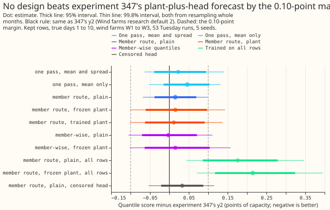
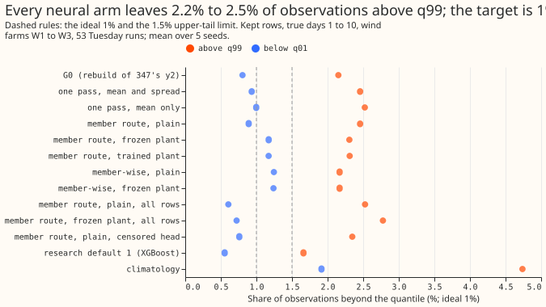
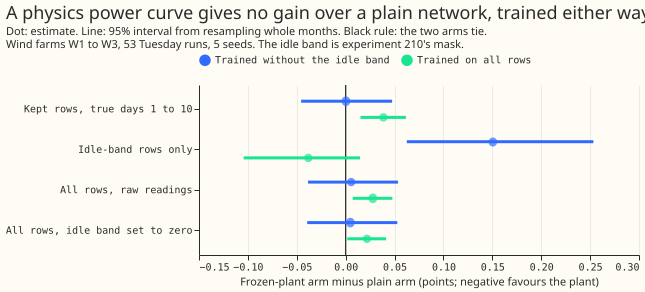
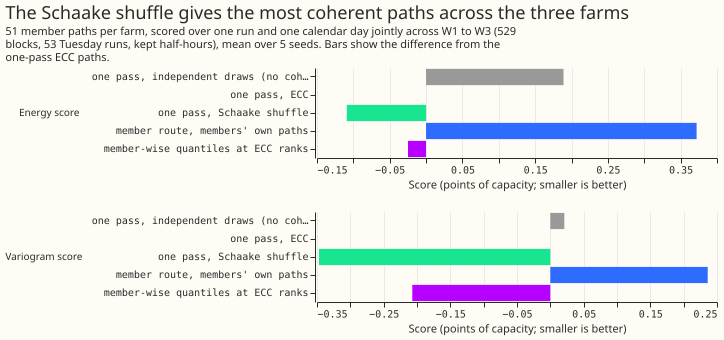
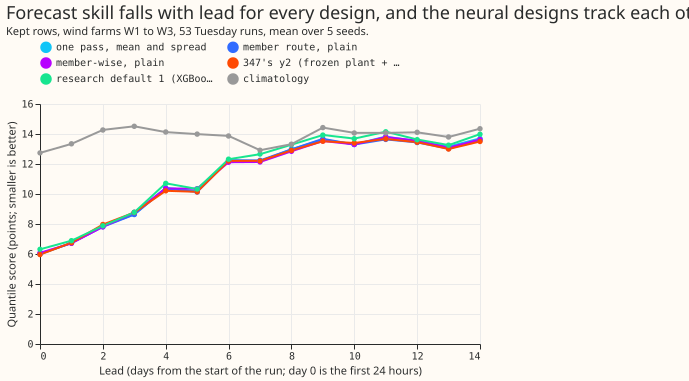
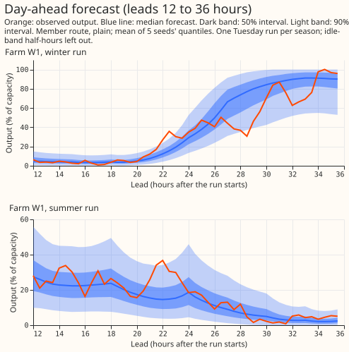
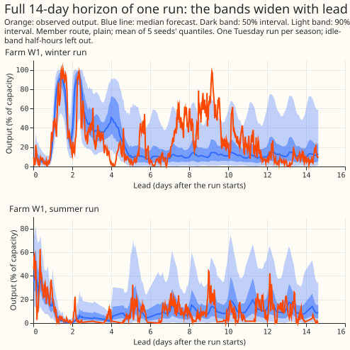

**Take-home: a plain pooled neural network ties Wind farms research default 2, and none of the
extra parts earns its place.** Default 2 runs a power curve trained on ERA5 weather on each of the
51 ensemble members, then a mixture-density head. "True days 1 to 10" means forecast lead times of
24 to 240 hours, and "kept rows" are the half-hours left after experiment 210's idle-band mask
removes those where a farm is idle at low wind. On the kept rows at true days 1 to 10,
`member_plain` scores 10.533 points of capacity against 10.518 for default 2 (difference +0.015,
99.8% interval -0.068 to +0.099). No design beats default 2 by the 0.10-point margin. The 1.5% limit
is the share of observations allowed above an arm's q99 (the 0.99 quantile forecast). Every arm
leaves 2.2% to 2.8% above it, and the maintainer's rule is that an arm must meet the limit to
advance, so no arm advances.

The three farms are W1 to W3. An arm is one design variant: how the ensemble enters the network,
whether a physics power curve (the plant) is present, and which head is used. The arms are grouped
as A1 (member handling), A4 (physics layer), and A7 (head). The 2 x 2 of plain network against
plant, each trained with or without the idle band, is called H-P. Each arm is a pooled
mixture-density network, trained five times
(seeds 0 to 4) on the daily ensemble hindcast, and scored on 53 Tuesday runs of 2025-07 to 2026-06.
Margins (0.10 points, tail harm at most 0.02) were agreed by the maintainer on 2026-10-31. The
reproduction gate passed: the shared code reproduces the default's 11.081 kept-row score and 10.518
true-days-1-to-10 score with a per-quantile gap against the stored rows of 0.000 at three decimals.

## Results

- **Absolute scores (kept rows, true days 1 to 10; every lead in brackets).**
  `member_plain` 10.533 (11.090), `member_frozen` 10.534 (11.085), `member_e2e` 10.530 (11.083),
  `one_pass_ms` 10.541 (11.126), `one_pass_m` 10.564 (11.137), `memberwise` 10.515 (11.109),
  `member_plain_censored` 10.551 (11.107). Wind farms research default 2: 10.518 (11.081); research
  default 1: 10.752 (11.352); climatology: 13.860 (13.842). Seed standard deviations are 0.02 to
  0.08 points.
- **A1, member handling: no gain.** `member_plain` minus `one_pass_ms` is -0.008 points at true
  days 1 to 10 (99.8% interval -0.093 to +0.076) and -0.002 at true days 3 to 10; both halves of
  the prediction failed: no gain of 0.10 points, and the q99 pinball loss rose 0.6% instead of
  falling 5%. Against `one_pass_m` it is -0.031 (-0.115 to +0.051). The member-wise
  arm's pooled mixture is -0.026 against `one_pass_ms` (-0.092 to +0.071). The minimum detectable
  effect is about 0.08 points, so smaller differences are inconclusive, not null.
- **A4, physics layer: a tie.** `member_frozen` minus `member_plain` is +0.000 (-0.071 to +0.073);
  `member_e2e` minus `member_frozen` is -0.004 (95% -0.008 to -0.001, within seed noise of 0.05).
  The plain network is chosen, as the maintainer's rule says.
- **A7, censored head: no better, and the tail is nearly unchanged.** `member_plain_censored` minus
  `member_plain` is +0.018 (95% +0.004 to +0.031; 99.8% -0.005 to +0.039). The q99 pinball loss
  falls 0.6% and the share of observations above q99 goes from 2.46% to 2.35%. The prediction of
  1.5% or less failed, and an ad hoc check, not in the stored report, found only 502 of 1,466
  exceedances of `member_plain`'s q99 at 99.9% of capacity or above, with a mean overshoot of 7.3
  points at a mean q99 of 0.80 of capacity. Censoring was tested on one base arm only.
- **Tails.** Observations beyond q99 at true days 1 to 10: 2.15% for the reproduced default, 2.17%
  to 2.78% for the arms, 1.66% for research default 1 (an XGBoost model), 4.74% for climatology.
  Beyond q01: 0.6% to 1.25% for the arms.
- **Idle-band results.** Scored with and without experiment 210's idle-band mask: training on all
  rows scores 0.16 points worse at true days 1 to 10 (plain, +0.161, 99.8% +0.043 to +0.290) and
  1.74 points better on the idle-band rows (-1.740), and ties on all rows with the idle half-hours
  scored as zero (plain +0.011 at true days 1 to 10). The scores on cleaned zeros (idle-band
  observations set to zero, the experiment 210 mask only) are 10.383 for `member_plain` and 10.374
  for the default at true days 1 to 10, and the all-rows arms move ahead of `member_plain` on
  cleaned zeros (`member_plain_allrows` 10.352). The mask's false-keep and false-drop rates need
  labelled idle periods, which this experiment does not have; experiment 210's own rates are a
  false-drop rate capped at 5% and misses of 51% to 69% out of sample. In the H-P 2 x 2, trained on
  all rows, the frozen plant is 0.039 points worse than plain at true days 1 to 10 (99.8% +0.003 to
  +0.074), 0.038 better on idle-band rows (interval includes zero), and 0.022 worse on cleaned
  zeros. Trained with the mask, it ties on kept rows (+0.000) and is 0.151 worse on idle-band rows.
  The prediction that the plant helps on the idle band, and that the gap halves with the mask,
  failed. The soft cut-in ramp variant and the detector-rule cells are not run.
- **Members as quantile forecasts.** The memberwise arm gives each member its own 11 quantiles, and
  the forecast is the equal-weight mixture of the 51 members' distributions. The mean score of one
  member's quantiles against the observation is 14.27 points, against 10.52 for the pooled mixture,
  and 9.8% of observations fall below, and 14.4% above, a member's own q01 and q99. One member's
  quantiles are therefore narrower than the pooled mixture, whose own tails are also too narrow
  (2.17% above q99). The maintainer has said production can afford 51 network passes per forecast,
  and no arm needed them to improve the score.
- **Coherence.** Scores use the 51 member paths across W1 to W3 jointly over one run and one
  calendar day (529 blocks). The Schaake shuffle beats ensemble copula coupling (ECC) from
  `one_pass_ms` by 9.3% on the [variogram score](https://doi.org/10.1175/MWR-D-15-0269.1) (99%
  interval -0.491 to -0.256) and by 0.8% on the [energy
  score](https://doi.org/10.1198/016214506000001437). The member route's own plant paths are 5.9%
  worse than ECC paths from the same arm on the variogram score. Member-wise quantiles taken at ECC
  ranks are 5.6% better than ECC on the variogram score but 4.2% worse than the Schaake shuffle. The
  design note's prediction (member route beats ECC by 5% on the variogram score) failed; the 5%
  margin came from the design note, and the maintainer has not agreed it. ECC beats independent
  draws by 1.3% on the energy score over a day. It does not beat them on the variogram score.
  Independent draws score better within the first day of the forecast. Methods: [Schaake shuffle
  (Clark et al. 2004)][clark], [ECC (Schefzik et al. 2013)](https://doi.org/10.1214/13-STS443).
- **Compute.** The member route runs 51 network passes per forecast, against one for `one_pass_ms`.
  The maintainer has said production can afford 51 passes (2026-10-31).
- **Possible follow-up (not agreed).** A soft cut-in ramp on the plant, and the detector-rule
  cells of the H-P 2 x 2, would need the maintainer's say and the cleaned-zero rows.

## Checks

- **Reproduction gate (G0):** passed. Kept 11.081 against stored 11.081; true days 1 to 10 10.518
  against 10.518, same seeds.
- **Fresh Sonnet reviews:** three code reviews before the first fit (they found a missing
  upper-tail verdict, a lead band that excluded its upper end, a wrong weight-decay setting on the
  plant, and a wrong member-wise path construction, all fixed). The results, write-up, and prose
  reviews are recorded in the pull request.
- **Audit triggers:** audit rule 2 (a result contradicts its own prediction) applied to A1, A7, and
  H-P. The A7 explanation (exceedances come from windy half-hours, not the cap) was tested with
  the exceedance diagnostic. The A1 and H-P explanations are untested.
- **Not applicable:** monthly refits and avoidable-curtailment cost (the wind protocol has none),
  and the 25-second smoke-test numbers, which are not kept.

## Caveats

- Seed standard deviations of 0.02 to 0.08 points make differences below 0.08 inconclusive, not
  null.
- The member-shifted coherence path keeps the plant's own spread; its comparisons mix in marginal
  differences.
- The scored year 2025-07 to 2026-06 follows the training cut-off; three farms is a small sample.

## Plan (as committed before any score)

### Question

The maintainer wants one neural design for the demand, wind, and solar forecasters, with each
difference between the three justified by an ablation. The Opus review that opens this programme
(`briefs/unified_forecaster_design_answer.md`, private) proposes a shared skeleton: a pooled
mixture density network (MDN) with a site embedding, a weather encoder, an optional physics power
layer, and a head. This experiment is the wind worker's part: a reproduction gate (G0), then
ablations A1 (member handling), A4 (physics layer), and the wind arms of A7 (bounded head), on the
three metered wind farms W1 to W3. A second worker runs the solar farms in a separate experiment
with its own id.

### Arms

All arms share one code path (`e00429_model.py`): a pooled network with an 8-wide learned farm
embedding, two hidden layers of 64, a three-component Gaussian mixture on the farm's output
fraction, and the 11-level quantiles read from the mixture's cumulative distribution (experiment
347's recipe). Inputs per case are the lead (sine and cosine of the hour of day and the lead in
hundreds of hours, as in 347) and the weather columns of experiment 303's member table (wind speed
at 10 m and 100 m, direction sine and cosine at both heights, and temperature). Wind farms in this
repository use no lagged power in the 347 head, so none is added.

| Arm | Member handling (D1) | Physics layer (D2) | Head (D3) |
|---|---|---|---|
| `G0` | Fixed summary of the plant's 51 powers | Frozen stage-3 plant, as 347 | Clipped |
| `one_pass_ms` | One pass on the mean and standard deviation of each column | none | Clipped |
| `one_pass_m` | One pass on the mean of each column | none | Clipped |
| `member_plain` | Shared encoder per member; mean, standard deviation, p10, p90 pooled | none | Clipped |
| `member_frozen` | As `member_plain` | Frozen stage-3 plant power as an extra encoder input and as the mixture's centre | Clipped |
| `member_e2e` | As `member_plain` | The stage-3 plant as an `nn.Module`, trained end to end from 347's parameters | Clipped |
| `memberwise` | Shared network on each member alone; pooled forecast is the equal-weight mixture of the 51 member mixtures | none | Clipped |
| `memberwise_frozen` | As `memberwise`, each member's mixture centred on its own stage-3 plant power | Frozen stage-3 plant | Clipped |
| `member_plain_allrows` | As `member_plain`, trained and early-stopped on every hindcast case, idle band included | none | Clipped |
| `member_frozen_allrows` | As `member_frozen`, trained on every hindcast case | Frozen stage-3 plant | Clipped |
| `member_<best>_censored` | As the better of the three member arms | as that arm | Censored at 0 and 1 |
| `ref_347_y2`, `ref_default`, `ref_clim` | stored rows | | |

`one_pass_ms` is the demand design moved to wind. Arms without a plant centre the mixture on the
mean fraction of the training cases, so C3 changes two things at once: the plant power as an encoder
input and the plant median as the mixture's centre. A tie in C3 cannot say which of the two failed
to help. The trainable plant in `member_e2e` learns at 2e-4 (the rest of the network at 2e-3) and
has no weight decay, so it starts from experiment 347's parameters. The member encoder is a
7-to-16-to-16 network applied to every member; the 51 outputs are pooled and fed to the trunk. The
design note suggests training on one random member per row to match the one-pass cost, but pooled
statistics need all 51 members, so the member arms use all 51 on the GPU and the cost is stated in
the write-up.

**The censored head** (A7) adds the exact likelihood of an observation at zero or at capacity:
for an observed fraction at or below 0.001 the likelihood is the mixture's mass below zero, and at
or above 0.999 it is the mass above one. This places point masses at 0 and 1 equal to the Gaussian
tails (the design note names point masses fitted by likelihood; the censored mixture is the
simplest form with the same effect). The clipped head leaves the likelihood alone and clamps the
quantiles, as 347 does.

**Carry-forward.** The censored arm runs on whichever of `member_plain`, `member_frozen`, and
`member_e2e` scores best at true days 1 to 10 (if none beats `member_plain` by the margin, on
`member_plain`), and the arm name states the choice. If `one_pass_ms` is within the margin of
`member_plain` (A1 fails), the A4 arms still run on the member route because a power curve needs
members (experiment 242); the write-up labels this.

Only the censored arm for the selected base is fitted, so there is one C5. C1 is judged on true
days 3 to 10 (lead 72 to 240 hours, kept rows), where the design note's prediction sits; the other
contrasts are judged on true days 1 to 10. The tail test is the change in the pooled 0.01 and 0.99
pinball loss at true days 1 to 10. Per-farm tail tables are in the report; the example-forecast
figures come from a separate script before the write-up.

### Added by the maintainer's decisions of 2026-10-31

- **Lead ranges.** Every table reports true days 1 to 10, the 12 to 36 hour band, and true days 1
  to 14 (lead 24 to 336 hours, the part of the row set that exists) side by side.
- **Training data.** Wind may use the one year of ENS hindcasts (experiment 303 argued against it;
  this experiment follows experiment 347 and uses it).
- **Physics layer against idle noise (H-P, A4).** The maintainer put the idle-noise 2 x 2 inside
  this experiment: {plain encoder, frozen plant channel} x {trained on all rows, trained without
  experiment 210's idle band}. The cells are `member_plain_allrows`, `member_frozen_allrows`,
  `member_plain`, and `member_frozen`. The prediction that can fail: trained on all rows, the plant
  arm beats the plain arm by at least 0.10 points on the idle-band rows and 0.05 on the kept rows,
  and the gap shrinks by at least half when both train without the idle band. All arms are also
  scored with and without the idle-band mask; scores on the cleaned-zero rows are added when that
  row set exists.
- **Members as quantile forecasts (A1).** NGED's proposed deliverable is a 51-member power
  ensemble in which each member is itself a quantile forecast, and production can afford 51 passes.
  The `memberwise` arms give each member its own 11 quantiles, and the pooled forecast is the
  equal-weight mixture of the 51 member mixtures (trained on the pooled likelihood). The report
  scores each member's quantiles against the observation (averaged over members) beside the pooled
  mixture's score and the share of observations beyond a member's q01 and q99; the path
  construction `memberwise` takes each member's own median as its path.
- **Coherence (A1).** NGED runs power-flow models one ensemble member at a time, so the forecast
  must give 51 members that are coherent across time and across the three farms. The script
  `e00429_coherence.py` scores the 51 member paths with the energy score and the variogram score
  (order 0.5) across W1 to W3 jointly, in two kinds of block: one run and one calendar day (at least
  36 shared half-hours), and one run's every twelfth lead across all leads. Four path constructions
  are compared: **ECC** (ensemble copula coupling: member k takes the arm's quantile at the rank of
  its own 100 m wind speed among the 51 at that farm and valid time); the **Schaake shuffle** (the
  51 hindcast runs nearest in day of year supply observed paths, and one historical date orders all
  three farms and all leads); **member-shifted** (member k keeps its own stage-3 plant power and
  adds the arm's median minus the plant's median; this stands for the member route using each
  member's own path); and **independent** (no coherence, the lower reference). Experiment 304 found
  member forecasts correlate 0.95 to 0.97 across farms while errors correlate 0.54 to 0.78, so the
  Schaake shuffle may beat ECC. The design note's prediction is that the member route beats ECC on
  the variogram score by at least 5% and on the marginal score by at least 0.10; the 5% coherence
  margin is the Opus note's proposal, not the maintainer's. The member-shifted construction keeps
  the plant's own spread and uses no learned encoder, so comparisons across arms mix in marginal
  differences. It is my reading of "the member route using each member's path", and the write-up
  says so. The stored default 2 is not path-scored because its stored rows are marginal only.

### Pre-registered contrasts

Each is the difference in kept-row quantile score at true days 1 to 10 and, beside it, over every
lead. All intervals are month-block bootstrap intervals (experiment 347's resampler), 99% level
with a Bonferroni correction over these six (level 0.9983).

1. **C1 (A1):** `member_plain` minus `one_pass_ms`.
2. **C2 (A1):** `member_plain` minus `one_pass_m` (experiment 343's input choice).
3. **C3 (A4):** `member_frozen` minus `member_plain`.
4. **C4 (A4):** `member_e2e` minus `member_frozen`.
5. **C5 (A7):** the censored arm minus the same arm clipped.
6. **C6 (A1):** `memberwise` (pooled mixture) minus `one_pass_ms`.

Reference contrasts, not corrected: each arm against `ref_347_y2` and `ref_default`.

### Standing practices this experiment follows

- **Cadence:** one fit per seed on the fixed hindcast, as 347 (not a refit schedule; the wind
  protocol has no refit loop).
- **Reuse:** experiment 347's case frames, stored plant parameters and plant-power summaries,
  experiment 339's default rows, experiment 324's climatology, and experiment 343's rows are read,
  not refitted. The scored rows match (the same 53 Tuesday runs and the kept mask).
- **Seeds:** 5 per arm (0 to 4); the minimum detectable effect of each contrast is printed from the
  seed spread and the interval half-width.
- **Models saved:** each fitted network's state file under the experiment's data folder.
- **Tails and curtailment:** q01, q05, q95, q99 pinball loss and coverage per farm beside the score.
  No wind-specific curtailment-cost metric exists in the wind protocol, so none is reported.
- **Examples:** a day-ahead forecast and a full 14-day forecast for one farm, anonymised.
- **Not applicable:** cleaned Primary data, the D15/D18 cut, load-shift events.
- **GPU:** one process under 8 GB, one feeder core, `MemoryMax=8G`, `OMP_NUM_THREADS=1`. The fit
  slot is requested from the manager before the first fit.

### Plan review

Earlier advice read and followed: 347's reproduction recipe, 339's head, 343's input comparison,
and 242's finding about member handling. Departure: the design note's random-member training trick
is not used (see Arms).

[clark]: https://doi.org/10.1175/1525-7541%285%29243:TSSAMF%3E2.0.CO;2
