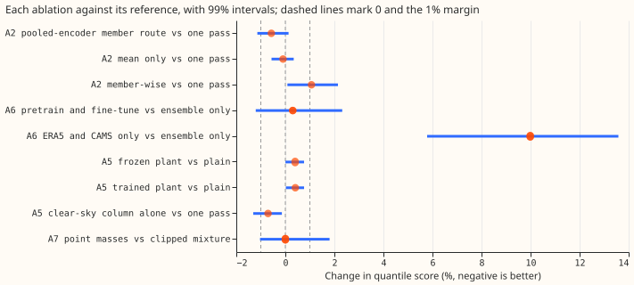
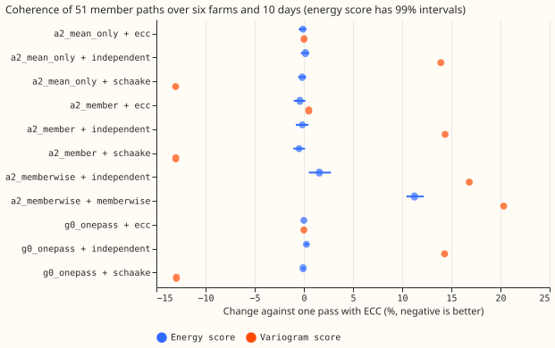

**One pass of a plain neural network on the ensemble mean and spread is as good as every richer
design we tested for the six metered solar farms.** None of the four design differences beats the
plain network by the agreed 1% margin. The 51-member encoder is 0.22% better at days 3 to 10 over
six seeds (99% interval −0.60% to +0.18%). A plant model inside the network is 0.4% worse at days 6
to 10. Pretraining on ERA5 and CAMS ties the network without it (+0.30%, interval −1.21% to +2.32%),
and point masses at zero and capacity tie the clipped mixture (+0.002%). The one arm with an
interval that excludes zero is the clear-sky irradiance column, which improves the score by 0.42% at
days 6 to 10 over six seeds (interval −0.88% to −0.03%). That gain is under the margin.

**For coherent member paths, a Schaake shuffle of the plain network's quantiles beats ensemble
copula coupling on the variogram score.** NGED's power-flow modelling needs 51 member paths that are
coherent across time and across the six farms (labelled A to F here). Ranking the 51 quantiles of
each half-hour with 51 observed paths from a year earlier lowers the variogram score by 13.0%
(interval −15.9% to −9.5%) and leaves the energy score unchanged (−0.08%, interval −0.22% to
+0.10%). Passing each ensemble member through the network alone gives paths whose energy score is
11.3% worse and whose variogram score is 20.3% worse, and a marginal quantile score that is 1.1%
worse.

Absolute scores are quantile scores in points of capacity (lower is better), on experiment 310's
scored year, farm-equal means. The reproduction gate passed with no difference: `g0_onepass` matches
experiment 345's `solar_pooled` network to machine precision in every band, because the shared code
with all switches off runs the same recipe with the same seeds.

## Results

### Quantile score by arm (points of capacity; three seeds unless stated)

| Arm | All bands | Day 1 | Days 3 to 10 |
|---|---|---|---|
| `g0_onepass` (one pass; experiment 345's recipe) | 6.842 | 5.350 | 7.182 |
| `a2_mean_only` (spread dropped) | 6.841 | 5.372 | 7.175 |
| `a2_member` (pooled 51-member encoder) | 6.810 | 5.356 | 7.141 |
| `a2_memberwise` (members passed one at a time) | 6.945 | 5.561 | 7.259 |
| `a5_plain` (one pass plus clear-sky column) | 6.798 | 5.329 | — |
| `a5_frozen` (plain plus frozen plant channel) | 6.833 | 5.368 | — |
| `a5_e2e` (plain plus trained plant channel) | 6.834 | 5.369 | — |
| `a6_ens_only` (fixed standardiser) | 6.850 | 5.356 | — |
| `a6_finetune` (pretrain then fine-tune) | 6.870 | 5.389 | — |
| `a6_pretrain_only` (ERA5 and CAMS only) | 7.534 | 5.751 | — |
| `a7_atoms` (point masses) | 6.843 | 5.362 | — |
| Experiment 310's blend (reference; six-seed `g0_onepass` is 6.830) | 6.799 | — | — |

The six-seed one-pass network scores 0.5% above experiment 310's blend over all bands (6.830 against
6.799). We computed no interval for that difference, so it is a point comparison only.

*Figure 1. Percentage change in quantile score for each ablation against its reference, with 99%
month-block intervals. The row set is the stage's own (days 3 to 10 for A2, days 6 to 10 for A5, all
bands for A6 and A7). The dashed lines mark 0 and the 1% margin; negative is better.*

### Predictions

- **G0 passed.** The difference to experiment 345 is below 1e-13% in every band.
- **A2 failed.** The member route beat one pass by 0.57% at days 3 to 10 on three seeds (interval
  −1.14% to +0.13%) and 0.22% on six seeds (−0.60% to +0.18%), against a predicted 2%. The
  seed-spread minimum detectable effect is 0.58% for this arm. Dropping the spread input
  (`a2_mean_only`) changes the score by −0.10% (−0.56% to +0.34%). The member-wise arm is 1.07%
  worse at days 3 to 10 (+0.08% to +2.14%) and 3.9% worse at day 1.
- **A6 failed.** Pretraining followed by fine-tuning is 0.30% worse than the ensemble-only arm over
  all bands (−1.21% to +2.32%), against a predicted 1% better. The three fine-tuned seeds spread
  widely (standard deviation 0.092 points), so the minimum detectable effect is 2.1%, and a gain
  below that cannot be ruled out. The ERA5-and-CAMS-only arm is 9.99% worse (+5.78% to +13.58%) over
  all bands and 7.4% worse at day 1.
- **A5 failed.** The frozen plant channel is 0.40% worse than the plain arm at days 6 to 10 (+0.004%
  to +0.76%) and 0.74% worse at day 1 (−0.11% to +1.55%). The trained plant is 0.41% worse at days 6
  to 10 (+0.02% to +0.76%), the same as the frozen plant. Experiment 313 found a 3.4% gain from a
  plant at days 8 to 10; the explanation we tested is in the next paragraph.
- **A7 failed on its coverage clause and passed on its tail-harm clause.** The 0.99 pinball loss is
  0.010 points higher (limit 0.02) and the 0.01 pinball loss is 0.006 lower. The coverage of the
  0.99 quantile rises from 0.9834 to 0.9887 (target 0.99). The coverage of the 0.01 quantile is
  0.0513 against 0.0532; the target is 0.01. Both are near 5%, which we did not investigate.

**The clear-sky column accounts for part of what experiment 313 attributed to a plant.** The plain
arm adds the clear-sky irradiance as an input column so that the plant arms differ from it only by
the plant channel. The column alone improves on the one-pass network by 0.71% at days 6 to 10 on
three seeds (−1.31% to −0.14%) and by 0.42% on six seeds (−0.88% to −0.03%). The six-seed minimum
detectable effect is 0.37%, so the estimate is just above seed noise. We did not test whether
experiment 313's plant gain disappears when its baseline also has the clear-sky column, so the
contradiction is only partly explained.

### Coherence of the 51 member paths

**The Schaake shuffle is the only route that lowers a score the others cannot match.** The reference
is the one-pass network with ensemble copula coupling (ECC). The energy score barely separates the
routes, because it is dominated by the marginal accuracy. The variogram score separates them
clearly.

| Arm and route | Energy score vs reference | Variogram score vs reference |
|---|---|---|
| One pass, ECC (reference) | 0 | 0 |
| One pass, Schaake shuffle | −0.08% (−0.22% to +0.10%) | −13.0% (−15.9% to −9.5%) |
| One pass, independent draws | +0.26% (+0.11% to +0.47%) | +14.3% (+4.8% to +27.7%) |
| Member encoder, ECC | −0.40% (−1.03% to +0.15%) | +0.5% (−0.1% to +1.2%) |
| Member encoder, Schaake shuffle | −0.48% (−1.08% to +0.12%) | −13.0% (−15.9% to −9.5%) |
| Member-wise, own paths | +11.25% (+10.43% to +12.21%) | +20.3% (+16.3% to +23.9%) |
| Member-wise, independent draws | +1.58% (+0.50% to +2.75%) | +16.8% (+6.5% to +32.5%) |

*Figure 2. Energy score (with 99% intervals) and variogram score of each route against one pass with
ECC, over six farms and 10 days jointly. Negative is better. Variogram intervals are in the table.*

- **The member-wise paths are worse than the independent floor on both scores.** Keeping each
  member's identity through the network does not produce coherent paths, because each member is
  drawn at one fixed quantile level, so a member's path is a single level of the member's own
  distribution and not a coherent trajectory.
- **The member route does not change the coherence ranking.** Its marginal gain of 0.4% to 0.5% in
  energy score is inside the intervals.
- **The Schaake shuffle's history is partly random for farm E.** Farm E has no observed power a year
  earlier, so its ranks come from random draws, and the shuffle's gain comes from the five farms
  that have history.

### Per-member quantiles

**Each member's own quantiles are almost as good as the pooled mixture of the 51 members.** NGED's
proposed deliverable is a 51-member power ensemble in which each member is a quantile forecast. We
scored each member's 11 quantiles alone against the observation, and the equal-weight mixture of the
51 members.

| Level | Coverage, one member | Coverage, mixture | Pinball loss, one member | Pinball loss, mixture |
|---|---|---|---|---|
| 0.01 | 0.0323 | 0.0321 | 0.355 | 0.355 |
| 0.05 | 0.0625 | 0.0614 | 1.517 | 1.514 |
| 0.25 | 0.2608 | 0.2590 | 5.210 | 5.188 |
| 0.50 | 0.4919 | 0.4913 | 6.682 | 6.651 |
| 0.75 | 0.7350 | 0.7370 | 5.023 | 4.995 |
| 0.95 | 0.9411 | 0.9433 | 1.382 | 1.375 |
| 0.99 | 0.9855 | 0.9864 | 0.323 | 0.322 |

Pinball loss is in points of capacity. A single member's quantiles score within 0.5% of the mixture
at each level, so the spread of the 51 members adds little to the single member's own distribution.
This follows from the member-wise training: the network sees one random member and zero spread, so
each member's distribution already carries the ensemble spread. It also means the member-wise route
counts the spread twice, which we did not correct for.

### Tails

**No arm changes the tails by more than the 0.02-point limit.** The 0.01 and 0.99 coverage of every
arm is between 0.051 and 0.067 and between 0.963 and 0.989.

| Arm | 0.01 pinball | 0.99 pinball | Coverage of 0.01 | Coverage of 0.99 | Median minus mean (points) |
|---|---|---|---|---|---|
| `g0_onepass` | 0.343 | 0.336 | 0.0532 | 0.9834 | −0.025 |
| `a2_member` | 0.339 | 0.336 | 0.0522 | 0.9848 | −0.072 |
| `a2_memberwise` | 0.338 | 0.333 | 0.0524 | 0.9871 | −0.360 |
| `a6_finetune` | 0.331 | 0.350 | 0.0514 | 0.9868 | −0.013 |
| `a6_pretrain_only` | 0.456 | 0.493 | 0.0667 | 0.9632 | +0.061 |
| `a5_plain` | 0.337 | 0.335 | 0.0524 | 0.9850 | −0.071 |
| `a7_atoms` | 0.326 | 0.344 | 0.0513 | 0.9887 | +0.108 |

### Example forecasts

*Figure 3. One-pass forecasts of farm A for the 12 to 36 hours after a summer run and a winter run.
Bands show the 25% to 75% and 5% to 95% quantiles; the dots are the observed output.*

*Figure 4. The same two runs over days 1 to 10.*

### Checks

- **Median minus mean forecast, per farm.** Averaged over all rows, the median forecast sits 0.39 to
  0.83 points of capacity above the mean forecast at each farm for the one-pass, member-encoder,
  plain, and point-mass arms. Averaged by month, the difference runs from −3.4 to +3.9 points for
  the one-pass arm, with the sign set by the season, so the farm-equal month-equal mean in the Tails
  table is near zero. The point-mass arm moves the difference from −0.03 to +0.11 points.
- **Mean-forecast error beside the quantile-score contrasts.** The mean absolute error of the mean
  forecast moves in the same direction as the quantile score for the member encoder and the plain
  arm, farm by farm (`scores/checks.csv`).
- **Triggers fired.** Trigger 2 fired: every A-stage prediction failed, and the plant result
  contradicts experiment 313. Audit findings: see the Audit section.

### Caveats

- **The member-wise route double-counts spread.** The network is trained with the spread input set
  to zero on one member, and the marginal is then the mixture of 51 member distributions, so the
  spread enters twice.
- **The Schaake shuffle is partly random for farm E.** See Coherence.
- **The variogram uses pairs up to 6 hours apart at one farm**, which misses the gap between one day
  and the next at night, so it scores the daytime structure only.
- **The `a6_*` arms have ERA5 rows with a single member.** The pretrained network sees no spread
  there, and its fine-tuning rows are the only ones with a spread.
- **Seed averaging differs between scores.** The marginal score averages the quantiles of the seeds,
  and the coherence scores average the scores of the seeds' paths.
- **The second seed set covers three arms** (`g0_onepass`, `a2_member`, `a5_plain`). The other
  contrasts use three seeds and their minimum detectable effects (0.14% to 2.1%) are in the text.
- **A6 for wind was not run.** Experiment 429's merged code has no pretraining arm, and the manager
  deferred it. The solar A6 tie (+0.30%) and the finding that the wind default already trains on
  ERA5 argue against urgency.

### Problems caused by the move

None so far.

## Question

**We test which of four design differences a pooled network for solar farms needs.** The Opus
design note of experiment 13 proposes one network design for demand, wind, and solar: a mixture
density network (MDN) pooled across sites with a learned site embedding, fed the ensemble mean and
spread once, and optionally pretrained on ERA5 and CAMS. Each difference between the three
forecasters must be justified by an ablation. This experiment is the solar worker's half; the wind
worker's half is experiment 429. Here a "farm" is one of the six metered solar farms, labelled A to
F.

## Design

**The four switches are small changes to one network class, and every arm differs from its
reference in exactly one switch.** The network is experiment 310's `MixtureHead`: the standardised
inputs, two hidden layers of 64, and a three-component Gaussian mixture on the capacity-normalised
output. All arms are pooled across the six farms and the six day bands, with experiment 345's 22
input columns (calendar, sun position, ensemble mean and spread of shortwave, beam, diffuse and
temperature, the clear-sky index, the lead in hours, and eight further ensemble variables).

- **Member route (A2).** A shared encoder (4 channels to 32 to 16) runs on each of the 51 members'
  shortwave, beam, diffuse, and temperature. The 51 encodings are pooled by mean, standard
  deviation, 10th and 90th percentile, and joined to the one-pass inputs. The member arm therefore
  sees everything the one-pass arm sees. All 51 members are used in every training step, which is
  cheap at this size, so the design note's one-random-member-per-epoch device is not needed.
- **Physics layer (A5).** A PyTorch copy of experiment 310's fleet plant adds a power channel (on
  the member mean for one pass, per member for the member route). "Frozen" fixes tilt 20 degrees
  (experiment 282 found 15 to 20), azimuth 180 degrees, and a scale fitted by least squares on the
  training rows; "end to end" also learns tilt, azimuth, scale, and clip. The plain arm adds the
  clear-sky irradiance as a column so that the arms differ only by the plant channel.
- **Pretraining (A6).** Pretrain on the farms' ERA5 and CAMS history before 2024-04-01 (about
  153,000 half-hours at five farms; farm E has none), then fine-tune all weights on the ensemble
  rows with half the learning rate. Columns the history lacks (eight ensemble variables and the
  spread) are 0 after standardisation, the lead is drawn uniformly from 12 to 252 hours, and every
  member is the same ERA5 value. One standardiser, fitted on ensemble rows before 2025-08-31, serves
  every refit of every A6 arm, including the ensemble-only control.
- **Coherent members (A2).** NGED's power-flow modelling runs one ensemble member at a time, so
  the forecast must give 51 member paths that are coherent across time and across the six farms.
  Four routes give paths. (i) The one-pass forecast with ensemble copula coupling (ECC): the
  member with the j-th lowest shortwave at a farm and half-hour takes the j-th of 51 quantile levels
  of that half-hour's forecast. (ii) The same marginals with a Schaake shuffle: the 51 members are
  ranked in each dimension by the ranks of 51 observed past paths of the same layout (the same
  farm and offsets from the run, on days within 25 days of the same date one year earlier; a
  dimension with no history is ranked at random). (iii) The member-wise route: each member is
  passed alone through the network, which is trained on one randomly drawn member per row per epoch
  with the spread input set to zero, and path m is the member's quantile function at one level
  that is fixed for the member across all times and farms (the 51 levels are (j - 0.5) / 51 in a
  fixed random order). (iv) The independent draw, which permutes the quantile levels at random in
  each dimension and is the floor. The coherence scores are the energy score and the variogram score
  of order 0.5 (over same-farm half-hour pairs up to 6 hours apart and same-time pairs across farms)
  of the 51 paths against the observed path, for the six farms and all leads of one run jointly, and
  for each day band alone.
- **Per-member quantiles (A2).** NGED's proposed deliverable is a 51-member power ensemble in which
  each member is a quantile forecast (for example the 0.99, 0.95, and 0.90 quantiles). For the
  member-wise route the experiment therefore also stores each member's own 11 quantiles and scores
  them two ways: the pooled equal-weight mixture of the 51 members (the marginal forecast, already
  scored) and each member's quantiles alone against the observation (pinball loss and coverage per
  level, averaged over members), to show how much of the spread comes from the members and how much
  from each member's own distribution. Production can afford 51 passes (maintainer, 2026-10-31).
- **Point masses (A7).** The head adds two point masses, at zero and at the farm's output ceiling
  (the 0.995 quantile of its training output, as experiment 310), and truncates the Gaussians to the
  interval between them. The likelihood is exact, and quantiles invert the truncated mixture.

**The stages run in this order, and each uses the winners of the stages before it.** G0, then A2,
then A6, then A5, then A7. The wind arms of A6 were not run: experiment 429's merged code has no
pretraining arm,
and the manager deferred them.

| Stage | Arms (all three seeds unless stated) | Reference |
|---|---|---|
| G0 | `g0_onepass`, five seeds | experiment 345 `solar_pooled` |
| A2 | `a2_mean_only` (spread dropped), `a2_member` (pooled encoder), `a2_memberwise`; paths by ECC, Schaake shuffle, independent draw, member-wise | `g0_onepass` (seeds 0 to 2), ECC |
| A6 | `a6_ens_only`, `a6_finetune`, `a6_pretrain_only` (on the A2 winner) | `a6_ens_only` |
| A5 | `a5_plain`, `a5_frozen`, `a5_e2e` (on the A2 and A6 winners) | `a5_plain` |
| A7 | `a7_atoms` (on the winners) | the same network with the clipped head |

## Pre-registered reading

- **G0.** Over all bands within 0.5% and in each band within 1.0% of experiment 345's score, five
  seeds each. Both networks are the same recipe with the same seeds, so the allowed gap is seed and
  GPU noise.
- **A2.** Row set: days 3 to 10. A member arm (pooled encoder or member-wise) is kept if it beats
  the better of the one-pass and mean-only arms by at least 2% (interval excluding zero). Otherwise
  one pass is adopted for the marginal forecast. Coherence is read separately: the energy score
  and variogram score of each route (independent, ECC and Schaake on the one-pass and
  pooled-encoder marginals, member-wise paths), jointly and per band, with month-block intervals
  over the 12 months of runs. A route that wins the marginal contrast but is worse than the best
  route on either coherence score by more than 5% does not advance (the Opus note's proposal).
- **A6.** Row set: all bands, and days 6 to 10 separately. Pretraining with fine-tuning is kept if
  it
  beats the ensemble-only arm and the ERA5-and-CAMS-only arm by at least 1%.
- **A5.** Row set: days 6 to 10 for the gain and day 1 for the harm. A plant arm is kept if it beats
  `a5_plain` by at least 1.5% at days 6 to 10 and is within 0.5% at day 1. The end-to-end arm
  needs to beat the frozen arm by a further 0.5% to be preferred.
- **A7.** Row set: all bands, tail metrics. Kept if the coverage of the 0.01 and 0.99 quantiles is
  closer to 1% and the score and the 0.99 pinball loss are no worse than 0.02 points.

## Lead range

**Every contrast is read at days 1 to 10 and, beside it, in the 12 to 36 hour band (day 1).** Days
11 to 14 are not scored, because experiment 310's tables stop at day 10 and rebuilding them was
judged not worth it for an optional extension.

## Recipe

- **Rows and refits.** As experiment 345: training rows have a valid time at least one day before
  the refit; the last 61 days are the validation set; four quarterly refits from 2025-09; own
  history only. Monthly refits are not used because the reference forecasts are quarterly.
- **Fit.** AdamW, learning rate 2e-3, weight decay 1e-4, 20 epochs, batch 2048, the best epoch by
  validation likelihood. Seeds 0 to 4 for G0 and 0 to 2 for ablations.
- **Weather at forecast time.** Every input is ensemble data of the 00 UTC run, the same as
  experiment 310. ERA5 and CAMS appear only in pretraining rows, which end before the ensemble
  store starts. No lagged power enters (experiment 345's solar-only network has none).
- **Reuse.** Experiment 345's forecasts are the gate reference and Metered solar farms research
  default 1's blend (experiment 310) is the absolute reference. Experiment 310's tables are read
  and never written. This experiment's one-pass arm is fitted here.

## Compute (as run)

About 135 fits: 20 for G0, 36 for A2, 27 for A6, 36 for A5, 12 for A7, plus second seed sets where
needed. The smallest network trains in about a minute and the member route in a few minutes on one
GPU process under 8 GB with one feeder core, so the whole programme is a few GPU-hours.

## Reviews

- Plan and code: one fresh Sonnet review before the first fit (leakage, the fit stopping at the
  refit cutoff, the scoring, row selection, agreement with experiment 345's recipe).
- Results, write-up numbers, and write-up prose: a fresh Sonnet review each.
- Unit tests: the PyTorch plant against pvlib and experiment 310's NumPy plant; the head's density
  and point masses integrate to 1; quantiles stay within bounds.
