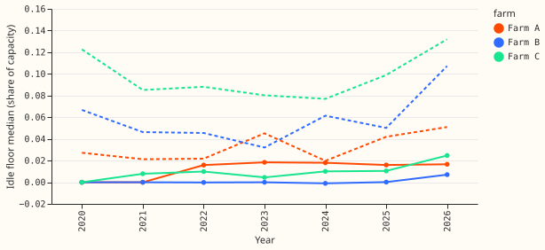
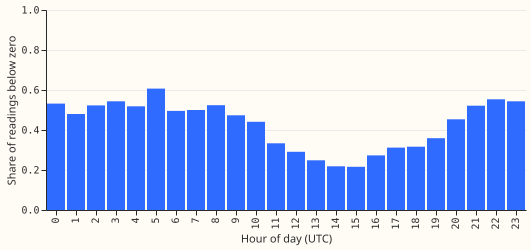
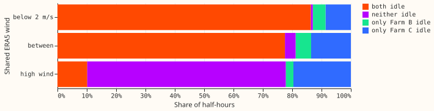

**Texture separates idle half-hours from genuine low output at Farm B and Farm C, and idle runs at
high wind are short except at Farm C.** At the same power level, idle readings
have smaller and more repeated changes from one half-hour to the next. The level-matched area under
the receiver operating characteristic curve (AUC) is 0.79 at Farm B and 0.76 at Farm C, so the
texture detector D1 stays in the design. At Farm A the two comparison sets share no power level,
so texture cannot be tested from power alone. The idle share at high wind is lower on weekday
daytimes than at other hours at Farm B and Farm C, but a weekday-only result does not settle the
whole-farm outage class I2, because maintenance and waits for components can disable turbines for
weeks. The run-length test finds idle runs at high wind of up to 5 days at Farm C that low wind
cannot explain, and none of 7 days or more at any farm. Verdict: `partly supported`.

We looked at the three metered wind farms (Farm A and Farm C metered in megavolt-amperes, Farm B
in megawatts) with no fit. The "sure-idle" set is half-hours with ERA5 100 m wind below 2 m/s and
power inside the idle band of experiment 210. The "sure-generating low-output" set is half-hours
with ERA5 wind of at least 6 m/s and power between 3% and 8% of capacity. Both sets are defined by
the same wind speed as the experiment 210 mask, so the test is of texture, not of the mask.

## Results

- **Gate for D1 (texture):** best level-matched AUC of a level-free statistic is 0.79 (3-hour
  rolling standard deviation of first differences, interval 0.75 to 0.83) at Farm B and 0.76
  (24-hour centred share of repeated values, 0.71 to 0.80) at Farm C. Both are above 0.65, so D1
  is kept. Farm A is untestable: its sure-idle power (0 to 3% of capacity) and sure-generating
  power (3% to 8%) do not overlap in any 0.5%-of-capacity bin.
- **Level alone separates the sets:** unmatched AUCs reach 0.95 (Farm A), 0.93 (Farm B), and 0.85
  (Farm C) for level-free statistics, and 1.0, 0.99, and 0.91 for the amplitude statistics. The
  matched numbers above are the ones that count.
- **Exact zeros and repeats:** 43%, 21%, and 43% of sure-idle half-hours are exact zeros at Farm
  A, B, and C, against none in the sure-generating set (which starts at 3% of capacity). Repeats
  of the previous value are 36%, 19%, and 33% of sure-idle half-hours and 0.1%, 0.2%, and 1.3% of
  sure-generating ones.
- **Quantisation step:** the smallest non-zero change is 0.005%, 0.011%, and 0.037% of capacity
  at Farm A, B, and C.
- **Run lengths (I2 gate):** with the pre-registered definition (power in the idle band, ERA5 wind
  above 1.5 times the used cut-in, no gaps), the longest run is 24 hours at Farm A, 28.5 hours at
  Farm B, and 49 hours at Farm C; 0, 3, and 21 runs exceed 24 hours; none exceeds 7 days. Farm C's
  longest run is just above the longest spell of ERA5 wind below the cut-in (47.5 hours). With the
  post hoc definition (power at or below the top of the idle band, gaps of up to 3 half-hours), 1,
  6, and 81 runs exceed 24 hours, the longest is 36, 55, and 120.5 hours, and the share of
  high-wind idle half-hours that sit in runs of 1 to 7 days is 6%, 3%, and 19%; none reaches 7
  days. With the empirical cut-in as the high-wind speed, no run exceeds 44 hours. So multi-day
  runs that low wind cannot explain appear at Farm C, only marginally at Farm B, and not at Farm
  A. No multi-week run is visible in these series.
- **Weekday and hour (secondary check on H2):** the idle share of high-wind half-hours on weekday
  daytimes (08:00 to 17:59 UTC), over the share at other hours, is 1.01 (0.67 to 1.35) at Farm A,
  0.77 (0.70 to 0.83) at Farm B, and 0.82 (0.77 to 0.86) at Farm C. The ratio never reaches 1.5, so
  the weekday cycle gives no support for planned weekday maintenance. This result alone does not
  settle I2 (see run lengths). With the empirical cut-in of experiment 210 as the high-wind speed
  the ratios are 1.01, 0.91 (0.55 to 1.42), and 0.72 (0.65 to 1.47), all with intervals that include
  1 and none reaching 1.5.
- **Floor by year:** the share of exact zeros in the idle floor falls from over 80% in 2019 to
  about 10% in 2026 at all three farms, and the median floor rises from 0 to about 1.6% (Farm A),
  0.7% (Farm B), and 2.5% (Farm C) of capacity. The floor level is not stable across years.
- **Farm B negatives:** none before 2020. From 2021 on, 33% to 53% of sure-idle readings are
  negative, with no pattern by hour of day (36% to 55% in every hour).
- **Farm B against Farm C:** at high wind, 10,368 half-hours read idle at both farms, 2,634 only
  at Farm B, and 20,018 only at Farm C. Of Farm B's idle half-hours at high wind, 80% are also
  idle at Farm C. A shared ERA5 error or a shared cause (for example a grid event) fits this,
  and so would an idle band that is wide at Farm C. The data cannot say which.
- **Gallery:** 60 farm-days per farm (20 sure-idle, 20 sure-generating low-output, 20 where the
  experiment 210 mask and the texture rule disagree), kept private under the experiment's data
  folder and not published. The disagreement days show flat zero runs at moderate wind that the
  mask does not cover, and low, noisy readings at low wind inside the mask.
- **Checks:** no forecast is scored, so the median-minus-mean, tail, and curtailment checks do
  not apply. Audit triggers: none fired.

## Caveats and what the data cannot show

- **No ground truth.** No outage log, availability record, or reactive-power channel exists on
  disk, so the data cannot say why a half-hour is idle, nor whether the maintainer's reactive-power
  reading holds. Farm B is metered in megawatts and still has idle half-hours.
- **Window statistics include the half-hour's neighbours.** A 24-hour centred window around a
  sure row can include half-hours outside the set, which dilutes contrast. Constant windows count
  as autocorrelation 0.
- **Coarse bootstrap.** The intervals resample about 8 calendar-year blocks, 2019 and 2026 being
  partial, and each class-year is capped at 3,000 half-hours.
- **Run lengths depend on the definition.** One noisy half-hour breaks a strict run, which shortens
  runs; the post hoc gap tolerance lengthens them, and both definitions are shown. The data cannot
  separate a whole-farm outage from an ERA5 error that lasts days, and ERA5's 25 km cell may show
  high wind while the turbines see calm.
- **24 statistics were scored per farm, 17 of them level-free and gated, and the best is quoted.**
  The best value is optimistic, though several statistics agree at Farm B (three above 0.77).
- **The high-wind speed is 1.5 times the used cut-in** (4.5 m/s at Farm B and Farm C), which is
  below their empirical cut-ins and dilutes the idle share; the sensitivity run above shows the
  conclusion does not change.
- **Sure sets are narrow.** Both come from ERA5 wind and a power band, so they cover only the
  clearest cases; a detector must still be tested on the ambiguous rows.

## What to try next

- **Build D1 as a level-matched detector**, scored within power bins, at Farm B and Farm C, then
  decide how to test Farm A (its overlap in power is empty on these labels).
- **Decide the I2 class per farm** from the run lengths, then test it against any outage record
  NGED can supply.
- **Look at the disagreement days with the maintainer** before the Stage 1 hand labels are drawn.
- **Ask NGED** whether a reactive-power channel or an outage log exists, because only that can
  say why a half-hour is idle.

## Experiment details

- **Code:** `ml-experiments/00431-wind-idle-data-look/` (`e00431_analysis.py`, `e00431_gallery.py`,
  `e00431_runs.py`, `e00431_charts.py`), reading experiment 210's `joined.parquet` and
  `report.json`.
- **Review:** one fresh Sonnet code review before the run found a crash in the centred correlation,
  a level leak that would have passed the gate on power alone, NaN rows dropped in the most
  idle-like stretches, and an upward bias from folding the AUC; the fixes were applied and the plan
  was amended before any number was read. The run-length analysis was added after the manager
  relayed the maintainer's correction, once the weekday result had been read.
- **Cadence, cleaned data, and weather:** no fit; the customer-generator series are never flagged
  by the production cleaning rule; weather is ERA5 100 m wind (research-only, about 5 days late).
- **Data:** `data/ml-experiments/00431-wind-idle-data-look/` (private).
