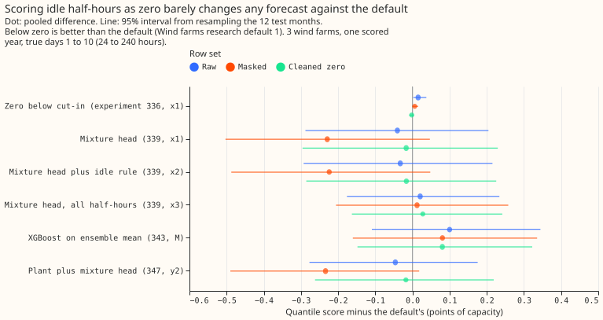
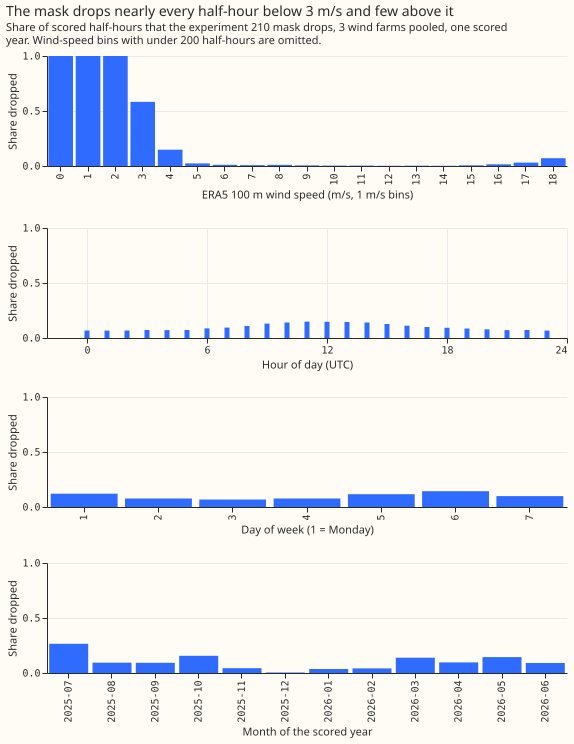
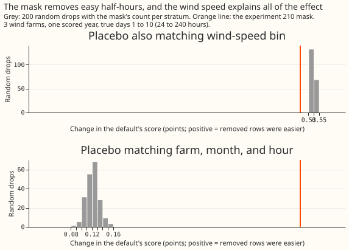

**Take-home: scoring the idle half-hours as zero output does not change which wind forecast is best,
and forcing the forecast to zero below cut-in gains nothing.** The zero-below-cut-in arm (experiment
336, x1) lost 0.015 points against raw readings (interval +0.002 to +0.037). Against the cleaned-zero
target the same arm ties Wind farms research default 1: the difference is -0.002 points (interval
-0.008 to +0.004), because the default already puts its 0.05 quantile at or near zero on 97% of the
idle half-hours. The arms with a mixture-density output layer (the mixture-head arms) lead the
default by 0.03 to 0.05 points on raw rows, 0.02 on cleaned-zero rows, and 0.23 on masked rows,
and every one of those intervals includes zero. The verdict is partly supported: the tie that the
hypothesis allowed holds, and the win of at least 0.05 points that the prediction asked for does not.

The question was whether the maintainer's rule changes the ranking of the stored forecasts. The
rule is that the forecast says zero where the farm should output zero, and the evaluation never asks
the forecast to predict the idle noise. We re-scored 7 stored forecasts on 3 row sets of the same
107,121 half-hours. The ranking hardly moves. The mixture-head arms' lead shrinks because those
arms rarely forecast zero on idle half-hours, and the lead disappears when every ERA5-flagged
half-hour is scored as zero. Hypothesis H-P (a wind neural network with a physics layer is more
robust to the idle noise) is not weakened by this check, and the check cannot support it.

## Results

Arm names: "zero below cut-in" is experiment 336's x1. "Head", "head plus rule", and "head on all
half-hours" are experiment 339's x1, x2, and x3. "XGBoost on ensemble mean" is experiment 343's M,
and "plant plus head" is experiment 347's y2. Scores are the quantile score of experiment 33
(it approximates the continuous ranked probability score) in points of capacity, at true days 1 to
10 with the 3 farms pooled, and intervals resample the 12 test months.

**The cleaned-zero row set keeps 65,740 of 66,269 half-hours.**

- Raw: 66,269 half-hours. Masked: 59,861. Cleaned zero: 65,740, which is raw minus the 529
  half-hours in `outage_suspected` runs (the scored year holds 855 of them at all leads).
- Of the 9,787 `low_wind_idle` half-hours in the scored year (all leads), 914 (9.3%) had observed
  power above the farm's idle band (172, 303, and 439 at the 3 farms). Those keep their reading in
  the cleaned-zero set, and the ERA5-only variant sets all 9,787 to zero.
- Default scores: raw 10.237, masked 10.752, cleaned zero 10.282, cleaned zero ERA5 10.294.

**Zeroing below cut-in ties the default on cleaned zeros and loses a little elsewhere.**

- Zero below cut-in minus default: raw +0.015 (+0.002 to +0.037), masked +0.006 (0.000 to +0.015),
  cleaned zero -0.002 (-0.008 to +0.004), cleaned zero ERA5 -0.008 (-0.016 to 0.000).
- Per farm on cleaned zeros: W1 -0.003, W2 -0.009 (-0.017 to -0.001), W3 +0.006 (-0.005 to +0.019).
  At 12 to 36 hours the pooled value is -0.005 (-0.011 to 0.000).
- The pre-registered rule reads "cannot tell" for the pooled days 1 to 10 value, so the arm does not
  "still lose", and H-P is not weakened.

**The mixture-head arms' lead depends on the row set and on the label.**

| Arm minus default | Raw | Masked | Cleaned zero | Cleaned zero ERA5 |
|---|---|---|---|---|
| Plant plus head | -0.046 | -0.234 | -0.018 | +0.007 |
| Head | -0.041 | -0.229 | -0.017 | +0.010 |
| Head plus rule | -0.033 | -0.224 | -0.016 | +0.004 |
| Head on all half-hours | +0.021 | +0.012 | +0.028 | +0.037 |
| XGBoost on ensemble mean | +0.100 | +0.081 | +0.080 | +0.082 |

Every interval for these rows includes zero. Dropping the mask's rows raises the default's score
by 0.515 points and the heads' by about 0.33, which is how the heads' lead grows to 0.23 on the masked rows.

**The default forecasts zero on idle half-hours and the mixture heads do not.**

- Share of idle-flagged half-hours (all 107,121 half-hours, all leads) whose 0.05 quantile is at or
  below 0.5% of capacity: default 0.97, zero below cut-in 0.97, XGBoost on ensemble mean 0.95, head
  on all half-hours 0.77, head 0.38, plant plus head 0.38, head plus rule 0.35.
- Observed power falls below the 0.05 quantile on 9.6% to 10.7% of cleaned-zero half-hours for the
  head, head plus rule, and plant plus head, against 2.1% for the default and 7.1% for the head on
  all half-hours.
- The 0.5 quantile is at or near zero on at most 7.2% of idle-flagged half-hours for every arm, so
  no forecast is a point forecast of zero there.

**The mask removes easy half-hours, and the wind speed explains all of the effect.**

- The mask raises the default's score by 0.515 points (kept minus all). Random drops matching farm,
  month, and hour raise it by 0.12 (5th to 95th percentile 0.10 to 0.14), so all 200 draws fall
  below the mask. Random drops that also match the wind-speed bin raise it by 0.54 (0.53 to 0.54),
  so all 200 draws are at or above the mask.
- The decision rule used the cleaned-zero set only if the mask beats its placebo. The mask beats
  the calendar placebo and does not beat the wind-matched placebo, so the mask removes easy low-wind
  half-hours and does not remove hard weather. Arm contrasts on the masked set are therefore
  comparable with raw contrasts, and absolute masked scores are not.

**Zeroing costs most on the half-hours just above cut-in.**

- Conditioned slice (ERA5 speed from cut-in to 1.5 times cut-in, power above the idle band, 810
  half-hours, a stress test), minus default: zero below cut-in +0.264 (0.000 to +0.568), head plus
  rule +0.412 (+0.023 to +0.723), head on all half-hours -0.226 (-0.465 to +0.098).
- Outcome-free slice (the same speeds, any power, 4,879 half-hours): zero below cut-in +0.085
  (+0.004 to +0.193), head +1.28, head plus rule +1.35, plant plus head +1.30 (every interval above
  +1.0), head on all half-hours -0.080 (-0.296 to +0.157), XGBoost on ensemble mean +0.110.

**Tails: no arm is calibrated at the 0.99 quantile.** On cleaned zeros the share of observed
power above q99 is 1.5% for the default, 1.8% for zero below cut-in, 2.0% for the head, 2.3% for
head plus rule, and 1.7% for XGBoost on ensemble mean (nominal 1%). Pinball loss at q99 is 0.595 for
the default, 0.616 for zero below cut-in, and 0.625 for the head. The share above q95 is 5.6% to
6.4% for all five.

**Ranking.** Masked order: plant plus head, head, head plus rule, default, zero below cut-in, head
on all half-hours, XGBoost on ensemble mean. Cleaned-zero order: the same, except that zero below
cut-in and default swap (a gap of 0.002 to 0.006 points, inside the intervals). On the ERA5-only
variant the default ranks above all three head arms. At 12 to 36 hours on cleaned zeros the head
arms lead by 0.17 to 0.23 and the interval of every arm but zero below cut-in includes zero.

**Pre-registered predictions.**

- P1 (zero below cut-in beats the default by 0.05 or more on cleaned zeros): not met, the arm ties.
- P2 (the ranking is the same on masked and cleaned-zero rows): met up to one swap inside the
  intervals. The second clause, that arms with mass at zero move up, is not met: only zero below
  cut-in moved, by one place, and head plus rule did not.
- P3 (the mask beats the calendar placebo): met by magnitude (0.515 against 0.14), but the
  removed half-hours raise the score, and the wind-matched placebo reproduces the whole effect.
- P4 (the conditioned slice shows zero below cut-in losing, and no forecast differs from the default
  by more than 0.05 on the outcome-free slice): the first clause holds only at the boundary
  (lower bound 0.000), and the second fails for zero below cut-in (+0.085), the three head arms
  with mass away from zero, and XGBoost on ensemble mean (+0.110).

**Experiment 429's final quantiles are not stored, so the experiment is not scored.** Experiment 429
can report the cleaned-zero row set beside the raw set. It cannot replace the raw set, because the
heads' lead on cleaned zeros depends on how the idle half-hours are labelled. Its arms need the same
ranking check on the masked and cleaned-zero sets once its quantiles exist.

## Checks

- **Reproduction gate:** every stored per-row score reproduced to 1e-6. The checked arms are the
  default, x1 of experiment 336, x1, x2, and x3 of experiment 339, y2 of experiment 347, and M of
  experiment 343, which was checked against its stored mean score. The experiment 347 arm uses its
  5 stored seeds, not the 5-seed mean of quantiles in `predictions_y2.parquet`.
- **Mask hash (G1, the frozen-mask guard of the plan):** sha256 `7ab3fe48...5368e4`, printed before
  scoring.
- **Fresh Sonnet reviews:** a plan review (it found that `low_wind_idle` is an ERA5 wind rule), a
  code review before the first run (it found null-handling crashes and an unchecked arm, all
  fixed), a results review (it re-derived the default's scores and x1's contrasts from the raw
  arrays and matched to 6 digits), and a write-up review (it found the lead was overstated, now
  corrected).
- **Audit triggers:** none fires that a re-score of stored forecasts could cause. The cleaned-zero
  target uses observed power to decide which half-hours become zero. The ERA5-only variant is
  reported beside it because of that, and the two differ by 0.012 points for the default and 0.014
  to 0.038 points for the other arms.
- **Median minus mean forecast per site and the mean-forecast error** are not recomputed: the stored
  forecasts are re-scored on a different target only.
- **Not applicable:** monthly refits, saved models, the GPU, avoidable-curtailment cost, and example
  forecast plots (the brief allows no farm time series to be drawn).

## Caveats

- **The sample is 3 farms, 2 weather cells, 1 scored year, and 12 month blocks,** so intervals are
  wide. Only the contrasts of zero below cut-in, which differs from the default on few half-hours,
  are tight.
- **The experiment 210 threshold was fitted on all years, including the scored year.** The fit suits
  a mask for scoring and would leak into a feature.
- **Idle noise at high wind outside runs of 12 hours or more stays in every row set.**
- **The headline band is days 1 to 10 of a lead range of 0.5 hours to 15 days.** The heads' lead at
  12 to 36 hours is larger and is not reduced by cleaned-zero scoring.
- **The conditioned slice selects on the outcome,** so it is a stress test and not a gate.

## What to try next

- Test whether a mixture head with a point mass at zero (experiment 429's censored likelihood) keeps
  its lead on cleaned zeros. The mixture heads here put little mass at zero, and the other
  contributors to their losses on idle half-hours are untested.
- Test an idle detector that does not use wind speed (the texture rules in the wind idle-noise
  detector design note) with the wind-bin-matched placebo.

## Plan (as committed before any score)

Nothing is fitted. The script reads the
stored quantile forecasts of experiments 336, 339, 343, and 347 and the experiment 210 mask, and
scores each forecast on three row sets.

## Plan

- **Forecasts re-scored (seven, all on the same 107,121 rows):**
    - the default: Wind farms research default 1 (`default.npy` of experiments 336, 339, and 343,
      the same forecast);
    - experiment 336, arm x1: the default with all 11 quantiles set to zero below cut-in;
    - experiment 339, arms x1, x2, and x3: the mixture head, the head plus the idle-floor rule, and
      the head trained on all half-hours;
    - experiment 343, arm M: the XGBoost model trained on the ensemble mean;
    - experiment 347, arm y2: the physics plant plus the mixture head.
- **Missing:** experiment 429's forecasts are not yet stored as final quantiles (only `parts/` and
  `models/` exist), so they are not scored here. The script takes a forecast table as input, so the
  same code scores them once they exist.
- **Idle and outage in the 210 mask:** `low_wind_idle` rows are the idle half-hours (class I1 of the
  design note), because the flag is set only where ERA5 100 m wind is below cut-in and power lies in
  the idle band. `outage_suspected` rows (at least 12 hours in the idle band at ERA5 wind above 1.5
  times cut-in) are outages (class I2) and are dropped from the cleaned-zero row set.
- **Guards:** G1, the mask file is hashed and its hash is printed before any score. G2, dropped
  share by month, 1 m/s wind bin, hour of day, and weekday, as a figure of shares. G3, the placebos:
  random drops with the mask's count in each (farm, month, hour) stratum, and in each (farm, month,
  hour, wind bin) stratum, 200 draws each. G4,
  the low-wind slices: ERA5 speed between cut-in and 1.5 times cut-in, with observed power above
  the farm's idle-band 95% value (chosen on the outcome, as the brief states, so a stress test and
  not a pass/fail gate) and without that condition. G5, the
  rank agreement of the arms on the masked and the cleaned-zero row sets.
- **Zero-mass report:** for each arm, the share of half-hours whose q05 and whose q50 sit at or below
  0.5% of capacity, on idle-flagged and on kept half-hours. A forecast whose 11 quantiles are all 0
  scores 0 on a cleaned-zero row, because pinball loss against a zero actual is (1 − τ) times the
  quantile; against a raw idle floor of 0.3 MVA the same forecast scores τ times 0.3.
- **Standing practices:** no model is fitted, so monthly refits, saved boosters, and the GPU do not
  apply. Cleaned data and the D15 and D18 cut are Primary-substation rules and do not apply to wind
  farms. Tail pinball loss and coverage at q05, q95, and q99 are reported. Avoidable-curtailment
  cost is not scored, because no load-shift events are involved. No farm time series is plotted,
  because the brief allows normalised, aggregated charts only, so the example-forecast and
  event-plot practices are not followed.
- **Earlier advice followed:** reuse stored predictions rather than refit (experiment 336 and 339
  rows); score on the same rows in every arm; say plainly that 210's mask uses ERA5 and observed
  power, so it serves evaluation and training only.
