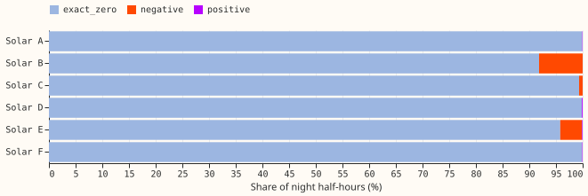
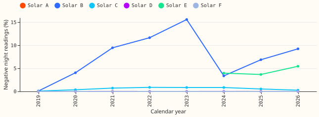
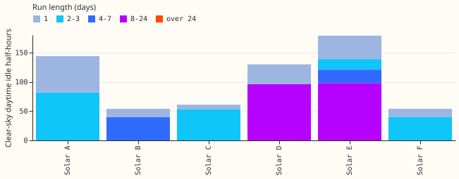

**The six metered solar farms read exact zeros at night, so they do not show the wind farms' idle
noise.** The question was whether the wind farms' noise while not generating, which the maintainer
suspects is reactive power on an MVA meter, also appears at the metered solar farms. It does not. The
metadata lists all six farms in MW, not MVA, and 95.8% to 99.9% of their night readings (solar
elevation below -6 degrees) are exact zeros. The wind farms' idle floor in
[experiment 210](../00210-wind-idle-noise-mva-artefact/result.md) held 19% to 41% exact zeros and a
median above zero at the two MVA farms. This narrows the next step: no solar detector, and no
cleaned-zero scoring for solar, unless the outage check below finds a reason.

**Solar B meets the pre-registered "the same noise" label, but the label is a flaw in the rule.**
The rule counted exact zeros towards criterion 1, so any farm that is nearly all zeros passes it,
and Solar B's 91.8% zeros also satisfy the "not the same" clause (at least 90% zeros). The rule
listed "the same noise" first. Solar B's other readings are 8.1% negative (interval's upper end
10.9%), and across all hours of the record its negative readings have a median of -0.010 MW and a minimum of -0.192 MW; its night median is zero.
Read post hoc, that is a small import (station load), not a floor above zero. The year-by-year
negative share moves between 0.1% in 2019 and 15.6% in 2023 (Figure 2), which a reactive-power floor
would not do. Solar E shows the same pattern at 4.1% negative.

**Idle runs on clear days are short, except at Solar D and Solar E.** Of the half-hours with CAMS
clear-sky index at least 0.7 between 10:00 and 15:00, 2.8% to 14.4% read near the night floor (3.2%
at Solar F). Whole idle days form runs of at most 4 days at Solar A, B, C, and F, 24 days at Solar D,
and 17 days at Solar E. No farm has a run longer than 24 days, and no farm has the pre-registered
outage class (at least 50% of idle half-hours in runs over 24 hours; the highest share is 41.6%, at
Solar E). Most idle half-hours lie outside whole idle days.

## Checks

- **Prediction.** Night median under 0.1% of capacity and non-zero repeats under 20%: holds at all
  six farms (prediction asked for five).
- **Pre-registered labels.** Solar A, C, D, E, and F "not the same"; Solar B "the same noise"
  (flawed rule, above). Overall verdict `supported` (five or more "not the same").
- **Texture statistics** (`summary.csv`): non-zero repeats are 0.01% to 0.14% of night readings. The
  quantisation step is 0.001 MW at Solar A, B, and E, 0.011 at C, 0.024 at F, and 0.035 at D, so each
  farm reports on the meter's own lattice, zero included. Lag-1 autocorrelation of night first
  differences is -0.51 to -0.03. Median rolling standard deviation of first differences is zero at
  every farm.
- **Season.** Summer and winter night medians are both zero at every farm, so the season criterion
  holds trivially (`season.csv`). Zero shares differ by under 1 point between seasons.
- **Flags.** The cleaning table flags 0 night half-hours at these six customer-metered series. The
  night statistics use all rows.
- **Share touched.** Where the label was "the same noise" (Solar B), night half-hours are 39.3% of
  all half-hours and 71.9% of half-hours with the sun up; the negative ones are 8.1% of those.
- **Daytime idle** (`daytime_runs.csv`, `daytime_run_bins.csv`): a day needs at least 3 qualifying
  half-hours. The run test sees only whole idle days; partial-day idling is counted in the idle
  share and not in a run.
- **Agreement between farms** (`pair_agreement.csv`): of the three pairs within 10 km, Solar A and
  Solar C share 5 idle days of 20 on either (Jaccard 0.25); the others share none. Idle days are
  mostly farm-specific, not weather.
- **Weekday profile** (`daytime_weekday_hour.csv`): a secondary table; it decides nothing.
- **What the data cannot show.** No MVAr channel, outage log, or curtailment record exists, so idle
  days cannot be told from curtailment or a station fault. CAMS clear-sky index is hourly and
  satellite-derived, so cloud inside the hour can make a "clear" half-hour dark. Rolling statistics
  are degenerate when readings are all zero. Gallery PNGs (20 farm-days per farm) are in the private
  data folder, not published.
- **Audit triggers:** the result contradicts nothing it predicted; the one flawed label (Solar B)
  is reported as pre-registered and read post hoc. No control or leave-one-out check applies.

## What to try next

- Check Solar D's 24-day and Solar E's 17-day idle runs against NGED's records for outages or
  export limits.
- Decide Solar B's small negative readings with NGED (station import), only if the solar scores
  show a farm-level bias at night.
