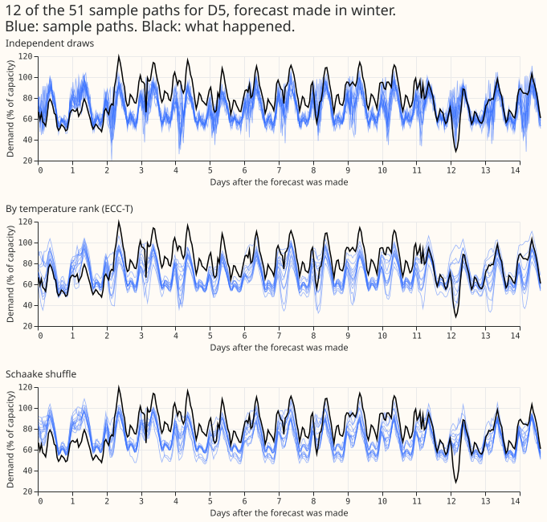
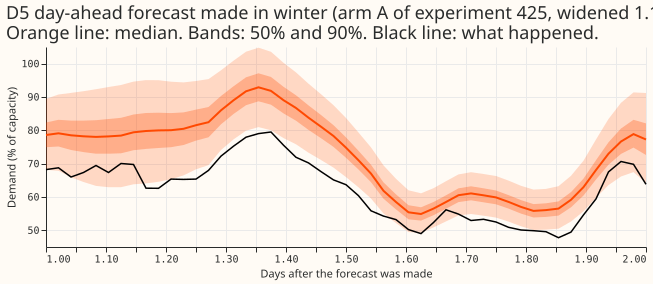
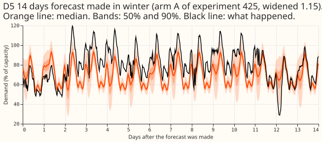
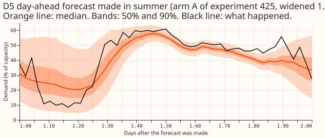
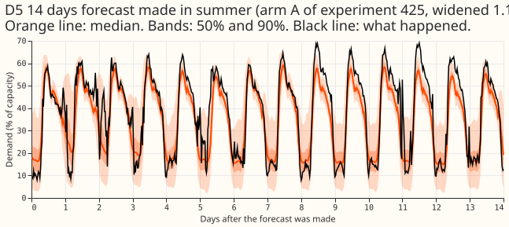

**Re-ordering the 51 values by temperature or by past paths does not make the paths clearly more
coherent overall, because ordering by temperature helps across leads and hurts across Primaries.**
The stored forecast of experiment 425's arm A gives 11 quantiles per Primary substation (a
substation feeding the distribution network from the transmission network) and half-hour. This
experiment drew 51 values from them and assigned the values to 51 sample paths in five ways, then
scored how well the paths match the observed dependence, with no fit. The scores are in points of
capacity, meaning percentage points of each Primary's effective capacity. The five orderings are
defined in the first bullet below. The joint variogram score (the gating block; the variogram score
penalises wrong differences between pairs of half-hours or Primaries) moved by 1% or less between
independent draws, temperature ranks, shortwave ranks, and the Schaake shuffle. It moved by 11.4%
for the comonotone ordering, so the score can see dependence. The Schaake shuffle did at least as
well as temperature ranks (the second claim of the hypothesis), but neither beat independent draws
by the 5% margin. The registered verdict is `not supported`: P2, P3, and P4 failed and P1 failed in
its second half.

- **Arms.** ECC-T (ensemble copula coupling: the coldest member gets the highest value), ECC-SW (the
  darkest member gets the highest value), SCH (the Schaake shuffle: the values follow the ranks of
  the 51 past observed paths nearest in day of year), IND (independent draws), and CO (comonotone:
  every Primary and lead takes the same rank, the strongest dependence possible). The energy score
  is the other coherence score, the distance of the paths from the observation. The signed-MW six
  are the Primaries whose meters report signed megawatts, the MVA-only eight report only apparent
  power, and D15 and D18 are the two with short histories. Every arm holds the same 51 values at
  each Primary, half-hour, and run.
- **Rows.** 12 monthly folds (2025-07 to 2026-06), 16 Primaries, daily runs at 09:00 UTC, scored on
  the half-hours with a cleaned actual (4,004,653 rows); 1,179 flagged exact-zero actuals are
  dropped from the whole scoring cache. Forecast: experiment 425's arm A, seeds 0 to 4 averaged in
  quantile space and widened by 1.15, stored in
  `data/ml-experiments/00425-best-mdn-architecture-assembly-with-ablations/work/seed_preds/A/`.
  Code reused by copying: experiments 87, 377, and 381 (scoring context); the page's scripts import
  those three folders.
- **Joint variogram score, days 1 to 10** (mean of 12 folds, points of capacity): IND 1.7657, ECC-T
  1.7752, ECC-SW 1.7679, SCH 1.7669, CO 1.9667. Against IND: ECC-T +0.5% (+0.3% to +0.8%), SCH
  +0.1% (-0.3% to +0.5%), CO +11.4% (+10.4% to +12.2%). At 12 to 36 hours the joint contrasts
  were +0.7% (-0.0% to +1.4%) for ECC-T, -0.4% (-1.0% to +0.1%) for SCH, and +7.0% (+5.9% to
  +7.9%) for CO. No ordering other than CO moves the joint score by 5%.
- **Across Primaries (spatial), days 1 to 10:** IND 1.6045, ECC-T 1.7115, ECC-SW 1.6694, SCH
  1.5984, CO 1.7440. ECC-T against IND +6.7% (+4.7% to +9.1%; the interval straddles +5%). SCH
  against IND -0.4% (-1.7% to +1.0%); SCH against ECC-T -6.6% (-7.6% to -5.5%). The spatial block is
  secondary and has no verdict. The energy score agrees (ECC-T +6.2%, +5.5% to +6.8%).
- **Across leads (temporal), days 1 to 10:** IND 1.6335, ECC-T 1.6050, ECC-SW 1.6268, SCH 1.5757,
  CO 2.1539. ECC-T -1.7% (-2.8% to -0.7%), SCH -3.5% (-6.3% to -0.9%), and neither reaches the
  margin. At 12 to 36 hours: IND 1.3914, ECC-T 1.2122, ECC-SW 1.3278, SCH 1.1778; ECC-T -12.9%
  (-17.0% to -9.0%), SCH -15.3% (-20.9% to -9.2%), SCH against ECC-T -2.8% (-5.7% to +0.2%).
- **Shortwave ranks (C4).** ECC-SW against ECC-T: -0.4% (-0.6% to -0.2%) jointly, -2.5% (-4.3% to
  -1.1%) across Primaries, and +1.4% (+0.5% to +2.3%) across leads at days 1 to 10. In the
  half-hours scored as daylight, ECC-SW beat ECC-T by -0.2% (-0.7% to +0.2%) across Primaries and
  -0.8% (-1.6% to +0.0%) across leads. In cold-night half-hours across Primaries ECC-SW beat ECC-T
  by -6.4% (-8.4% to -3.6%), the opposite of P4, because the radiation is zero at night and the
  ranks there are random, which is independent draws.
- **Marginal check.** The 51 values give the same CRPS for every ordering, so the marginal contrast
  is zero by construction and the 0.03-point margin applies only in step 2. The CRPS of the 51
  values was 3.597, 4.608, and 10.604 at the signed-MW six, the MVA-only eight, and D15 and D18
  (days 1 to 10), against 2.829, 3.598, and 8.431 from experiment 425's 11-level estimator, so the
  second half of P1 failed. The gap is the estimator: on one run (2025-10, fourth run) the same
  11 quantiles scored 3.487 with the 11-level formula and 4.558 with 51 even levels
  (`e00434_estimator_check.py`). The two numbers are not comparable, and the page makes no claim
  about discretisation loss beyond that.
- **Tails.** The share of actuals above the largest of the 51 values (days 1 to 10) was 2.43%,
  0.90%, and 3.66% at the signed-MW six, the MVA-only eight, and D15 and D18; below the smallest it
  was 0.70%, 0.69%, and 0.30% (a calibrated 51-value ensemble gives 1.92% each way). The ordering
  does not change these shares.
- **Slices.** The cold-night slice has actuals in only 5 to 7 of the 12 folds (the other months have
  no cold nights), so those contrasts are interim. The spatial daylight and cold-night slices keep
  the half-hours where at least half of the Primaries with an actual are flagged; the temporal
  slices use each Primary's own flags. Daylight is the local mid-day band, not the sun's elevation.
- **Caveats.** The 2026-06 fold has 29 or 30 runs in some blocks instead of 30, because the actuals
  end on 2026-07-01 and a late-June run's vector loses components past that date; every arm has the
  same rows in each block. The marginal means and tail shares are taken per Primary over all its
  rows, then averaged within the group. The Schaake pool starts on 2025-03-01 (so that D15 and D18
  have data), holds 89 to 346 dates per run, and uses the 51 dates nearest in day of year, which are
  mostly consecutive days. Experiment 425 gave the 2025-07 fold only March to mid-June dates. A past
  path of 14.6 days overlaps its neighbours, so the 51 paths are less varied than 51 independent
  years would be. The Primaries are scored together, not by group. The temperature sign (colder
  member, higher demand) was fixed in the plan and could not be checked against an observation per
  member. No per-member quantiles exist in the stored forecasts: arm A ran one pass on the ensemble
  mean and spread, so the member-wise comparison is not scored here.
- **Checks.** No model was fitted, so median-minus-mean and mean-error checks do not apply. Every
  arm was verified to hold the same 51 values at every run (the script stops otherwise), and the
  score code matches a brute-force version on random inputs. One planned check failed: the second
  half of P1, which the estimator check explains.
- **What to try next (the manager decides).** A step 2 that runs the 51 members through the neural
  network could compare it against SCH and ECC-T on the spatial and temporal variogram scores,
  because the joint score cannot separate them. A longer Schaake pool would need Primary data from
  before 2025-03-01 for D15 and D18, or the pool could use the 14 Primaries with long histories.
- **Problems caused by the move to the `nged-ml-research` repository.** None.
- **Reviews.** One Sonnet plan review (10 findings; the tails, verdict rules, pool, ties,
  missing-actuals rule, and scaling were added to the plan), one Sonnet code review before the first
  run (no score-changing bugs; NaN and permutation checks added, wording of the spatial slice and
  `n_dim` documented). Results and write-up reviews: see the pull request.
