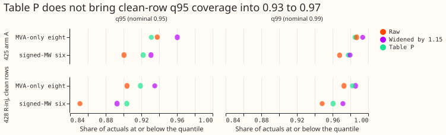
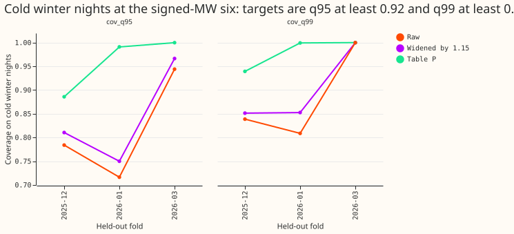
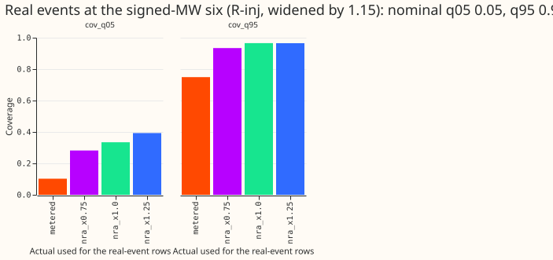

**Take-home: the table fixes stale forecasts and moves demand tails most of the way, but it does not
reach the 0.93 floor on clean rows, so the 1.15 widening is not replaced.** Harm rows are no worse
off than clean rows after the table. The remaining shortfall is month-to-month drift in the error
scale, which a table fitted on earlier months cannot follow. This stage fits no forecast model.

## Setup

- **Arms.** Stored forecasts of experiments 428 (arms R-inj, R, E1, E2, E3, E3-surp, L0, Bmix),
  425 (arms R and A), 422, 410, 429 (wind), and 430 (solar). Nothing is refitted.
- **Table P.** For each metering group, lead band (0 to 12 h, 12 to 36 h, 36 to 72 h, days 4 to 5,
  days 6 to 10), and input-condition class, one factor per tail quantile multiplies the quantile's
  distance from the median. It is fitted on earlier months and scored on the next month, with at
  least 200 fitting rows per cell.
- **Groups.** Signed-MW six (D5, D9, D10, D11, D14, D16), MVA-only eight (D2, D3, D4, D8, D12, D19,
  D21, D22), and D15 and D18 (reported, never judged).
- **Classes (experiment 428).** Clean, injected-harm, surprise 2 to 4, surprise above 4, lag
  missing, and real event.
- **NRA-corrected actuals.** The metered actual minus the event's step, using the measured
  deviation for 34 of 184 events and the labelled depth for the other 150. No event was dropped.
  The median ratio of measured to labelled depth is 0.96. The 0.75 and 1.25 variants scale the used
  step.
- **Compute.** No fits, one to four CPU cores, nice 19.

## Results

**Table P does not pass the clean-row rule on experiment 428 arm R-inj.**

| Group | q95 raw | q95 widened 1.15 | q95 table P | q99 raw | q99 widened 1.15 | q99 table P |
|---|---|---|---|---|---|---|
| Signed-MW six | 0.851 | 0.893 | 0.904 | 0.948 | 0.972 | 0.961 |
| MVA-only eight | 0.904 | 0.935 | 0.919 | 0.973 | 0.986 | 0.982 |

- The rule asks for q95 in 0.93 to 0.97 and q99 in 0.98 to 0.995. Only the MVA-only q99 passes.
- The 1.15 widening beats table P on q95 at the MVA-only eight (0.935 against 0.919), and the
  pinball loss at q95 and q99 is no worse for table P than for the widening (differences under 0.001
  of capacity).
- **Harm rows sit within 0.01 of clean rows after table P** (injected-harm q95 0.911 at the six and
  0.923 at the eight), so the shortfall is not caused by the untrusted inputs. Surprise 2 to 4 at the
  six is the one class that misses the gap rule (q99 0.930 against 0.961 on clean rows).
- **Real events are under-covered against metered actuals.** At the six, q95 is 0.742 and q05 is
  0.158. Against NRA-corrected actuals, q95 is 0.961 and q05 is 0.377, because the forecast follows
  the event. The 0.75 and 1.25 scalings change q95 by under 0.05 (0.917 to 0.964).
- **Stale arms are fixed.** Raw q95 coverage is 0.52 (experiment 410 DROP) and 0.70 (experiment 422
  DROP) and table P lifts it to 0.89 and 0.95. The fresh arms rise from 0.875 to 0.927.
- **Cold winter nights remain under-covered at the six** (experiment 425 arm A, 34 days, 15,449
  rows, minimum detectable effect 0.066 for q95): q95 0.752 and q99 0.827 raw, 0.782 and 0.856
  widened by 1.15, against targets of 0.92 and 0.975. A cold-night class of table P, fitted
  leave-one-fold-out, reaches 0.943 and 0.972, missing the q99 target by 0.003, and varies by fold.
- **Seed pooling does not widen the bands.** The band widths of the three seeds and of their pooled
  average differ by under 1% on clean rows (R-inj, MVA-only eight: 0.250, 0.252, 0.251, pooled
  0.251).
- **Wind (experiment 429, clipped to 0 to 1 of capacity).** q99 coverage is 0.979 to 0.982 raw and
  0.984 to 0.987 after table P. P4 predicted a rise from about 0.972, but the raw figure here is
  already above 0.98 on the median-band stand-in.
- **Solar (experiment 430) is where the clip matters.** In 2.0% of rows the normalised actual
  exceeds 1 (maximum 1.14), and the stored raw q99 exceeds 1 in 16% of rows. A clip to 0 to 1 therefore
  cuts q99 coverage: table P gives 0.963 to 0.967, and the 1.15 widening gives 0.970. Without the clip
  the same tables read 0.984 to 0.992 (P) and 0.995 (widening), so the unclipped figures are
  optimistic and the clipped ones are pessimistic. The cause of actuals above 1 is unmeasured.

## Checks

- **Clipping.** The widening and table P rescale the quantiles. Wind and solar quantiles are
  clipped to 0 to 1 of capacity after rescaling. Demand quantiles in MW are not clipped, because no
  bound applies to every series. The 422 and 410 tables are also unclipped.
- **Median and mean.** The scored point forecast is the median, and the mean forecast is not scored
  here, so no mean-forecast contrast is available from this stage.
- **Audit triggers.** None of the seven triggers is a concern for this stage, because it fits no
  model, changes no stored row, and reads each stored forecast once.

## Caveats

- **The shortfalls are lower bounds.** NGED's logs miss some events, so rows labelled clean may
  hold unlogged events.
- **The true rate of genuine level changes is unmeasured.** The label table's median event lasts
  48.2 hours and 10.7% of its rows last longer than 7 days, and the injected-rate sweep belongs to
  Brief B.
- **Table P under-corrects across months.** It is fitted on earlier months only, so a drift in the
  error scale appears as a shortfall.
- **Wind scoring uses a median-band stand-in** for the wind-speed-band class.
- **Cold nights use leave-one-fold-out** fitting and day-resampling intervals, a departure from the
  earlier-folds-only rule, because three folds are too few for month blocks.
- **Event-cluster upper bounds** for classes with fewer than 20 real events, and the real-event
  scores without the largest event, are not computed.

## Steps as planned

- Step 1: build NRA-corrected actuals for the scored months of experiment 428's four folds and
  2025-12. The step removed from each event is the measured deviation (experiment 402's
  measurement and filters) where one exists, and the labelled depth otherwise. The 0.75 and 1.25
  variants scale the used step, so they are centred on the measured deviation. The page reports
  how many events have a measured deviation (34 of 184) and the count of dropped events (0).
- Step 2: tail-coverage diagnostics on stored forecasts of experiments 425, 429, and 430.
- Step 3: fit table P once the cross-fit table of experiment 404 is frozen (commit 63d3799f) and
  experiment 428 seeds 1 and 2 are scored; apply it to the stored forecasts of 410, 422, 425, 428,
  429, and 430.
- Step 4: pool the three seeds of experiment 428 and report the band-width ratio and coverage on
  harm rows against clean rows.
- Compute: no fits, one CPU core, `nice 19`, under 16 GB of memory.

## Conditions from the load-shift review (2026-10-31)

- **Event durations are checked.** The label table has a median duration of 48.2 hours, and 10.7%
  of its 112 rows last longer than 7 days (0.125 of the 184 event rows), which matches the figures
  the review quoted.
- **The true rate of genuine level changes is unmeasured.** The write-up states this, and the
  injected-rate sweep (2% and 5% of training rows) belongs to Brief B.
- **Clean-row and harm-row results are lower bounds.** NGED's logs miss some events, so rows
  labelled clean may hold unlogged events, and every coverage figure on the page is reported as a
  lower bound on the shortfall.

## Cold winter night slice (2026-10-31)

- **Slice.** Experiment 441's `cold_winter_night` mask, read from its stored mask table, is a named
  slice and an extra input condition of the table. Targets on the slice, per metering group: q95
  coverage at least 0.92 and q99 coverage at least 0.975. The page states the slice's rows, days, and
  minimum detectable effect first, and reports it per fold.
- **Scored folds.** The mask covers four folds (2025-10, 2025-12, 2026-01, 2026-03), and only the
  last three hold cold nights, so the slice is fitted leave-one-fold-out on experiment 425's arms
  `R` and `A`. That is a departure from the earlier-folds-only rule of the main table.
- **Interval.** Three folds are too few for a month-block interval, so intervals resample whole
  local days.
