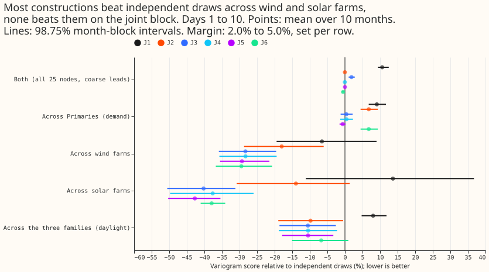
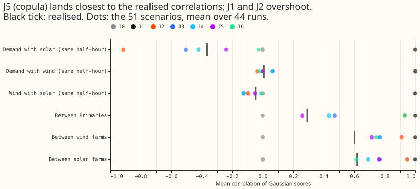
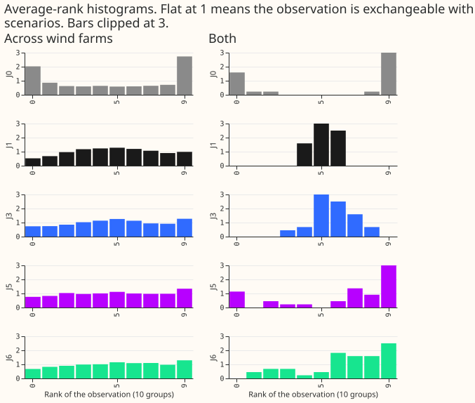
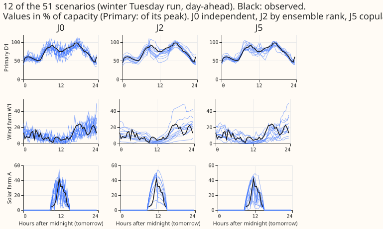
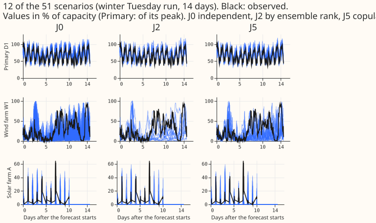
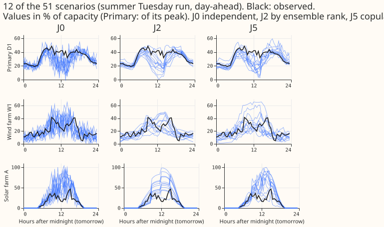
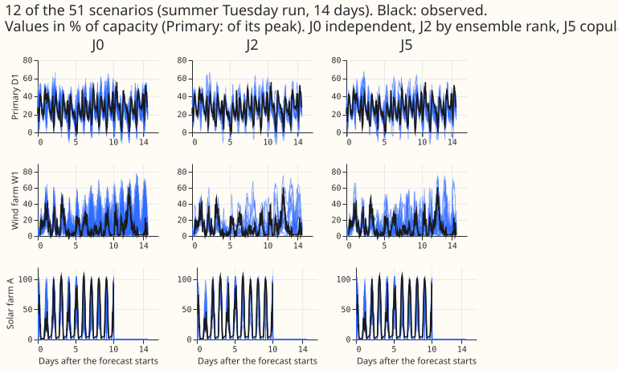

**A single Schaake shuffle or the copula-corrected ensemble ranks make the wind-farm and solar-farm
scenarios 28% to 43% more coherent than independent draws, but nothing helped across the 16
Primaries and no construction passed the registered gate on the joint block.** The question is how
to turn the calibrated marginal forecasts of the Primaries (substations feeding the distribution
network from the transmission network), wind farms, and solar farms into 51 scenarios that a
power-flow study can use, each scenario being one coherent realisation across substations, across
demand, wind, and solar, and across time. We took the stored 51 values per node and lead, re-ordered
them in eight ways, and scored how well the re-ordered scenarios match the observed joint behaviour
over 44 Tuesday runs (2025-09 to 2026-06). The scores are variogram scores in points of capacity
(percentage points of each node's effective capacity). The variogram score penalises wrong
differences between pairs of nodes or half-hours. The registered verdict is `partly supported`: the
coupling beat ensemble ranks for the farms (the first claim), tying scenario k to member k gave no
gain (the second claim failed), and the gating joint block saw no difference at the margin.

## Design

- **Why now.** Experiment 434 (pull request 91) found that no ordering beat independent draws for
  demand alone. Experiments [429](../00429-unified-forecaster-wind-ablations/result.md) and 430
  (pull request 87) found that a Schaake shuffle beat ensemble copula coupling (ECC) for the farms
  alone. No experiment has scored a
  scenario joint across families. The design note (the Opus note of 2026-10-31, in the private
  `briefs/` folder) gives the reasons and eight questions for NGED; the maintainer approved this
  experiment on 2026-10-31.
- **Working assumption, to be confirmed with NGED.** NGED needs each scenario to be one coherent
  realisation across demand, wind, and solar, across substations, and across time, to feed
  power-flow models. Requirement (d), that scenario k uses ensemble member k's weather, is untested.
- **Marginals.** All constructions share one set of 51 values per node and lead: the values at
  levels k/52 (k = 1 to 51), by linear interpolation of the stored 11 quantiles (as in experiment
  434), no extrapolation. Demand: experiment 425 arm A, seeds averaged in quantile space, widened by
  1.15 (the recalibration table of experiment 435, pull request 92, has not reported, so the
  widening is the one 434 used). Wind: experiment 429's `one_pass_ms` quantiles, five seeds
  averaged. Solar: experiment 430's `g0_onepass`, seeds averaged.
- **Row set.** The Tuesday runs of 2025-09 to 2026-06 present in all three families. The three
  families used the same ensemble run per date: demand and wind publish at 09:00 UTC from the 00:00
  UTC ensemble run, and solar's `init_time` is that 00:00 UTC run. The builder checks the lead-0
  valid times match, aligns all families by valid time on the 702 half-hours after 09:00 UTC, and
  prints the run count before any score. Experiments 428, 431, and 432 hold no usable member input
  or forecasts and are not used.
- **Nodes.** 16 Primaries, wind farms W1 to W3, and solar farms A to F (anonymised in every chart
  and table).

### Arms

| Arm | Construction | Stands for |
|---|---|---|
| J0 | independent draw per node and lead | floor |
| J1 | comonotone: scenario k is level k everywhere | all nodes at one rank |
| J2 | ECC on a shared member index: temperature (shortwave in daylight, as 434's ECC-SW) for demand, 100 m wind for wind, shortwave for solar | ranks from the weather members |
| J3 | one Schaake template: one historical date orders every node, family, and lead | historical dependence, no member tie |
| J4 | member-anchored Schaake: scenario k takes the date whose observed weather over the farms' and Primaries' cells best matches member k | historical dependence, weak member tie |
| J5 | J2's ranks re-mixed with a Gaussian copula of PIT residuals fitted on the other months, mixing weight per family and lead band | ECC corrected by an error copula |
| J6 | member-wise quantiles where stored (wind `memberwise`, solar `a2_memberwise`), demand by J2; latent level per scenario drawn from J5's copula | member-wise with a residual copula |
| J6-median | J6 with each member's median path | member paths, no residual |

### Tier 0 and tier 1 fits

- **Tier 0 (no fit): J0 to J4 and J6-median.** J1 and J0 are exact. J3 follows experiment 434's
  `schaake_pool` extended to all nodes: the 51 candidate dates nearest in day of year, from
  2025-03-01 and at least 16 days before the run; a date is dropped if any node lacks more than 5%
  of its half-hours; the pool for the farms starts when each farm has data. J4 matches member k to
  the date by ERA5 temperature, 100 m wind, and shortwave over the nodes' cells (the weather source
  and its availability at forecast time are stated in the write-up; ERA5 at the matched date is
  past weather, so it is available at forecast time for dates at least five days old, and the pool
  respects that gap).
- **Tier 1 (cheap fits): J5 and J6.** The copula correlation is structured, not free: an exponential
  decay in lead time times a family-block matrix, because one year of data estimates a free 25-node
  by 28-lead matrix poorly. It is fitted on probability-integral-transform residuals of the other
  months (leave one month out). The mixing weight is chosen from {0, 0.25, 0.5, 0.75, 1} by the
  joint variogram score on the training months, per family and per lead band (12 to 36 hours, days 1
  to 10).
- **Tier 2 is not planned.** If tier 1 shows that member identity matters for demand (J4 or J6 beats
  J3 by the margin), the manager asks the maintainer for the go-ahead for 12 demand fits.

### Metrics

- **Marginal check.** CRPS per node from the 51 values, within 0.03 points of the stored quantile
  CRPS. The calibration tolerance for J6: q95 coverage within 0.03 of 0.95, q99 within 0.015 of 0.99
  at days 1 to 10, with the accepted clean-row bands (q95 0.93 to 0.97, q99 0.98 to 0.995) beside
  them.
- **Coherence scores, four blocks.** Within-family spatial (same half-hour), cross-family (the same
  half-hour across families), temporal (each node across leads), joint (every node at 6-hourly
  leads). Each is reported at 12 to 36 hours and days 1 to 10, with daylight and cold-night slices.
- **Multivariate rank histograms.** Average-rank and band-depth histograms of the 52 values (51
  scenarios and the observation) per block
  ([Thorarinsdottir et al. (2016)](https://doi.org/10.1080/10618600.2014.977447)).
- **Dependence check.** Spearman correlation matrices of the scenarios' PITs across nodes and across
  lead lags of 0.5, 3, 12, and 24 hours against the same matrices from the realised PITs: the
  root-mean-square difference per block, and the demand-to-solar and demand-to-wind entries.
- **Spread-skill ratio** per family and lead day, as the double-counting test; for J6, the variance
  between members and within members.
- **Downstream proxies.** Groups come from the NGED hierarchy file (two bulk supply points, Boston
  and Skegness, each with the Primaries and farms beneath it); the limit proxies are stated before
  scoring. Simultaneous exceedance (Brier score of at least two Primaries above their own static q95
  proxy limit in the same half-hour, and of group net flow below its export proxy); group-sum CRPS
  and q95 and q99 coverage; ramps (Brier score of a ramp larger than 20% of capacity within 3 hours,
  per node); tier 1 curtailment volume of the [cost-savings
  metric](https://openclimatefix.github.io/nged-substation-forecast/roadmap/cost-savings-metrics/)
  per scenario at each group, against the realised volume.

### Standing practices

- **Followed.** Cleaned data everywhere (flagged `substation_zero` half-hours dropped, counts per
  block reported); the D15 and D18 cut before 2025-03-01; tails reported at q01, q05, q95, q99;
  example forecasts (a day-ahead and a 14-day scenario fan, a winter and a summer run, anonymised
  generators); each review before its step, per the code-review-first order; draft pull request.
- **Not applicable.** No fit in tiers 0 and 1, so no refit cadence, model saving, or GPU use; no
  load-shift events are scored, so the event plots do not apply.
- **Earlier advice followed.** Experiment 429: Schaake gives more coherent farm paths than ECC;
  report the upper tail. Experiment 434: report the spatial and temporal blocks beside the joint
  block; score the 51 values with the energy form of the CRPS, and do not compare with the 11-level
  CRPS of earlier experiments (the check compares the 51-value CRPS with the stored 11-quantile CRPS
  recomputed in the same form).

## Compute and reviews

- **Compute.** CPU only, one core (`OMP_NUM_THREADS=1`), `nice -n 19`, memory capped with
  `systemd-run --user --scope -p MemoryMax=8G -p OOMPolicy=continue`. About 4 to 8 hours of scoring
  (estimate). No GPU.
- **Reuse.** The scorer and pool of experiment 434, the quantile tables of experiments 425, 429,
  and 430, and the member weather arrays of experiments 429 and 430 are read, not refitted; no fit
  is saved by repeating one.
- **Reviews.** Sonnet plan review; Sonnet code review before the first run; Sonnet results review
  (re-derives the headline numbers); two Sonnet write-up reviews.

## Details registered after the plan review

- **Leakage rules.** The copula correlation and the mixing weight are both re-selected inside each
  held-out-month fit, from the other months only (nested). The Schaake pools (J3, J4) hold only
  dates strictly earlier than the run date, at least 16 days earlier so that every path ends before
  the run (J3) and at least 5 days earlier for ERA5 (J4). J4 matches member k's forecast weather to
  the past observed ERA5; it never reads observed weather at the run date. A pool starts on
  2025-03-01 and is thin for the earliest runs (about 6 months, seasonally mismatched); if fewer
  than 51 dates qualify, the nearest dates repeat cyclically, as in experiment 434, and the pool
  size per run is reported.
- **Bootstrap.** The resampling unit is the calendar month, with each month's score the mean over
  its runs; the number of runs per month is printed. With about 10 months the 98.75% interval is
  close to the range of the resampled means, so "straddles the margin" is the likely outcome and the
  page says so. A run-level block bootstrap (blocks of 2 weeks) is reported beside it as a
  sensitivity check.
- **Margin.** Relative gap = (J1 score minus J0 score) divided by J0's score, per block at each lead
  window (not per slice); margin = a quarter of it, bounded to 2% to 5%. The gap is computed from
  the data before any contrast is read. J0 is the reference of every coherence contrast.
- **Decision rule details.** A construction must first pass the coherence gate. "Within the margin
  of the best" means the interval of the difference to the best includes no value beyond the margin.
  "No worse on the exceedance Brier score" means the point estimate is not higher than the best's by
  more than 5% of J0's score and the interval of the difference includes zero. "Rank histograms no
  worse than J3's" means the average-rank histogram's distance from flat is below J3's in the
  bootstrap's median. J6-median is a diagnostic and is not ranked.
- **Expected sizes.** Demand: the J1-to-J0 gap on the joint block about 11% (experiment 434), so a
  margin about 2.8%. Farms: Schaake against ECC 9% to 13% lower on the variogram score (experiments
  429, 430), and J5 closing at least a third of that gap to J3. Spread-skill ratio of the
  calibrated scenarios near 1; J6's between-member share of variance below 50%. The dependence-check
  difference ranks J1 worst, then J2, and J3 or J5 best. P5's direction: the point estimate favours
  J3 or J5 over J0 on simultaneous exceedance.
- **Per-family reporting.** C1 to C3 are also reported for demand, wind, and solar separately, as
  descriptive results without Bonferroni correction; the verdicts use the pooled contrasts.
  Expected outcome of tier 2: dropped (P1 predicts J4 ties J3 for demand); the gating block is the
  joint block at days 1 to 10.
- **Alignment.** 702 half-hours is lead 0.5 to 351 hours, the 14.6-day horizon of experiment 434.
  If a family's run for a date used a different ensemble run, the builder aligns by valid time and
  flags the date; the count is reported.
- **Slices and proxy file.** Daylight is the local mid-day band and a cold night is the shared slice
  table's flag, as in experiment 434. The group limit proxies are written to
  `proxies.json` in the experiment's folder and committed before the first scoring run. Curtailment
  volume is compared with the realised volume by absolute error per group and run.

## Results

- **Rows.** 44 Tuesday runs, 4 to 5 per month from 2025-09 to 2026-06, each with 702 half-hours
  after 09:00 UTC, scored on 25 nodes (16 Primaries, W1 to W3, solar farms A to F). All three
  families used the same 00:00 UTC ensemble run on each date. The month-block bootstrap resamples
  the 10 calendar months (20,000 draws, 98.75% intervals), so every interval is wide and "straddles
  the margin" is a common outcome.
- **Margins.** The margin is a quarter of the gap between J1 (comonotone) and J0 (independent):
  2.6% for the joint block at days 1 to 10 and 2.4% at 12 to 36 hours. It runs from 2.0% to 5.0%
  across the other blocks. J1 scored 10.6% above J0 on the joint block, so the score sees
  dependence on that block. J1 is not a clean control within every family: across wind farms it
  scored 6.6% better than J0 and across solar farms its interval spans zero (-11.1% to +36.7%).
- **Joint block, days 1 to 10** (J0 7.42, relative to J0): J1 +10.6% (+9.4% to +12.5%), J2 -0.0%
  (-0.2% to +0.1%), J3 +1.9% (+1.0% to +2.8%), J4 -0.0% (-0.2% to +0.1%), J5 -0.0% (-0.1% to
  +0.1%), J6 -0.5% (-1.0% to -0.2%), J6-median +3.2% (+2.2% to +4.4%). No construction passes the
  coherence gate of -2.6%. At 12 to 36 hours the picture is the same (J6 -0.5%, J5 -0.2%).
- **Registered contrasts, days 1 to 10** (relative difference of the variogram score, 98.75%
  interval, margin in brackets). C1 J4 against J3: -1.9% (-2.7% to -1.1%) on the joint block
  (2.6%), +0.0% (-0.2% to +0.2%) across Primaries, +0.0% (-0.8% to +0.7%) across wind farms, +4.3%
  (-0.6% to +9.5%) across solar farms. C2 J5 against J2: +0.0% (-0.1% to +0.2%) jointly, -7.0%
  (-8.4% to -5.6%) across Primaries, -13.8% (-17.1% to -9.2%) across wind farms, -33.4% (-37.3% to
  -27.3%) across solar farms. C3 J6 against the best of J2 to J5 on the joint block: -0.5% (-0.9% to
  -0.1%). C4 the best construction (J5) against J0 on the Brier score of two or more Primaries above
  their static q95 limit in one bulk-supply-point group: -0.4% (-2.2% to +1.3%). C1 and C3 sit
  below the margin and C4 straddles zero, so all four read "no difference at the margin" on the
  gating measures.
- **Per-family intervals** use the same 98.75% level as the registered contrasts, so no
  construction's gain across a family is more lenient than the gating contrasts.
- **Across the farms** (variogram score, days 1 to 10, against J0): wind J2 -18.0% (-28.7% to
  -6.0%), J3 -28.3% (-35.9% to -19.6%), J4 -28.3% (-35.7% to -19.4%), J5 -29.3% (-35.5% to -21.5%),
  J6 -29.5% (-36.7% to -20.7%); solar J2 -14.0% (-30.8% to +1.4%), J3 -40.2% (-50.6% to -31.2%), J4
  -37.6% (-49.8% to -26.0%), J5 -42.7%, J6 -37.9% (-41.1% to -34.1%). At 12 to 36 hours the wind
  gains vanish for J3 (+2.5%) and J4 (+2.3%) and keep for J5 (-3.9%, -9.2% to +2.4%) and J6
  (-1.2%); the solar gains hold (J3 -20.0%, J5 -26.2%, J6 -25.9%).
- **Across Primaries, days 1 to 10:** J2 +6.8% (+4.4% to +9.4%), J3 +0.4% (-1.2% to +2.2%), J4 +0.4%
  (-1.3% to +2.3%), J5 -0.7% (-1.5% to +0.2%), J6 +6.8% (J6 uses J2's ranks for demand), J1 +9.1%.
  No construction beats independent draws by the 2.3% margin.
- **Across the three families in daylight, days 1 to 10:** J2 -9.8%, J3 -10.5%, J4 -10.5%, J5
  -10.5% (-17.9% to -3.3%), J6 -6.7% (-15.1% to +1.0%), J1 +8.0%. The margin is 2.0% and J2 to J5
  all lie below it. The shortwave radiation that drives both net demand and solar output couples the
  families, and any ordering that includes it captures the dependence (the prediction that J2 or J4
  beat J3 here failed: all four tie).
- **Across leads.** Every construction except J1 and J6-median stays within 5% of J0 for each node
  except demand D4, where J3 scored -17.1% (-28.8% to -6.6%) and J4 -14.0% (-23.8% to -5.5%). J6's
  member-wise quantiles score 1.6% to 4.0% worse than J0 across leads for every solar farm (for
  example farm A +3.3%).
- **Dependence check.** Mean correlations of Gaussian scores, scenarios against realised. Demand
  with solar: J2 -0.92, J3 -0.51, J4 -0.42, J5 -0.24, J6 -0.03, realised -0.36. Between Primaries:
  J2 0.93, J3 0.47, J4 0.43, J5 0.26, realised 0.29. Between wind farms: J2 0.91, J3 0.77, J5 0.71,
  realised 0.60. Between solar farms: J2 0.95, J3 0.77, J5 0.76, realised 0.62. J2 overshoots the
  realised correlation in every pair except demand with wind (J2 -0.04, realised +0.01). The nearest
  construction differs by pair: J4 (-0.42) and J6-median (-0.34) for demand with solar, J5 for
  Primaries and for the wind farms, and J4 and J6 for the solar farms. J5 for demand takes mixing
  weight 0 in every held-out month, so it is a pure Gaussian copula with no ensemble-rank component.
- **Rank histograms.** The across-wind-farm histogram of J0 is U-shaped (the observation is
  more extreme than random scenarios suggest) and J3, J5, and J6 are nearly flat. On the joint block
  the histograms hold few observations (44 runs) and are noisy: J1 piles up in the middle bins,
  and J0, J5, and J6 pile up at the ends. The registered "no worse than J3" comparison is not
  informative at this sample size.
- **Marginal check.** J0 to J5 hold the same 51 values, so their CRPS is the same (days 1 to 10:
  demand 5.05, wind 10.56, solar 8.85 points). The share of actuals above the 51 values' q95
  was 7.9%, 8.8%, and 7.6%, and above q99 2.7%, 4.2%, and 3.3% (demand, wind, solar), and below q05
  3.7%, 6.9%, and 7.8%. J6 changed the marginals: CRPS 10.67 for wind (+0.11 points, beyond the 0.10
  tolerance) and 9.18 for solar (+3.8%, beyond the 1% tolerance). J6 therefore fails its marginal
  tolerances and does not advance. The spread-skill ratio of the 51 values was 0.98, 0.91, and 0.96
  (demand, wind, solar; J6 wind 0.97, solar 0.97).
- **Downstream proxies, relative to J0** (mean over 10 months and two bulk-supply-point groups,
  days 1 to 10). The Brier score of two or more Primaries above their q95 limit: J1 +8.0% (+3.7% to
  +12.2%), J2 +7.1% (+3.0% to +11.4%), J3 +1.7% (-2.0% to +4.8%), J4 +2.0%, J5 -0.4% (-2.2% to
  +1.3%). The Brier score of group net flow below its export proxy: J1 +9.6% (+2.3% to +15.9%),
  every other construction within 1.5% of J0 with intervals that straddle zero. The Brier score of a
  ramp over 20 points in 3 hours: J2 -9.0%, J3 -14.5% (-17.0% to -11.7%), J4 -14.6%, J5 -14.3%, J6
  -10.6%, J1 +0.9%. The group-sum CRPS: J3 -1.1% (-1.8% to -0.3%), J4 -1.2%, J5 -1.7% (-2.3% to
  -1.1%), J2 +1.2%, J6 +1.1%, J1 +9.6%. The excess-export volume proxy has intervals too wide to
  read (J5 -3.2%, -19.8% to +57.9%).
- **Marginal tails limit the group-sum result.** The 51 values are too narrow in the upper tail
  (7.6% to 8.8% of actuals above q95), so the group-sum exceedances below partly show the marginals,
  not only the ordering.
- **Tails.** The scenarios' q95 and q99 exceedance shares are given in the marginal check. For the
  sum over a group, the share of actuals above the q95 of the scenario sums was 13.9% for J0, 26.4%
  for J1, 2.6% for J2, 6.6% for J3, 7.2% for J4, 7.9% for J5, and 2.4% for J6; above q99 it was
  8.1%, 18.9%, 0.6%, 2.7%, 3.0%, 3.2%, and 0.5%. J0 and J1 exceed far more often than 5%, J2 and J6
  far less, and J3 to J5 sit closest to the nominal 5% and 1%. The audit is asked to re-derive these
  sums.
- **Not run.** Tier 2 (12 demand fits) was not run, because neither J4 nor J6 beat J3 for demand
  (across Primaries J4 scored +0.4% and J6 +6.8% against J0, J3 +0.4%). The run-level block
  bootstrap sensitivity check registered in the plan was not run.

### Checks

- **Median forecast minus mean forecast of the 51 values** (mean over runs and nodes, points of
  capacity): demand -0.57, wind -3.81, solar +0.06. The marginals are identical across J0 to J5, so
  the difference does not vary across the constructions that share them. The negative wind figure
  means the stored distribution is skewed above its median.
- **Error of the mean forecast beside the quantile contrasts.** The mean error of the 51 values
  (actual minus mean) is 1.45 (demand), 2.30 (wind), and -0.71 (solar), the same in every
  construction from J0 to J5 by design, so no contrast on it exists to point the other way (trigger
  3 cannot fire). J6 changes the mean, and its CRPS moved in the same direction as its variogram
  score for solar (worse), so the two agree.
- **Audit triggers.** Trigger 2 fired: P3 (J2 or J4 beats J3 across families in daylight) failed
  because all four tie, and P4 (J6 meets the marginal tolerances) failed because J6 shifts the
  solar CRPS by 3.8%; the write-up gives the explanation for each above. Predictions P1 and P2 also
  failed: J3 scored worse than J2 on the joint block (+1.9% against -0.0% against J0), J5 only tied
  J2 there, and J6 was 8.3% worse than J5 across solar farms (+1.5% to +19.1%) instead of tying it.
  Triggers 1 (J1 control moves the score as expected, and J5 at weight 1 reproduces J2 exactly), 3,
  5, 6, and 7 did not fire. Trigger 4 (leave-one-site-out) was not run, and the farm contrasts rest
  on only three wind farms. The audit is pending and is described in the pull request.
