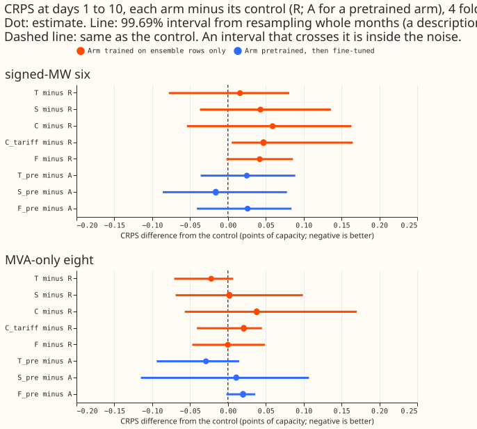
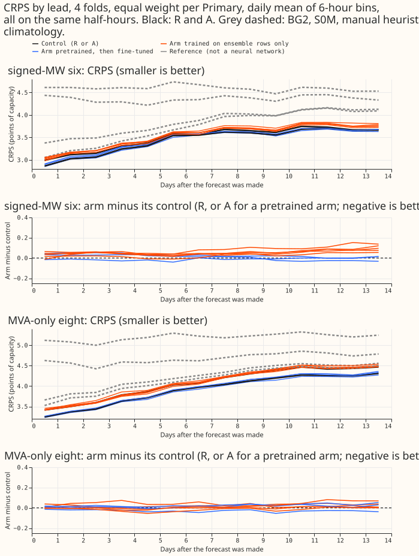
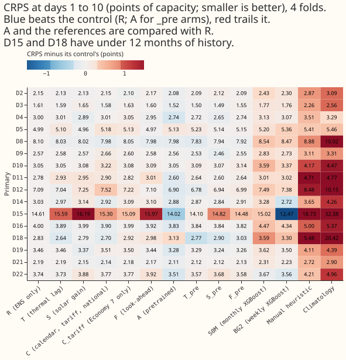
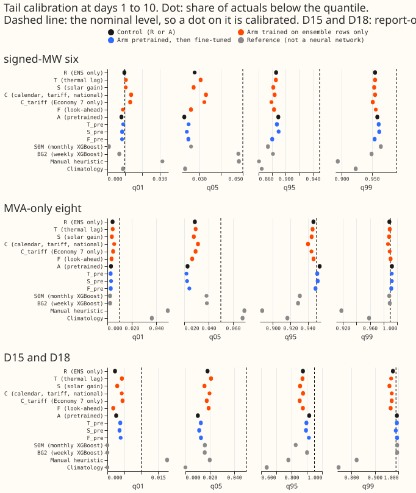
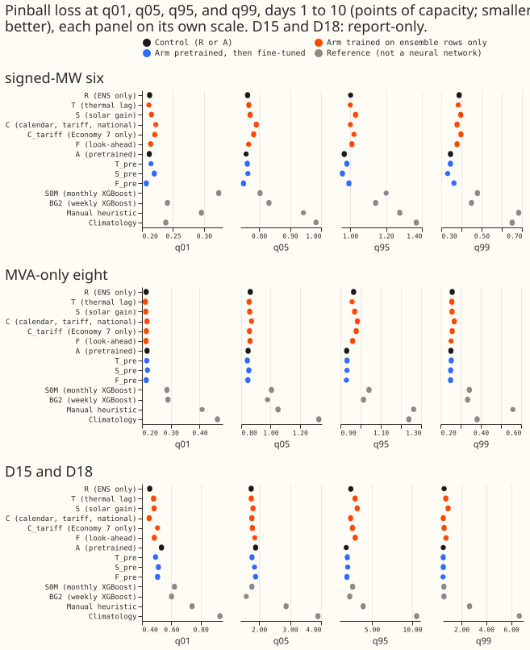
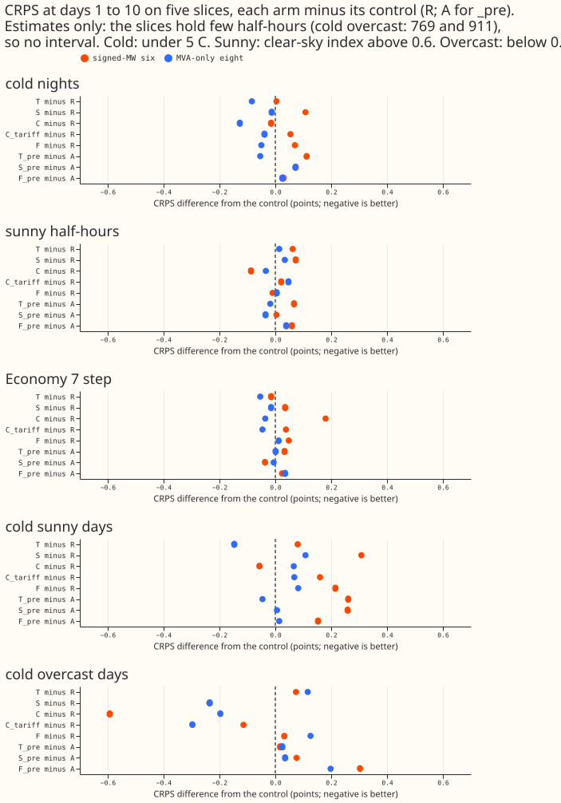
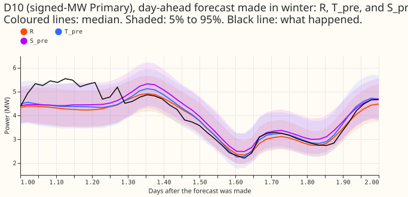
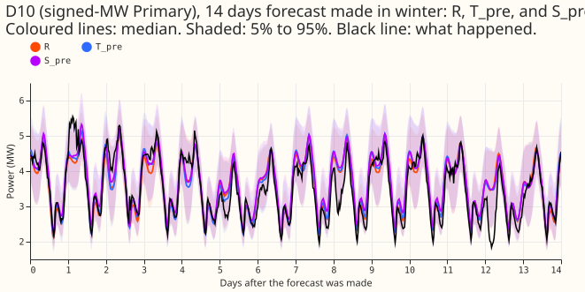
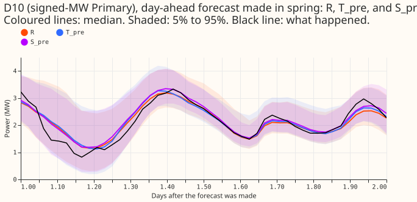
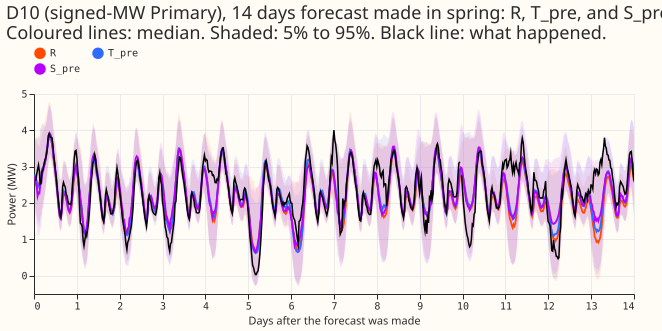

**This plan tests, on four folds, whether windows of weather and a few calendar and national
signals lower the error of the pooled neural network that experiments 397 to 425 built.** The
network predicts 11 quantiles of Primary substation demand from the ECMWF ensemble mean and spread
at one valid time. Experiment 419 gave it a centred daily mean of shortwave and found
-0.012 (-0.043 to +0.013), one sixth of its minimum detectable effect. Trailing and forward windows
of temperature and shortwave were never given to the neural network, although the maintainer asked
for them on 2026-10-31.

## Design

- **Reference.** `R` and `A` of [experiment 425](../00425-best-mdn-architecture-assembly-with-ablations/result.md):
  the pooled plain network with the 8-wide Primary embedding, 3 Gaussian components, setting `g09`,
  and the ensemble mean and spread inputs, trained on ensemble rows only (`R`) or pretrained on
  ERA5 and CAMS rows and fine-tuned at a learning rate of 2e-4 (`A`). Same rows, the D15 and D18
  start cut at 2025-03-01, the flagged exact-zero drop, held-out weeks, row weights, 1.15 widening,
  and monthly refits. The stored seeds 0 to 2 of both arms on the four screen folds are the controls.
  A check (`e00437_fit.py check`) proves that a fold built here without extra columns equals
  experiment 425's fold, bit for bit.
- **Arms.** Each arm appends columns to the 46 inputs and changes nothing else. Bundles:
    - **T, thermal lag (8 columns).** Trailing means of the ensemble-mean temperature over 3, 6, and
      24 hours; the temperature change over 3 and 6 hours; the minimum and maximum over the local
      day of the valid time; and the days since the trailing 24-hour mean last exceeded 5 degrees C,
      capped at 10.
    - **S, solar gain (6 columns).** Trailing means of the ensemble-mean shortwave over 3, 6, and 24
      hours; the 3-hour change in the clear-sky index (shortwave over Haurwitz clear-sky shortwave,
      held at its last daylight value overnight; the helper of experiment 396 arm W7); and the
      realised CAMS irradiance of the last complete UTC day before the origin (its mean in W/m2 and
      its ratio to CAMS clear-sky). CAMS publishes the previous day at midnight UTC, so production
      can read both.
    - **F, look-ahead (6 columns).** Forward means of ensemble-mean temperature and shortwave over
      the 6 and 24 hours after the valid time, taken from the same run only, and the share of each
      window the run covers (windows are truncated at the end of the 14-day horizon).
    - **C, calendar, tariff, and national signals (14 columns).** The Economy 7 step as a UTC
      half-hour indicator and that indicator times degrees below 15.5 C; five Lincolnshire
      school-term columns from experiment 11's calendar (term flag; signed days to the nearest term
      start and end; signed days from the year's first working day; a window flag); and seven
      signals of the local day before the origin: the mean, maximum, and 16:00 to 19:00 mean of the
      Elexon market index price, a Demand Flexibility Service flag, and the day's mean national
      demand, embedded solar, and embedded wind (NESO historic demand). All 16 Primaries lie at
      52.9 to 53.3 degrees N, 0.2 degrees W to 0.3 degrees E, inside the box that experiment 11 found
      to be Lincolnshire, so one county's calendar applies to every Primary.
- **Pretrained form.** T, S, and F are also run as `T_pre`, `S_pre`, and `F_pre`: pretrained on
  experiment 418's ERA5-and-CAMS pseudo-run rows with the same columns computed from the dense
  weather, then fine-tuned on ensemble rows at 2e-4. C has no pretraining form, because the
  pretraining rows carry no school or national columns. A pretrained network is fitted for each
  bundle, fold, and seed, and cannot be shared across folds: the pretraining rows end 3.5 hours
  before each fold's refit, so a network pretrained for a later fold has seen the earlier fold's
  test month.
- **Window construction.** A trailing window ends at the valid time. For half-hours at or before
  the forecast origin (09:00 UTC) the series holds the ensemble mean of the previous run that
  covers them (leads of about 9 to 33 hours); after the origin it holds this run's own ensemble
  mean. ERA5 is not used, because it arrives about 5 days late and a column built from it could not
  be served. `e00437_features.py check` rebuilds sample runs with every later run deleted and
  requires identical columns (the check script exists; its result goes in the results). In the
  pretrained form the windows come from the
  dense ERA5-and-CAMS series, which is the same stand-in the pretraining rows use for the
  valid-time weather.
- **Known mismatch in the pretrained form.** `check-pretraining` printed each column's standardised
  mean and spread in the pretraining rows and the ensemble rows for the 2026-01 fold. The weather
  windows agree to within 0.25 standard deviations in the mean and 0.07 in the spread, except
  `csi_change_3h`, whose spread is 2.6 in the pretraining rows against 0.9 in the ensemble rows. CAMS
  irradiance changes more over 3 hours than the mean of 51 ensemble members does, the same smoothing
  gap that affects the shortwave input itself. The write-up reports it as a caveat for `S_pre`.
- **Dismantling.** A bundle that advances is split into halves and refitted in the same form:
  `T_means`/`T_rest`, `S_means`/`S_rest`, `F_temperature`/`F_shortwave`, and for C
  `C_tariff`/`C_school`/`C_national`. A combination of the winning bundles (`T+S+F`, with or
  without `C`) is fitted once at least two bundles advance. These are descriptive.
- **Fits and compute.** 4 bundles by 4 folds by 3 seeds is 48 ensemble-only fits (about 75 seconds
  each including the forecast) and 36 pretrained fits (about 55 seconds of pretraining and 40 of
  fine-tuning each, plus a pretraining-row build of about 2 minutes per fold and bundle). That is
  about 1.0 plus 1.8 GPU-hours before dismantling, and up to 2 more GPU-hours for the halves and
  the combination. One GPU process under 8 GB, one feeder core, 8 GB of host memory, one BLAS
  thread.
- **Standing practices followed.** Monthly refits; cleaned data (flagged exact-zero half-hours
  dropped, counts printed per fold); the D15 and D18 cut at 2025-03-01; every fitted network saved
  under `work/models/`; stored controls reused; tails, the avoidable-curtailment cost, and the
  example forecasts reported; four-fold screen with every number labelled interim.

## Caveats registered before the fits

- **Window seam at the origin.** The ensemble-mean summaries hold no half-hour at or before the run's
  own origin, so half-hours between 00:00 and 09:00 on the origin day come from the previous run
  (leads of about 9 to 33 hours). Trailing windows therefore mix two runs at 09:00.
- **T is partly a look-ahead bundle.** The daily minimum and maximum temperature use the later hours
  of the valid time's local day, which the run already forecasts. F isolates pure look-ahead.
- **Publication latency of the previous-day signals.** The CAMS, Elexon price, and NESO demand
  columns use the whole local or UTC day before the origin date. The brief states that CAMS arrives
  at midnight UTC; the latency of the Elexon and NESO files at 09:00 UTC was not measured, and the
  training values are the final revised ones. The write-up states both as open points for serving.
- **Forward windows in the pretrained form** come from ERA5 and CAMS, which do not degrade with
  lead, while the ensemble-mean forward windows do. The write-up reports this as a caveat for `F_pre`.
- **Economy 7 is on the UTC clock, as the brief and experiments 121, 137, and 281 define it.** The
  protocol's `economy_7_step` slice is on local half-hours, so during British Summer Time the two
  differ by one hour. The write-up reports C on that slice and states the offset.
- **Bundle C has no pretrained form.** The brief asks for the weather bundles in both forms; the
  pretraining rows hold no school or national columns, so `C` runs ensemble-only.
- **No summer fold.** The four folds are autumn, Christmas, winter, and spring; 2026-06 is not
  included, so a solar-gain effect in summer cannot show.
- **Data searched for bundle C.** On disk and used: Lincolnshire County Council term dates
  (experiment 11, 2021-22 to 2025-26), Elexon market index prices (`p3-price-download`), NESO
  historic demand and embedded generation (experiment 185), and Demand Flexibility Service
  requirements (experiment 177). A school calendar for another county is not needed, because all 16
  Primaries lie in Lincolnshire. No download is made.
- **Reported beside CRPS:** the 12-to-36-hour band, tail calibration per group and per Primary, the
  cold winter night slice, the avoidable-curtailment cost, and the dropped half-hours per fold.
  Load-shift plots and load-shift row sets do not apply. Experiment 396 arm W7 has no result yet;
  the write-up cites it if it lands.
- **Process, in order.** Draft pull request; plan review (fresh Sonnet); code review (fresh Sonnet)
  before the first fit; fits; results review with the audit triggers; write-up; prose review.

## Results

**No bundle lowered the CRPS by the registered bar, so no dismantling or S1 confirmation is
planned.** The best arms lowered the CRPS at only one group, by less than 0.03 points, in 2 of 4
folds. The next step is to leave these bundles out of the pooled plain network and, if the question
returns, to test the thermal-lag bundle T on more folds.

### Contrasts

CRPS at days 1 to 10 in points of capacity, four monthly folds (2025-10, 2025-12, 2026-01,
2026-03), seeds 0 to 2. A positive difference means the arm is worse than its control. Intervals
are the descriptive month-block bootstrap at the 99.69% level, which with four blocks spans the fold
range; the decision rests on the fold counts.

| Arm (control) | Signed-MW six | MVA-only eight | Verdict |
|---|---|---|---|
| `T` (`R`) | +0.016 (-0.078 to +0.081) | -0.022 (-0.071 to +0.007) | 2 of 4 folds at the eight |
| `S` (`R`) | +0.043 (-0.037 to +0.136) | +0.002 (-0.069 to +0.099) | tail harm at q95 |
| `C` (`R`) | +0.059 (-0.054 to +0.163) | +0.038 (-0.057 to +0.170) | worse |
| `C_tariff` (`R`) | +0.047 (+0.005 to +0.165) | +0.021 (-0.041 to +0.045) | worse |
| `F` (`R`) | +0.042 (-0.002 to +0.086) | -0.000 (-0.047 to +0.049) | no change |
| `T_pre` (`A`) | +0.025 (-0.036 to +0.089) | -0.029 (-0.094 to +0.015) | 2 of 4 folds at the eight |
| `S_pre` (`A`) | -0.016 (-0.086 to +0.078) | +0.011 (-0.115 to +0.107) | below the bar |
| `F_pre` (`A`) | +0.026 (-0.041 to +0.084) | +0.020 (-0.002 to +0.036) | tail harm at q95 |

Controls: `R` scores 3.404 and `A` 3.341 at the six, 3.917 and 3.764 at the eight. The D15 and D18
group is report-only; every arm except `T_pre` (-0.176) is worse than its control there, by 0.14
to 0.66 points.

### Predictions

- **P1 (S helps most on cold sunny days) is not supported.** `S` was worse than `R` on cold sunny
  days (+0.308 at the six) and better on cold overcast days (-0.236), the opposite order.
- **P2 (T helps at both groups, most on cold winter nights) is not supported.** `T` was worse at
  the six (+0.016). Its small gain at the eight came from the 2025-12 fold (-0.071); 7 of 8
  Primaries improved.
- **P3 (F helps at the eight) is not supported.** `F` changed the CRPS at the eight by -0.000.
- **P4 (C helps on the Economy 7 step) is not supported.** `C` was worse on that slice at the six
  (2.985 against 2.805 for `R`).
- **P5 (pretrained form gains at least as much) is not supported.** The pretrained form did better
  than the ensemble-only form at one group and worse at the other, for each bundle: `S_pre` against
  `S` was 0.059 better at the six and 0.009 worse at the eight, and `F_pre` against `F` was 0.016
  better at the six and 0.020 worse at the eight. `T_pre` was 0.009 worse at the six and 0.007
  better at the eight.

### Checks

- Fold-by-fold differences, per-Primary CRPS, tails, and the cold-night, sunny, Economy 7, and cold
  sunny-versus-overcast slices are in the figures below; the slice intervals are not shown
  because few half-hours (769 and 911 on cold overcast days) make them unreliable.
- A fresh reviewer re-derived the pooled CRPS of `R`, `A`, `T`, and `S_pre` from the raw forecast
  files and matched the scorer to three decimals. The median-error and CRPS contrasts agree in sign
  in all 16 arm-and-group pairs. Leaving out any one Primary flips no verdict.
- The new columns are not degenerate: standardised spread near 1, used by the first layer, and the
  ensemble-only fold without extras equals experiment 425's bit for bit.
- `C_tariff` (2 columns) beat `C` (which contains them) by 0.012 at the six. Both are inside the
  noise.

### Caveats

- **The screen is too coarse to show "no effect".** The minimum detectable effect is 0.064 points
  against `R` and 0.045 against `A`, about twice the 0.03 bar, and fold-to-fold differences swing
  by more than the bar.
- **The four folds hold no summer month,** so the second example is spring and `S` cannot be judged
  in summer.
- **The hyperparameters were tuned at 46 inputs** and reused at 48 to 60. Extra inputs at fixed
  capacity may explain the worse scores of `C` and `S`, and a bundle might help with another setting.
- **The scorer does not compute P1 and P4 as single numbers,** and it pairs by fold, not by fold and
  seed. The slice contrasts above were read by hand.
- The pretraining mismatch for `csi_change_3h` registered above applies to `S_pre`.

### What to try next

- **Test bundle T on more folds,** since it is the only bundle that leans the right way at both
  control settings.

### Data used and where it lives

- **Data.** The cleaned NGED Primary-substation power series, ECMWF ensemble forecasts, ERA5 and
  CAMS estimates of past weather for the pretrained arms, and the on-disk school, price, and
  national-demand series for bundle C.
- **Code.** `ml-experiments/00437-neural-demand-thermal-lag-solar-gain-and-tariff-feature-bundles/`.
- **Saved networks and forecasts.** `$DATA_PATH_INTERNAL/ml-experiments/00437-neural-demand-thermal-lag-solar-gain-and-tariff-feature-bundles/work/`.
