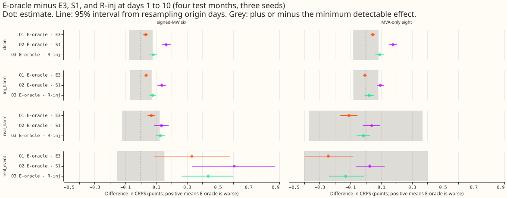
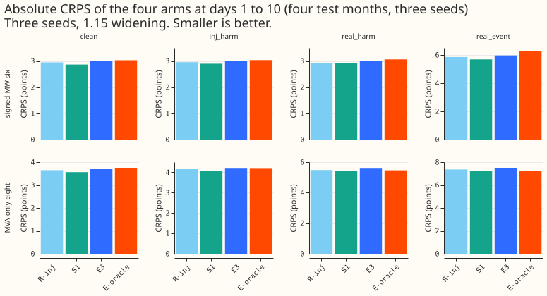
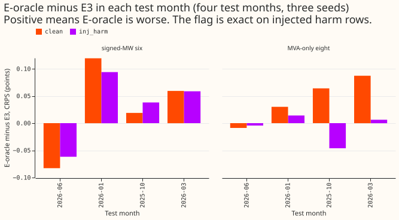
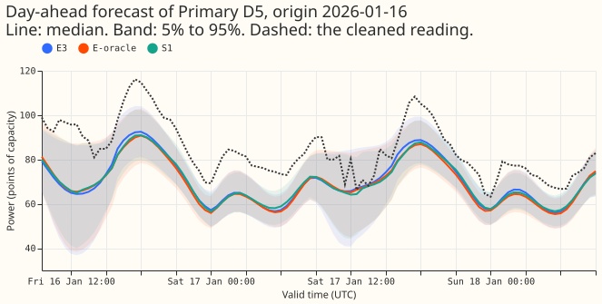
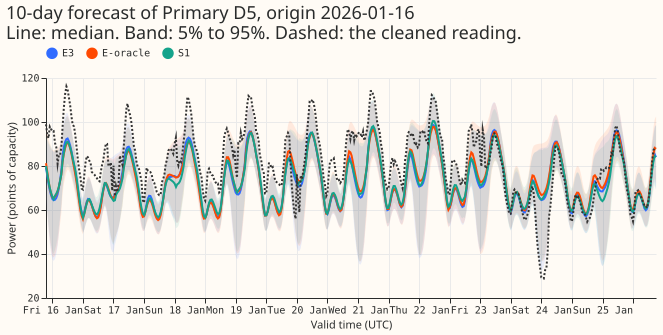
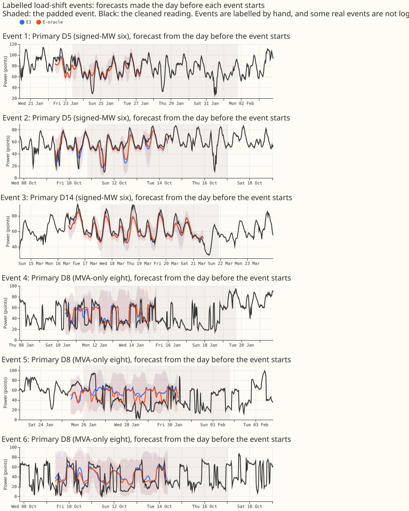

**Take-home message: the control failed, so this experiment cannot say whether detecting events is
the limit on trusting recent power.** We gave the three-day neural network (E3) a sixth input
channel
that marks exactly which half-hours of its three windows lie inside a load-shift event (E-oracle).
On injected harm rows the mark is exact, so E-oracle should have scored clearly better than E3.
E-oracle scored 0.035 CRPS points worse (3.033 against 2.998), against a pre-registered range of
-0.60 to -0.15. Under the plan's
decision rule, a result like this is a failed control and not a finding. The verdict is therefore
`inconclusive`. The audit found no wiring bug. The explanation we have not tested is that the neural
network already infers events from the power values, so the flag adds variance and no information.

**How to read the numbers.** CRPS is the continuous ranked probability score. Unless a column says
otherwise, each number is the CRPS in percentage points of effective capacity at days 1 to 10
(smaller is better) after the 1.15 widening of the bands. Every number comes from four test
months (2025-10, 2026-01, 2026-03, 2026-06), three fit seeds (0 to 2), and monthly refits. A fresh
reviewer re-derived the headline numbers from the stored forecasts, and they matched. A
contrast is the first arm minus the second, so a positive number means E-oracle scored worse. The
minimum detectable effect (MDE) is 1.96 x sqrt(2) x s / sqrt(3), where s is R-inj's seed-to-seed
standard deviation on the row set. Intervals are 95% intervals from resampling months and days. The
signed-MW six are the Primary substations metered in signed megawatts (MW), and the MVA-only eight
are metered in unsigned megavolt-amperes (MVA) only. E3, S1, and R-inj are the arms of experiment
428: E3 is the three-day neural network without the flag, S1 is the three lags plus their surprise,
and R-inj is the three lags trained on injected events. NGED is National Grid Electricity
Distribution, the distribution network operator.

A row is a clean row when its recent power lies outside every logged load-shift event. A real event
row is one whose time being forecast lies inside a logged event. A real harm row is one whose time
being forecast lies outside every logged event but whose recent power lies inside one. An injected
harm row is the same as a real harm row, with simulated events added to clean power. The real events
are the corrected label table's events, each padded by 48 half-hours (24 hours) before the onset and
after the end, as in experiment 402 and experiment 428. The table holds 170 padded events across the
experiment's Primaries, and 33 of them have target rows in the four test months (56,214 target rows,
before the split into the two metering groups). The largest event supplies 6,640 of those rows,
which is why the real-event contrasts are also given without it.

**The pre-registered rule says this is a failed control.** At the signed-MW six, E-oracle minus E3
on
injected harm rows is +0.035 (0.021 to 0.049). The plan counted the result as a failed control if
that contrast was above minus the MDE (the MDE there is 0.071), and +0.035 is above it. Of the five
pre-registered predictions, only P2 held (clean rows within plus or minus 0.05: +0.032). P1 failed
(+0.035, predicted -0.60 to -0.15). P3 failed (E-oracle minus S1 on real event rows is +0.607,
predicted -0.40 to 0.00). P4 failed (E-oracle minus E3 on real harm rows is +0.068, predicted -0.20
to 0.00). P5 failed (the MVA-only eight do not show the same signs, see below).

Table 1 gives the three contrasts at the signed-MW six, with the MDE and the absolute CRPS of
E-oracle and E3. O1 is E-oracle minus E3, O2 is
E-oracle minus S1, and O3 is E-oracle minus R-inj.

| Row set | Rows | E-oracle / E3 CRPS | O1 E-oracle - E3 | O2 E-oracle - S1 | O3 E-oracle - R-inj | MDE |
|---|---|---|---|---|---|---|
| Clean | 254,725 | 3.029 / 2.997 | +0.032 (+0.016 to +0.048) | +0.165 (+0.135 to +0.196) | +0.082 (+0.057 to +0.107) | 0.077 |
| Injected harm | 432,081 | 3.033 / 2.998 | +0.035 (+0.021 to +0.049) | +0.137 (+0.108 to +0.166) | +0.077 (+0.056 to +0.098) | 0.071 |
| Real harm | 40,643 | 3.062 / 2.994 | +0.068 (+0.044 to +0.093) | +0.135 (+0.087 to +0.182) | +0.127 (+0.097 to +0.157) | 0.123 |
| Real event | 31,898 | 6.295 / 5.964 | +0.331 (+0.086 to +0.578) | +0.607 (+0.331 to +0.873) | +0.438 (+0.266 to +0.598) | 0.153 |
| Real event, without the largest event | 25,258 | 5.553 / 5.311 | +0.242 (+0.112 to +0.387) | +0.638 (+0.375 to +0.936) | +0.388 (+0.245 to +0.537) | 0.329 |

**Absolute scores show the same order on every row set at the signed-MW six.** Table 2 gives the
CRPS
of each arm.

| Row set | E-oracle | E3 | R-inj | S1 |
|---|---|---|---|---|
| Clean | 3.029 | 2.997 | 2.947 | 2.865 |
| Injected harm | 3.033 | 2.998 | 2.956 | 2.897 |
| Real harm | 3.062 | 2.994 | 2.935 | 2.928 |
| Real event | 6.295 | 5.964 | 5.857 | 5.687 |

At the signed-MW six, E-oracle is the worst of the four arms on all four row sets, and S1 is the
best. The flag therefore
did not turn the three-day neural network into a better forecaster than the arms that see three
lagged
readings. Because the control failed, the reading rule for O2 is not applied: O2 on real event rows
(+0.607) is above the MDE, which the rule would read as "the limit is downstream of detection", but
that reading needs a working control.

**At the signed-MW six, E-oracle minus E3 is positive in three of the four test months.** On clean
rows O1 is positive in 3 of 4
test months (-0.083 in 2026-06, +0.019 in 2025-10, +0.119 in 2026-01, +0.059 in 2026-03). On
injected harm rows it is positive in 3 of 4 (-0.062, +0.038, +0.094, +0.059, in the same order).

## The MVA-only eight

**At the MVA-only eight, E-oracle beat E3 on real event rows and real harm rows. This is one
observation at one group.** Table 3 gives the same contrasts.

| Row set | Rows | E-oracle / E3 CRPS | O1 E-oracle - E3 | O2 E-oracle - S1 | O3 E-oracle - R-inj | MDE |
|---|---|---|---|---|---|---|
| Clean | 389,812 | 3.739 / 3.694 | +0.045 (+0.031 to +0.059) | +0.177 (+0.149 to +0.204) | +0.090 (+0.061 to +0.120) | 0.082 |
| Injected harm | 663,901 | 4.175 / 4.181 | -0.006 (-0.020 to +0.008) | +0.094 (+0.072 to +0.117) | +0.022 (-0.008 to +0.052) | 0.081 |
| Real harm | 35,235 | 5.465 / 5.575 | -0.110 (-0.166 to -0.054) | +0.038 (-0.020 to +0.092) | -0.016 (-0.059 to +0.028) | 0.368 |
| Real event | 18,810 | 7.232 / 7.476 | -0.244 (-0.397 to -0.082) | +0.026 (-0.066 to +0.122) | -0.131 (-0.241 to -0.013) | 0.401 |

The flag lowered the error on real event rows (O1 -0.244, CRPS 7.232 against 7.476) and real harm
rows (O1 -0.110, 5.465 against 5.575), and did not change it on injected harm rows (-0.006, 4.175
against 4.181, interval from -0.020 to +0.008). Both gains are smaller
than the MDE of their row sets (0.401 and 0.368). Against S1, E-oracle is no better on real event
rows (+0.026, interval from -0.066 to +0.122; CRPS 7.232 against 7.207). In the 2026-01 and 2026-03
test months O1 on real
event rows is -0.466 and -0.378, and it is +0.102 in 2025-10 (2026-06 has no real event rows for
this group). We report this as a single-group observation, from three of four test months, with no
tested cause.

## Checks

- **Wiring audit.** A fresh Sonnet sub-agent re-derived the headline numbers from the stored
  forecasts, which matched, and read the code. It found no wiring bug. The flag is `(code != 0) |
  real-event mask`, gathered at the same window
  positions as the power values, multiplied by the observed channel, and appended as channel 5. The
  fit and the prediction both build the neural network with one more channel.
- **Untested explanation.** This explanation is untested. The encoder may already infer events from
  the power values, and the
  training loss gives no reason to read the flag. An extra input would then add variance.
- **Triggers fired:** the control failed (see above). No nested arm beats its container.

## Setup and caveats

- **Arms and rows.** E-oracle is experiment 428's E3 with the sixth channel, fitted with experiment
  428's training recipe: injected worlds 1 to 3 mixed with the clean series, cleaned data with the
  D15 and D18 start cut, and monthly refits on the 24 months before each test month. It is scored on
  the held-out injected worlds 4 to 6 and the real series. E3, S1, and R-inj are experiment 428's
  stored forecasts, scored on identical rows (the scoring script asserts this).
- **Fits saved.** The 12 neural networks (4 test months x 3 seeds) and their forecasts are in this
  experiment's private data folder, never in git.
- **Seeds and folds.** Three seeds and four test months. The MDE comes from R-inj's seed-to-seed
  spread on three seeds (`mde.parquet`), and the real-event row sets are few and dominated by one
  event, so their intervals are wide.
- **Unlogged events.** NGED says some load-shift events are
  missing from its logs. Clean rows can therefore hold events no label covers, the flag is zero for
  those events, and the real-event rows may undercount events. The padded real-event mask is also
  hindsight: it covers each logged event with the padding above, which no live detector could know.
- **Exact flag on injected worlds only.** The flag is exact only on injected worlds. On the real
  series it is the padded label table.
- **Group D15 and D18.** The contrasts for D15 and D18 are in `contrasts.parquet`; they are
  report-only and are not discussed here.

## What to try next

- The failed control means a flag-as-input neural network is not yet a test of detection. A repeat
  could
  first find why E-oracle does not beat E3 on injected harm rows, for example by checking whether
  the fitted weights on channel 5 are near zero, or by training with the flag as a gate on the
  lagged power values.
- The MVA-only eight observation could be re-checked on a different set of seeds before it is
  trusted.

## Problems from the move to nged-ml-research

None.

## Plan, as registered before any fit

*The plan below is kept as written.*

## Question

CRPS is the continuous ranked probability score. The signed-MW six and the MVA-only eight are the
two
groups of Primary substations by metering.

**This control asks whether the limit on trusting recent power is detection.** Experiments 404 and
428 never gave the neural network an event label, so a failure to follow fewer event steps might
mean the
neural network cannot find events or might mean that, even told where the events are, it cannot use
the
information. E-oracle tells it exactly. The idea is the maintainer's (2026-10-31). The oracle
follows
the flag-oracle controls of experiment 402, which set XGBoost mixture weights from event flags.

## Design

- **Network.** Experiment 428's E3 (three windows of 48 half-hours, a convolution, one attention
  head,
  the unchanged mixture head), with a sixth channel on every window position: 1 where the half-hour
  is inside an event, else 0, and 0 where the half-hour is unobserved.
- **Flag.** On the clean series, a half-hour of the padded real-event mask of the corrected label
  table. On an injected world, a half-hour with a non-zero injected-event code (donor, recipient, or
  spike), or inside the padded real-event mask. The flag is exact on injected worlds. The padded
  real-event mask is hindsight: it covers each logged event with the padding of experiment 428, so
  the real-event result carries the unlogged-event caveat (NGED may have events missing from its
  logs).
- **Training and rows.** Experiment 428's: injected worlds 1 to 3 mixed with the clean series,
  cleaned data with the D15 and D18 start cut, monthly refits on the 24 months before the test
  month,
  scored on the held-out injected worlds 4 to 6 and the real series. The 1.15 widening is applied
  at scoring, as in 428.
- **Compute.** Twelve fits (4 folds, 3 seeds), about 15 GPU-minutes each (a one-epoch timing took 27
  s
  including start-up), so about 3 GPU-hours, one process under 8 GB. E3, S1, and R-inj are not
  refitted: their stored forecasts are read.
- **Reported.** The real event count and definition, the absolute score of each arm beside the
  contrasts, tails, and the plots of example forecasts and of six labelled real events.
