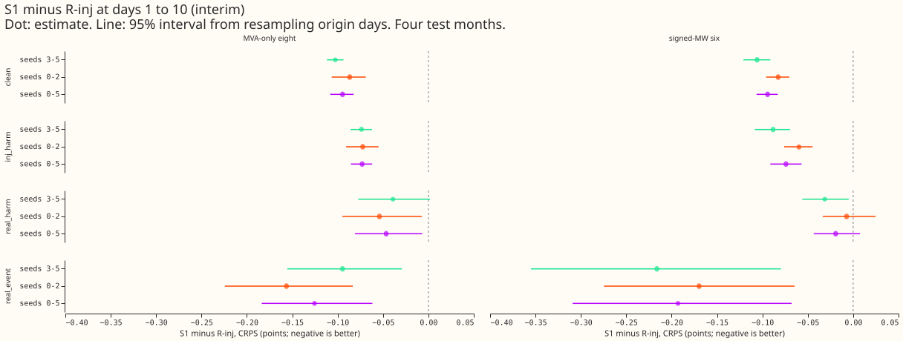
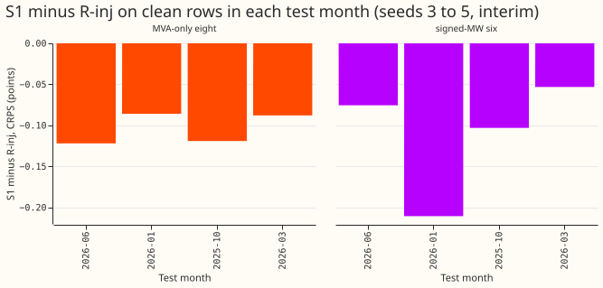
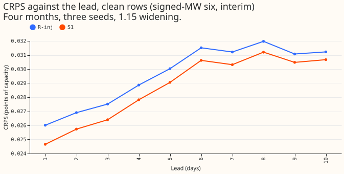
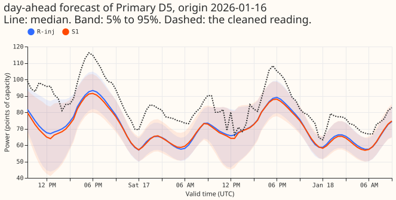
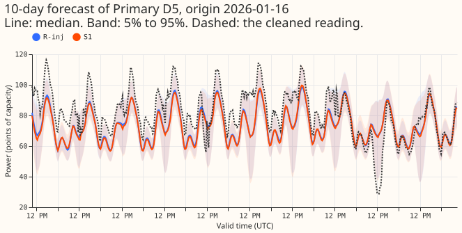
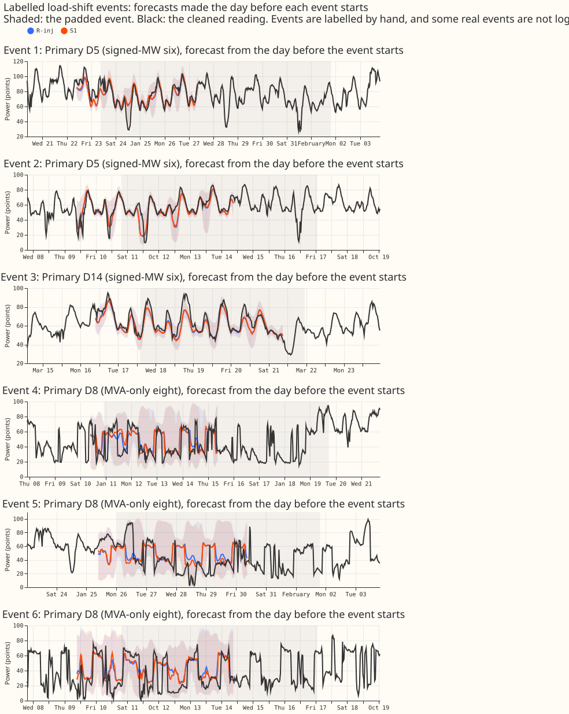

**Take-home message: adding the surprise to the three lagged power readings still lowered the
forecast error on three new fit seeds, by about as much as on the first three seeds, so S1 meets the
pre-registered rule and is the base for later neural lag experiments, pending the maintainer's
decision on the serving-path requirement.**

Experiment 428 found that a neural network given three lagged power readings plus the surprise at
each reading (S1) beat the same network without the surprise (R-inj) by 0.083 continuous ranked
probability score (CRPS) points on clean rows. That margin was only slightly larger than the
spread between fit seeds. We refitted both networks with three new seeds (24 fits, where one fit is
one network for one arm, test month, and seed) and scored them on the same rows. S1 again scored
lower than R-inj in all four test months on clean rows at the six Primary substations metered in
signed megawatts, though the gain is uneven (-0.210 in 2026-01, -0.053 in 2026-03).

The lagless forecast is a forecast that sees no lagged power. The surprise at a lag is the
difference between the lagged reading and the lagless forecast, divided by half the width of the
lagless forecast's 5% to 95% band.

**How to read the numbers.** Unless a column says otherwise, each number is the CRPS in percentage
points of effective capacity at days 1 to 10 (smaller is better) after the 1.15 widening of the
bands. Every number is interim, from four test months (2025-10, 2026-01, 2026-03, 2026-06). A
contrast is S1 minus R-inj, so a negative number favours S1. The minimum detectable effect (MDE) is
1.96 x sqrt(2) x s / sqrt(n), where s is R-inj's seed-to-seed standard deviation and n is the number
of seeds. A row is a clean row when its recent power lies outside every logged load-shift event. A
row is a real harm row when the time being forecast lies outside every logged event but its recent
power lies inside one, and a real event row when the time being forecast lies inside one. Injected
harm rows are the same as real harm rows, with simulated events added to clean power. The signed-MW
six are the Primaries metered in signed megawatts, and the MVA-only eight are metered in unsigned
megavolt-amperes. A row is one forecast of one Primary, issued at one time, for one valid time.

**The pre-registered rule is met on seeds 3 to 5.** At the signed-MW six, S1 minus R-inj on clean
rows is -0.106 (95% interval -0.121 to -0.091), below minus the MDE of 0.061, and all four test
months are negative. At the MVA-only eight, S1 minus R-inj on clean rows is -0.103 (-0.112 to
-0.094), with an MDE of 0.087. Pooled over seeds 0 to 5, the signed-MW six give -0.094 (-0.106 to
-0.083), with an MDE of 0.066.

**S1 lowered the error clearly on injected harm rows, and by less than the MDE on real event rows
and real harm rows.** Table 1 shows the contrasts at the signed-MW six.

| Row set | Seeds 3-5 | Seeds 0-5 | MDE (seeds 3-5) | Test months negative (seeds 3-5) |
|---|---|---|---|---|
| Clean | -0.106 (-0.121 to -0.091) | -0.094 (-0.106 to -0.083) | 0.061 | 4 of 4 |
| Injected harm | -0.088 (-0.108 to -0.069) | -0.074 (-0.091 to -0.057) | 0.071 | 4 of 4 |
| Real event | -0.216 (-0.355 to -0.079) | -0.193 (-0.309 to -0.068) | 0.246 | 3 of 4 |
| Real harm | -0.031 (-0.056 to -0.005) | -0.019 (-0.043 to +0.008) | 0.102 | 2 of 4 |

There are 31,898 real event rows and 40,643 real harm rows at the signed-MW six. At the MVA-only
eight the real harm contrast is -0.039 (-0.077 to +0.002), with an MDE of 0.262.

**Absolute scores (seeds 3 to 5, signed-MW six, CRPS points).** On clean rows R-inj scores 2.972 and
S1 2.866. On injected harm rows they score 2.987 and 2.899, on real event rows 5.921 and 5.705, and
on real harm rows 2.944 and 2.912.

## Tails

**S1's tails are better on clean rows and real event rows, and slightly worse on real harm rows.**
Table 2 gives the pinball loss (points) and coverage at q95 and q99 (the 95th and 99th percentile
forecasts) at the signed-MW six, seeds 3 to 5.

| Row set | Arm | q95 pinball | q99 pinball | q95 coverage | q99 coverage |
|---|---|---|---|---|---|
| Clean | R-inj | 0.751 | 0.202 | 0.909 | 0.978 |
| Clean | S1 | 0.703 | 0.185 | 0.920 | 0.985 |
| Real event | R-inj | 2.443 | 1.314 | 0.793 | 0.847 |
| Real event | S1 | 2.157 | 0.895 | 0.793 | 0.868 |
| Real harm | R-inj | 0.854 | 0.256 | 0.927 | 0.975 |
| Real harm | S1 | 0.871 | 0.282 | 0.927 | 0.972 |

On real harm rows S1's q99 pinball loss is 0.026 points higher than R-inj's, above the 0.02 maximum
increase that the research programme allows. S1's q95 pinball loss on real harm rows is also higher
(0.871 against 0.854). On real event rows S1's q05 pinball loss is higher (1.228 against 1.191). At
the MVA-only eight, S1's q99 pinball loss on real harm rows is lower (0.349 against 0.368).

## Checks

- **Median minus mean forecast, per Primary (clean rows, pooled seeds).** The stored forecasts hold
  11 quantiles and no mean, so the mean is the average of the 11 quantiles (a proxy). The difference
  ranges from -6.4 points (D15) to +0.06 (D22). The difference is nearly identical for S1 and R-inj
  at every Primary (for example D15 -6.44 and -6.20), so the median-minus-mean difference does not
  explain the contrast.
- **Error of the median forecast.** The mean absolute error of q50 on clean rows is lower for S1 in
  every group: 5.092 against 5.270 (signed-MW six), 6.320 against 6.489 (MVA-only eight), and
  16.116 against 16.820 (D15 and D18). The sign agrees with the CRPS contrast.
- **Triggers fired:** none. No control exists here, the result agrees with its prediction and with
  experiment 428, no nested arm beats its container, and the interval widths match 428's.

## Setup and caveats

- **Arms and rows.** S1 and R-inj of experiment 428, refitted with experiment 428's code on seeds 3,
  4, and 5 (4 months x 3 seeds x 2 arms = 24 fits), monthly refits on the 24 months before each test
  month, cleaned data, the D15 and D18 start cut at 2025-03-01, and the simulated load-shift events
  that experiment 428 added to clean power. Seeds 0 to 2 are experiment 428's stored forecasts. Each
  seed has its own cross-fitted lagless table. The tables for seeds 3 to 5 were built with experiment
  404's frozen code (15 tables: 5 months x 3 seeds), and the tables for seeds 0 to 2 are untouched.
- **Fits saved.** Networks and forecasts are in this experiment's private data folder, never in git.
- **Experiment 404 harness.** The arm needs only the lagless table and the three lags, so it could
  also run in experiment 404's harness.
- **Row identity.** The scoring script asserts that S1 and R-inj are scored on identical rows.
- **Unlogged events.** NGED (the distribution network operator) says some load-shift events are
  missing from its logs. Clean rows can therefore hold events no label covers. The real-event rows
  may undercount events, and the clean-row and harm-row figures may understate the effect of events.
- **Forecast horizon.** The stored forecasts reach 10 days (240 hours), so the long example covers
  10 days.
- **Serving-path requirement.** S1 needs a lagless forecasting model in the serving path. The
  maintainer must accept that requirement before a release. R-inj is the fallback that needs no
  lagless forecast.
- **Schedule.** Monthly refits, the research default. A weekly-refit re-check has not been run.

## What to try next

- Later neural lag experiments (recent history, window statistics, untrusted inputs) could use S1 as
  the base network.
- Those experiments could report the q99 pinball loss on real harm rows.

## Problems from the move to nged-ml-research

None.

## Plan, as registered before any fit

*The plan below is kept as written.*

## Question

CRPS is the continuous ranked probability score. The signed-MW six and the MVA-only eight are the two
groups of Primary substations by metering.

**This experiment checks a result that cleared its minimum detectable effect by 0.006.** Experiment
428 found S1 lowered CRPS against R-inj by 0.083 on clean rows (minimum detectable effect 0.077),
and one of four folds did not clear the minimum. New fit seeds are the cheapest independent check.

## Design

- **Arms.** S1 and R-inj of experiment 428, fitted with its code unchanged on seeds 3, 4, and 5
  (4 folds, so 24 fits, about 6 GPU-hours, one process under 8 GB).
- **Lagless tables.** S1's surprise reads experiment 404's cross-fitted lagless forecast (K = 6
  blocks). Experiment 404 froze tables for seeds 0 to 2 only, so tables for seeds 3 to 5 are built
  with the same frozen code (15 builds of about 1 minute each) so each fit seed has its own table.
- **Other.** Cleaned data, D15 and D18 start cut, injected worlds, and scoring rows as in 428. The
  frozen tables for seeds 0 to 2 are untouched; experiment 428's stored forecasts supply seeds 0 to 2.
- **Reported.** Absolute CRPS beside each contrast, the minimum detectable effect, per-fold and
  per-seed contrasts, the pooled contrast over seeds 0 to 5, tails, example forecasts, and whether
  the arm can run in experiment 404's harness.
