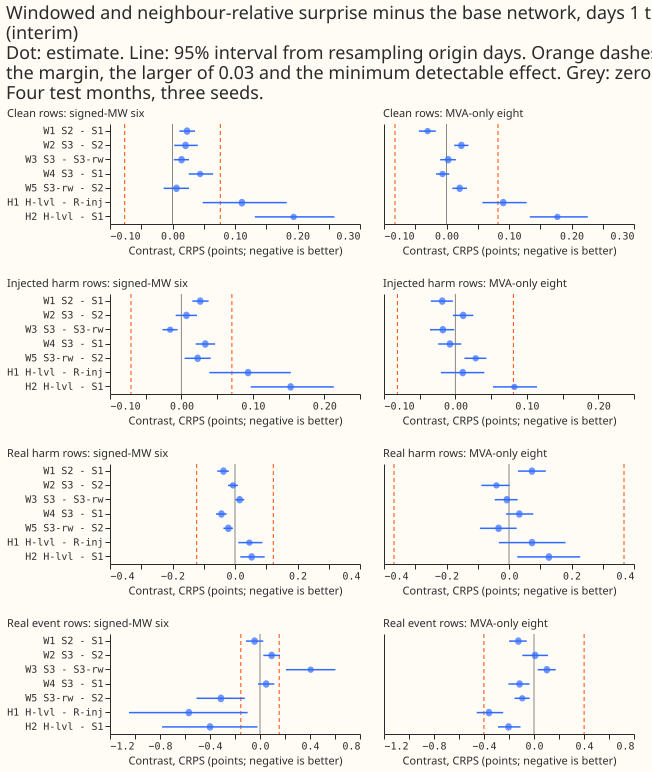
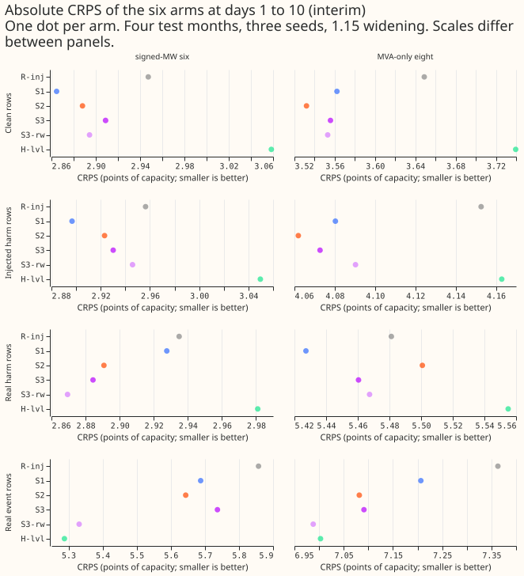
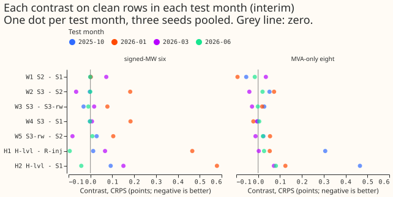
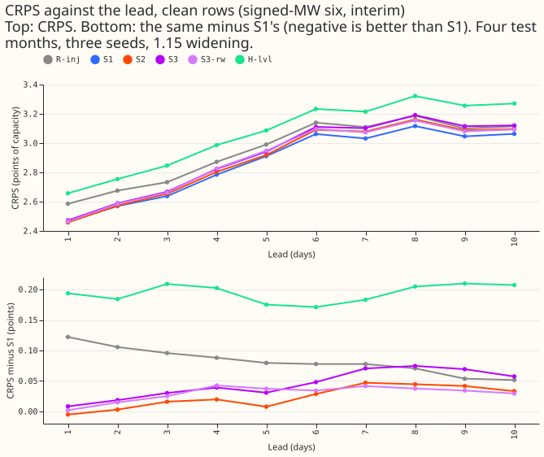
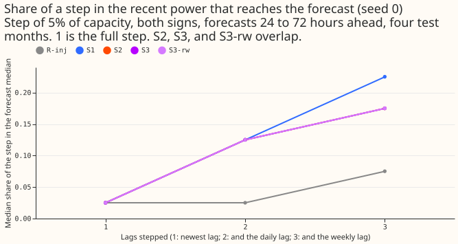
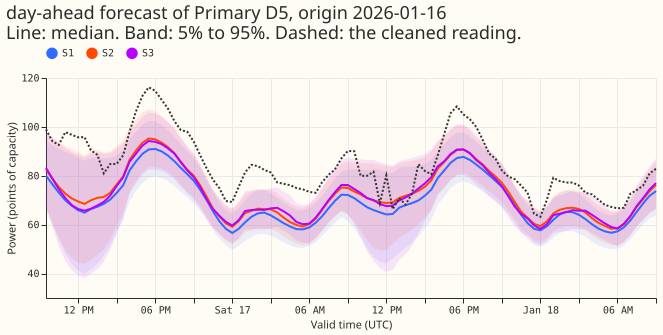
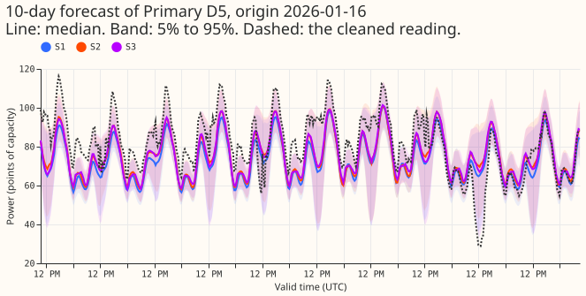
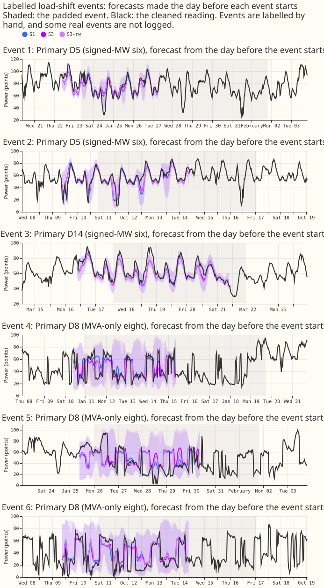

**Take-home message: giving the lag network more ways to read the surprise did not lower the
forecast error, so the network given the surprise at its three lagged readings alone (S1) stays the
base for later lag experiments.** The window statistics (S2) and the neighbour columns (S3) scored
slightly worse than S1 on ordinary rows, and neighbours chosen at random scored about as well as the
real neighbours. The limit on trusting recent power therefore does not lie in how the surprise is
summarised.

**We tested whether a lag network forecasts better when it is told more about how unusual each
reading is.** A lag network is a neural network that forecasts a substation's power from three
earlier readings of that power. The surprise at a reading is the reading minus a forecast made
without any lagged power, divided by half the width of that forecast's 5% to 95% band. Experiment
[428](../00428-day-window-convolution-attention-encoder-replacing-lagged-power-inputs/result.md)
gave the network the surprise at each reading (S1), and experiment
[439](../00439-surprise-at-the-lags-confirmation-on-seeds-three-to-five/result.md) confirmed that S1
beats the same network without the surprise (R-inj). Here S2 adds the average, spread, and extremes
of the surprise in a 12-hour window around each reading, and S3 adds the same figures for the
neighbouring Primary substations, because a load-shift event that moves load between neighbours
shows an opposite shift next door and a genuine level shift does not. The window statistics come
from experiment 404's module, copied with credit. We fitted 36 neural networks (3 arms, 4 test
months, 3 fit seeds), added a control with randomly chosen neighbours (S3-rw), and scored all of
them on experiment 428's rows. None of the arms beat S1 by the margin we set before any fit, so the
verdict is `not supported`.

**One arm, H-lvl, joined the experiment after the 36 window-arm fits.** H-lvl is S1 plus a learned
level offset per forecast origin. We added H-lvl after those fits and before we read any H-lvl score.
The sweep covers seed 0 only. A fresh reviewer re-derived the window-arm numbers from the stored
forecasts; the H-lvl numbers have not been audited separately.

**Every number is interim, and its unit is CRPS points of effective capacity.** CRPS is the
continuous ranked probability score. Unless a column says otherwise, each number is the CRPS in
percentage points of effective capacity at days 1 to 10 (smaller is better) after the 1.15 widening
of the bands. All numbers are from four test months (2025-10, 2026-01, 2026-03, 2026-06) and three
fit seeds (0 to 2). H1 is H-lvl minus R-inj and H2 is H-lvl minus S1. A contrast is the first arm
minus the second, so a negative number favours the first arm. Intervals are 95% intervals from
resampling (test month, origin day) blocks. The minimum detectable effect (MDE) is 1.96 × sqrt(2) ×
s / sqrt(3), where s is R-inj's seed-to-seed standard deviation. The pre-registered margin for a
gain is the larger of 0.03 and the MDE of the row set. The signed-MW six are the Primaries metered
in signed megawatts, and the MVA-only eight are metered in unsigned megavolt-amperes. A clean row is
a forecast whose recent power lies outside every logged load-shift event. A real event row is one
whose target time lies inside a logged event, and a real harm row is one whose target time lies
outside every logged event but whose recent power lies inside one. An injected harm row is a real
harm row with simulated events added to clean power. A row is one forecast of one Primary, issued at
one time, for one valid time.

**No contrast shows S2 or S3 beating S1 by the pre-registered margin, so neither advances.** Table 1
gives the contrasts at the signed-MW six. The margin is 0.077 on clean rows, 0.071 on injected harm
rows, 0.123 on real harm rows, and 0.153 on real event rows. Four contrasts on real event rows
exceed their margin: W3 (+0.406, which favours the control), W5 (-0.313, which favours S3-rw over
S2), H1 (-0.569), and H2 (-0.400). W5 numerically meets the gain rule, because -0.313 is below minus
0.153 and its interval excludes zero. W5 comes almost entirely from one test month, however: W5 on
real event rows is -0.504 in 2026-01 against -0.050, -0.017, and +0.032 in the other three months.
For the related contrast of S3-rw with S3 (W3), the audit found that 41 of 93 event-days favour
S3-rw and that 91% of the gain comes from 2026-01 and from a single Primary (see Checks). None of
the four decides whether S2 or S3 advances: W3
and W5 involve the control with random neighbours, and H1 and H2 involve H-lvl. The attention
version of S3 did not run, because its condition (W2 a gain on clean or injected harm rows) failed.

| Contrast | Clean | Injected harm | Real harm | Real event |
|---|---|---|---|---|
| W1 S2 - S1 | +0.023 (0.011 to 0.036) | +0.026 (0.015 to 0.038) | -0.037 (-0.057 to -0.020) | -0.044 (-0.112 to +0.026) |
| W2 S3 - S2 | +0.021 (0.003 to 0.040) | +0.007 (-0.008 to +0.022) | -0.006 (-0.022 to +0.010) | +0.093 (0.027 to 0.159) |
| W3 S3 - S3-rw | +0.015 (0.002 to 0.027) | -0.016 (-0.027 to -0.005) | +0.015 (0.001 to 0.030) | +0.406 (0.207 to 0.603) |
| W4 S3 - S1 | +0.044 (0.026 to 0.065) | +0.033 (0.020 to 0.047) | -0.043 (-0.061 to -0.027) | +0.049 (-0.015 to +0.114) |
| W5 S3-rw - S2 | +0.006 (-0.014 to +0.026) | +0.023 (0.004 to 0.041) | -0.021 (-0.037 to -0.007) | -0.313 (-0.508 to -0.121) |
| H1 H-lvl - R-inj | +0.111 (0.048 to 0.183) | +0.093 (0.039 to 0.153) | +0.046 (0.011 to 0.088) | -0.569 (-1.048 to -0.099) |
| H2 H-lvl - S1 | +0.194 (0.132 to 0.259) | +0.153 (0.097 to 0.213) | +0.053 (0.017 to 0.095) | -0.400 (-0.783 to -0.020) |

Table 1: contrasts in CRPS points at the signed-MW six. There are 254,725 clean rows, 432,081
injected harm rows, 40,643 real harm rows, and 31,898 real event rows.

**S2 and S3 raised the error on clean rows and injected harm rows, and lowered it on real harm rows
by less than the margin.** On real harm rows S2 beat S1 by 0.037 (interval excludes zero), a
difference under a third of the 0.123 margin. The lower error on real harm rows does not offset the
higher error on clean rows, which number about six times as many as the real harm rows. The gap
between S3 and S2 is small (W2 on clean rows +0.021). The control with random neighbours scored
within 0.02 points of S3 on every row set except real event rows, where it scored better (W3
+0.406).

**Absolute scores (signed-MW six).** Table 2 gives the CRPS of each arm, which shows that S1 is the
lowest on clean rows and injected harm rows, and that the differences between the five lag arms are
under 0.1 points on every row set except real events.

| Arm | Clean | Injected harm | Real harm | Real event |
|---|---|---|---|---|
| R-inj | 2.947 | 2.956 | 2.935 | 5.857 |
| S1 | 2.865 | 2.897 | 2.928 | 5.687 |
| S2 | 2.888 | 2.923 | 2.891 | 5.644 |
| S3 | 2.909 | 2.930 | 2.884 | 5.737 |
| S3-rw | 2.894 | 2.946 | 2.869 | 5.331 |
| H-lvl | 3.058 | 3.050 | 2.981 | 5.288 |

Table 2: CRPS in points at the signed-MW six.

**The MVA-only eight show S2 lower than S1 on clean rows, and the gain is smaller than the margin.**
At the MVA-only eight, W1 is -0.030 (-0.044 to -0.017) on clean rows, against an MDE of 0.082, and
-0.125 (-0.199 to -0.058) on real event rows, against an MDE of 0.401. On real harm rows W1 is
+0.074 (0.029 to 0.118). W4 (S3 minus S1) is -0.006 (-0.017 to +0.004) on clean rows. H1 is +0.091
(0.057 to 0.128) on clean rows and -0.360 (-0.459 to -0.246) on real event rows. D15 and D18 are
report-only, with MDEs above 1 point on every row set but real harm rows: W1 is -0.181 (-0.260 to
-0.095) on clean rows and +0.848 (0.643 to 1.044) on real event rows.

**The differences between arms on clean rows come from one or two test months.** Table 3 gives each
contrast on clean rows in each test month at the signed-MW six.

| Contrast | 2025-10 | 2026-01 | 2026-03 | 2026-06 |
|---|---|---|---|---|
| W1 S2 - S1 | +0.000 | +0.002 | +0.072 | -0.001 |
| W2 S3 - S2 | -0.003 | +0.182 | -0.065 | -0.001 |
| W3 S3 - S3-rw | -0.031 | +0.078 | +0.017 | -0.010 |
| W4 S3 - S1 | -0.003 | +0.183 | +0.007 | -0.002 |
| W5 S3-rw - S2 | +0.028 | +0.104 | -0.082 | +0.009 |
| H1 H-lvl - R-inj | +0.013 | +0.466 | +0.067 | -0.095 |
| H2 H-lvl - S1 | +0.093 | +0.579 | +0.151 | -0.042 |

Table 3: contrasts on clean rows in each test month at the signed-MW six, in CRPS points.

**S1 has the lowest CRPS at every lead day except the first.** On day 1, S2 scores 2.458 against
2.463 for S1, and from day 2 to day 10 S1 is lowest. The gaps between S1, S2, S3, and S3-rw are
below 0.08 points at every lead day, and H-lvl scores 0.17 to 0.21 points above S1 at every lead
day.

## Tails

**S3 raised the q99 pinball loss on real event rows by 0.174 points over S1, above the 0.02 maximum
increase that the research programme allows.** Table 4 gives the pinball loss at the 95th and 99th
percentile forecasts (q95 and q99) at the signed-MW six. S2 lowered the q99 loss on real event rows
(1.047 against 1.127 for S1) and added no tail harm on any row set.

| Row set | Arm | q95 pinball | q99 pinball |
|---|---|---|---|
| Clean | R-inj | 0.726 | 0.195 |
| Clean | S1 | 0.717 | 0.191 |
| Clean | S2 | 0.714 | 0.191 |
| Clean | S3 | 0.733 | 0.204 |
| Clean | S3-rw | 0.713 | 0.191 |
| Clean | H-lvl | 0.740 | 0.195 |
| Real event | R-inj | 2.472 | 1.323 |
| Real event | S1 | 2.271 | 1.127 |
| Real event | S2 | 2.256 | 1.047 |
| Real event | S3 | 2.423 | 1.301 |
| Real event | S3-rw | 1.909 | 0.775 |
| Real event | H-lvl | 1.830 | 0.737 |
| Real harm | R-inj | 0.852 | 0.254 |
| Real harm | S1 | 0.885 | 0.276 |
| Real harm | S2 | 0.843 | 0.262 |
| Real harm | S3 | 0.851 | 0.270 |
| Real harm | S3-rw | 0.836 | 0.261 |
| Real harm | H-lvl | 0.836 | 0.258 |

Table 4: pinball loss in points at the signed-MW six.

## Sweep

**A step in the lags reaches the forecast median in a share of 0.175 for S2, S3, and S3-rw, against
0.225 for S1 and 0.075 for R-inj.** The sweep adds a step of 5% of effective capacity (both signs)
to the three lags of clean rows, one more lag at each k (k = 1 steps the newest lag, k = 2 also
steps the daily lag, and k = 3 also steps the weekly lag), and reads the forecasts 24 to 72 hours
ahead. The median share at k = 3 is the share of the step that appears in the forecast median, where
1 means the forecast follows the step in full. S3 follows as large a share of the step as S2 (0.175
each), so P5 holds. The 90% band width ratio is at most 1.007 for every arm, and the lag-masked
control gives exactly 0 gap for every arm, so the sweep ran as designed. The sweep covers seed 0
only.

## H-lvl

**H-lvl failed its first condition: it scored worse than R-inj on clean rows at leads of 12 to 36
hours.** H1 on those rows is +0.072 (0.000 to 0.152) CRPS points (26,620 rows), against the required
-0.03 or lower, and over the whole range of leads it is +0.111 (0.048 to 0.183). The contrast over
all leads is positive in three of four test months (2025-10 +0.013, 2026-01 +0.466, 2026-03 +0.067)
and negative in 2026-06 (-0.095). H2 at 12 to 36 hours is +0.183 (0.108 to 0.263). The level-trace
diagnostic for the second condition (the learned level moves the right way in at least 7 of 10 real
events) was not run, because the first condition had already failed.

**H-lvl scored lowest of the six arms on real event rows, and the evidence for that gain is weak.**
On those rows H-lvl has CRPS 5.288 against 5.857 for R-inj and a q99 pinball loss of 0.737 against
1.323. The interval on that gain is wide (-1.048 to -0.099), and H-lvl scored worse on the other
three row sets. We read the real-event gain as a tail-calibration effect and not as evidence for the
learned level. H-lvl was added after the 36 window-arm fits and before any H-lvl score was read, and
its numbers have not been audited separately.

## Examples

**The three arms give almost the same forecast.** Figures 6 and 7 show a day-ahead and a 10-day
forecast of one Primary from the signed-MW six, from an origin in 2026-01, for S1, S2, and S3. The
medians differ by a few points of capacity at most, and the 5% to 95% bands overlap.

**Figure 8 shows six labelled events, with the forecasts of S1, S3, and S3-rw made the day before
each event starts.** Three events are from the signed-MW six and three from the MVA-only eight.

## Checks

- **Median minus mean forecast (clean rows, signed-MW six and MVA-only eight).** The stored
  forecasts hold 11 quantiles and no mean, so the mean is the average of the 11 quantiles (a proxy).
  The median minus the mean ranges from -0.499 (S3) to -0.579 (R-inj) points at the signed-MW six
  and from -0.717 (S3) to -0.833 (R-inj) at the MVA-only eight. The difference is similar for every
  arm, so the median-minus-mean difference does not explain the contrasts.
- **Error of the median forecast.** The mean absolute error of q50 on clean rows at the signed-MW
  six is 5.097 for S1, 5.153 for S2, 5.173 for S3, 5.154 for S3-rw, 5.281 for R-inj, and 5.394 for
  H-lvl. The order agrees with the CRPS contrasts. At the MVA-only eight S2 has the lowest error
  (6.309 against 6.352 for S1), which also agrees with the CRPS.
- **S3-rw's gain over S3 on real event rows is not shown to be a real effect.** An audit found that
  41 of 93 event-days favour S3-rw, that 91% of the gain comes from 2026-01, and that 91% comes from
  one Primary. The random neighbours are degree-matched (each Primary keeps its number of
  neighbours), were drawn once with seed 12345 and are the same for every fold and seed, and they
  overlap the real neighbours for 8 of 16 Primaries. The overlap is a mild weakness of the control.
- **Triggers fired.** Trigger 5 fired twice. S1 is nested inside S2 and S3 and beats both on clean
  rows, and the control S3-rw beats S3 on real event rows by more than the half-width of the
  interval. Trigger 2 fired, because P1 and P2 failed (see below) and no explanation of the failure
  has been tested. A fresh Sonnet agent computed and audited the score tables, and a fresh reviewer
  re-derived the headline CRPS of S1, S2, S3, S3-rw, and R-inj from the stored forecasts, and the
  numbers matched. No reviewer re-derived the H-lvl numbers (Tables 1, 2, and 4, and the H-lvl
  section), which were not audited separately. The leave-one-Primary-out check of trigger 4 was not
  run for the other contrasts.
- **Predictions against outcomes.** P1 failed (S2 minus S1 is +0.023 on clean rows against a
  predicted -0.06 to 0.00, and +0.026 on injected harm rows against -0.15 to -0.02). P2 failed on
  injected harm rows (+0.007 against -0.15 to 0.00) and held on real harm rows (-0.006 against -0.20
  to +0.05). P3 held (-0.016 against -0.12 to -0.01). P4 held (+0.021 against +-0.04). P5 held
  (equal shares). P6 failed on clean rows, where the MVA-only eight show W1 -0.030 and the signed-MW
  six +0.023.

## Setup and caveats

- **Arms and rows.** S2 (S1 plus 24 window statistics), S3 (S2 plus 30 neighbour columns), and S3-rw
  (S3 with random neighbours that keep each Primary's degree). All three use experiment 428's rows,
  injected worlds, training loop, and experiment 404's frozen cross-fitted lagless tables. S1 and
  R-inj are experiment 428's stored forecasts. H-lvl is experiment 428's arm, refitted into this
  experiment's folder with 428's code. Experiment 438's oracle control failed, so it supplies no
  ceiling for these arms; see experiment
  [438](../00438-lag-event-flag-oracle-in-the-day-window-encoder/result.md).
- **Statistics.** Per lag: the mean, signed sum, standard deviation, minimum, maximum, the counts
  above the 95% and below the 5% lagless quantile, and a triangular-tent mean of the surprise in a
  window of 12 hours either side of the lag, cut at the newest usable reading. Neighbour columns are
  capacity-weighted means of the same statistics, the lag's surprise minus the weighted neighbour
  surprise, and the weighted sign agreement. The neighbour graph is from experiment 383.
- **Sweep approximation.** A step shifts the window's mean, sum, minimum, maximum, and tent by the
  step. The standard deviation and the two counts do not move under the step, because prefix sums
  cannot update them, so the sweep leaves three of the eight window inputs unchanged. The protocol
  is experiment [392](../00392-xgboost-nra-load-shift-masked-targets/result.md)'s.
- **Seeds and folds.** Three seeds and four test months. The MDE comes from R-inj's seed spread over
  three seeds, so it is itself uncertain.
- **Unlogged events.** National Grid Electricity Distribution (NGED), the distribution network
  operator, says some load-shift events are
  missing from its logs. Clean rows can therefore hold events no label covers, and the real-event
  rows may undercount events.
- **Step count of H-lvl.** H-lvl keeps experiment 428's convolutional training settings, which take
  more optimiser steps per epoch than R-inj, so H1 and H2 mix the level offset with the step count.
- **Forecast horizon.** The stored forecasts reach 10 days (240 hours), the horizon NGED cares
  about, and the lead figure covers all 10 days.
- **Sweep scope.** The sweep covers seed 0 only, for R-inj, S1, S2, S3, and S3-rw. H-lvl was not
  swept.
- **H-lvl timing.** H-lvl was added after the 36 window-arm fits and before any H-lvl score was read.
  Its numbers are not separately audited.

## What to try next

- Later lag experiments can take S1 as the base, because S2 and S3 add inputs without lowering the
  error.
- A question that remains open is whether a neighbour-aware design helps on events that really
  move load between neighbouring Primaries. The real event rows are too few and too concentrated in
  one test month and one Primary to answer it with these arms.

## Plan, as registered before any fit

*The plan below is kept as written. The section on arm H-lvl at the end was added after the 36
window-arm fits and before any H-lvl score was read.*

### Question

**The signed-MW six and the MVA-only eight are the two groups of Primary substations, split by
metering.** CRPS is the continuous ranked probability score. A Primary's neighbours are the
Primaries that share a supply route with it, from the adjacency file of experiment 383.

**Experiment 428 gave the lag network the surprise at each lag, and the maintainer asks whether the
surprise is better read in a window and against the neighbours.** A load-conserving load-shift
event shows an opposite shift at the neighbours, so the lag should be ignored. A genuine level shift
shows no mirror, so a large surprise should raise the lag's weight. A gate that can only down-weight
a surprising lag cannot express this, so these arms feed the features to the network as plain inputs
and let the network learn either direction. The window statistics are experiment 404's (copied, with
credit).

### Design

- **Arms.** S2 (S1 plus 24 window statistics), S3 (S2 plus 30 neighbour columns), S3-rw (S3 with
  random neighbours keeping each Primary's degree). All three use experiment 428's rows, injected
  worlds, training loop, and the frozen cross-fitted lagless tables of experiment 404.
- **Statistics.** Per lag: the mean, signed sum, standard deviation, minimum, maximum, counts above
  the 95% and below the 5% lagless quantile, and a triangular-tent mean of the surprise in a window
  of 12 hours either side of the lag, cut at the newest usable reading. Experiment 404's median is
  omitted (prefix sums cannot give it). Neighbour columns are capacity-weighted means of the same
  statistics, the lag's surprise minus the weighted neighbour surprise, and the weighted sign
  agreement.
- **Sweep.** Prediction only, on the saved networks, stepping the same lags (k = 1, 2, 3) in every
  arm including R-inj and S1, with the masked-lag control. A step shifts the window's mean, sum,
  minimum, maximum, and tent by the step and leaves the standard deviation and counts unchanged (an
  approximation).
- **Compute.** 36 fits (3 arms, 4 folds, 3 seeds), about 6 to 10 graphics-processing-unit hours, one
  process under 8 GB (a one-epoch timing used 2.9 GB). Twelve more only if the attention version
  runs.
- **Reported.** Absolute CRPS beside every contrast, tails, the real event count, and example
  forecasts and labelled-event plots.

### Arm H-lvl and its criteria (registered after the 36 fits, before any H-lvl score)

**H-lvl is experiment 428's S1 lag network plus one learned level offset per forecast origin, and
the arm joined this experiment after the 36 window-arm fits.** The offset fades with the lead at a
learned rate, and a four-way soft regime vector joins the head. Experiment 428's code, rows, worlds,
and training loop are used unchanged, and the 12 fits (4 folds, 3 seeds) took 28 to 63 minutes each.
The criteria come from the brief `recent_history_encoder_brief`, aim (a): H-lvl passes only if
H-lvl minus R-inj on clean rows at leads of 12 to 36 hours is at most -0.03 CRPS points, and the
learned level moves the right way in at least 7 of 10 real events. Two contrasts are added: H1
(H-lvl minus R-inj) and H2 (H-lvl minus S1), on the same row sets as W1 to W5. The level-trace
diagnostic for the second condition is run only if the first condition holds.
