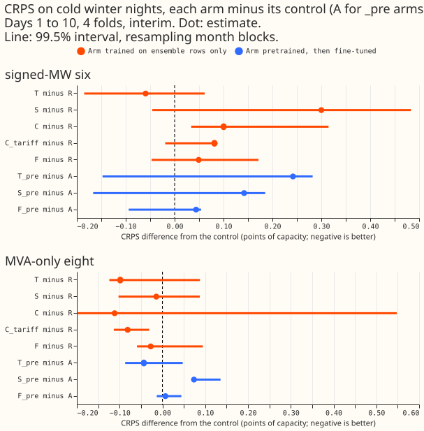
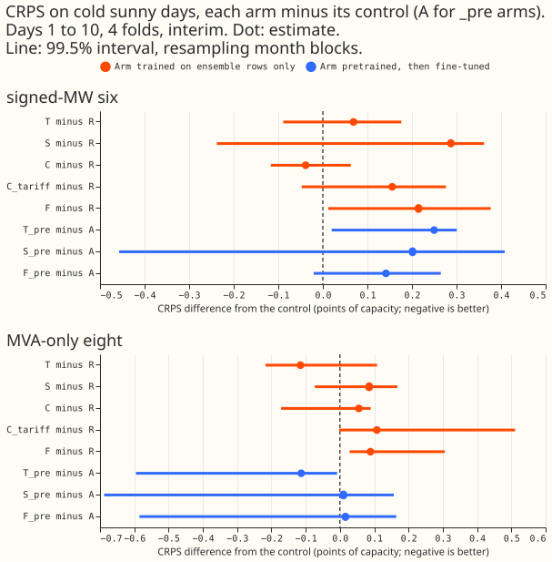
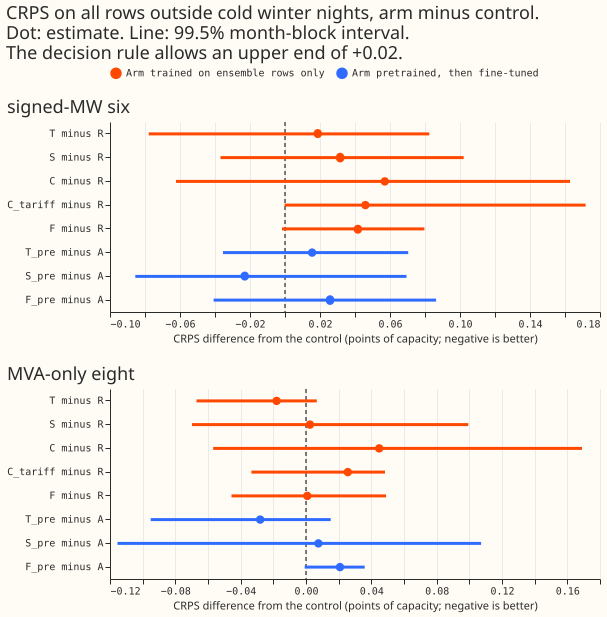
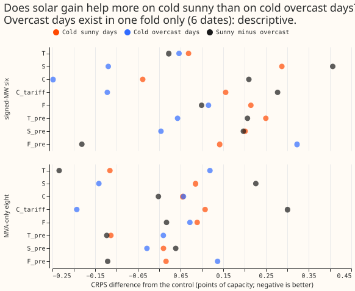
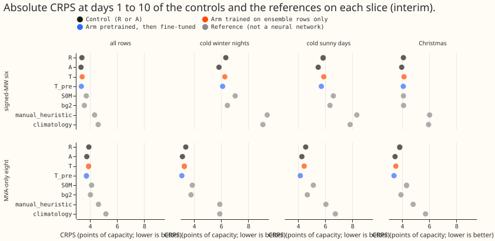
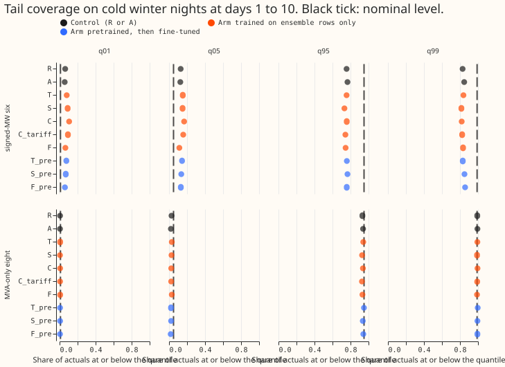
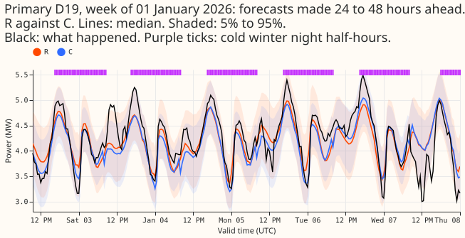
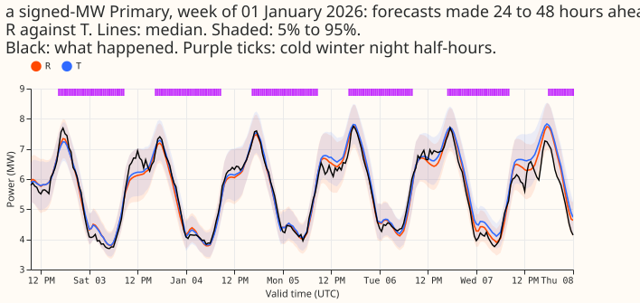
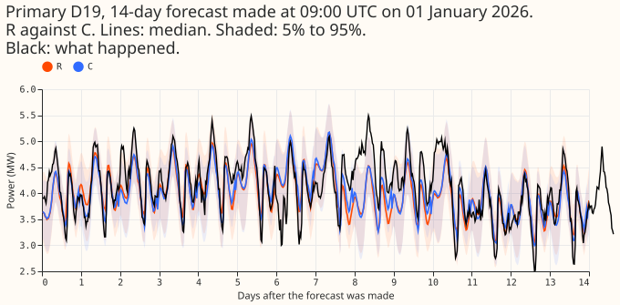
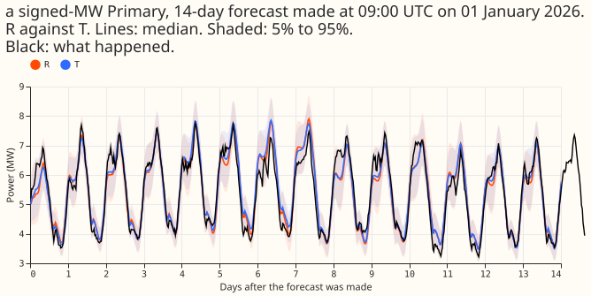

**Take-home message (here a bundle is a set of extra input columns added to the neural network of
experiment 437, and "points" are percentage points of a Primary substation's effective capacity):
the bundles did not help on the difficult rows either, but four test months
cannot show a gain smaller than 0.12 to 0.26 points on these slices, so this is inconclusive, not a
finding of no effect.** Thermal lag was the only one of the eight arms that looked better on cold
winter nights at
both groups, and the signed-MW part of that gain came from two Primaries. The clearer lesson is
about tails: on cold winter nights the signed-MW Primaries' upper quantiles are badly
under-covering.

## Question

CRPS is the continuous ranked probability score, a single error number for a probabilistic forecast.
The signed-MW six and the MVA-only eight are the two groups of Primary substations by metering.

**This re-score asks whether the input bundles that did not help on average help on the rows NGED
cares about most.** Experiment 437 added eight bundles of extra input columns to the pooled neural
network and judged them on the annual mean. The maintainer expects thermal-lag columns and similar
bundles to help mostly in winter, so a gain on cold winter nights, Christmas, or heat waves would be
averaged away. No network is refitted: the stored forecasts of experiment 437 are scored again on
slices of difficult rows.

## Design

- **Forecasts.** The eight arms of experiment 437 (T, S, C, C_tariff, F, T_pre, S_pre, F_pre) and
  controls `R` and `A`, four folds, three seeds, loaded by `e00437_score.load_frames`. Experiment
  437
  folder is imported; nothing in it is edited.
- **Slices.** Each is defined from the ENS-mean 2 m temperature and clear-sky index of the
  forecast's own run, from solar elevation, and from the calendar, per Primary. Thresholds that are
  percentiles come from the 730 days of runs before each fold's refit (runs exist from 2024-04-01,
  so
  the first fold's window is 18 months).
    - **Cold winter nights.** Elevation below 0, local month November to March, ENS-mean temperature
      at or below the Primary's 10th percentile of winter-night ENS temperatures in the window.
    - **Cold sunny days and cold overcast days.** Daily-mean ENS temperature below 5 °C; sunny if
      the
      daily-mean clear-sky index is at least 0.7, overcast if at most 0.3. Daylight half-hours only.
    - **Christmas and other bank holidays.** 24 December to 2 January; and Good Friday to Easter
      Monday and the May and August bank holidays of England and Wales.
    - **Heat-wave days.** Daily-maximum ENS temperature at or above the Primary's 95th percentile of
      June to August daily maxima, on at least 2 consecutive days of the same run.
- **Counts before scoring** (from `work/pre_output.txt`, days are distinct local valid dates, rows
  are
  scored half-hours at days 1 to 10 summed over the folds and Primaries):

  | Slice | Signed-MW six | MVA-only eight | Folds with rows |
  |---|---|---|---|
  | Cold winter nights | 11,793 rows, 21 days | 16,958 rows, 28 days | 3 |
  | Cold sunny days | 7,005 rows, 24 days | 8,340 rows, 19 days | 3 |
  | Cold overcast days | 971 rows, 6 days | 1,011 rows, 5 days | 1 (2026-01) |
  | Christmas | 23,040 rows, 10 days | 30,720 rows, 10 days | 2 |
  | Other bank holidays | 5,664 rows, 4 days | 7,552 rows, 4 days | 1 (2026-03) |
  | Heat-wave days | 0 | 0 | 0 |

- **Minimum detectable effect, from the seed spread, before any arm is scored** (7-day valid-date
  blocks; control `R` or `A`; six or eight):

  | Slice | `R`, six | `R`, eight | `A`, six | `A`, eight |
  |---|---|---|---|---|
  | Cold winter nights | 0.23 | 0.16 | 0.21 | 0.12 |
  | Cold sunny days | 0.19 | 0.18 | 0.13 | 0.26 |

  Every cell is above the 0.05 bar, so **no slice can detect a gain of 0.05**: an arm meets the
  decision rule only if its gain is several times the bar. A failure to meet it is not evidence of
  no effect. The same figures over folds are smaller (0.02 to 0.16) but rest on three folds.
- **Standing practices.** Monthly refits (stored); cleaned data (flagged exact zeros dropped, 1,179
  half-hours in the scored set); the D15 and D18 cut at 2025-03-01; stored controls reused and no
  fit; tails reported. The four-fold screen labels every number interim.
- **Figures.** Per slice, a gain-with-interval chart for every arm; example winter-night week of
  forecast, actual, control, and best arm; the sunny-minus-overcast gap of S and S_pre; a day-ahead
  and a 14-day example forecast.
- **Reviews.** Draft pull request; fresh Sonnet code review before the arms are scored (it found
  that the protocol's own `christmas` column overrode the registered mask, now fixed, which moved
  the Christmas count from 9 to 10 dates; the six tested cells were unaffected); results
  review with the audit triggers; write-up; prose review.

## Caveats registered before scoring

- **The folds hold no summer month,** so heat waves cannot be scored at all.
- **Christmas, other bank holidays, and cold overcast days have 10 dates or fewer and one or two
  folds,** so they are descriptive.
- **Winter nights come mostly from two folds** (2025-12 and 2026-01), with 3 dates in 2026-03.
- **The first fold's percentile window is 18 months,** not 24, because ENS runs are stored from
  2024-04-01.

## Results

CRPS differences are arm minus control in points of capacity at days 1 to 10 (negative is better),
pooled over rows. The all-rows contrasts reproduce experiment 437's table exactly (gate in
`work/score_output.txt`). Every number is interim.

**No tested cell advanced.** Of the 10 tested cells, the gain bar of -0.05 was met only by `T` at
the signed-MW six (-0.059) and at the MVA-only eight (-0.099). Both cells fail the interval
condition (the
interval includes zero) and the fold condition (2 of 3 folds negative).

- **Cold winter nights** (21 dates at the six, 28 at the eight; folds 2025-12, 2026-01, 2026-03).
  `T`: -0.059 (-0.185 to +0.062) at the six and -0.099 (-0.124 to +0.088) at the eight. `T_pre`:
  +0.242 and -0.043. `F`: +0.049 and -0.027. `F_pre`: +0.044 and +0.007. Intervals are 99.5%, month
  blocks (3 blocks, so the interval is the range of three fold values).
- **Cold sunny days** (24 dates at the six). `S`: +0.287 (-0.238 to +0.362), `S_pre`: +0.201 (-0.457
  to +0.408). Solar gain did not help on cold sunny days; the `S` arm was worse in 2 of 3 folds.
- **Sunny minus overcast.** `S`: +0.41 (-0.23 to +0.76) at the six and +0.23 (-0.10 to +0.42) at the
  eight. Overcast days exist in one fold (6 dates), so the gap is descriptive and its sign (S helped
  on overcast days, not on sunny days) is the opposite of the solar-gain hypothesis.
- **Christmas** (10 dates, two folds, descriptive). `T` at the eight: -0.28 (-0.31 to -0.22, 7-day
  blocks); `F` at the six: +0.34. These intervals cover one run's weeks, not other refits.
- **Other bank holidays** (4 dates, one fold) and **cold overcast days** (6 dates): descriptive; see
  `work/figure_tables/contrasts.parquet`.
- **Heat waves.** No rows, because no screen fold holds a summer month.
- **Harm elsewhere.** Outside the two primary slices every arm stays within +0.061 of its control
  (point estimates); no arm's q95 or q99 pinball loss rose by more than +0.027 outside the slice.

### Tails and absolute skill

- **Signed-MW tails fail on cold winter nights.** `R` covers 75.6% at q95 and 82.9% at q99 on those
  half-hours (95% and 99% nominal), against 88.6% and 95.5% over all rows. `A` covers 76.6% and
  84.7%. At the MVA-only eight, `R` covers 93.2% and 99.2%, and `A` 93.9% and 99.4%.
- **Absolute skill on cold winter nights** (CRPS, `A`, `R`, BG2, `manual_heuristic`, `climatology`):
  signed-MW six 5.84, 6.34, 6.46, 9.39, 9.08; MVA-only eight 3.14, 3.39, 3.78, 5.90, 5.90. The
  neural network beats the weekly XGBoost model (BG2) and both naive baselines on these rows at both
  groups.

### Example forecasts

The week figures stitch day-ahead forecasts (24 to 48 hours ahead) and compare the control with the
arm that scored best on cold winter nights at that group. The signed-MW Primary is not named.

### Predictions

- **P1 (T lowers cold-night CRPS by 0.05 to 0.30 at the eight, -0.20 to +0.10 at the six) is partly
  supported.** `T` fits both ranges (-0.099, -0.059); `T_pre` misses both (-0.043, +0.242).
- **P2 (S lowers cold-sunny-day CRPS by 0.00 to 0.20 at the six) is not supported.** `S` +0.287,
  `S_pre` +0.201.
- **P3 (F within +-0.10 on cold nights) is supported** in all four cells.
- **P4 (outside every primary slice within +-0.06) is supported** except one cell at +0.061 (`C`
  outside cold sunny days at the six).
- **P5 (no slice detects 0.05) is supported.**

### Checks

- **Median forecast minus mean forecast:** not available; the networks store quantiles only.
- **Error of the median beside each CRPS contrast:** same sign in all primary cells except `S` at
  the eight on cold winter nights (CRPS -0.014, median error +0.025; descriptive).
- **Triggers fired:** the leave-one-Primary-out trigger (trigger 4) for `T` on cold winter nights at
  the six:
  dropping Primary D14 or D16 flips the sign (-0.059 to +0.039 or +0.123), and dropping Primary D10
  takes it under
  the bar. The gain rests on Primaries D16 and D14, while D5 pulls the other way. `T_pre` at the
  eight meets
  the bar if Primary D4 or D8 is dropped, and its sign never flips. No verdict changes. A fresh
  Sonnet agent
  re-derived the six headline cells and the masks of two Primaries from the stored forecasts and ENS
  tables, and all matched to 5 decimals.
- **Code review:** a fresh Sonnet reviewer found that the protocol's own `christmas` column overrode
  the registered mask, so the first Christmas counts were wrong (9 dates, not 10). It was fixed
  before any arm was scored; the six tested cells were unaffected.
- **Dropped half-hours:** 1,179 flagged exact-zero half-hours are excluded from the scored set (as
  in experiment 437).

### Caveats

- **Three blocks make the interval degenerate.** With 3 month blocks the 99.5% interval is the range
  of the three fold values, so condition 2 reduces to "all three folds negative" and conditions 2
  and 3 are not independent.
- **The slices are thin.** Cold winter nights come mostly from 2025-12 and 2026-01; 2026-03 holds 3
  dates. The first fold's percentile window is 18 months.
- **Slice masks are ENS-mean based,** so a night the ensemble mean calls cold may not be cold; ENS
  smoothing leaves few overcast days (6 dates).
- **Absolute table weights Primaries equally,** while the contrasts pool rows, so differences in the
  absolute table need not equal the contrasts on thin slices.
- **Interval widths** (7-day blocks) on Christmas and bank holidays describe one run's weeks only.

### What to try next

- **Recalibrate cold-night tails at the signed-MW six** (widen or condition the uncertainty on a
  cold-night flag), since the coverage gap is far larger than any bundle's gain.
- **Retest thermal lag (`T`) on many more winter months,** the only one of the eight arms that
  looked better on
  both groups.

### Data used and where it lives

- **Data.** Experiment 437's stored forecasts (arms and controls, 4 folds, seeds 0 to 2), experiment
  425's controls, and the stored ENS summaries; no new data.
- **Code.** `ml-experiments/00441-difficult-row-rescore-of-the-neural-demand-input-bundles/`; it
  imports experiments 87, 377, 381, 396, 397, 407, 418, 425, and 437.
- **Tables and logs.**
`$DATA_PATH_INTERNAL/ml-experiments/00441-difficult-row-rescore-of-the-neural-demand-input-bundles/work/`
  (`pre_output.txt`, `score_output.txt`, `figure_tables/`, `masks.parquet`).
