**Take-home message: adding thermal-lag columns (bundle `T`) to the pooled neural network (control
`R`) did not lower its error on cold winter nights by an amount six monthly folds can detect. The
gain that experiment 441 saw at the eight MVA-only Primary substations did not appear in the two new
winter months.** The error measure is the continuous ranked probability score (CRPS) in points of
capacity, and a negative difference is a gain. Pooled over five folds, `T` minus `R` on cold winter
nights was -0.086 at the six signed-MW Primary substations and -0.014 at the eight MVA-only ones.
Both intervals include zero. The minimum detectable effect (0.15 to 0.19) is three to four times the
0.05 bar. All numbers are interim.

## Question

CRPS is a single error number for a probabilistic forecast. The signed-MW six and the MVA-only eight
are the two groups of Primary substations by metering.

**This experiment asks whether thermal-lag columns help the pooled neural network on cold winter
nights.** Experiment 441 found a gain of at least 0.05 points there, but its intervals included
zero. The scored year holds five winter months (November to March); experiment 437 fitted three of
them and October. This experiment fits bundle T on the other two winter months, November 2025 and
February 2026, so that the cold-night slice rests on five folds.

## Results

**The registered rule was not met at either group.** Adding two winter folds moved the pooled gain
at the MVA-only eight from the 0.05 or more of experiment 441 to 0.014. At the signed-MW six, the
gain stayed at 0.086, and one fold (February 2026, +0.205) contradicts it. `T` is experiment 437's
thermal-lag neural network, and `R` is its control.

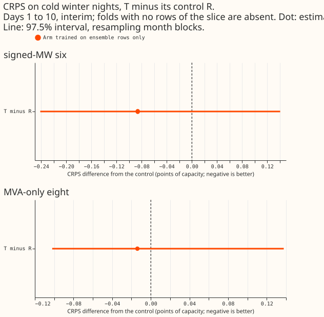

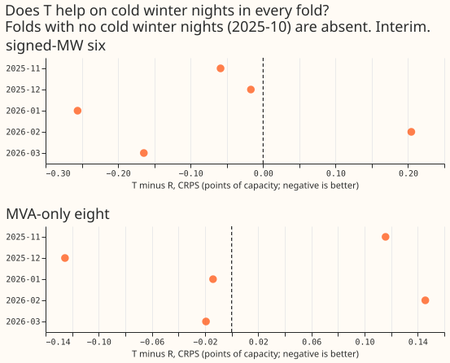

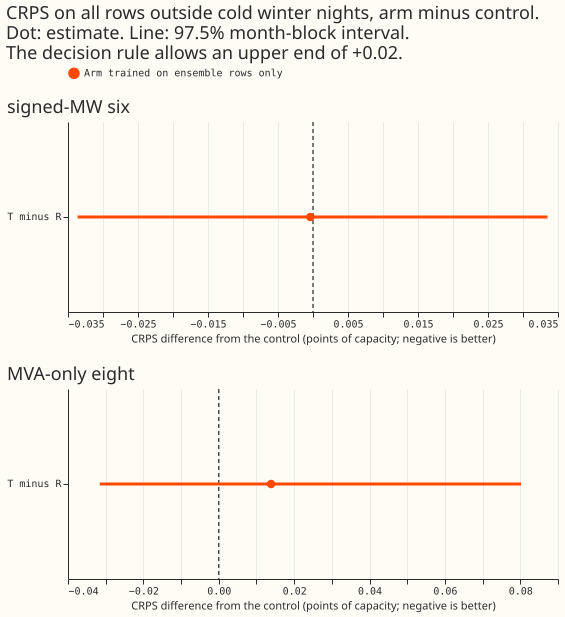

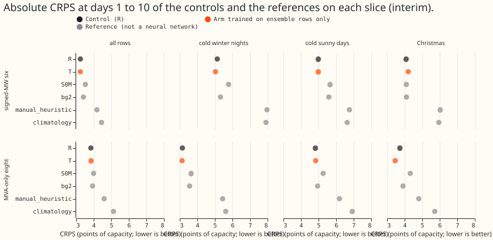

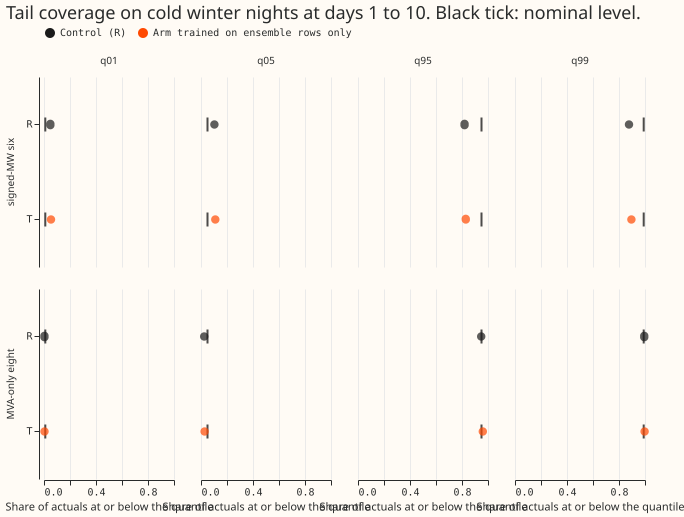

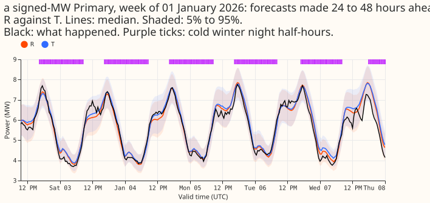

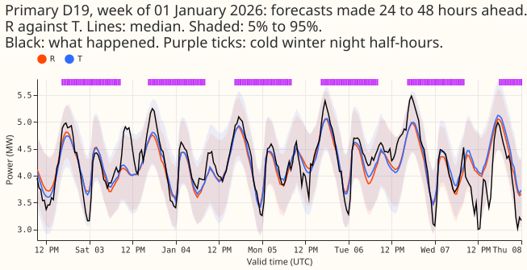

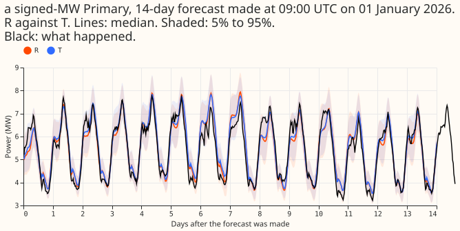

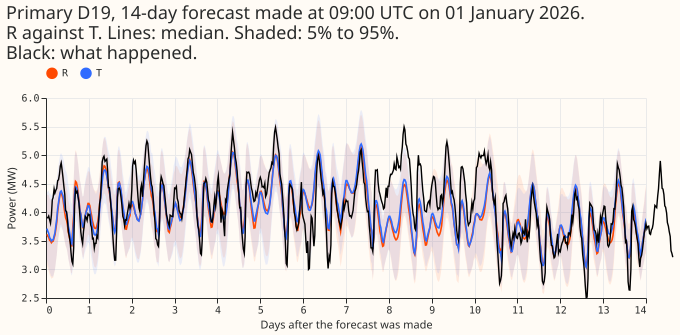

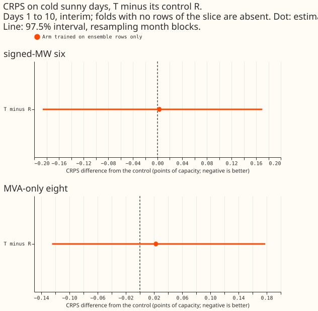

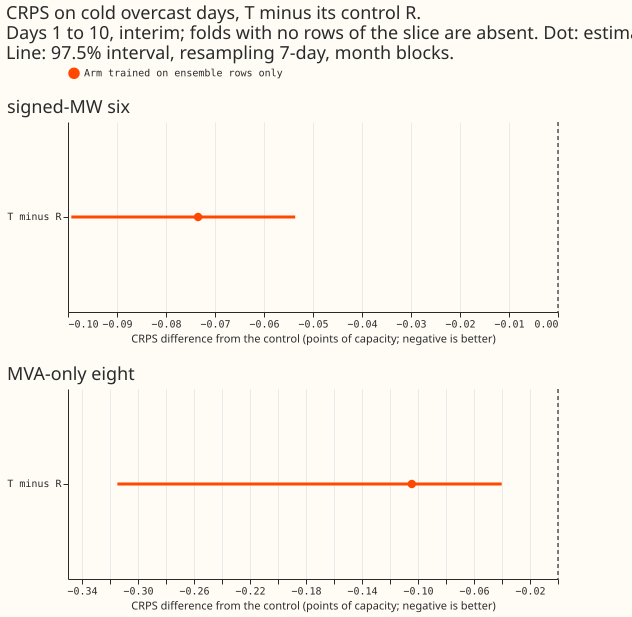

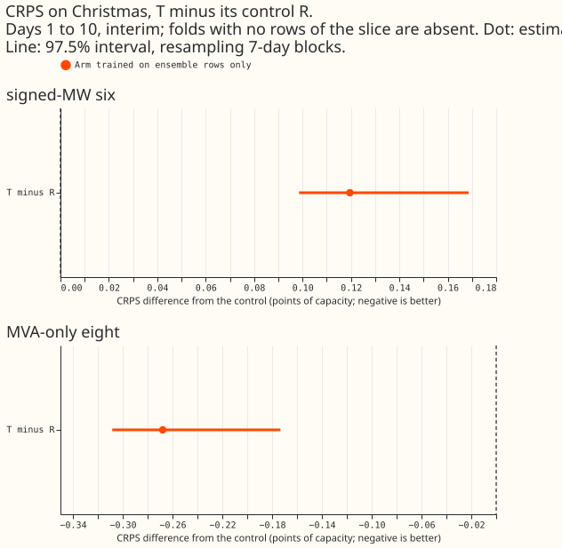

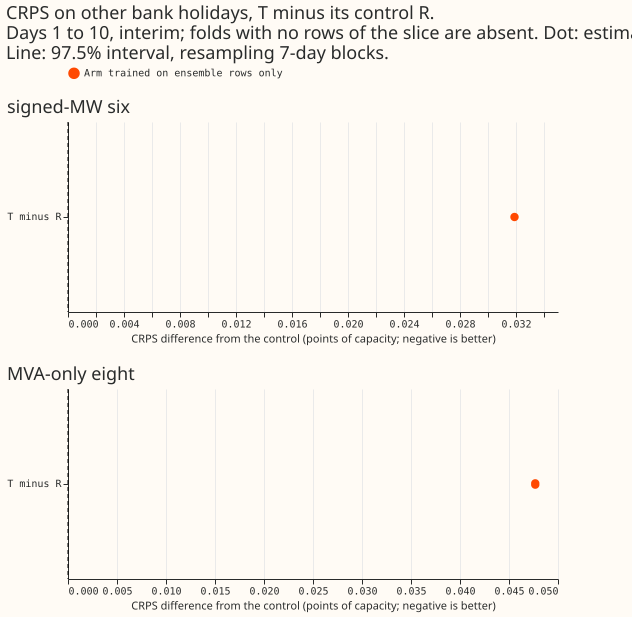

- **Primary contrast, `T` minus `R` on cold winter nights** (CRPS, points of capacity, days 1 to 10,
  widened by 1.15, seeds 0 to 4, 97.5% month-block interval; 16,185 half-hours on 35 dates at the
  six, 22,459 on 42 dates at the eight):

    | Group | Difference | Interval | Folds negative | Tail pinball q95, q99 | Reading |
    |---|---|---|---|---|---|
    | Signed-MW six | -0.086 | -0.241 to +0.141 | 4 of 5 | -0.195, -0.160 | does not advance |
    | MVA-only eight | -0.014 | -0.102 to +0.138 | 3 of 5 | -0.007, +0.002 | does not advance |

- **Conditions that failed.** At the signed-MW six, two conditions failed: the interval is not
  wholly below zero, and the upper end outside the slice is +0.033 against the allowed +0.02. At
  the MVA-only eight, four failed: the gain is below 0.05, the interval is not below zero, only 3
  of 5 folds are negative, and the upper end outside the slice is +0.080.
- **Fold by fold at the six:** 2025-11 -0.059, 2025-12 -0.017, 2026-01 -0.256, 2026-02 +0.205,
  2026-03 -0.165. **At the eight:** 2025-11 +0.116, 2025-12 -0.125, 2026-01 -0.014, 2026-02 +0.146,
  2026-03 -0.019. The two new folds (November and February) are worse at the eight. February is also
  worse at the six.
- **Rows outside the cold winter nights.** `T` minus `R` on all rows was -0.004 (-0.034 to +0.021)
  at the six and +0.013 (-0.034 to +0.081) at the eight. At the eight, November 2025 alone is
  +0.159 on all rows, so part of the eight's fold spread is not specific to cold nights.
- **Absolute CRPS** (equal weight over Primaries): on cold winter nights `R` scores 5.137 and `T`
  5.034 at the six, `R` 3.150 and `T` 3.135 at the eight. On all rows `R` scores 3.245 and `T` 3.242
  at the six, `R` 3.841 and `T` 3.854 at the eight. References on cold winter nights, six and eight:
  the monthly XGBoost recipe 5.779 and 3.646, BG2 (the best-guess forecast of experiment 87) 5.318
  and 3.561, `manual_heuristic` 7.963 and 5.442, `climatology` 7.911 and 5.621.
- **Tails on cold winter nights, six:** coverage at q95 rises from 0.820 (`R`) to 0.829 (`T`) and at
  q99 from 0.877 to 0.895; pinball loss at q95 falls from 2.067 to 1.850 and at q99 from 1.226 to
  1.046. **Eight:** coverage at q95 0.948 to 0.960, at q99 0.994 to 0.997; pinball loss at q95
  0.717 to 0.709, at q99 0.187 to 0.189. Both networks undercover the tails at the six on these
  nights (q99 coverage 0.88 to 0.90).
- **Descriptive slices** (not tested by the rule): cold sunny days +0.003 (six)
  and +0.023 (eight); cold overcast days -0.073 and -0.104 (3 folds, 12 and 10 dates); Christmas
  +0.120 and -0.268 (2 folds, 10 dates); other bank holidays +0.032 and +0.048 (1 fold, 4 dates).
  Christmas at the eight is the largest gain in the table but rests on 10 dates in two folds.
- **D15 and D18 (report only):** all rows -0.014 (-0.326 to +0.108); cold winter nights -0.170
  (-0.532 to +0.355).
- **Predictions.** P1 (a gain of 0.05 to 0.30 at the eight) failed: -0.014. P1 at the six
  (-0.30 to +0.10) held: -0.086. P2 (within +-0.04 outside the slice) held at both groups. P3
  (minimum detectable effect above 0.05) held.
- **Data.** 1,179 flagged exact-zero half-hours were dropped from the scoring actuals; D15 and D18
  start at 2025-03-01.
- **Gate.** The four-fold, seeds 0 to 2 contrast of `T` minus `R` on all rows reproduced
  experiment 437's published +0.016 (six) and -0.022 (eight).

### Checks

- **A fresh Sonnet reviewer re-derived the headline from the raw seed files** (their own seed
  averaging, widening, and CRPS from the 11 quantiles) and reproduced every contrast and fold value
  to 3 decimals. Pooling is by row; the equal-weight mean over folds is -0.058 at the six and +0.021
  at the eight, so the sign at the eight depends on the weighting.
- **Audit triggers fired: three of the seven** listed in the `ml-experiment` skill's "Audit before
  merge".
    - **A registered prediction failed** (P1 at the eight).
    - **The sign of the CRPS contrast differs from the sign of the mean and median error.** At the
      eight on cold winter nights CRPS is -0.014, but the absolute error of the mean forecast is
      +0.044 and of the median forecast +0.017. At the six all three agree (CRPS -0.086, mean
      -0.041, median -0.012). On all rows at the eight, CRPS +0.013, mean +0.036, and median +0.043
      agree.
    - **Leaving out one Primary flips a sign.** At the six on cold winter nights, D16 alone is
      -0.996; dropping it turns -0.086 into +0.070, and dropping D5 (+0.448) gives -0.186. The
      six Primaries' own values are D10 -0.113, D11 +0.067, D14 -0.118, D16 -0.996, D5 +0.448,
      D9 +0.095. At the eight, dropping D19, D8, or D22 moves -0.014 to between 0.000 and +0.008,
      and D12 (+0.31) and D4 (+0.14) are the worst Primaries.
- **The gain at the signed-MW six depends mainly on one Primary substation (D16),** so the result is
  not evidence of a gain at that group.
- **Median minus mean forecast per Primary on cold winter nights** is within +-0.5 points of
  capacity at almost every Primary for both networks. The exceptions are D12 (-0.91 for `R`, -0.98
  for `T`), D8 (+0.94, +0.68), and the report-only D15 (-2.04, -3.13).
- **Tails per fold.** At the six, the q95 and q99 pinball losses are lower for `T` in all 5 folds,
  including February 2026 where CRPS is +0.205. At the eight, q95 and q99 are higher for `T` in 3
  of 5 folds.

### Caveats

- **Six folds, not eight,** and the folds are not independent of experiment 441: three of the five
  cold-night folds were seen there. The two new folds alone are the November and February values
  above.
- **The cold-night slice rests on very few days in March** (3 dates) and none in October.
- **The minimum detectable effect is above the bar** (0.19 and 0.15 over blocks; 0.063 and 0.090
  over folds), so a failure to meet the rule is not evidence of no effect.
- **The in-slice interval resamples 5 months** and is nearly all-or-nothing.
- **The hyperparameters were tuned at 46 inputs** and reused at 54, as in experiment 437.
- **Seeds come from two experiments.** `T` seeds 0 to 2 on four folds come from experiment 437.
  Seeds 3 and 4 on those folds, and all five seeds on the new folds, were fitted here.

### What to try next

- **Leave thermal lags out of the pooled plain neural network** unless a test with at least 10
  winter months and an interval narrow enough to resolve 0.05 becomes possible.

### Data used and where it lives

- **Data.** The cleaned NGED Primary-substation power series and the ECMWF ensemble forecasts.
- **Code.** `ml-experiments/00442-thermal-lag-cold-night-test-on-six-winter-folds/`; it imports
  experiments 11, 48, 87, 377, 381, 396, 397, 407, 418, 425, and 437, and its masks, scorer, and
  figures are copied from experiment 441.
- **Saved networks and forecasts.**
  `$DATA_PATH_INTERNAL/ml-experiments/00442-thermal-lag-cold-night-test-on-six-winter-folds/work/`.

## Design

- **Arms.** `T` (experiment 437's thermal-lag bundle, ensemble-only form; `T_pre` is skipped
  because it was worse) and the control `R`.
- **Base network: `R`, not S1 and not the brief's "R-inj".** The S1 confirmation (experiment 439)
  is still a plan, so S1 has not passed. The brief names "R-inj" as the reference, but experiment
  428's R-inj is the lagged network trained on injected load-shift worlds, which bundle T was
  never tested on. The contrast that experiments 437 and 441 measured is T minus `R`, so the
  contrast here is the same.
- **Folds: six, not eight.** The brief asked for two further winter months before 2025-07 (January
  and February 2025). They cannot be scored: the 51-member demand frames, the forecast origins,
  the stored references (BG2, `manual_heuristic`, `climatology`, the XGBoost recipe), and the
  protocol rows all cover only 2025-07-01 to 2026-06-30, so a 2025 fold would need those rebuilt
  first, and its training window (stored runs start on 2024-04-01) would be 9 to 10 months against
  the 18 to 24 of the other folds. The six folds are 2025-10, 2025-11, 2025-12, 2026-01, 2026-02,
  and 2026-03; October holds no cold winter nights.
- **Reuse and fits.** The control `R` is stored by experiment 425 for every month with seeds 0 to
  4, so it is not refitted. `T` is stored by experiment 437 for four folds with seeds 0 to 2. New
  fits: `T` on 2025-11 and 2026-02 with seeds 0 to 4 (10 fits) and `T` on the four old folds with
  seeds 3 and 4 (8 fits), 18 fits of about 75 seconds each, under 1 GPU-hour. One GPU process
  under 8 GB, one feeder core, `MemoryMax=8G`, `OMP_NUM_THREADS=1`. The fits wait for a free slot
  from the manager.
- **Slices.** The masks of experiment 441 (copied, because its pull request is not merged):
  cold winter nights (primary), cold sunny days, cold overcast days, Christmas, and other bank
  holidays; heat waves cannot be scored. Row and day counts per slice and fold are printed before
  scoring.
- **Standing practices.** Monthly refits (stored neural networks); cleaned data (flagged exact zeros
  dropped, count per fold printed); the D15 and D18 cut at 2025-03-01; tails reported;
  every number labelled interim.
- **Figures.** Gain-with-interval chart for T on each slice; fold-by-fold table; example winter
  night week (forecast, actual, `R`, `T`); a day-ahead and a 14-day example forecast.
- **Reviews.** Draft pull request; plan review (fresh Sonnet); code review (fresh Sonnet) before
  the first fit; results review with the audit triggers; write-up review; prose review.

## Counts and minimum detectable effect, printed before `T` was scored

The scorer's `pre` stage read only the control `R` (stored seeds 0 to 2 against seeds 3 and 4).

- **The pooled cold-winter-night slice is large enough to decide on but not to detect 0.05.** It
  holds 16,185 scored half-hours on 35 local dates at the signed-MW six, and 22,459 half-hours on
  42 dates at the MVA-only eight. Both groups have rows in five folds: 2025-11 (7 dates at each
  group), 2025-12 (13), 2026-01 (15 at the six, 22 at the eight), 2026-02 (7), and 2026-03 (3).
  October 2025 has none.
- **The minimum detectable effect of the pooled cold-night slice exceeds 0.05 at both groups.**
  Over 7-day valid-date blocks it is 0.19 at the six (15 blocks) and 0.15 at the eight (16 blocks).
  Over the five folds it is 0.063 at the six and 0.090 at the eight. A gain of 0.05 can therefore
  meet the decision rule only if the interval is unusually narrow, and a failure to meet it is not
  evidence of no effect. The write-up reports the interval whatever the rule's reading.
- **Cold sunny days** hold 40 dates at the six and 35 at the eight (minimum detectable effect 0.20
  and 0.29 over blocks); **cold overcast days** 12 and 10 dates; **Christmas** 10 dates in two
  folds; **other bank holidays** 4 dates in one fold. The last three are descriptive.

## Caveats registered before the fits

- **Six folds, not eight,** for the reason above; the sign rule is scaled from 6 of 8 to 4 of 5.
- **Two of the five cold-night folds are new, three were seen in experiment 441,** so the pooled
  result is not an independent replication. The new folds alone are reported beside the pooled
  result.
- **Seeds 3 and 4 of `T` on the old folds are fitted after experiment 441's result was read.**
  They fix the number of seeds, not the design.
- **The in-slice month-block interval is nearly all-or-nothing.** It resamples 5 origin months, so
  an upper end below zero needs almost every fold to be negative, which is stricter than the
  "4 of 5" condition.
- **The mask thresholds use runs up to the refit, whose later valid times pass it.** Only ECMWF
  ensemble (ENS) weather enters the thresholds, never a score or an actual, and experiment 441 used
  the same window.
