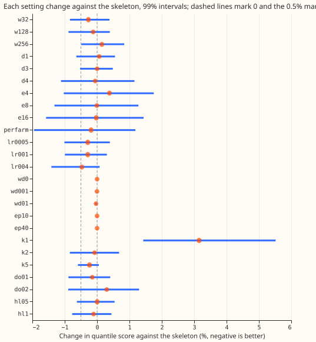
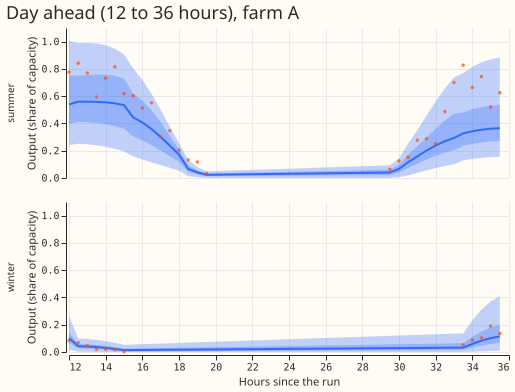
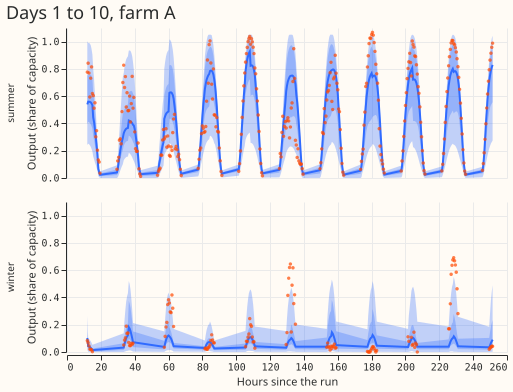

**The plain pooled solar network is already near the best score its settings can give.** We asked
whether changing one setting of the network that forecasts the six metered solar farms (labelled A
to F, each farm's output as a share of its capacity) would improve its forecast. Experiment 430
found that nothing added to the plain network helps, so we left its design alone and changed 25
settings one at a time: width, depth, the width of a learned farm embedding, learning rate, weight
decay, training epochs, number of mixture components, dropout, and a weight that favours recent
training rows. The forecast is a 51-ensemble-member weather forecast turned into quantiles by a
mixture of Gaussians. No change beat the plain network by the 0.5% margin, so the random search that
would follow a positive result was not run. All numbers on this page come from the experiment's own
scripts.

**The best change, a learning rate of 4e-3, was a lucky draw of seeds.** It scored 0.47% better on
the three screening seeds (99% interval −1.41% to +0.08%), and 0.14% better on three fresh seeds
(−0.74% to +0.55%). That check was run after the results were read (post hoc), on one arm. The
minimum detectable effect from seed noise is 0.40% at three seeds, so a screening gain of 0.47% sits
at the noise floor. One mixture component is the only clear change, and it is worse: 3.15% worse
(+1.43% to +5.52%), with a 0.99 pinball loss 0.077 points higher.

*Figure 1. Percentage change in the farm-equal quantile score of each arm against experiment 430's
`g0_onepass`, over all day bands, three seeds, with 99% month-block intervals. Negative is better.
The dashed lines mark 0 and the −0.5% margin.*

## Results

Scores are quantile scores in points of capacity (twice the mean pinball loss over 11 levels; lower
is better), farm-equal means over experiment 430's scored year (2025-09 to 2026-08), 410,899 rows,
all day bands, seeds 0 to 2 for every arm and for the skeleton. "Skeleton" is experiment 430's
`g0_onepass`, read from its stored predictions. The 0.01 and 0.99 pinball losses are row-pooled
differences in points of capacity.

| Arm | Change | Score | Change vs skeleton (99% interval) | 0.01 / 0.99 pinball vs skeleton |
|---|---|---|---|---|
| `g0_onepass` | skeleton | 6.842 | | |
| `w32` | width 32 | 6.824 | -0.27% (-0.84% to +0.38%) | -0.0032 / +0.0006 |
| `w128` | width 128 | 6.834 | -0.12% (-0.88% to +0.39%) | -0.0019 / +0.0046 |
| `w256` | width 256 | 6.853 | +0.15% (-0.49% to +0.84%) | -0.0027 / +0.0087 |
| `d1` | 1 hidden layer | 6.847 | +0.07% (-0.64% to +0.55%) | -0.0019 / -0.0046 |
| `d3` | 3 hidden layers | 6.842 | +0.00% (-0.53% to +0.48%) | -0.0030 / +0.0049 |
| `d4` | 4 hidden layers | 6.838 | -0.06% (-1.12% to +1.16%) | -0.0032 / +0.0085 |
| `e4` | farm embedding 4 | 6.869 | +0.38% (-1.03% to +1.75%) | -0.0028 / -0.0071 |
| `e8` | farm embedding 8 | 6.842 | -0.01% (-1.32% to +1.27%) | -0.0041 / -0.0064 |
| `e16` | farm embedding 16 | 6.841 | -0.03% (-1.58% to +1.44%) | -0.0034 / -0.0045 |
| `perfarm` | one network per farm | 6.830 | -0.18% (-1.95% to +1.18%) | -0.0138 / -0.0028 |
| `lr0005` | learning rate 5e-4 | 6.823 | -0.29% (-1.01% to +0.40%) | -0.0023 / +0.0065 |
| `lr001` | learning rate 1e-3 | 6.823 | -0.29% (-0.99% to +0.30%) | -0.0021 / +0.0071 |
| `lr004` | learning rate 4e-3 | 6.810 | -0.47% (-1.41% to +0.08%) | -0.0017 / +0.0061 |
| `wd0` | weight decay 0 | 6.842 | +0.00% (+0.00% to +0.00%) | +0.0000 / +0.0000 |
| `wd001` | weight decay 1e-3 | 6.842 | -0.00% (-0.01% to -0.00%) | -0.0000 / -0.0000 |
| `wd01` | weight decay 1e-2 | 6.840 | -0.03% (-0.06% to -0.01%) | -0.0000 / -0.0000 |
| `ep10` | 10 epochs | 6.842 | +0.00% (-0.00% to +0.00%) | +0.0000 / +0.0000 |
| `ep40` | 40 epochs | 6.842 | -0.00% (-0.00% to +0.00%) | +0.0000 / +0.0000 |
| `k1` | 1 mixture component | 7.058 | +3.15% (+1.43% to +5.52%) | +0.0007 / +0.0773 |
| `k2` | 2 components | 6.837 | -0.08% (-0.84% to +0.68%) | -0.0013 / +0.0084 |
| `k5` | 5 components | 6.826 | -0.23% (-0.59% to +0.06%) | +0.0008 / -0.0020 |
| `do01` | dropout 0.1 | 6.832 | -0.15% (-0.89% to +0.41%) | -0.0024 / +0.0027 |
| `do02` | dropout 0.2 | 6.863 | +0.30% (-0.89% to +1.30%) | -0.0029 / +0.0063 |
| `hl05` | recency half-life 0.5 year | 6.843 | +0.00% (-0.62% to +0.54%) | -0.0027 / +0.0025 |
| `hl1` | recency half-life 1 year | 6.835 | -0.11% (-0.77% to +0.44%) | -0.0017 / -0.0002 |

- **No level passed the rule.** The rule needs a gain of at least 0.5%, a 99% interval that excludes
  zero on the favourable side, and no tail harm above 0.02 points. The lowest point estimate is
  −0.47% (learning rate 4e-3), and its interval reaches +0.08%.
- **Two weight-decay arms have intervals that exclude zero, on a gain of 0.003% to 0.03%.** These
  intervals are narrow because the arms barely differ from the skeleton, and the gain is far under
  the margin.
- **Training length changes nothing because the best epoch is early.** The 10-epoch and 40-epoch
  arms score the same as the 20-epoch skeleton to 13 decimal places. A rerun of the seed-0 skeleton
  with a logged validation curve picked epoch 3 at three refits and epoch 2 at the fourth, out of 40
  epochs, and the validation loss rises steadily afterwards (it is −0.72 at the best epoch and −0.48
  at epoch 40 for the first refit). Weight decay at 1e-4 to 1e-2 and a learning rate under 4e-3
  change little because the network stops after two or three epochs.
- **The embedding arms are no better, and the per-farm arm is no better than the pooled one.** The
  per-farm networks score 0.18% better (−1.95% to +1.18%) with the widest interval of all arms.
- **Tails are unchanged except for one mixture component.** Coverage of the 0.01 quantile is 5.2%
  to 5.5% in every arm (target 1%), and coverage of the 0.99 quantile is 98.2% to 99.2%
  (target 99%). Dropout 0.2 moves the 0.99 coverage to 99.2%.
- **Example forecasts** of the skeleton are in Figures 2 and 3.

*Figure 2. The skeleton's forecast of farm A for the 12 to 36 hours after a summer run and a winter
run (three-seed average). Bands show the 25% to 75% and 5% to 95% quantiles; dots are the observed
output.*

*Figure 3. The same two runs over days 1 to 10.*

### Checks

- **Median minus mean forecast, per farm** (points of capacity, seeds 0 to 2): the skeleton's median
  sits 0.45 to 0.83 above its mean at the six farms. The learning rate 4e-3 arm gives 0.13 to 0.74,
  width 32 gives 0.39 to 0.73, and one mixture component gives −0.06 to +0.07. One component forces
  a symmetric distribution, so its median and mean agree, and its score is the worst.
- **Error of the mean forecast beside the score:** for learning rate 4e-3, the mean absolute error
  of
  the mean forecast is lower than the skeleton's at all six farms, as is the quantile score, so the
  two agree. For one mixture component, the mean absolute error is higher at five farms and the
  score is higher at all six.
- **Audit triggers.** None fired. No control or placebo exists in this experiment. The result agrees
  with its prediction and with experiment 430. The 10-epoch and 40-epoch arms match the skeleton,
  and
  the best-epoch curve above explains why. Every contrast has an interval of similar width to
  experiment 430's contrasts of the same rows (a half-width of 0.5% to 1.5% for most arms). No
  nested arm beats its
  container. The leave-one-farm-out check was not run, because no contrast is a candidate for
  adoption.

### Caveats

- **Each level is a single point in a coarse grid.** A change of two settings together (for example
  a wider network with a lower learning rate) was not tested, because the plan runs a random search
  only after a single setting moves.
- **The screen is not corrected for 25 contrasts.** Each interval is a 99% interval on its own, so
  25 screens are expected to produce about 0.25 false passes. None did.
- **The scored year is the same year as in experiment 430,** so a choice that suits another year
  would not show here.
- **Lead range:** the scored lead range is days 1 to 10 (12 to 252 hours) for the six metered solar
  farms; day-ahead (12 to 36 hours) is band d1.
- **Weather at lag times:** the farm network has no power lags, and its weather inputs are the
  ensemble run available at forecast time.
- **Stored networks:** the fitted networks are not saved (see Design); the quantile tables are in
  the
  experiment's private data folder.

### Problems caused by the move

None.

## What to try next

**Look for solar gains in the inputs instead of the network.** The network stops improving after two
or three epochs, so a larger network or longer training cannot help. The inputs that experiment 430
found to help were a clear-sky column (0.4%) and nothing else; a better irradiance product is the
remaining candidate.

## Design

**The skeleton is experiment 430's `g0_onepass`.** It is a mixture-density network: it reads the
standardised inputs (calendar, sun position, ensemble mean and spread of shortwave radiation, and
the other columns of experiment 345's list), has two hidden layers of 64, and outputs a mixture of
three Gaussians for the farm's output as a fraction of its ceiling. It is trained with AdamW at
learning rate 2e-3, weight decay 1e-4, batch 2048, for 20 epochs with the best epoch chosen on the
last 61 days of the training rows. One network is pooled over the six farms and the six day bands
and
refitted quarterly, four refits from 2025-09. A job is one (arm, seed, refit); the stored skeleton
supplies seeds 0 to 5.

**Stage 1 changes one factor at a time (25 arms, 3 seeds, 4 refits: 300 jobs).**

| Factor | Skeleton level | Other levels |
|---|---|---|
| Hidden width | 64 | 32, 128, 256 |
| Depth (hidden layers) | 2 | 1, 3, 4 |
| Farm embedding width | none | 4, 8, 16, and per-farm networks (six networks, each trained on one farm only) |
| Learning rate | 2e-3 | 5e-4, 1e-3, 4e-3 |
| Weight decay | 1e-4 | 0, 1e-3, 1e-2 |
| Epochs | 20 | 10, 40 |
| Mixture components | 3 | 1, 2, 5 |
| Dropout (after each hidden layer) | 0 | 0.1, 0.2 |
| Row-recency weight (half-life of the loss weight, by the row's age at the refit) | none | 0.5 year, 1 year |

The brief also named "the loss weights that the design note lists". The note lists one loss weight
for the demand networks, the row-recency half-life (0.5 year; 1 year and 0.25 year were no better),
so that is the loss-weight factor. It lists no tail or pinball weight, so none is tested.

**Stage 2 (run only if a factor moved) is a random search; it was not run.** 45 configurations are
drawn at random from
the levels of the moved factors (each other factor stays at its skeleton level), two seeds each (360
jobs). The best three by mean score are refitted on seeds 3 to 5 and judged against the skeleton's
seeds 3 to 5.

**Compute.** Stage 1 was 300 jobs at 11 to 17 s each on the GPU, in one process under 8 GB with
`MemoryMax=8G`, `OMP_NUM_THREADS=1`, and one feeder core: about 1.2 hours.

**Standing practices.** Monthly refitting does not apply to a farm network, which follows
experiment 345's quarterly refits so that the rows match. Cleaning and the D15/D18 start cut apply
to demand only. The farm rows are experiment 310's, with its idle-band handling. The fitted networks
are not saved: a job's output is its quantile table, and the sweep's 700 networks are small enough
to refit in minutes. Stored predictions reused: experiment 430's `g0_onepass` seeds 0 to 5, so the
skeleton is not refitted; the gate (G0) refits one job to prove the new code reproduces it.

**Scoring details.** The 0.01 and 0.99 pinball differences are row-pooled means in 100 times the raw
pinball loss, as in experiment 430. The per-farm arm fits one network per farm, but its input
standardiser is still computed over all six farms' rows before the refit cutoff. The "embedding"
factor includes the per-farm arm, so it counts as moved if the per-farm arm passes.

**Gate G0.** The new code with every factor at its skeleton level must reproduce the stored
`g0_onepass` forecasts for seed 0 and all four refits to within 1e-4 points of capacity. If it
misses, the run stops and reports.
