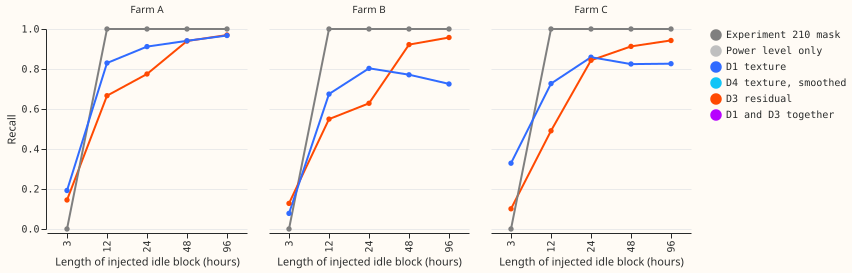
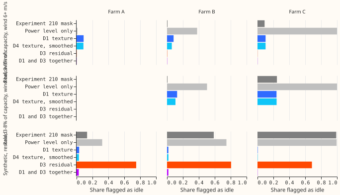
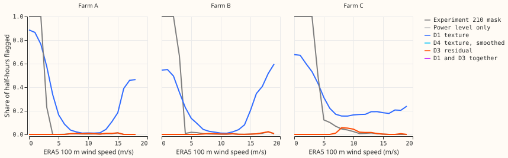

**A rule that reads only a wind farm's own power readings cannot replace the existing mask.** The
texture detector D1 finds injected idle blocks of 12 hours or more (recall 0.74 to 0.90 across the
three farms) but misses blocks of 3 hours (0.08 to 0.38), and it flags 6% to 12% of genuine low
output. The experiment 210 mask already finds every injected block of 12 hours or more, because its
outage rule is a run-length rule. No candidate passes the pre-registered gate at any farm, so the
verdict is `not supported`. All numbers below are the experiment's own scored output, reviewed once
by a fresh Sonnet agent.

**The question and what it narrows.** The wind idle-noise design asks for a detector that finds idle
half-hours at any wind speed, which the ERA5 wind rule of experiment 210 cannot do. This experiment
runs every part of that design's Stage 1 that needs no human label, on three kinds of pseudo-label
(none of them ground truth): idle blocks pasted into generating periods, genuine low output
(real, and synthetic by rescaling), and a few real events (storm shutdown, negative readings). The
result narrows the next step to hand labels or NGED outage records: the label-free route has been
run and does not settle the question.

## Results

- **Gate (interim until audited; test years only, tune on the other parity of years).** Recall is the
  equal-weight mean over block-length by wind-bin cells; false drop is the equal-weight mean over
  the real sets and the synthetic set. Intervals resample calendar-year blocks.

| Farm | Candidate | Recall (95% interval) | False drop | Passes |
|---|---|---|---|---|
| A | D1 | 0.72 (0.70 to 0.75) | 0.061 | no |
| A | D4 | 0.72 (0.70 to 0.75) | 0.058 | no |
| A | Experiment 210 mask | 0.75 | 0.066 | not gated |
| B | D1 | 0.58 (0.53 to 0.63) | 0.076 | no |
| B | D4 | 0.59 (0.54 to 0.63) | 0.061 | no |
| B | Experiment 210 mask | 0.75 | 0.200 | not gated |
| C | D1 | 0.66 (0.59 to 0.73) | 0.115 | no |
| C | D4 | 0.66 (0.57 to 0.75) | 0.115 | no |
| C | Experiment 210 mask | 0.71 | 0.441 | not gated |

- **Which parts of the gate fail.** Recall is below 0.80 at all three farms for D1 and D4; the false
  drop is above 0.05 at all three; and D1's recall at the mask's own false-drop rate exceeds the
  mask's recall by 0.10 at no farm (0.72 against 0.75 at Farm A, 0.61 against 0.75 at Farm B, 0.75
  against 0.71 at Farm C).
- **Short blocks cause the recall shortfall.** D1's recall for blocks of 12 hours or more is 0.90 at
  Farm A, about 0.74 at Farm B, and 0.79 at Farm C, against 0.19, 0.08, and 0.33 for 3-hour blocks.
  D4 (a two-state smoothing of D1) changes recall by 0.00 to 0.01, so its stay probability adds
  nothing; D4's minimum detectable effect over D1 is 0.005 to 0.023.
- **The mask is a strong comparator on this test, by construction.** It recalls every injected block
  of 12 hours or more and none of 3 hours (the prediction P5). Its false-drop rate is high at
  Farm B and Farm C (0.20 and 0.44) because the synthetic low output is an unbroken in-band run
  of 12 hours or more at high wind, which is exactly what the mask's outage rule drops. That
  false drop shows the mask cannot tell a rescaled run from an outage, and a real outage differs
  from it only in a way these pseudo-labels cannot show.
- **The residual rule D3 cannot separate idle from low output at high wind.** It flags 69% to 81% of
  the synthetic low output (false drop 0.23 to 0.38 in total) while recalling 0.56 to 0.64 of the
  injected blocks. Requiring both D1 and D3 gives false drops of 0.1% to 1.5% and recall of 0.44 to
  0.59, a high-precision flag only. It does not enter the verdict.
- **Level-matched AUC of D1's score** (sure-idle against sure-generating rows, test years): 0.92
  (0.88 to 1.00) at Farm A, 0.71 (0.66 to 0.77) at Farm B, and 0.74 (0.69 to 0.79) at Farm C. Farm A
  is high because its two sets differ in level and the bins are narrow, not because texture
  separates them.
- **Real data at high wind.** D1 flags 3.8%, 7.3%, and 20.3% of half-hours with ERA5 wind above 1.5
  times the used cut-in at Farm A, B, and C (the mask: 0.5%, 0.7%, 7.4%). At Farm C, D1's flags form
  86 runs of 24 hours or more and 40 of 48 hours or more, the longest 263 hours. D1 also flags 10%
  of half-hours with power of at least 10% of capacity at high wind, so a share of those flags are
  false. Farm B and Farm C agree on 3,069 of the 7,270 high-wind half-hours that D1 flags at Farm B.
- **Farm B negative readings (a real proof of non-export).** At high wind, D1 flags 41% of the 713
  negative readings (D4 35%, the mask 10%), against the 70% the prediction P6 required, so P6 fails.
  Over all winds D1 flags 57% and the mask 75%.
- **Storm shutdown.** Only 3, 0, and 4 half-hours have ERA5 wind of 22 m/s or more with power in
  the idle band at Farm A, B, and C, which is too few for any rate.
- **Predictions.** P1 fails (neither D1 nor D4 passes at Farm B or Farm C); P2 holds in part (Farm A
  fails the false-drop gate and, contrary to P2, also the recall gate); P3 fails (D4 raises recall by
  at most 0.01); P4 holds in part (D3 flags 69% to 81% of synthetic low output, short of 90%, and
  fails alone, while D1 and D3 together pass the false-drop gate but fail recall); P5 holds; P6 fails.

## What a hand-labelled sample would add

- **The question label-free evidence cannot answer** is whether a flagged half-hour at moderate or
  high wind is a whole-farm outage, a partly available farm, or an ERA5 error at a 25 km cell. Every
  pseudo-label here is built from the same series and ERA5 wind the detectors read.
- **Precision of a recall estimate.** D4 flags at least 6 half-hours at high wind on 8%, 16%, and 28%
  of farm-days at Farm A, B, and C. A random sample of 100 farm-days per farm would hold about 8,
  16, and 28 idle days, giving a half-width on a recall of 0.8 of about 0.28, 0.20, and 0.15. A
  sample of 100 days drawn from days at least one detector flags would give about 0.08.
- **Minimum detectable effects.** For the injected blocks, paired recall differences smaller than
  0.04 to 0.11 (D1 against the mask, 2.8 times the standard error, seven year blocks) cannot be told
  from zero, so the mask and D1 are not separable at Farm C.

## Caveats

- **Injection flatters recall.** The pasted floor is an exact copy of calm-night readings from
  adjacent years, with hard joins every 12 half-hours; recall excluding the half-hours next to a join
  differs by at most 0.01, but the 3-hour and 24-hour windows reach past a join, so the exclusion
  understates the join's effect.
- **The false-drop sets are not independent of the detectors.** The synthetic low output shrinks
  half-hour differences along with the level, which should make it look more idle, and D1 is
  trained on part of that set; the real sets (power 3% to 8% of capacity at ERA5 wind of 6 m/s or
  more, or of 1.5 times cut-in to 6 m/s) contain any idle rows at high wind that the study seeks.
  The set of 1.5 times cut-in to 6 m/s is empty at Farm A, whose cut-in used is 4.5 m/s.
- **Tune-year thresholds transfer imperfectly.** D1's threshold gives a 5% false drop on the tune
  years; on the test years it gives 6% to 12%. The recall-against-false-drop sweep (D1 at 1%, 2%, and
  10%) shows that tightening cannot recover the gate at Farm B or Farm C.
- **Cut-in and ERA5 are not refitted per fold.** The used cut-in comes from experiment 210's report
  (fitted on all years) and defines the high-wind rows and the mask's outage rule; the idle band,
  wind threshold, power curve, logistic fit, and thresholds are all fitted on the tune years only.
- **Seven cells were thinner than 10 blocks per fold** and were dropped from the recall average: the
  96-hour and 192-hour moderate-wind cells at Farm A and Farm B, and the 48-hour, 96-hour, and
  192-hour moderate-wind cells at Farm C. Ten replicates re-pick the same locations, so intervals
  resample calendar years, of which there are about seven.
- **Checks.** No forecast is scored, so the median-minus-mean, tail, and curtailment checks do not
  apply, and none of the audit triggers applies. The three customer-generator series are never
  flagged by the production cleaning rule, so no `substation_zero` rows were dropped.

## What to try next

- **Offer hand labels or ask NGED** for outage dates and a reactive-power channel; the label-free
  route is exhausted.
- **Keep the experiment 210 mask** for the training and evaluation row sets for now.
- **Stage 5 of the design (capacity change points)** is untouched by this experiment and is the next
  label-free item.

## Experiment details

- **Code:** `ml-experiments/00444-wind-idle-detectors-label-free-bake-off/` (`e00444_bakeoff.py`,
  `e00444_summarise.py`, `e00444_charts.py`), importing experiment 431's feature code
  (`ml-experiments/00431-wind-idle-data-look/`) and experiment 210's wind-threshold fit
  (`ml-experiments/00210-wind-idle-noise-mva-artefact/`). Data: the experiment's folder under
  `data/ml-experiments/` (private).
- **Cadence, weather, and cleaning:** no forecast and no refit. ERA5 100 m wind (research-only, about
  5 days late) is used by the pseudo-labels, D3, D2's census, and the mask; D1 and D4 read the power
  series only and are usable as-of.
- **Reviews:** one Sonnet plan review (nine findings, all accepted and written into the plan before
  any code) and one Sonnet code review before scoring (ten findings; eight fixed, one documented,
  one rejected as harmless). The results and write-up reviews are listed in the pull request.
