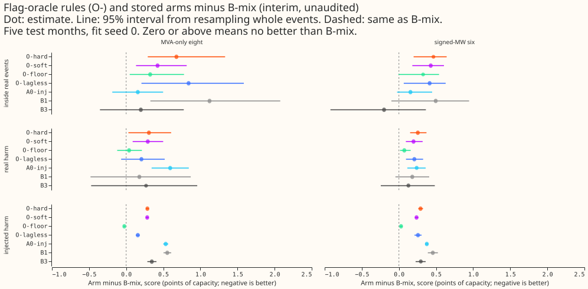
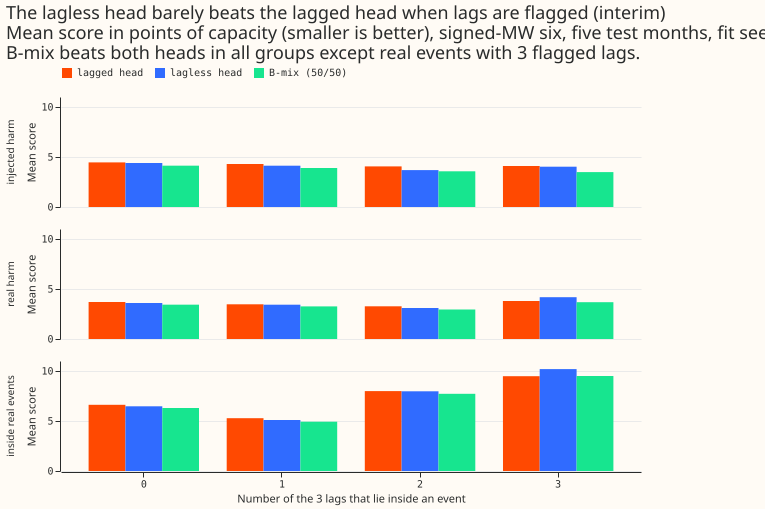
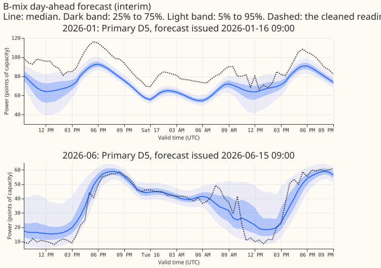
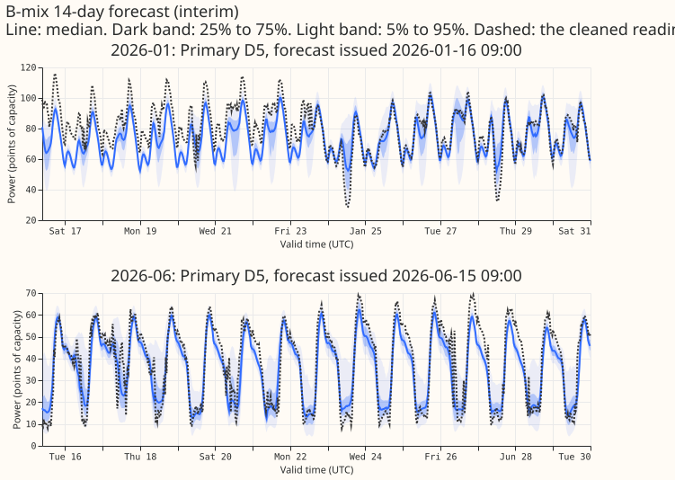
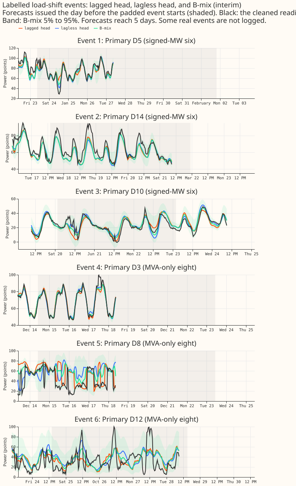
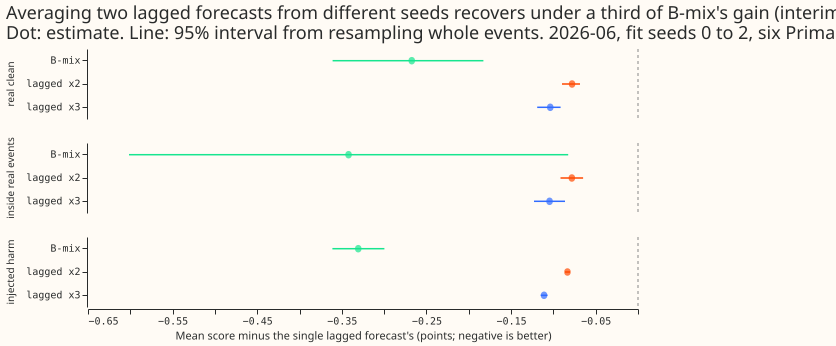

**Take-home message: telling a mixture of two forecasts exactly which recent power readings lie
inside a load-shift event did not make the mixture better than simply averaging the two forecasts
50/50, so in these data the limit is the two forecasts and not the event detector. The hypothesis
that exact event flags would improve the mixture is refuted.**

We forecast the power drawn at NGED's Primary substations (the substations that step down from the
high-voltage network), up to 14 days ahead. A load-shift event is a period in which the network
operator moved load between substations, so recent power readings do not show normal demand. The
lagged forecast uses the recent readings (lags) of the substation's own power, and the lagless
forecast does not. B-mix averages the two with equal weight. We replaced the equal weight with rules
that use an exact record of which of the three lags lie inside an event. The hard rule uses the
lagless forecast whenever any lag is flagged (marked as inside an event), and the soft rule weights
the lagless forecast by the share of flagged lags. Both rules scored worse than B-mix, in real
events and in events we added to otherwise normal data. We re-scored forecasts that experiment 404
had stored, so no model was fitted.

Figure 2 shows why. With all three lags flagged, the lagless forecast is barely better than the
lagged forecast on the added events, and worse inside real events, while the average of the two is
better than either in most row sets. An equal average of two lagged forecasts from different fit
seeds (the control at the end of this page) recovers 0.29 of B-mix's gain over a single lagged
forecast on real clean rows, so most of B-mix's gain comes from combining a lagged and a lagless
forecast. These results rule out a better detector as the way to improve this pair of forecasts. The
next experiment to run is O-mask, which hides the flagged readings from the lagged forecast.

**How to read the numbers.** Every number is interim and unaudited. The score is the continuous
ranked probability score (CRPS) in points of capacity, from 11 quantiles (smaller is better), pooled
over five test months (2025-10, 2025-12, 2026-01, 2026-03, 2026-06) at fit seed 0. A contrast is the
arm minus B-mix on the same rows, so a positive number favours B-mix. Intervals resample whole
events (95%). "Inside real events" are rows whose valid time lies inside a padded real event or in
the 96 half-hours after it. "Real harm" rows lie outside every event but have a day window of recent
power that touches an event. The lagged head is the A0-inj network of experiment 404 and the lagless
head is its frozen cross-fitted forecast (each month's lagless forecast comes from a fit that did
not see that month), so B-mix is exactly experiment 404's arm. The signed-MW six are the Primaries
metered in signed megawatts, and the MVA-only eight are the remaining Primaries.

## Headline numbers

- **Arms.** O-hard, O-soft, O-lagless (the lagless head alone), and O-floor (post hoc). O-floor puts
  weight 0.5 + (flagged lags) / 6 on the lagless head, so it equals B-mix when no lag is flagged.
  The stored experiment 404 arms A0-inj, B1, and B3 are reference rows. B6 and S1 are not stored for
  all five months, so they are not scored.
- **Inside real events, signed-MW six, minus B-mix (20 events):** O-hard +0.465 (+0.198 to +0.644),
  and +0.374 (+0.154 to +0.592) without the largest event; O-soft +0.429 (+0.180 to +0.607);
  O-lagless +0.414 (+0.065 to +0.630); O-floor +0.326 (-0.004 to +0.540); A0-inj +0.155 (-0.025 to
  +0.448). B-mix scores 7.855, O-hard 8.320.
- **Inside real events, MVA-only eight (18 events):** O-hard +0.677 (+0.291 to +1.333), O-soft
  +0.423 (+0.133 to +0.815), O-floor +0.323 (+0.048 to +0.779).
- **Real harm rows, six:** O-hard +0.255 (+0.151 to +0.371), O-soft +0.197 (+0.093 to +0.320),
  O-floor +0.073 (+0.015 to +0.159). B-mix scores 3.351.
- **Injected harm rows, six:** O-hard +0.292 (+0.261 to +0.325), O-soft +0.238 (+0.215 to +0.263),
  O-floor +0.029 (+0.010 to +0.050). B-mix scores 3.987.
- **Clean rows:** O-hard equals A0-inj, which is 0.390 worse than B-mix on real clean rows at the
  six (3.959 against 3.569). O-floor equals B-mix exactly on clean rows (control passed).
- **Number of flagged lags (six, pooled):** on injected harm rows with three flagged lags the lagged
  head scores 4.10, the lagless head 4.03, and B-mix 3.49. Inside real events with three flagged
  lags the lagged head scores 9.48, the lagless head 10.19, and B-mix 9.51.
- **Every month and seed.** O-hard minus B-mix inside real events is positive in all seven
  month-and-seed combinations (2026-06 seeds 0 to 2 and the four other months): +0.21 to +0.70 at
  the six.
- **Tails, six, inside real events** (pinball loss; share of actuals below the quantile): B-mix q01
  0.600 (7.9%), q99 2.307 (71.8% below); O-hard q01 0.806 (9.0%), q99 2.794 (69.1%); O-floor q01
  0.807, q99 2.694. The upper tail is where flags hurt most: O-hard's q99 loss is 0.487 above
  B-mix's.
- **Event counts.** `events_corrected.parquet` holds 184 corrected events: 78 at the six, 88 at the
  eight, and 18 at the report-only D15 and D18. Neighbouring events on one Primary merge into 170
  padded runs. The five scored months overlap 49 corrected events (2026-06 has 2, 2026-03 has 4,
  2026-01 has 15, 2025-12 has 10, and 2025-10 has 18; an event straddling a month boundary counts in
  both). A padded run is an event with 48 half-hours of padding on each side, merged with any
  neighbouring event that the padding touches.
- **Cadence and data.** No fit: forward passes of experiment 404's saved A0-inj networks (monthly
  refits, cross-fitted lagless tables) on one CPU core. Cleaned power with the D15 and D18 cut as in
  experiment 404. Copies of experiment 404's modules at PR 58 commit `1ddeab7e` (`e00445_*.py`,
  code-identical after renaming).
- **Stored forecasts.**
  `data/ml-experiments/00445-flag-oracle-o-rule-ceiling-for-lag-event-detectors/work/predictions/<arm>/`.

## Checks

- **Median minus mean forecast (points of capacity, per Primary, clean world).** For O-hard it
  ranges from -2.33 (D15) to -0.03 (D22), mostly small and negative, as for the lagless head alone
  (-1.75 at D12 to +0.29 at D18). No Primary has a gap of more than 2.6 points (O-soft at D15).
- **Error of the median beside each contrast.** The mean absolute error of q50 inside real events at
  the six is 9.81 for B-mix, 10.06 for A0-inj, 10.06 for O-lagless, 10.19 for O-hard, 10.17 for
  O-soft, and 9.99 for O-floor, so the median agrees in direction with every quantile-score contrast
  (trigger 3, a disagreement in direction, did not fire).
- **Numbers review.** A fresh Sonnet agent re-derived every pooled mean, by-count mean, point
  contrast, and identity check from the stored forecasts with its own code and found no wrong
  number. The reviewer's own clustering gave O-floor's inside-event interval a lower endpoint of
  +0.02 to +0.03 against -0.004 here, so O-floor's gap to B-mix inside real events is marginal. The
  reviewer's point estimates agreed.
- **Triggers.** Trigger 2 (a result contradicts its own prediction) fired: the result contradicts
  predictions P1 (O-rules beat B-mix on injected harm rows: they lose by 0.29 and 0.24) and P2 (hard
  minus B-mix between -0.4 and +0.2 inside real events: it is +0.465). The explanation, tested in
  this experiment, is that the 50/50 average gains from averaging two forecasts that score alike
  (Figure 2). O-floor keeps the average and removes most of the loss on injected rows (+0.029).
  Trigger 4 (leaving out one site or event flips a verdict) did not fire: removing the largest event
  leaves every inside-event contrast positive. Triggers 1, 5, 6, and 7 (a failed control, a nested
  arm beating its container, an interval twice or half as wide as a sister experiment's, and an
  unreplicated headline that a later experiment depends on) did not fire; the control O-floor equals
  B-mix on clean rows. P3 held: O-hard equals A0-inj on clean rows.

## Caveats

- **Interim.** One fit seed per month, five months, 20 events at the six. 2026-06 seeds 1 and 2 give
  the same sign (+0.34 and +0.28 for O-hard inside real events), scored separately.
- **Unlogged events.** NGED (the electricity distribution network operator that supplies the data)
  says load-shift events may be missing from their logs. Clean rows can therefore hold unlogged
  events, a harm table measured on clean rows is optimistic, and real-event slices undercount.
- **Flags are exact only on the simulated worlds.** On real data the flag is the padded
  hand-labelled event, so labels that miss an event, or rows inside an event whose actuals are not
  the normal running arrangement, would make the real-event result worse than the oracle name
  suggests.
- **Avoidable-curtailment cost not computed.** The measure needs forecasts for each grid supply node
  and its generators, which experiment 404 does not store.
- **O-floor is post hoc.** Its weights were chosen after the first scores. Its rows, rule, and
  intervals were not tuned on the scored rows.

## What to try next

- **Run O-mask.** Train S1 and score it with each flagged lag replaced by "missing". If the lagged
  head improves inside events once it cannot see the flagged lags, the gain comes from the head and
  not from a switch.
- **Make the lagless head better inside events.** Inside real events with three flagged lags the
  lagless head is 0.71 points worse than the lagged head, so the lagless forecast also misses the
  events.

## Addendum: ensembling control (pre-registered 2026-10-31, before any ensemble score was read)

Question: is B-mix's edge over a single head an ensembling gain (averaging two forecasts) or a gain
from combining a lagged and a lagless forecast? No new fits; forward passes of experiment 404's
saved A0-inj networks and its stored lagless tables, and stored S1 forecasts.

- **Arms.** Equal-weight density mixtures of two lagged heads (A0-inj seeds i and j, the 404
  equivalent of R-inj); of two lagless heads (tables of seeds i and j); a 3-way mixture of lagged
  heads (seeds 0 to 2), a 3-way and a 5-way mixture of lagless heads (seeds 0 to 2 and 0 to 4); and
  the stored S1 seeds i and j mixed from their stored quantiles (approximate, validated against the
  exact mixture of A0-inj and the lagless head before use). Reference rows: B-mix (A0-inj seed i
  with the lagless table of seed i), each single head, and the post hoc O-floor rule.
- **Cells.** Lagged-head ensembles and S1 ensembles exist only for 2026-06, where 3 seeds are
  stored. Lagless-head ensembles exist for all 5 months (6 table seeds each). Other months have one
  lagged seed, so only B-mix and the lagless ensembles are scored there.
- **Rows.** The tables of this page: clean, injected harm, real harm, inside real events, signed-MW
  six and MVA-only eight, with and without the largest event.
- **Reading rule.** Let G_B be the single lagged head's score minus B-mix's, and G_E the single
  lagged head's score minus the lagged-plus-lagged mixture's, both averaged over the 3 seeds (pairs
  for G_E), on real clean rows at the six in 2026-06. If G_E / G_B is at least 0.5, B-mix beats
  single heads mostly through ensembling, and the next step is to compare every trust arm with a
  seed-matched ensemble of its base. If it is at most 0.25, the lagged and lagless diversity does
  the work. Between those values the result is mixed and reported as such. Inside real events the
  same ratio is reported as a second reading.

### Results of the ensembling control

- **Question and reading.** Does averaging forecasts of one kind recover B-mix's gain over a single
  forecast? The pre-registered ratio is G_E / G_B, the gain of an average of two lagged forecasts
  over a single lagged forecast, divided by the gain of B-mix over a single lagged forecast (Figure
  6). At least 0.5 means ensembling, at most 0.25 means diversity, and in between is mixed.
- **Reading: mixed, leaning towards diversity.** At the six Primaries in 2026-06 the ratio is 0.29
  on real clean rows (the primary reading), 0.23 inside real events, 0.25 on injected clean rows,
  and 0.25 on injected harm rows. With a three-way average of lagged forecasts the ratios are 0.39,
  0.31, 0.33, and 0.34.
- **Scores on real clean rows, six, 2026-06.** The single lagged forecast scores 3.239. Relative to
  it, B-mix is -0.267 (-0.361 to -0.183), the average of two lagged forecasts -0.078 (-0.090 to
  -0.069), and the three-way average -0.104 (-0.119 to -0.092). B-mix minus the three-way average is
  -0.164 (-0.246 to -0.086), so B-mix is better than three lagged forecasts averaged.
- **S1.** S1 is the network with the surprise at each lag as an extra input. Its stored forecasts
  were averaged from their quantiles, which is approximate (it differed from the exact mixture by
  0.0001 points on 60,000 validation rows). The average of two S1 seeds is -0.069 (-0.084 to -0.057)
  against a single S1, and B-mix minus that average is -0.119 (-0.261 to +0.010).
- **Averaging lagless forecasts.** Averaging lagless tables from different seeds gains less than
  B-mix does over a single lagless table, but a five-way average is about as good as B-mix. Pooled
  over five months at fit seed 0 at the six, inside real events the five-way average scores 7.795
  against 7.855 for B-mix (B-mix minus it +0.060, -0.259 to +0.322), and on real clean rows B-mix
  minus it is -0.127 (-0.472 to +0.116). At the MVA-only eight inside real events the five-way
  average scores 8.418 against 8.664. B-mix is still better on injected harm rows (-0.101, -0.147 to
  -0.057).
- **O-floor beside it (post hoc).** In 2026-06, O-floor minus B-mix is -0.021 (-0.062 to +0.049) on
  real clean rows and +0.098 (+0.035 to +0.162) inside real events.
- **Cells.** Lagged and S1 averages exist for 2026-06 only (three fit seeds). Averages of lagless
  tables exist for all five months (tables of seeds 0 to 4).
- **Caveat.** Inside real events at 2026-06 the intervals rest on two events at the six, so the
  second reading is weak.

## Reuse and credit

The lagged head, lagless table, row classes, scoring, and event-cluster bootstrap come from
[experiment 404](https://github.com/openclimatefix/nged-ml-research/pull/58) (copied as
`e00445_*.py`). The row classes and flag construction follow [experiment
428](../00428-day-window-convolution-attention-encoder-replacing-lagged-power-inputs/result.md), and
the flag oracle idea follows [experiment
402](../00402-lag-gate-learned-weight-injected-load-shifts-part-1/result.md).
