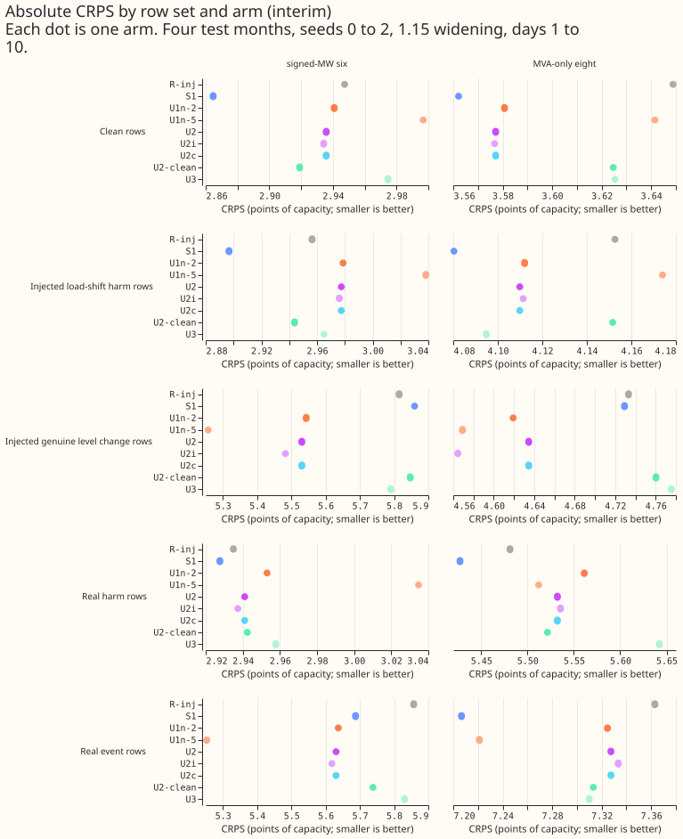
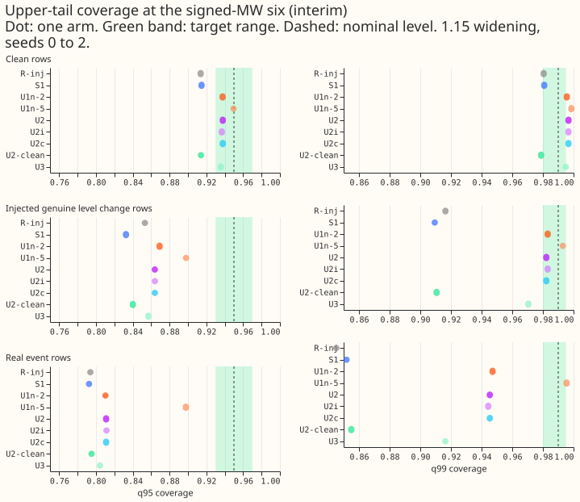
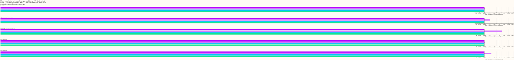
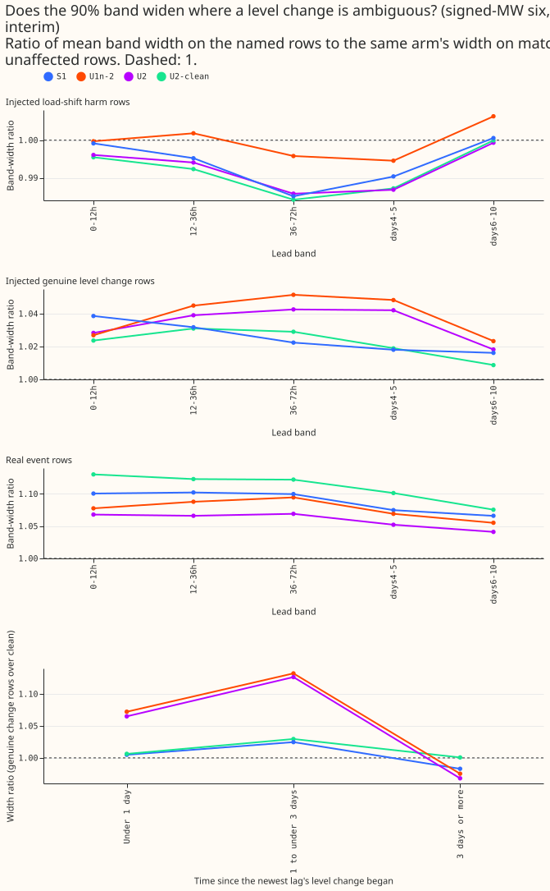
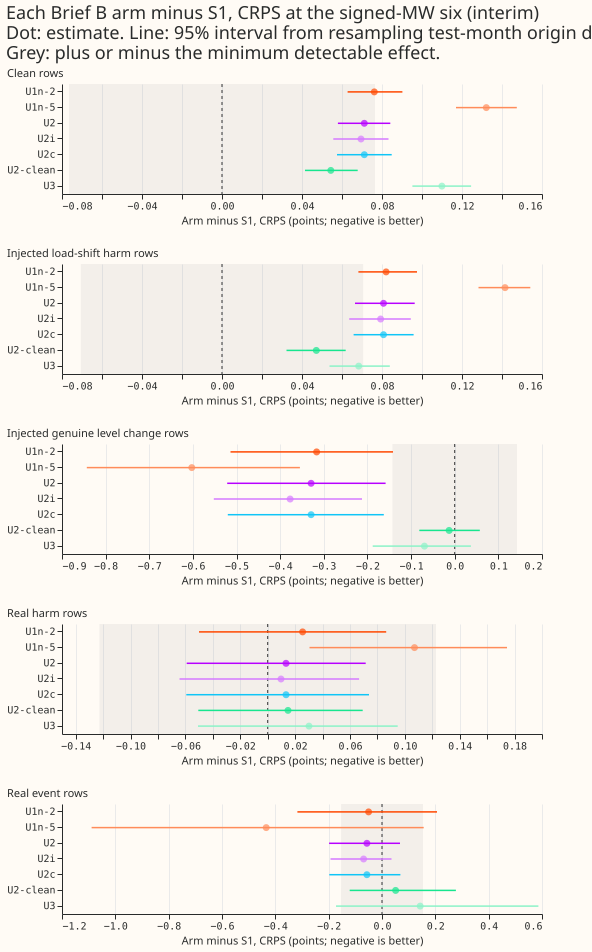
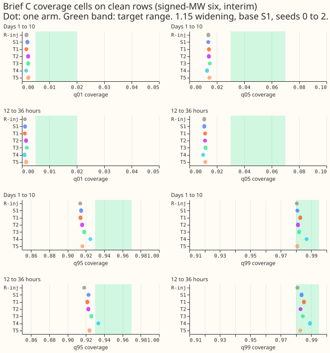
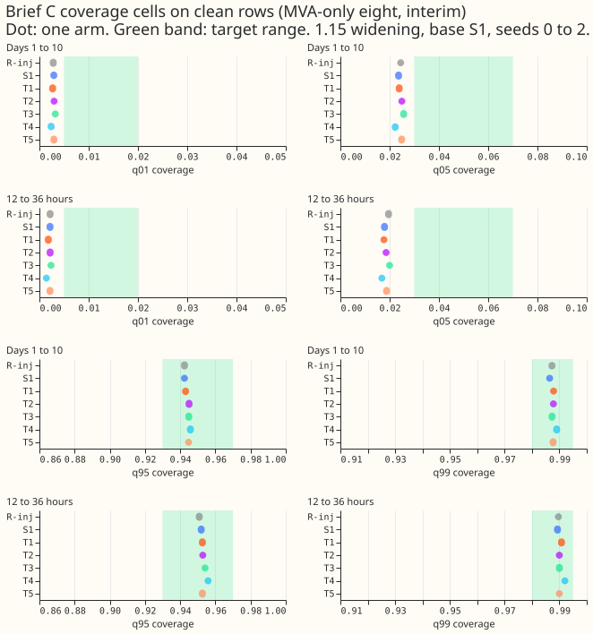
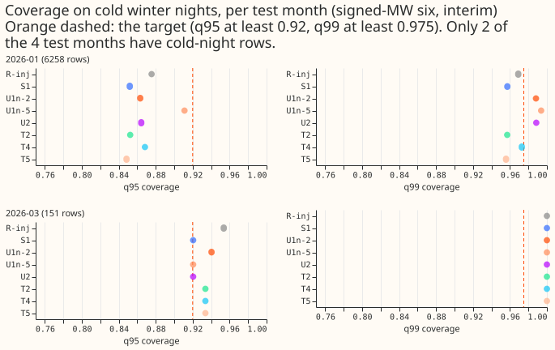
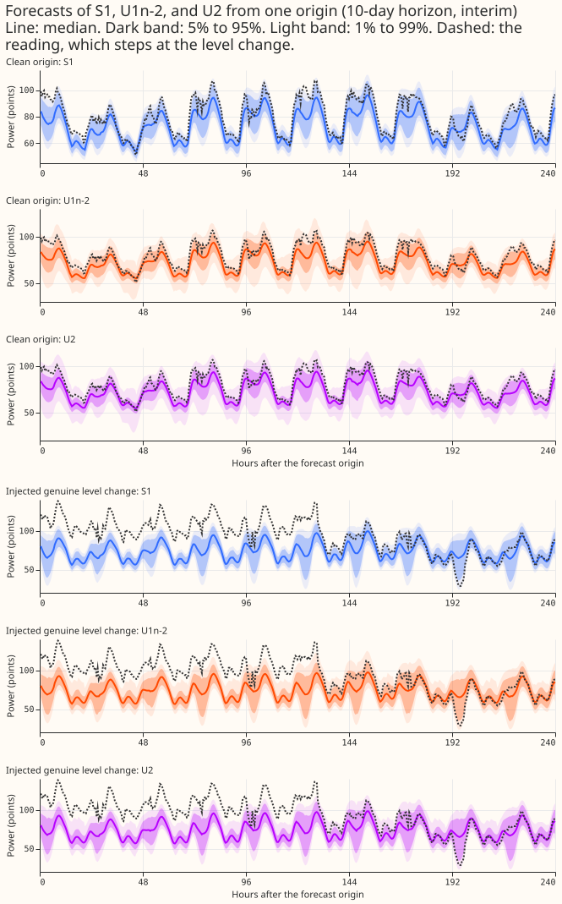
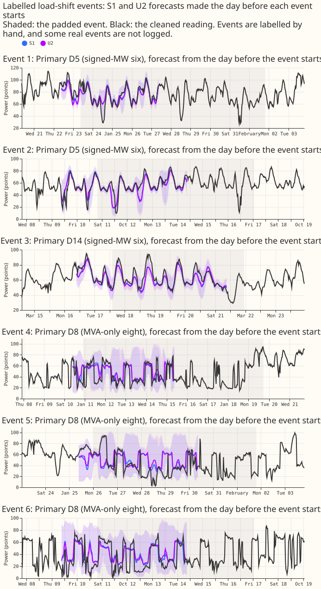

**Take-home message: training the forecast neural network on examples of genuine level changes makes
its upper bands wide where a jump in recent power is ambiguous, but the same training makes the
bands too wide on clean rows and raises the clean-row error by more than the limit we set, so no arm
passes. The extra scale-only path learned no widening by itself, and none of the five tail changes
brought clean-row upper-tail coverage into the target range. Verdict: not supported. Every number is
interim, from four test months.**

**Two questions drove the experiment: whether training on genuine level changes widens the bands
where a jump is ambiguous, and whether a change to the tails fixes the clean-row coverage.** The
demand forecast is a neural network that returns 11 quantiles. First, can the neural network be
taught to widen its upper bands when a recent power reading may be corrupted by a load-shift event,
or may instead be a genuine level change (a new connection, or a generator curtailed for days)? We
trained it on simulated worlds in which some jumps are genuine level changes added to both the
recent readings and the target, and we added a separate path that can only widen the bands. Second,
can a change to the tails of the output distribution bring the clean-row upper tails into their
target range? We scored every arm against the forecasts of experiments
[428](../00428-day-window-convolution-attention-encoder-replacing-lagged-power-inputs/result.md) and
[439](../00439-surprise-at-the-lags-confirmation-on-seeds-three-to-five/result.md). Training on
genuine level changes widened the bands where intended, and the widening spilled over onto clean
rows. The separate widening path and the tail changes did not help. The "after table P" rules (table
P is the stratified recalibration table of experiment 435) cannot be settled yet (see "What is still
interim").

## How to read the numbers

**Unless a column says otherwise, every number is a score at days 1 to 10, after the 1.15 widening
of the bands, at the six Primary substations metered in signed megawatts (the "signed-MW six").**
CRPS is the continuous ranked probability score in percentage points of effective capacity (smaller
is better). Coverage at q95 is the share of readings at or below the 95th-percentile forecast, so
the target is near 0.95. The MVA-only eight are the Primaries metered in unsigned megavolt-amperes
(MVA). The four test months are 2025-10, 2026-01, 2026-03, and 2026-06, with seeds 0 to
2. The arms are listed in the plan below. In short: S1 is the neural network given three lagged
   power readings plus the surprise at each; R-inj is the same neural network without the surprise;
   U1n-2 and U1n-5 are S1 trained on worlds with genuine level changes in 2% and 5% of training
   rows; U2, U2i, U2c, and U2-clean add the scale-only path (U2i adds an interval-score term, U2c
   adds a coverage-matching penalty, and U2-clean trains on worlds with no genuine level changes);
   U3 masks lags at prediction time; and T1 to T5 are the Brief C tail changes on the S1 base.

**Row sets.** A clean row has recent power outside every logged load-shift event. An injected harm
row holds a simulated load-shift event added to clean power. An injected genuine-level-change row
(`gen_jump`) has a genuine level change in force at one of the three lags. A real event row has its
target inside a logged event, and a real harm row has a target outside every event but recent power
inside one. The injected genuine level changes come from the same generator as the training worlds
of U1n and the scale-only arms, with different random draws, so those rows are in-distribution for
the U arms only. The comparison on them between S1 or R-inj and a U arm is therefore not like for
like.

## Brief B: genuine level changes in the training worlds

**Training on worlds with genuine level changes widens the upper bands on the rows where a jump is
ambiguous.** Table 1 gives the signed-MW six. On injected genuine-level-change rows, q99 coverage
rises from 0.909 (S1) and 0.916 (R-inj) to 0.983 (U1n-2) and 0.993 (U1n-5). On real event rows,
which the training worlds did not simulate, q99 coverage rises from 0.852 (S1) to 0.947 (U1n-2) and
0.995 (U1n-5).

**The same training also widens the bands on clean rows, where they were already close to target.**
Clean-row q95 coverage rises from 0.915 (S1) to 0.938 (U1n-2), inside the target range of 0.93 to
0.97. Clean-row q99 coverage rises from 0.981 to 0.996, above the target range of 0.98 to 0.995. The
clean-row CRPS rises by 0.076 points (95% interval 0.063 to 0.090, minimum detectable effect 0.077)
for U1n-2 and by 0.132 (0.117 to 0.147) for U1n-5. Both are above the pre-registered limit of 0.03.

| Arm | Clean CRPS | Clean q95 | Clean q99 | Genuine-change CRPS | Genuine-change q99 | Real event q99 | Real harm q99 pinball |
|---|---|---|---|---|---|---|---|
| R-inj | 2.947 | 0.914 | 0.980 | 5.815 | 0.916 | 0.845 | 0.254 |
| S1 | 2.865 | 0.915 | 0.981 | 5.860 | 0.909 | 0.852 | 0.276 |
| U1n-2 | 2.941 | 0.938 | 0.996 | 5.543 | 0.983 | 0.947 | 0.284 |
| U1n-5 | 2.997 | 0.950 | 0.999 | 5.257 | 0.993 | 0.995 | 0.316 |
| U2 | 2.936 | 0.938 | 0.997 | 5.531 | 0.982 | 0.945 | 0.268 |
| U2i | 2.934 | 0.937 | 0.997 | 5.483 | 0.983 | 0.944 | 0.265 |
| U2c | 2.936 | 0.938 | 0.997 | 5.531 | 0.982 | 0.945 | 0.268 |
| U2-clean | 2.919 | 0.914 | 0.979 | 5.847 | 0.911 | 0.855 | 0.279 |
| U3 | 2.975 | 0.936 | 0.995 | 5.790 | 0.970 | 0.916 | 0.278 |

Table 1: signed-MW six, seeds 0 to 2, four test months. The row counts are 254,725 clean rows,
43,009 genuine-change rows, 31,898 real event rows, and 40,643 real harm rows. The last column is
the q99 pinball loss on real harm rows (points).

**The scale-only path (U2) learned no widening, and U2 scores like U1n-2.** The mean scale factor of
U2 is 1.000 on every row set, including injected harm and genuine-change rows. The path is
connected: U2i has the same code and reaches factors up to 3.3, which rise with the surprise. U2
learned no widening because the last-layer bias of the factor fell from -5.0 to about -5.17, and the
factor stays 1.0 even at a surprise of 5 or 20. U2 and U2c have the same scores to three decimals
on every row set, so the coverage-matching penalty did nothing. U2i's interval-score term does
produce widening: on genuine-change rows its CRPS is 5.483 against 5.531 for U2, and its q99
pinball loss is 0.371 against 0.431. Its mean scale factor is 1.001 on clean rows, 1.011 on injected
harm rows, 1.037 on genuine-change rows, and 1.015 on real event rows. Within 0.007 CRPS points on
clean rows, U2, U2i, and U2c match U1n-2 (2.941), so the widening on clean rows also came from the
training worlds.

**The band-width ratios show where the widening lands.** The ratio is the mean width of the 5% to
95% band on the named rows over the same arm's width on matching unaffected rows. U1n-2 and U2 widen
the band by a ratio of about 1.07 on genuine-change rows in the first day after the change began
(U2-clean: 1.006), and by about 1.13 at 1 to 3 days. After 3 days the ratio falls to 0.97, so the
band is no wider than on unaffected rows. U1n-5 stays wide after 3 days (1.39). U2-clean keeps a
ratio of 0.994 on injected harm rows, inside 0.02 of 1.00. Because U2 matches U1n-2 here, the
first-day widening comes from the location neural network trained on the new worlds, not from the
scale path.

**Contrasts against S1 show a clear rise in CRPS on clean and injected harm rows and a clear fall on
genuine-change rows.** Table 2 gives CRPS differences with 95% intervals from resampling origin days
within test months, and the minimum detectable effect (MDE) from the seed spread of R-inj. On real
event and real harm rows every interval includes zero, except U1n-5 on real harm rows (+0.107, 0.030
to 0.174).

| Row set | MDE | U1n-2 minus S1 | U2 minus S1 | U2i minus S1 | U2-clean minus S1 |
|---|---|---|---|---|---|
| Clean | 0.077 | +0.076 (+0.063 to +0.090) | +0.071 (+0.058 to +0.084) | +0.069 (+0.056 to +0.083) | +0.054 (+0.042 to +0.068) |
| Injected harm | 0.071 | +0.082 (+0.068 to +0.098) | +0.081 (+0.066 to +0.096) | +0.079 (+0.064 to +0.094) | +0.047 (+0.032 to +0.062) |
| Genuine change | 0.143 | -0.316 (-0.514 to -0.141) | -0.329 (-0.522 to -0.159) | -0.377 (-0.552 to -0.213) | -0.013 (-0.081 to +0.057) |
| Real event | 0.153 | -0.050 (-0.317 to +0.206) | -0.057 (-0.198 to +0.067) | -0.069 (-0.193 to +0.036) | +0.051 (-0.121 to +0.277) |
| Real harm | 0.123 | +0.025 (-0.050 to +0.086) | +0.013 (-0.059 to +0.072) | +0.010 (-0.064 to +0.067) | +0.015 (-0.051 to +0.069) |

Table 2: CRPS difference from S1 (points; negative favours the arm), signed-MW six. For reference,
S1 minus R-inj on clean rows is -0.083 (-0.095 to -0.070).

**The pre-registered predictions for Brief B.** P1 holds (U2-clean's width ratio on injected harm
rows is 0.994). P2's numbers hold for U2 (a ratio of 1.065 on the first day and 0.968 after 3 days),
but the cause predicted in the plan does not: U2's first-day ratio equals U1n-2's, so the scale path
did not raise it. P3 holds (U2i adds 0.000 q99 coverage on injected harm rows). P4 holds (the mean
scale factor on clean rows is 1.000 for U2 and U2c and 1.001 for U2i), but for U2 and U2c a factor
of 1.000 means the path learned nothing, not that a penalty worked.

**Table P changes the picture, and its numbers are interim.** The "after P" variant here is this
experiment's own refit of the recalibration table on earlier folds (the first fold is not scored),
which differs from table P of experiment 435. Experiment 435's table is unreviewed for science and
is not yet merged, so every after-P number is interim. After P, clean-row q99 coverage at the
signed-MW six falls to 0.963 for R-inj and S1, 0.944 to 0.956 for U1n-2, U2, U2i, U2c, and U2-clean,
and 0.974 for U1n-5, on three folds (199,635 clean rows). Clean q95 coverage after P is 0.894 to
0.910 for every arm, so the refit table does not lift q95 either.

## Why no Brief B arm passes

**No Brief B arm passes the pre-registered rules.** The decision rule compares each arm with R-inj
after table P. Table P is not final, so the rules were read on raw forecasts, on the 1.15 widening,
and on this experiment's own refit of table P.

- **Clean-row tail limit.** At the 1.15 widening, every U arm except U2-clean exceeds R-inj's
  clean-row tail pinball by more than 0.02 (q99 pinball +0.043 to +0.056 for U1n-2, U1n-5, U2, U2i,
  U2c, and U3), and their clean-row q99 coverage of 0.995 to 0.999 is above the target range.
  U2-clean stays inside the limit and also does not widen on jump rows (genuine-change q99 coverage
  0.911), so U2-clean fails the purpose of the rule. After the refit table P, only U1n-5 meets the
  clean-row limit, and its band-width ratio after 3 days is 1.27 (the rule allows 1.05 on classes
  where R-inj already passes, so the 1.27 reading is rough).
- **Cold winter nights.** No arm reaches q95 0.92 and q99 0.975 at the signed-MW six on every fold
  with cold-night rows (Figure 6). The best is U1n-5 at 0.911 and 0.994 pooled over the two folds.
- **Real harm rows.** The q99 pinball loss on real harm rows exceeds R-inj's (0.254) by more than
  0.02 for S1 (+0.022), U1n-2 (+0.030), U1n-5 (+0.062), U2-clean (+0.025), and U3 (+0.024). It does
  not for U2 (+0.014), U2i (+0.011), and U2c (+0.014).
- **Not evaluated.** Rule (a), the coverage tolerances of experiment 435 per class of input
  condition, and rule (d), the real-event q95 check with event-cluster intervals, were not computed
  because they need experiment 435's table P and its tolerances. Neither rule can make an arm pass
  alone, and the other rules already fail every arm.

## Brief C: changes to the tails, base S1

**No tail arm moves clean-row q95 coverage into the target range of 0.93 to 0.97.** At the signed-MW
six, clean-row q95 coverage is 0.915 for S1 and 0.914 to 0.925 for T1 to T5 (Table 3). The
pre-registered prediction P5 (at least one of T1, T2, and T3 lifts q95 to 0.93) fails, and so does
P6 (T5 lifts cold-night q95 by 0.05): T5's cold-night q95 coverage is 0.850 against 0.853 for S1.
P7 holds, because no arm reaches q95 0.92 and q99 0.975 in every fold.

| Arm | Clean CRPS | Clean q95 | Clean q99 | Clean q05 | Real harm q99 pinball minus R-inj | Cells met (of 8) |
|---|---|---|---|---|---|---|
| S1 | 2.865 | 0.915 | 0.981 | 0.014 | +0.022 | 2 |
| S1, three seeds pooled | 2.823 | 0.924 | not read | not read | not read | not read |
| T1 (Student-t components) | 2.869 | 0.914 | 0.983 | 0.014 | +0.021 | 2 |
| T2 (pinball term in the loss) | 2.858 | 0.916 | 0.981 | 0.014 | +0.015 | 2 |
| T3 (tail fine-tune) | 2.847 | 0.918 | 0.982 | 0.015 | +0.021 | 2 |
| T4 (five seeds pooled) | 2.809 | 0.925 | 0.987 | 0.013 | +0.023 | 3 |
| T5 (temperature-dependent tail weight) | 2.854 | 0.916 | 0.981 | 0.015 | +0.016 | 2 |

Table 3: signed-MW six, clean rows, 1.15 widening. The "cells" are the four tails (q01, q05, q95,
q99) times two windows (days 1 to 10, and 12 to 36 hours), each in its target range. The S1 pooled
row is the quantile-averaged forecast of S1's seeds 0 to 2.

**T4 has the lowest CRPS, and most of its gain is ensembling.** T4 scores 2.809 against 2.865 for
the mean of S1's per-seed scores, a gain of 0.056. The quantile-averaged forecast of S1's own seeds
0 to 2 scores 2.823 (about 2.825 when the three forecasts are pooled by distribution function), so
about 0.04 of the gain comes from averaging three seeds, and the two extra seeds add about 0.015.
S1's q95 coverage is 0.915 per seed and 0.924 pooled over three seeds, against 0.925 for T4. T4 is a
way to ensemble, not a way to calibrate tails.

**Every arm misses the lower-tail cells.** Clean-row q05 coverage is 0.013 to 0.015 against a target
range of 0.03 to 0.07, and q01 coverage is 0.002 against 0.005 to 0.02. T1 to T3 and T5 meet 2 of
the 8 cells, as S1 does, and T4 meets 3. No arm meets the rule that every cell is in range, that the
arm meets more cells than its base after the refit table P, and that cold nights reach target, so no
arm passes (`pass_brief_c` is false for every arm, group, and variant). At the signed-MW six the
lowest per-Primary clean q95 coverage is 0.892 to 0.912 across the five arms (T3 and T4 clear the
0.90 floor, T1, T2, and T5 do not), and D14's q95 coverage is 0.79 to 0.82.

## Cold winter nights

**On cold winter nights at the signed-MW six, no arm reaches the target of q95 0.92 and q99 0.975.**
The rows exist in two of the four test months: 6,258 rows in 2026-01 and 151 rows in 2026-03. Pooled
over the two months, q95 coverage is 0.853 for S1, 0.877 for R-inj, 0.850 to 0.870 for T1 to T5,
0.865 for U1n-2, and 0.911 for U1n-5. The U arms reach q99 coverage of 0.958 to 0.994, but their
pooled q95 coverage stays below 0.92 (0.851 for U2-clean to 0.911 for U1n-5). A slice with so few
days is not a test, and the minimum detectable effect on CRPS on this slice is 0.216.

**At the MVA-only eight, many arms reach the target.** S1 has pooled cold-night q95 coverage of
0.942 and q99 of 0.992, and every T arm and every U arm is above 0.92 and 0.975 as well, so the
cold-night shortfall of the signed-MW six does not appear at the MVA-only eight. Table P (this
experiment's refit) lowers cold-night coverage everywhere at the signed-MW six (q95 0.709 to 0.830).

## Encroachment sweep

**Interim, seed 0 only: no arm widens its bands by more than 3% when the recent power readings step,
and every arm that sees the surprise passes more of the step through to the median than R-inj
does.** The sweep follows the protocol of experiment
[392](../00392-xgboost-nra-load-shift-masked-targets/result.md). It adds a step of 5% of effective
capacity to the same lagged power readings in every arm, rebuilds every input that depends on those
readings (the surprise included), and compares the forecast with the unstepped forecast. It reads
lead times of 24 to 72 hours, in the four test months, on clean rows. Here k is the number of lags
stepped (1 to 3), the median share is the part of the step that reaches the forecast median, and the
width ratio is the 90% band width with the step over the width without it. The masked-lag control
hides all recent power after the step. Its gap from the unstepped masked forecast is exactly 0 for
every arm.

| Arm | Median share, k=1 | k=2 | k=3 | Width ratio, k=1 | k=2 | k=3 |
|---|---|---|---|---|---|---|
| R-inj | 0.025 | 0.025 | 0.075 | 1.000 | 1.001 | 1.001 |
| S1 | 0.025 | 0.125 | 0.225 | 1.000 | 1.004 | 1.007 |
| U1n-2 | 0.025 | 0.125 | 0.225 | 1.002 | 1.008 | 1.012 |
| U1n-5 | 0.025 | 0.125 | 0.175 | 1.005 | 1.018 | 1.028 |
| U2 | 0.025 | 0.125 | 0.225 | 1.002 | 1.008 | 1.012 |
| U2i | 0.025 | 0.125 | 0.225 | 1.002 | 1.008 | 1.012 |
| U2c | 0.025 | 0.125 | 0.225 | 1.002 | 1.008 | 1.012 |
| U2-clean | 0.025 | 0.125 | 0.175 | 1.000 | 1.003 | 1.007 |

Table 4: seed 0, step of 5% of effective capacity, pooled over the four test months, every
Primary, and both signs of the step, on clean rows from every third daily origin (about 98,800 rows
per cell).

**The widening of the arms trained on ambiguous worlds does not come from a response to a step in
the lags.** The largest width ratio is 1.028 (U1n-5 at k=3), so no arm widens by more than 3%. The
widening on genuine level changes that Brief B reports therefore comes from learning on the new
training worlds. This experiment reads that widening on the held-out worlds with injected genuine
level changes, not on this sweep.

**Every arm that sees the surprise passes more of the step through than R-inj does.** At k=3 the
median share is 0.075 for R-inj, 0.225 for S1, U1n-2, U2, U2i, and U2c, and 0.175 for U1n-5 and
U2-clean. Even the largest share leaves more than three quarters of the step out of the median.

**The sweep differs from the registered plan.** The plan listed steps of 2.5% and 5% of effective
capacity and 10% of the Primary's trailing 30-day mean power. Table 4 reports the 5% step of
effective capacity only, and the other seeds were not swept.

## Example forecasts

**The examples show S1, U1n-2, and U2 on one clean origin and on one origin with an injected genuine
level change.** In both examples the bands of U1n-2 and U2 are wider than S1's. In the level-change
example the reading steps above the forecast for about 5 days, and the median of every arm stays
low.

## Checks

- **Median minus mean forecast, per Primary (clean rows, seed 0, unwidened).** The stored forecasts
  hold 11 quantiles and no mean, so the mean is the average of the 11 quantiles (a proxy). The
  difference ranges from -5.5 points (D15, S1) to +0.07 (D22, S1). D15 reads -5.18 for R-inj, -5.54
  for S1, -5.23 for U1n-2, and -5.20 for U2, so the difference does not explain the contrasts.
- **Error of the median forecast (clean rows, seed 0, unwidened).** The mean absolute error of q50
  at the signed-MW six is 5.361 (R-inj), 5.151 (S1), 5.255 (U1n-2), 5.277 (U2), and 5.271 (U2i), so
  S1 leads on both CRPS and median error. At the MVA-only eight the error is 8.565 (R-inj), 8.254
  (S1), 8.192 (U1n-2), 8.166 (U2), and 8.165 (U2i), so U1n-2, U2, and U2i have a lower median error
  than S1 but a higher CRPS (3.581, 3.577, and 3.577 against 3.562). The two measures point in
  different directions at the MVA-only eight.
- **Triggers that fired.** Trigger 3 (CRPS and median error disagree) fires at the MVA-only eight
  for U1n-2, U2, and U2i against S1, on seed 0 only. The other triggers did not fire: the masked-lag
  control held at a gap of exactly 0 for every arm (Table 4), the U2-clean control holds P1, S1
  reproduces experiment 439's clean-row CRPS (2.865 against 2.866 on different seeds), U2 matches
  U1n-2 on clean rows, and U2i beats U2 on the rows it was built for. Leaving one site out was not
  run.
- **Audit by a fresh reviewer.** The reviewer re-derived the clean-row CRPS and q95 and q99 coverage
  of S1, U1n-2, U2, and T4, and the q99 coverage of S1 and U1n-2 on real event rows, from the stored
  forecasts, and all matched. The reviewer found no bug in the injected worlds (the shift is equal
  on the lags and the target, the held-out seeds 400 to 402 are disjoint from the training seeds 300
  to 303 apart from at most 2.9% overlap of draws, and the lagless table is untouched).

## What is still interim

- **The after-P rules wait for experiment 435.** The table P here is this experiment's own refit on
  earlier folds, and experiment 435's table P is unreviewed for science, so every after-P number is
  interim.
- **The encroachment sweep is interim.** Table 4 covers seed 0 only, because the other seeds were
  not swept. This experiment's widening on genuine jumps is read on the held-out worlds, not on the
  sweep.
- **Table 1 and the figures use seeds 0 to 2.** B-mix, L0, and R exist for seed 0 only, and they are
  not in the tables.

## Caveats

- **The genuine-level-change rows favour the U arms.** The held-out genuine-level-change worlds use
  the same generator as the U arms' training worlds, so those rows are in-distribution for the U
  arms only, and the R-inj and S1 rows there are not a like-for-like contest.
- **The true rate of genuine level changes is unmeasured.** We swept 2% and 5% of training rows. The
  band width a U arm learns depends on that rate and on the duration distribution.
- **Unlogged events.** National Grid Electricity Distribution (NGED) says some load-shift events are
  missing from its logs. Rows labelled clean can hold events no label covers, so every clean-row and
  harm-row figure is a lower bound on the effect of events, and the real event rows undercount.
- **Seeds and arms.** B-mix, L0, and R exist for seed 0 only. U2-clean was fitted here.
- **Cold winter nights.** The slice has rows in two of the four test months (2026-01 and 2026-03),
  and 2026-03 has 151 rows.
- **Actuals corrected to the normal running arrangement (NRA).** The corrections come from
  experiment 435's measured deviation (34 of 184 events) or from the labelled depth. Experiment
  435's files were code-reviewed and are not final.
- **S1's real-harm tail.** S1's q99 pinball loss on real harm rows is 0.276 against 0.254 for R-inj
  (+0.022), above the 0.02 limit, as in experiment 439. Of the other arms, U1n-2, U1n-5, U2-clean,
  U3, T1, T3, and T4 also exceed R-inj's by more than 0.02, and U2, U2i, U2c, T2, and T5 do not.
- **Horizon.** The forecasts reach 10 days, but the cold-night rows and the real events are few, so
  none of this result shows a gain at the 12 to 36 hour range alone.

## What to try next

- **Test whether a recalibration table removes the clean-row widening.** A recalibration table
  fitted per class of input condition might remove the widening on clean rows once experiment 435's
  table P is final, and U1n-2 after that table would be the first check.
- **Give the scale path a signal that moves it.** U2's factor stayed at 1.0 and U2i's rose with the
  surprise, so an interval-score term is the part of the design worth testing alone.
- **Judge the tail changes on the signed-MW six cold nights first.** No tail arm moved coverage
  there, so a change that does not need cold-night rows to show an effect is more informative.

## Problems from the move to nged-ml-research

None.

## Plan, as registered before any fit

*The plan below is kept as written, apart from the status line.*

## Question

**Two questions share one batch of fits, because both ask whether a trained change can do what a
lookup table of widening factors might do alone.** The demand forecast is a neural network that
returns 11 quantiles. Its upper bands are too narrow in two places. First, when the recent power
readings it was given are untrusted (they may sit inside a load-shift event, or be missing or
stale), the bands do not widen, because a neural network fitted to a clean target has no reason to
widen (the argument is in the design note of the uncertainty programme). Second, on clean rows the
upper tail covers too little: S1's q95 and q99 cover 0.920 and 0.985 of clean readings at the
signed-MW six (experiment 439), and on cold winter nights the pooled plain neural network's q95 and
q99 cover only 0.76 and 0.83 (experiment 441).

**Experiment 435 is fitting table P, which widens the bands by a factor per class of input
condition, from stored forecasts and with no new fit.** Table P does not exist yet. This experiment
asks whether a fitted change does better than P laid over the same neural network: Brief B changes
the training worlds and adds a path that can only widen (arms U1n, U2, U2i, U2c); Brief C changes
the tails on clean rows (arms T1 to T5). Both ride on S1, the neural network that experiment 439
confirmed. "Better than P" cannot be decided until P exists, so the plan scores every arm raw and at
1.15 now, and applies the "after P" rules to the stored forecasts when experiment 435 delivers P.

**Definitions used throughout.** The signed-MW six are the Primary substations metered in signed
megawatts, and the MVA-only eight are metered in unsigned megavolt-amperes; D15 and D18 are reported
separately. A clean row has recent power outside every logged load-shift event. A harm row has a
target outside every event but recent power inside one (injected harm rows hold simulated events
added to clean power; real harm rows hold logged ones). A real event row has its target inside a
logged event. A cold winter night is defined as in experiment 441: solar elevation below 0, local
month November to March, and ensemble (ENS) mean 2 m temperature at or below the Primary's 10th
percentile of winter-night ENS temperatures in the 730 days before the fold's refit.

**The cold-winter-night slice is read on fewer folds than every fold.** Experiment 441's mask table
has cold-winter-night rows only for 2025-12, 2026-01, and 2026-03. It has none for 2025-10 or
2026-06, and 2025-12 is not a test fold of experiment 428. Every rule that reads the
cold-winter-night slice is therefore judged on the folds that have rows, not on all folds.

## Decisions already made

- **One experiment, 446, hosts Brief B and Brief C as one batch.** It runs in experiment 428's
  harness, with module-global redirection of the output folders as experiments 438 to 440 did.
  Experiment 428's folders are read and never written. The base neural network is S1.
- **Shared reference arms and rows.** R-inj, S1, and B-mix are read from experiment 428's stored
  forecasts (seeds 0 to 2) and 439's (seeds 3 to 5, used only where an arm needs extra seeds). All
  new arms share the held-out worlds (world 0 is the real clean series; worlds 4 to 6 are
  experiment 428's injected ones) and the row sets of experiment 428.
- **Order.** Brief B is fitted and scored first. Brief C's base is the Brief B arm with the lowest
  raw clean-row CRPS among arms that meet the 1.03 scale limit and the coverage tolerances on raw
  and 1.15 forecasts; otherwise S1. The brief says R-inj; the plan uses S1 because S1 is the
  confirmed base (experiment 439). Brief C therefore starts after Brief B is scored.
- **Cadence.** Monthly refits on the 24 months before each test month (the research default), four
  test months, three seeds. A candidate that passes is re-checked on more folds before any release
  claim, and the release claim needs the 12 folds of experiment 425.
- **Wind.** The per-wind-speed-band copy of T2 runs only if experiment 435 shows P cannot fix the
  wind upper tail. It is not in this experiment, so the wind rule that
  flags 1.5% of rows above q99 is not applied here either.

## Arms and fit counts

**One fit is one neural network for one arm, one test month, and one seed (4 folds x 3 seeds = 12
fits per arm).**

| Brief | Arm | What changes from S1 | Fits |
|---|---|---|---|
| B | U1n at 2% | S1 trained on worlds that add genuine NRA level changes to lags and target together, at 2% of training rows | 12 |
| B | U1n at 5% | The same worlds at 5% of training rows | 12 |
| B | U2 | U1n at 2% plus a scale-only path (factor 1 + softplus(g) on every component's standard deviation) | 12 |
| B | U2i | U2 plus the 90% and 98% interval score on corrupted rows | 12 |
| B | U2c | U2 plus the coverage-matching penalty (improper; labelled) | 12 |
| B | U2-clean | The scale-only path trained on clean-target worlds, as experiment 428 planned (read from experiment 428 if already fitted; otherwise fit here) | 12 (0 if read) |
| B | U4 (conditional) | Experiment 404's B1, normal lagged head, trained on U1n worlds | 12 |
| C | T1 | Student-t mixture components, degrees of freedom learned and at least 2.5 | 12 |
| C | T2 | Negative log-likelihood plus 0.2 times the pinball loss at q01, q05, q95, and q99 | 12 |
| C | T3 | Trunk frozen, head fine-tuned for a few epochs on the four tail pinball losses | 12 |
| C | T4 | 2 extra seeds of the base, 5 mixtures pooled | 8 |
| C | T5 | T2 with a tail weight that depends on the ENS-mean temperature | 12 |

**Totals.** Brief B has 72 fits (6 arms of 12), Brief C has 56, so the batch is 128 fits, plus 12
for U1n with trimmed durations at 2% (24 with the 5% rate), 12 for U4 if experiment 404's stop rule
did not fire, and up to 36 for 5% U2, U2i, and U2c only if U1n at 5% matches held-out coverage
better. U3 (20 masked passes with a mask probability that rises with the lag's surprise) is
prediction only and has no fit; it is run if U1n's token dropout does not match the masking, which
means U3's 90% band-width ratio on injected harm rows is not within 0.02 of U1n-dropout's.

**The seeds, the lagless tables, and the compute time.** Seeds 0 to 2 use experiment 404's frozen
cross-fitted lagless tables. S1-sized fits took about 30 seconds each in experiment 439 (24 fits in
about 11 minutes), and the briefs allow 1 to 3 minutes. The batch is therefore about 1 to 6 GPU
hours, in one graphics processing unit (GPU) process under 8 GB plus one feeder core, and Brief B
comes first.

**Design choices fixed before any score is read.**

- **U1n's worlds.** Experiment 428's three injected worlds (seeds 100 to 102) plus genuine NRA level
  changes, in which depth and duration are drawn from the ranges in the label table and the shift
  enters the lags and the target together. Token dropout 0.2 on lags and spread, and 8 origin hours.
  The 2% rate runs first. The scale-only arms (U2, U2i, U2c) train on the 2% worlds; the 5% rate is
  a sweep of U1n only, and a 5% rate for U2 is run only if the 5% U1n arm is closer to the held-out
  world's coverage than the 2% arm. The held-out world is a world with injected genuine level
  changes, built the same way as U1n's training worlds but with different draws, scored on
  clean-target rows for the load-shift worlds. It is new in this experiment and held-out for all
  arms; P2 and the "closer to the held-out world's coverage" rule read it. The write-up states that
  the true rate of genuine level changes is unmeasured.
- **Duration.** The load-shift session reported a median event duration near 48 hours and about
  10% of events above 7 days (unverified). The code checks both figures against the corrected label
  table
  (`sw_block_detector_label_table_corrected.csv`; the sign was wrong for 51 of 112 rows before the
  correction) before the first fit. For U1n only, the duration distribution is swept (the label
  table's own, and a version with the upper tail trimmed) beside the rate.
- **U2's scale path.** The surprise magnitude, lag ages, missing flags, and lead feed a factor
  1 + softplus(g), initialised at 1, with a penalty on the mean log factor on clean rows. The
  stored inputs hold no weather-age column, so the scale path has 11 inputs: 3 absolute surprises,
  3 lag ages, 3 missing flags, and the 2 lead columns (`lead` and `lead_sqrt`, in place). The scale
  path adds its own inputs; the location path is S1's neural network, unchanged (it takes the signed
  surprise directly), and receives no gradient from the scale-only loss terms. U2i and U2c compute
  their interval-score and coverage-penalty terms with the mixture weights, means, and base spread
  detached, so only the factor g receives gradient from them.
- **U2-clean.** This arm is experiment 428's planned scale-only arm: the U2 neural network on worlds
  without U1n's genuine level changes. Running it beside U2 makes the training worlds the only
  difference. Experiment 428's earlier widening path (E3-surp-w) learned no widening on the clean
  target; U2-clean is the control that tests whether the same holds on the S1 base.

## Earlier advice followed and departed from

- **Followed.** S1 is the base (experiments 428 and 439). Q99 pinball loss on real harm rows is
  reported beside every arm (experiment 439's advice). Every slice carries its seed-spread minimum
  detectable effect, and a slice with fewer than 20 dates is not called a test (experiment 441's
  advice). The sweep steps the same lags in every arm (experiment 428's advice).
- **Departed from.** Experiment 428 advised "do not train a widening path on the clean target". U2
  does not do that: U2 trains on worlds in which the jump is ambiguous, and U2-clean repeats the
  clean-target design as the control.

## Handling the S1 tail caveat

**Experiment 439 found S1's q99 pinball loss on real harm rows 0.026 higher than R-inj's, above the
0.02 limit.** Three rules handle it.

1. Every table reports q95 and q99 pinball loss and coverage of S1 beside R-inj, for every row set.
2. Every Brief C tail arm is scored on real harm rows against both S1 and R-inj as comparators.
   (The arms are fitted once, on the Brief C base. The R-inj comparison is a second reference in
   the table, not a second fit.)
3. The clean-row tail pinball limit of +0.02 is measured against S1 as well as against the base.

## Slices, row sets, and actuals

- **Row sets** as in experiment 428: clean, injected harm, real harm, and real event rows, for the
  signed-MW six, the MVA-only eight, and D15 and D18 (report-only). Real event and real harm rows
  are reported with and without the largest event, with event-cluster intervals.
- **Cold-winter-night slice.** A named slice in every coverage table and every pass rule, defined as
  in experiment 441 (its mask code is imported, not copied). Targets: q95 coverage at least 0.92 and
  q99 at least 0.975 per group (the accepted tolerances of 0.03 and 0.015 from nominal), with
  month-block intervals. The table first lists the row and day counts and the minimum detectable
  effect from the seed spread, then each arm per fold. For orientation, experiment 441's counts on
  its scored set were 11,793 rows on 21 days at the six and 16,958 rows on 28 days at the eight,
  in 3 of the 4 folds; the counts here are recomputed on this experiment's rows. Its minimum
  detectable effects on CRPS were 0.12 to 0.23, so a gain smaller than that is not detectable on
  the slice.
- **NRA-corrected actuals.** Real event rows are scored against the metered reading minus the
  measured deviation of the event at the donor and at each recipient, where experiment 402's step 2
  redo measured one, and against the labelled depth otherwise. The labelled-depth fallback is also
  scaled by 0.75 and 1.25, centred on the measured deviation where it exists. The page states how
  many events have a measured deviation and how many were dropped for lack of any depth. The
  metered flow is a secondary report. Experiment 435 builds these actuals; this experiment reads
  them if they exist before the first score and otherwise builds them with the same code.
- **Unlogged events.** NGED says some load-shift events are missing from its logs. Rows labelled
  clean can hold events no label covers, so every clean-row and harm-row result is a lower bound
  on the effect of events, and the real event rows undercount. The true rate of genuine level
  changes (new connections, a generator curtailed for days) is unmeasured.
- **Rate and duration.** A genuine level change and a load-shift event cannot be told apart at the
  start of a jump, so the band width that U2 learns depends on the injected rate and duration.
  The write-up reports the 2% and 5% rates side by side, and both duration distributions for U1n
  only.

## What can only be evaluated after table P

**Every rule that compares against "R-inj with P" or "the base with P" waits for experiment 435.**
Until P exists, the page reports each rule on raw and 1.15 forecasts and labels the result interim.

- Brief B (a), the classes where R-inj with P fails, which are not known until P exists.
- Brief B (b), (c), and (d), whose comparator is R-inj with P.
- Brief C's coverage cells after P, refitted on each arm's own validation months, and its
  comparison with "more cells than the base with P".
- Brief C's clean-row CRPS and lower-tail pinball limits against the base with P.
- Every cold-winter-night rule that reads "after P", including Brief B (e) and P6. The
  cold-winter-night stratum of table P is requested from experiment 435 (Brief A), and these rules
  wait for it.

Rules that can be read now, on raw and 1.15 forecasts: the predictions P1 to P7, the mean scale
factor on clean rows, the coverage cells before P, the cold-winter-night coverage targets before P,
the encroachment sweep, and the limits against S1. All quantile forecasts are stored (11
quantiles, every arm, every world, every seed), so the "after P" pass is a free re-score.

## Encroachment sweep, as registered

**Every arm, including the references, is swept with experiment 392's protocol and its masked-lag
control.** The code copies the pattern of `e00428_sweep.py` (and of `e00440_sweep.py`, which sits on
the unmerged branch `exp-440-windowed-surprise` and is therefore copied, not imported). A step of
2.5% and 5% of effective capacity, and of 10% of the Primary's trailing 30-day mean power, is added
to the recent power of clean rows (both signs), and the forecast distribution is compared with the
unshifted one: median shift as a share of the step, band-width ratio, and coverage. The same lags
are stepped in every arm. After the step, every input that is a function of the lags is rebuilt,
including the surprise. The masked-lag control hides all recent power after the step, and its
largest difference from the unshifted masked forecast must be below 1e-6.

## Standing practices

- **Cleaned data** everywhere (flagged `substation_zero` half-hours dropped; the count per fold is
  reported), and the D15 and D18 start cut at 2025-03-01.
- **Fits saved** (state files in the experiment's private data folder, never in git).
- **Stored forecasts reused:** R-inj, S1, B-mix, L0, and R from experiments 428 and 439. Fitted
  here: every arm in the table above. Reuse saves 4 arms x 12 fits for the references (B-mix needs
  no fit).
- **Tails and cost reported** beside the CRPS: q01, q05, q95, and q99 coverage and pinball loss per
  group and per Primary, cold winter nights, and the avoidable-curtailment cost on the scaled limit
  (experiment 84's pattern).
- **Example forecasts:** a day-ahead forecast (median, 50% and 90% bands, actual) and the full
  10-day horizon of one forecast (the stored forecasts reach 240 hours), for S1 and the arms that
  pass, so the reader sees whether the bands widen with lead.
- **Load-shift plots:** at least 6 time series plots across both metering groups, marking each
  event's start and end and showing the forecast response of S1, U2, and the best Brief C arm. The
  unlogged-event caveat above is stated beside them. Metered generators are anonymised.
- **Compute:** one GPU process under 8 GB plus one feeder core. Scripts run as `systemd-run --user
  --scope -p MemoryMax=16G -p OOMPolicy=continue`, with the multiprocessing "spawn" start method.
  The first minutes of the first run check `uptime` and `nvidia-smi`.

## Process and reviews

**The first commit contains this planned `result.md` and the row in the theme's Research plan
page.** No pull request is opened at plan time. Sonnet writes the code. A fresh Sonnet agent that
did not write it reviews the code before the first fit (leakage, the fit stopping at each fold's
`train_end`, the injected-world construction, the scoring, the match with experiment 428's recipe,
and that every quantile forecast is stored), and a second fresh Sonnet reviews the fixed code if
the first flagged many problems. Then the fits run, a fresh Sonnet reviews the results, the
write-up is written, and a fresh Sonnet reviews the write-up against the printed report, and a
second fresh Sonnet runs the prose review. A fresh Sonnet reviews this plan first, as the size
requires.

**Audit triggers to watch.** (1) A control fails: the masked-lag control not at 0, or U2-clean
widening on injected harm rows beyond P1. (2) A result contradicts its prediction or an earlier
experiment: S1 or R-inj reproduced here differing from experiment 439 or 428. (3) The quantile
score and the error of the median point in different directions. (4) Leaving one site out flips a
contrast's sign. (5) A nested arm beats the arm that contains it: U2 beating U2i on its own
corrupted-row interval score, or U2 failing to match U1n on clean rows. (6) A headline interval
more than twice or under half as wide as the same contrast's in experiments 428 or 439. (7) A later
design depends on an unreplicated headline. If any fires, the manager starts a fresh audit before
the prose review. The write-up has the "Checks" list: median minus mean forecast per site, the
error of the median beside each quantile contrast, and which triggers fired.

## Open items

- Experiment 435 has delivered no table P, no NRA-corrected actuals, and no per-Primary diagnostic
  yet, so every "after P" rule is deferred.
- The 5% rate and the duration sweep multiply fits only for U1n; whether the scale-only arms are
  also run at 5% is decided by the rule in the design choices above.

## Addendum: the rules that waited for table P, read on the final experiment 435 recipe

**Take-home: with the recalibration table as the baseline, no Brief B arm and no Brief C arm passes,
so no verdict above changes to a pass.** Two readings move. After table P, the injected-level-change
arms (U1n-2, U2, U2i, U2c, U2-clean, U3) lose real-event q95 coverage against R-inj at the signed-MW
six, and the cold-night coverage of the MVA-only eight falls to target only for U1n-5. All numbers
are interim and unaudited, from four test months and three scored ones for table P.

- **Method.** No forecast was read and nothing was fitted. The stored `P` score tables of this
  experiment already refit experiment 435's recipe (one factor per metering group, lead band, tail,
  and class, on the arm's own earlier folds). Experiment 435 has merged, and its recipe is unchanged
  for demand (no clip, because demand in signed MW has no common bound). R-inj's clean-row q95 and
  q99 coverage at the signed-MW six is 0.910 and 0.963 here, against 0.904 and 0.961 in experiment
  435, whose clean class leaves out lag-missing and large-surprise rows. This refit has no 200-row
  floor per cell, and judges no class beyond clean, injected harm, and the real-event classes.
- **Scored set.** Months 2026-01, 2026-03, and 2026-06 (the first fold fits only). Signed-MW six and
  MVA-only eight are separate; D15 and D18 are not judged. Code: `e00446_table_p_rules.py`.
  Intervals are event-cluster bootstrap intervals (10 events at the six, 6 at the eight).
- **"Without the largest event" now means something.** The stored `*_wo_largest` row sets of the
  main analysis drop nothing, because the longest event lies outside the scored rows. The addendum
  drops the event with the most scored R-inj rows instead.

| After P (clean rows) | CRPS | q95 | q99 | q05 | q01 |
|---|---|---|---|---|---|
| R-inj, signed-MW six | 3.115 | 0.910 | 0.963 | 0.043 | 0.008 |
| S1, signed-MW six | 3.029 | 0.904 | 0.963 | 0.041 | 0.007 |
| R-inj, MVA-only eight | 3.742 | 0.925 | 0.983 | 0.037 | 0.008 |
| S1, MVA-only eight | 3.681 | 0.918 | 0.980 | 0.041 | 0.009 |

Table 4: absolute clean-row scores with table P (points; coverage). Clean-row q95 stays below 0.93
at the signed-MW six for every arm (0.894 to 0.910) and at the MVA-only eight for every arm (0.912
to 0.925).

**Brief B, rule by rule (after P).**

- **(a) Class tolerances.** R-inj itself fails the tolerance on the generated level-change rows and
  on NRA-corrected real events at both groups, so an arm must meet them. Only U1n-5 at the MVA-only
  eight meets the first; no arm meets the second. Rule (a) fails for every arm.
- **(b) Clean-row cost against R-inj.** At the signed-MW six every U arm fails the tail-pinball
  limit (worst tail +0.039 for U1n-5, +0.062 for U2-clean, +0.125 to +0.147 for the others). At the
  MVA-only eight, six arms stay inside it (CRPS -0.004 to -0.057) and U1n-5 fails (+0.034).
- **(c) Band width.** All arms stay within the 1.05 ratio except U1n-5 at the signed-MW six (1.070).
- **(d) Real-event q95 coverage against R-inj.** After P, the interval for arm minus R-inj lies
  wholly below zero on at least one of the four sets (harm and NRA-corrected events, with and
  without the largest event) for U1n-2, U2, U2i, U2c, U2-clean, and U3 at the signed-MW six, and for
  every U arm and S1 at the MVA-only eight. U1n-5 at the six is not vetoed (+0.005 on NRA-corrected
  events). Under the 1.15 widening, only S1 and U2-clean at the eight were vetoed, so this reading
  moves. Intervals rest on 5 to 10 events and are wide, and the veto needs only one of four sets.
- **(e) Cold winter nights (pooled 2026-01 and 2026-03).** At the signed-MW six R-inj reaches 0.830
  (q95) and 0.922 (q99), and every U arm is lower (q95 0.709 to 0.780). At the MVA-only eight only
  U1n-5 reaches the targets (0.947, 0.998), and it fails (b). Under the 1.15 widening, every arm at
  the eight reached them, so P lowers cold-night coverage.
- **Extra limits.** The mean scale factor on clean rows is at most 1.03 for every arm. The q99
  pinball on real harm rows exceeds R-inj's by more than 0.02 for S1, U1n-2, U2, U2i, U2c, U2-clean,
  and U3 at the six, and for U1n-5 at the eight.

**Brief C (after P, base S1).**

- **Cells and limits.** Every T arm meets the same number of coverage cells as S1 at the signed-MW
  six (4), one more at the eight for T1, T2, T4, and T5 (6 against 5; T3 meets 5), and T4 meets one
  fewer at D15 and D18 (3 against 4). `pass_brief_c` is false for every arm and group, because no
  arm clears the cold-night and per-Primary q95 rules.
- **P6 fails.** T5's pooled cold-night q95 at the signed-MW six is 0.784 against 0.776 for S1
  (+0.008; the prediction needed +0.05).
- **P7 holds.** No arm reaches q95 0.92 and q99 0.975 in every fold at the six. At the eight, T4
  pools to q95 0.923 and q99 0.990 on 2026-01, but its 2026-03 q95 is 0.915.

**Which verdicts change.** None changes to a pass. Two readings change: rule (d) now vetoes most U
arms, and the cold-night result at the MVA-only eight now holds only for U1n-5.
