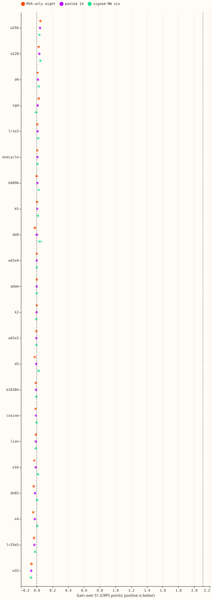
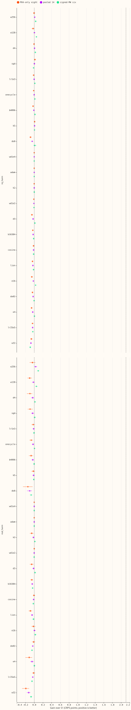
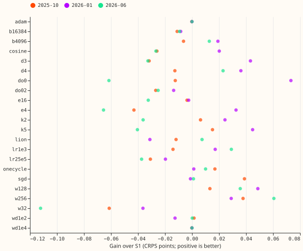
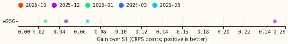
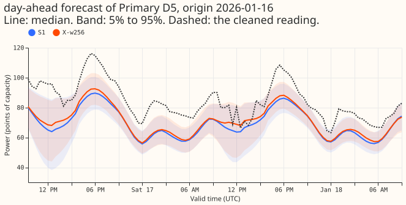
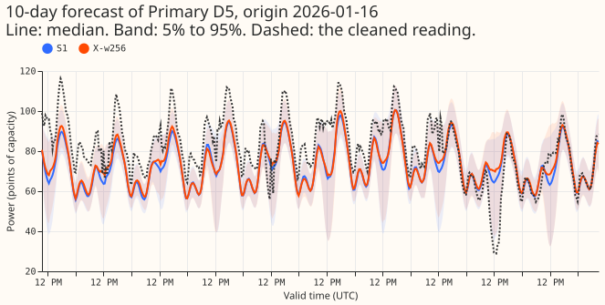

**Changing one setting of the S1 demand neural network at a time does not improve it by the margin
we required, so S1 stays as it is.** S1 is the pooled neural network of experiment 428 that reads
the three recent power readings and the surprise at each. We changed one setting at a time on 3
test months by 2 seeds and compared each change with S1 on clean rows, pooled over the 14
Primaries. The margin was 0.064 CRPS points (the seed minimum detectable effect; the agreed 0.03
never binds). No pre-registered arm reached it, so the stop rule ended the pre-registered
experiment: no random search, and no further arms. The verdict is **not supported**.

**Post hoc, the other 13 arms and a width-256 confirmation were run on the manager's request, and
the pre-registered verdict is unchanged.** None of the 13 arms moves S1. Hidden width 256 passes
the confirmation rule on 5 folds by 3 seeds (gain 0.087 points, interval 0.067 to 0.107, better on
5 of 5 folds). That gain comes mostly from the new fold 2025-12 (+0.250), the four folds with stored
S1 forecasts give +0.047 (below the margin), and real events get worse, so we do not recommend
width 256.

*Figure 1. Gain over S1 in CRPS points on clean rows (positive is better), 3 folds by 2 seeds, all 22
arms (13 of them post hoc). Dashed lines mark 0 and the 0.064 margin.*

*Figure 2. The same on injected harm and real harm rows.*

*Figure 3. Each arm's gain in each screen fold, clean pooled rows.*

*Figure 6. Width 256's gain in each of the 5 confirmation folds (post hoc), 3 seeds.*

*Figure 4. A day-ahead forecast of one signed-MW Primary, S1 and width 256 (seeds 0 and 1).*

*Figure 5. The full 10-day horizon of one forecast of the same Primary.*

## Results

- **Pre-registered stage (width, depth, embedding, components; 54 fits).** Gains over S1 in CRPS
  points, pooled clean: width 256 +0.042 (0.029 to 0.056, 3 of 3 folds), width 128 +0.033, depth 4
  +0.016, 5 components +0.007, 2 components -0.002, depth 3 -0.006, embedding 16 -0.013, embedding
  4 -0.024, width 32 -0.070. S1's absolute score is 3.011 (screen folds).
- **Post hoc, the other 13 arms (78 fits).** SGD +0.012, learning rate 1e-3 +0.011, one-cycle
  +0.009, batch 4,096 +0.009, dropout 0 +0.001, weight decay 1e-4 -0.0001, Adam -0.0001, weight
  decay 1e-2 -0.004, batch 16,384 -0.010, cosine -0.010, Lion -0.012, dropout 0.2 -0.022, learning
  rate 2.5e-4 -0.029. All sit inside the 0.064 minimum detectable effect except the clearly worse.
- **Post hoc, width 256 on 5 folds by 3 seeds (33 fits).** Pooled clean CRPS 3.300 against S1's
  3.387 (+0.087, 0.067 to 0.107). Per fold: 2026-06 +0.068, 2026-01 +0.027, 2025-10 +0.047, 2026-03
  +0.046, 2025-12 +0.250. The four folds with stored S1 give +0.047; the screen folds give +0.047.
- **Where width 256 loses (confirmation).** Real-event CRPS 6.956 against 6.673 (-0.283; MVA-only
  eight -0.519); real-harm MVA-only eight -0.087. Clean q95 coverage 0.918 against 0.933 and q99
  0.979 against 0.986; real-event q99 coverage 0.857 against 0.891 (signed-MW six 0.774 against
  0.830). Tail pinball loss on clean, real-harm, and injected-harm rows stays within 0.02 points.
- **Checks.** Error of the median forecast, clean rows (screen folds): signed-MW six 4.700 (S1)
  against 4.668 (width 256) and MVA-only eight 5.685 against 5.671; the median minus mean forecast
  is -0.33 and -0.29 at the six, so the CRPS gain is not a median-versus-mean artefact. Audit
  triggers fired: one fold carries the gain (2025-12), and the gain is on clean rows while real
  events lose. Seeds 0 to 5 of S1 each use their own cross-fitted lagless table, so the stored
  seeds are independent draws.
- **Reference.** S1 is experiment 428's and 439's stored forecasts; the refit under this
  experiment's loop reproduced the stored validation loss exactly (0.4336399, 60 epochs). For
  2025-12, which has no stored S1, the S1 refit of this experiment is the reference.

## Caveats

- **Resolution.** At two seeds the screen detects 0.064 points about half the time and about 0.09
  points 80% of the time, so a gain between 0.03 and 0.064 is undetectable here and is no evidence of
  a flat optimum.
- **Winner's curse.** Width 256 was picked as the best of 22 arms and confirmed on rows and seeds that
  overlap the screen (3 folds, seeds 0 and 1); the new folds carry the gain.
- **Optimiser arms** change the learning rate and weight decay together with the update rule, so
  they test a recipe, not the optimiser alone. Schedules ran all 60 epochs.
- **Schedule.** Monthly refits (the research default); a weekly-refit re-check was not run.
- **What it rules out.** Tuning these settings one at a time will not give S1 a demand gain of the
  size already agreed. Combinations were not tested because no single arm moved.

## Next steps

- Look for demand gains in the inputs and the lag-trust design, not in these settings.
- If width 256 is of interest, test it inside the assembled network and report real-event CRPS and
  q99 coverage beside the clean-row gain.

## Plan

**Every change is made to S1 one at a time, and the order of the stages is set by the stop rule.**

- **Base.** S1 of experiment 428: hidden width 64, 2 hidden layers, Primary embedding 8, 3 mixture
  components, dropout 0.1, AdamW with weight decay 1e-3 and learning rate 5e-4, constant schedule,
  batch 8,192, gradient clip 1.0, training on clean and injected worlds, up to 60 epochs with early
  stopping (patience 8). All of these except the setting under test carry over to every arm.
- **Levels (22 one-factor arms).** Hidden width 32, 128, 256. Depth 3, 4. Embedding 4, 16.
  Components 2, 5. Dropout 0, 0.2. Weight decay 1e-4, 1e-2. Learning rate 2.5e-4, 1e-3. Schedule
  cosine over the 60-epoch cap, one-cycle (peak 2 x 5e-4, 60 epochs of steps; S1 runs all 60 epochs,
  so the schedules complete). Batch 4,096, 16,384. Optimiser Adam (no decay), Lion (learning rate
  1.5e-4, weight decay 1e-2), SGD with Nesterov momentum 0.9 (learning rate 5e-2, weight decay
  1e-3). The optimiser arms use each optimiser's customary learning-rate scale, so they test a
  recipe, not the optimiser alone.
- **Stages.** Stage 1a runs hidden width, depth, embedding width, and mixture components (9 arms).
  The other factors (dropout, weight decay, learning rate, schedule, batch size, optimiser; 13 arms)
  run only if a stage 1a arm moves S1; if none does, the page says the neural network is
  insensitive to these settings and stops.
- **Fits.** 6 fits per arm (3 folds by 2 seeds): 54 for stage 1a, 78 for the rest, up to 120 for
  the random search, and 33 for the confirmation (2 configurations by 5 folds by 3 seeds, plus 3 S1
  refits for 2025-12, which has no stored S1 forecast; the refits stand in as S1 for that fold).
- **Compute.** One fit of S1 took 38 seconds on the GPU (2026-11-01), so the full programme of up to
  285 fits is about 3 GPU-hours plus scoring; width 256, depth 4, and small batches are slower.
- **Gate.** The refit of S1 (2026-01, seed 0) under this experiment's training loop reproduced
  experiment 428's stored validation loss exactly (0.43363991, 60 epochs). Any later disagreement
  beyond 1e-3 in validation loss stops the sweep.
- **Seeds.** Seeds 0 to 5 of S1 each have their own cross-fitted lagless table (experiments 404 and
  439), so the six stored seeds are independent draws.
- **Reports.** Absolute CRPS beside every contrast, the signed-MW six and the MVA-only eight
  separately, clean, injected harm, real harm, and real event rows as in experiment 439, tail
  pinball and coverage, and the seed spread.
