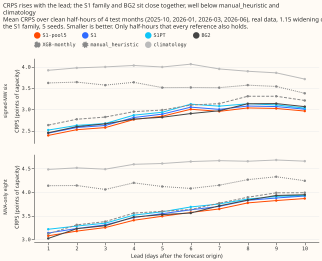
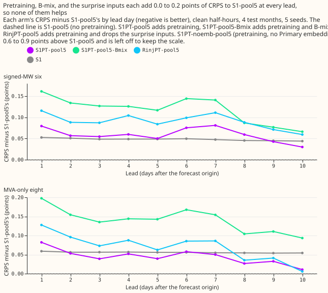
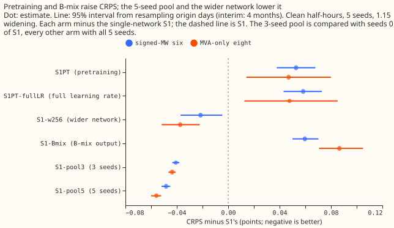
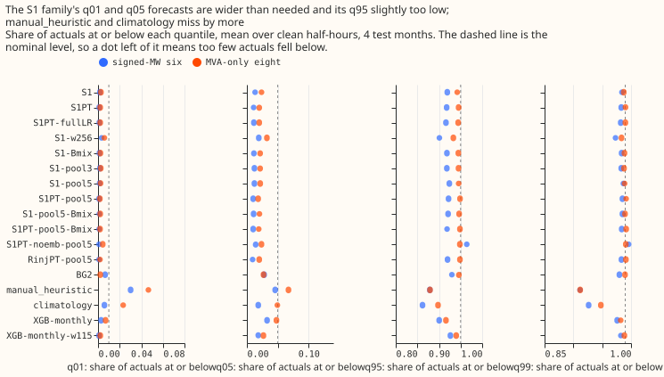
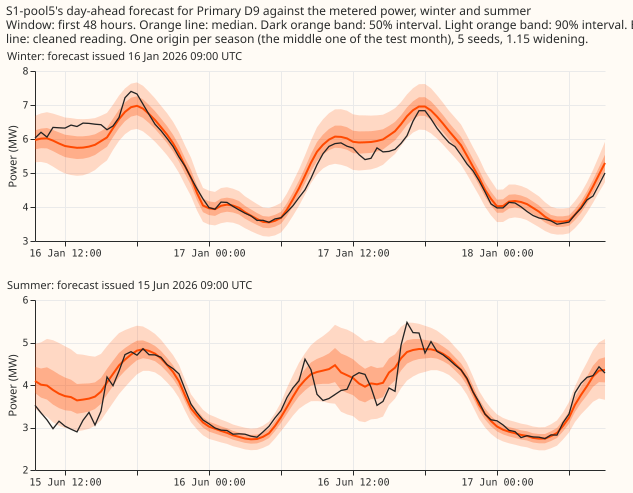
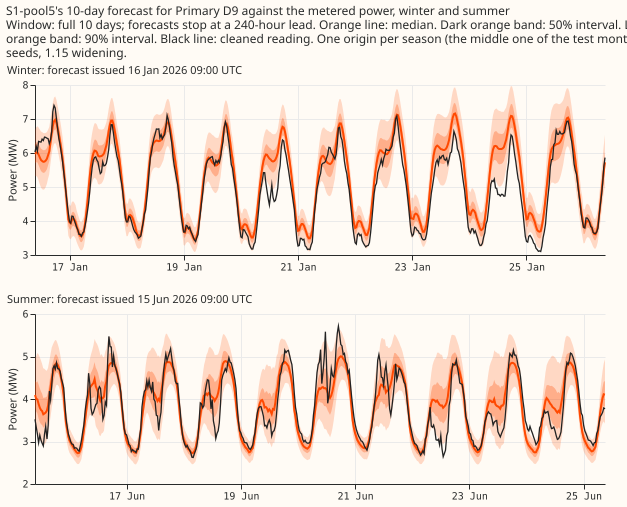
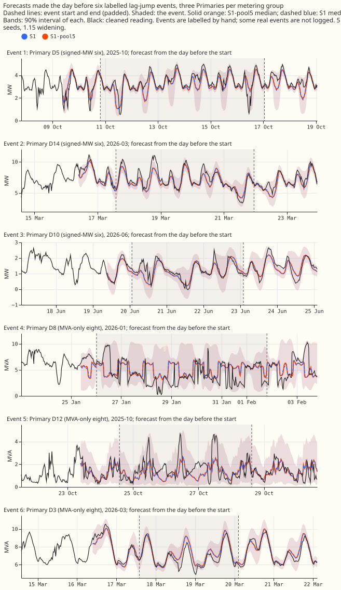

**Take-home message: averaging five random-seed fits of the S1 neural network lowered its error by about
0.05 points at both groups of Primary substations, and no other add-on helped.** Pretraining, the fixed
50/50 B-mix, and a wider hidden layer each failed their pre-registered rule. On four test months the
five-seed average is level with BG2 (the best-guess stack of five demand models) and ahead of the
monthly XGBoost recipe. With a fifth month, BG2 is ahead at the signed-MW six. All numbers are
interim.

## Figures

*Figure 1. CRPS by lead time, clean rows, four screen folds, 1.15 widening.*

*Figure 2. Removing the embedding, the surprise inputs, B-mix, or pretraining, by lead day.*

*Figure 3. Contrasts against S1 with 95% intervals, by metering group.*

*Figure 4. Coverage at q01, q05, q95, and q99.*

*Figure 5. Day-ahead forecasts of the five-seed pool for series D9, winter and summer.*

*Figure 6. Ten-day forecasts of the five-seed pool for series D9. Stored forecasts end at 240 hours,
so the page shows 10 days, not 14.*

*Figure 7. Six real events, three per metering group, with the event start and end marked.*

## Definitions

- **S1:** a mixture density neural network trained jointly on all Primary substations, with three
  lagged power readings and the surprise (observed minus forecast power) at each lag.
- **Signed-MW six and MVA-only eight:** the six Primaries metered in signed megawatts and the eight
  metered in megavolt-amperes only. D15 and D18 (short-history Primaries) are reported separately.
- **Clean rows:** half-hours with no logged lag jump (a step in the recent-power readings). **Real
  event rows** are half-hours inside an event that NGED's log confirms.
- **1.15 widening:** each forecast's quantile spread multiplied by 1.15 about the median.
  **CRPS** is in points of effective capacity, days 1 to 10 unless stated.
- **Five-seed pool:** the equal-weight average of the mixture distributions of five fits of one
  arm that differ in random seed. **B-mix** is the fixed 50/50 mixture of S1's distribution and
  that of the lagless neural network L0.

## Results

- **Contrasts against S1** (clean rows, CRPS points, negative is better; 95% intervals from a paired
  bootstrap within folds, which understates fold-to-fold and seed uncertainty; labels follow the
  plan; minimum detectable effect 0.057 at the six and 0.056 at the eight):

  | Contrast | Signed-MW six | MVA-only eight | D15 and D18 |
  |---|---|---|---|
  | C1 pretrained S1 | +0.053 (0.037 to 0.067) | +0.047 (0.014 to 0.078) | +0.859 |
  | C1b pretrained S1, fine-tuned at the full learning rate (added after the scores were seen) | +0.058 (0.042 to 0.073) | +0.048 (0.016 to 0.081) | +0.902 |
  | C2 B-mix | +0.060 (0.050 to 0.070) | +0.087 (0.070 to 0.104) | +0.927 |
  | C3 five-seed pool | -0.048 (-0.052 to -0.045) | -0.056 (-0.060 to -0.052) | -0.213 |
  | C3b three-seed pool | -0.033 (-0.038 to -0.029) | -0.044 (-0.051 to -0.037) | -0.053 |
  | C4 pretrained five-seed pool minus five-seed pool | +0.059 (0.043 to 0.073) | +0.047 (0.015 to 0.080) | +0.843 |
  | C5 hidden width 256 | -0.022 (-0.037 to -0.005) | -0.037 (-0.052 to -0.022) | +0.375 |

- **Leave-one-out against the pretrained five-seed pool:** removing the Primary embedding raises CRPS
  by 0.649 (0.597 to 0.702) at the six and 0.741 (0.686 to 0.794) at the eight; removing the surprise
  inputs, by 0.033 (0.026 to 0.039) and 0.027 (0.017 to 0.036); removing B-mix lowers CRPS by 0.059
  and 0.096; removing pretraining lowers CRPS by 0.059 and 0.047.
- **Pretraining fails.** C1 is above zero, so no interval lies below -0.03. Plan predictions P1
  (pretraining helps) and P4 (the assembly beats the five-seed pool) failed.
- **B-mix fails.** Its clean-row CRPS exceeds the +0.03 cap at both groups. On real harm rows its q99
  pinball loss is lower than S1's at the six (0.255 against 0.278) and higher at the eight (0.367
  against 0.347), without intervals. At D15 and D18 it lowers real-event CRPS. It stays a named option.
- **The five-seed pool advances.** C3 is below zero and the pool adds no extra fitted network, only
  255 forward passes per series (5 seeds times 51 ensemble members).
- **Width 256 fails rule (b).** Rule (a) asks for the clean gain to hold on the four screen folds
  at both groups; it held in 3 of 4 folds at the six and 4 of 4 at the eight, and is under the
  minimum detectable effect. Rule (b) caps real-event CRPS at +0.03 and q99 pinball loss at +0.02
  against S1. At the eight, real-event CRPS is +0.323 (0.217 to 0.420), so the rule fails. At the six
  it is -0.200, and the q99 pinball loss is unchanged at the eight (0.449) and 0.025 lower at the six.
- **Five-seed pool against the references** (days 1 to 10, the 579,044 half-hours that every arm and
  reference shares; XGBoost monthly is unwidened):

  | Slice | S1 | Five-seed pool | BG2 | XGBoost monthly | `manual_heuristic` | `climatology` |
  |---|---|---|---|---|---|---|
  | Signed-MW six | 2.850 | 2.802 | 2.845 | 3.017 | 3.554 | 3.946 |
  | MVA-only eight | 3.556 | 3.501 | 3.543 | 3.615 | 4.171 | 4.599 |
  | D15 and D18 | 9.160 | 8.952 | 7.687 | 8.879 | 12.088 | 22.740 |
  | Cold nights, six | 2.801 | 2.722 | 2.405 | 2.814 | 4.820 | 5.159 |
  | Cold nights, eight | 2.917 | 2.821 | 2.848 | 3.015 | 4.450 | 4.799 |

  The differences between the pool and BG2 (0.043 at both groups) are under the minimum detectable
  effect and have no interval. BG2 is better on cold nights at the six and at D15 and D18.
- **With the fifth month (2025-12)** (S1, its pool, and the references on the same 713,323 rows):
  CRPS at the six is 3.038 for S1, 2.949 for the five-seed pool, 2.856 for BG2, and 3.046 for
  XGBoost monthly; at the eight it is 3.602, 3.523, 3.563, and 3.654. On cold nights at the six the pool
  scores 3.237, XGBoost monthly 3.045, and BG2 2.568.
- **Tails** (five folds, clean rows, days 1 to 10): the five-seed pool has q95 coverage 0.932 and
  q99 coverage 0.989 at the six, and 0.949 and 0.990 at the eight; S1 has 0.925 and 0.987 at the six.
  On the four folds, the cold-night q99 pinball loss at the six is 0.155 for the pool, against 0.26
  for BG2 and 0.39 for XGBoost monthly (five folds: 0.161 and 0.242).
- **Avoidable-curtailment cost** (the cost of curtailing more than needed, signed-MW six, lead 12 to
  36 hours, four folds, shared clean half-hours, seed-mean forecast for the S1 arms): with the
  export limit set at 0.5 and 0.75 of its reference value, the pool costs £18.0M and £5.82M against
  £19.3M and £6.40M for BG2. At 0.9, BG2 is lower (£1.28M against £1.76M).
- **Real events:** the pool lowers real-event CRPS at the eight (7.049 against 7.142 for S1) and at the
  six (5.569 against 5.689). Its q99 coverage at the six is 0.871 against 0.860 for S1, and the
  target is 0.99. NGED's logs may miss events, so clean rows may hold unlogged events and real-event
  rows undercount.

## Design

- **Arms.** S1; the pretrained S1; the pretrained S1 fine-tuned at the full learning rate; S1 with B-mix;
  the three-seed and five-seed pools; the pretrained five-seed pool, with and without B-mix; the
  leave-one-out arms without the embedding and without the surprise inputs; and S1 with hidden
  width 256. S1 seeds 0 to 2 (experiment 428) and seeds 3 and 4 (experiment 439) were already stored.
- **Fits.** 20 pretrained S1, 20 full-learning-rate, 40 leave-one-out, 16 lagless, 20 width-256, and
  five S1 fits at the fifth fold. Each took about a minute.
- **Pretraining.** ERA5 and CAMS rows (reanalysis estimates of past weather) from experiment 418
  pass through the input scaling fitted on the fold's training data. The ensemble-spread inputs are
  set to the median spread at each lead-time band, since past-weather estimates have no
  ensemble. Every recent-power input is masked (lag values 0, missing flags 1, surprise 0). Fine-tuning
  then switches the lags on, so the network meets live lag values for the first time there.
- **Pooling.** The pool averages the members' cumulative distribution functions on the capacity
  scale. Single-seed arms report tails from the seed-mean quantile forecast, as in experiment 428,
  so their tail coverage is not strictly comparable with the pool's.
- **Reused code.** Experiments 428, 439, 425, 418, 404, and 446, imported and not edited.
- **Cadence and cleaning.** Monthly refits; cleaned data; D15 and D18 cut at 2025-03-01.
- **Not run.** The export gate is not a ladder arm, because it is scored on signed output (see
  experiments 420 and 424). The recalibration table of experiment 435 was not available when the
  screen finished, so scores are raw and 1.15-widened only.
- **Reference rows.** The reference forecasts of experiment 87 cover only 25 of 31 forecast
  origins per month. The reference comparison therefore loses about 20% of the S1 rows. All other
  tables use every row.

## Caveats

- Four screen folds plus a fifth fold for S1 and its pool; every number is interim with no 99% claim.
  The pool's gain (0.048) is under the minimum detectable effect of 0.057, which comes from seed-to-seed
  spread. The paired interval nonetheless excludes zero.
- D5 has no clean rows in 2026-01, so the signed-MW six holds five series that month.
- The 14-day horizon is not available; stored forecasts end at 240 hours.
- Pretraining with masked lags is one design. Pretraining that includes lagged power from the
  ERA5 period, with a lagless cross-fit, was not tried.

## What to try next

- Use the five-seed pool of S1 in the next demand experiments, and look at why BG2 is better on cold
  nights at the signed-MW six and in the fifth fold.
- Try pretraining with lagged power in the pretraining rows, because the masked-lag design may be why
  pretraining failed.

## Checks

- **Audit triggers.** Trigger 2 (the result contradicts its predictions and earlier experiments)
  fired: P1, P2, P4, and the surprise-input range failed, and experiments 425 (pretraining helped)
  and 428 and 439 (surprise inputs worth 0.106) point the other way. Trigger 3 is not cleared,
  because the median minus mean forecast per site and the mean-forecast error beside each quantile
  contrast were not computed. Trigger 4 (leave one site out) was not run. Trigger 7 may apply,
  because the pool is recommended as the default and is not replicated. An audit is needed before
  merge.
- **Reviews.** The plan review, code review, numbers review, and prose review ran; their findings are
  in the pull request.
