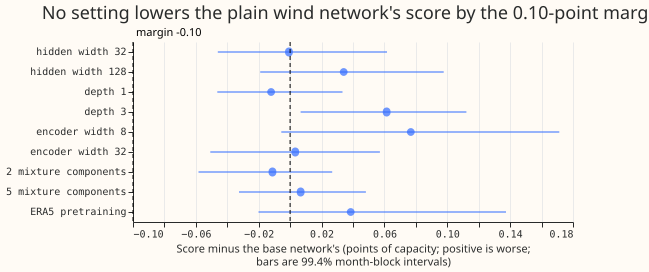
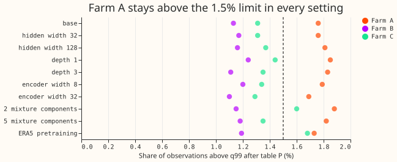

**Take-home (interim, unaudited): the plain wind network is at a plateau, and Farm A's upper tail is
the open problem.** After table P, 1.39% to 1.50% of observations fall above q99 for the 10 neural
arms of experiment 429 pooled over the three farms (limit 1.5%; Wind farms research default 2:
1.64%), but Farm A stays at 1.7% to 2.1% in every arm and in every setting of the plain network.
None of 9 changes to the plain
network lowers its quantile score by the 0.10-point margin, so the pre-registered rule to stop when
no setting helps ended the experiment after stage 1 (9
arms with 5 seeds each = 45 fits; the ERA5 arm also needed 5 pretraining fits; the base arm
re-used stored forecasts).

**Terms.** *Table P* (experiment 435) rescales each quantile forecast per farm and lead band, fitted
on earlier months only, so that coverage matches the nominal level. *Kept rows* are the half-hours
left after experiment 210's idle-band mask removes periods when a farm is idle. *True days 1 to 10*
means forecast lead times of 24 to 240 hours. The *base network* is `member_plain` from experiment
429, the plain pooled wind neural network, whose stored forecasts the `base` arm reproduces. The
*10 neural-network arms* are all experiment 429 arms except the repeat of Wind farms research
default 2.

## Results

- **Step 1, table P (kept rows, true days 1 to 10, after clipping to [0, 1]).** Pooled share above
  q99: 1.39% to 1.50% for the 10 neural arms (`member_plain` 1.41%, 95% month-block interval 0.85%
  to 1.97%), 1.64% for default 2 (0.98% to 2.29%), against 2.1% to 2.5% before table P. Farm A:
  `member_plain` 1.76% (0.85% to 2.78%), default 2 2.07%; Farm B 1.13%; Farm C 1.31%. All rows:
  1.32% to 1.48% and 1.63%. q01 and q05 coverage are not harmed. Without the clip, the share
  above q99 would read 0.7% to 1.1%; observations between 1.0 and 1.09 of capacity count as covered
  by a q99
  above 1. Experiment 435's table P code has the same missing clip.
- **Step 2, stage 1 (kept rows, true days 1 to 10; score and difference to `member_plain`,
  99.4% interval).** `member_plain` 10.533. Hidden width 32: -0.001 (-0.046 to +0.062); width 128:
  +0.034; depth 1: -0.012 (-0.046 to +0.033); depth 3: +0.061 (+0.007 to +0.112); encoder width 8:
  +0.077; encoder width 32: +0.003; 2 mixture components: -0.011; 5: +0.007; ERA5 pretraining:
  +0.039 (-0.020 to +0.137). Positive is worse. No setting reaches -0.10.
- **Tails of the settings.** The q99 pinball loss rises by 0.067 points (2 components) and 0.063
  (ERA5 pretraining), above the 0.02 allowance, and by 0.022 (encoder width 8); the share above q99
  after table P is 1.37% to 1.55% pooled (depth 1 is 1.51%, above the limit). Farm A is at 1.69%
  (encoder width 32) to 1.88% (2
  components) in every setting.
- **Farm C** is above 1.5% for 2 mixture components (1.60%) and ERA5 pretraining (1.68%).
- **Seed spread.** The `member_plain` seed standard deviation is 0.027 points, a seed-only minimum
  detectable effect of 1.96 x sqrt(2) x 0.027 / sqrt(5) = 0.034 for 5 seeds; the month-block
  intervals above are wider.
- **Cost.** 50 fits of about 56 to 69 seconds each, about 0.8 GPU-hours, one process of 5.5 GB.
  Stage 2 and the confirmation did not run, because no setting moved the network.

## Checks

- **Median minus mean forecast** (kept rows, true days 1 to 10, points of capacity): -3.16 for the
  base network; -3.33 (Farm A), -3.35 (Farm B), -2.77 (Farm C); -2.95 to -3.23 for the settings
  (-3.57 for 2 mixture components). The median sits well below the mean everywhere, the signature
  of a right-skewed mixture, so the median and the mean score differently.
- **Error of the mean forecast beside each score contrast** (positive is worse): depth 1 score
  -0.012 but mean-forecast error +0.022; 2 components -0.011 but +0.060; width 32 -0.001 but
  +0.024; 5 components +0.007 but -0.010. Other settings are worse on both (width 128 +0.016, depth
  3 +0.070, encoder width 8 +0.132, encoder width 32 +0.047, ERA5 pretraining +0.037). The score
  gains of depth 1 and 2 components are inside noise, so the verdict stands.
- **Audit triggers.** Trigger 3 fired (score and mean-forecast error disagree for four settings).
  Triggers 2 and 5 did not fire; triggers 4 and 6 were not tested.

## Caveats

- Step 1 was run before its rule was written; the rule is post hoc. The step 2 rule was fixed
  before the first stage 1 fit.
- Step 1 gives 11 scored months to resample and step 2 gives 12; the per-farm intervals include
  1.5%.
- Table P's page (experiment 435) is not merged; this page cites its code at commit `552c3f87` and
  this page applies the same code with the clip added.
- Every number is interim and unaudited; the results review has not run yet.

## Problems caused by the move

None.
