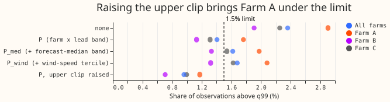
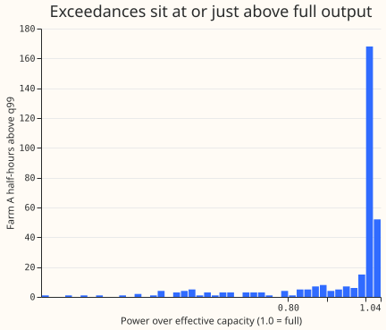
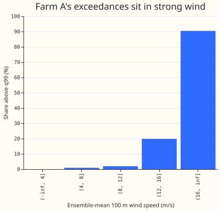
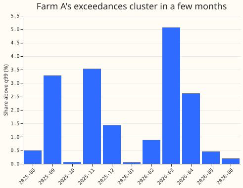

**Take-home (interim): Farm A's upper-tail failure after table P is partly a clipping effect.**
Raising the clip on every rescaled quantile from 1.0 to the farm's largest earlier power over
capacity cuts Farm A's share of observations above q99 from 1.76% to 1.17%, under the 1.5% limit,
and all three farms pass (pooled 0.96%). At Farm A, 1.04 of the 1.76 points are half-hours where
the forecast q99 is at the clip of 1.0 and the farm produced 1.00 to 1.035 of its effective
capacity; raising the clip removes 0.59 points. Experiment 341's capacity-state table says "full"
at Farm A for every scored half-hour, so no flagged capacity reduction explains the exceedances. A
finer table makes the share worse, so no tail-weight fits were run.

**Terms.** *q99* is the forecast's 0.99 quantile; 1.5% is the limit on the share of observations
above it. *Table P* (experiment 435) rescales each tail quantile's distance from the median per farm
and lead band, with factors fitted on earlier months so that coverage matches the nominal level.
*Clip* means bounding a rescaled quantile to a range, here 0 to 1.0 unless stated.
*Power over effective capacity* is measured power divided by the farm's effective capacity (the
divisor that turns its power into a fraction of capacity). *Kept rows* are the half-hours outside
experiment 210's idle-band mask. *True days 1 to 10* means forecast lead times of 24 to 240 hours.
`member_plain` is experiment 429's plain pooled neural network for the three wind farms. In figure
1, "none" is the unrecalibrated forecast, P_med adds the forecast-median band to table P, and P_wind
adds the wind-speed tercile.

The finer-table half of the hypothesis is refuted and the clip half is supported, so the verdict is
partly supported.

## Results

- **Finer tables do not help (step 1).** Farm A's share above q99: unrecalibrated 2.90%; table P
  (farm x lead band) 1.76%; plus forecast-median band 1.98%; plus ensemble-mean wind-speed tercile
  2.08%. Farm B and Farm C move the same way (Farm B 1.13%, 1.33%, 1.32%; Farm C 1.31%, 1.54%,
  1.62%).

- **Raising the clip removes about a third of Farm A's exceedances.** With the upper bound of every
  rescaled quantile set to the farm's largest power over capacity in earlier months (at least 1.0):
  Farm A 1.17%, Farm B 0.71%, Farm C 1.00%, pooled 0.96%, against 1.76%, 1.13%, 1.31%, and 1.41%
  with the clip at 1.0. The 1.17% that remains equals the share of Farm A half-hours with power over
  capacity above 1.0, so the remaining exceedances are the highest-output half-hours.
- **The clip at 1.0 matters at Farm A.** 1.17% of its kept half-hours at true days 1 to 10 have
  power over capacity above 1.0 (maximum 1.035; Farm B 0.80%, Farm C 0.74%). Table P's q99 is at the
  clip (0.999 or more) for 38.6% of Farm A's half-hours; 1.04 points of exceedance are half-hours
  with q99 at the clip and 0.73 points are half-hours with q99 below it. Half the exceedances have
  an output above 1.008.

- **Where the exceedances sit (step 2, table P with the clip at 1.0; 332 exceedances in 18,831
  half-hours).**
    - By wind speed: 19.9% above q99 at 12 to 16 m/s ensemble-mean 100 m wind (418 half-hours) and
      19 of 21 above 16 m/s, against 0.9% at 4 to 8 m/s and 1.9% at 8 to 12 m/s. The 106
      exceedances at 4 to 8 m/s have a mean excess of 0.084, larger than in the other bins, and the
      clip does not explain them.
    - By forecast median: 19.4% above q99 where the forecast median is at least 0.7 of capacity
      (581 half-hours), against 0.5% to 2.4% in the three lower bands.
    - By month: 5.1% in 2026-03, 3.5% in 2025-11, 3.3% in 2025-09, 2.6% in 2026-04, and 0.1% or
      less in 2025-10 and 2026-01.
    - By hour: 0.25% to 1.0% from 04:00 to 06:00 and 2.1% to 3.3% from 16:00 to 22:00.
    - By lead band: 1.4% to 2.6%, with no pattern.

- **No flagged capacity reduction.** Experiment 341's capacity-state table says "full" for every
  scored half-hour at Farm A. This rules out a flagged outage or derating. It does not test whether
  the effective capacity figure itself is correct.

## Caveats

- This is a screen on one year of data with 11 scored months. The 95% month-block interval of Farm
  A's 1.76% in experiment 450 was 0.85% to 2.78%, and the intervals of 1.17% and 1.76% overlap, so
  this screen does not show that the raised clip is better than the clip at 1.0.
- The raised clip uses the largest power over capacity in earlier months, a single extreme value.
  It may be below the scored months' maximum of 1.035, in which case some exceedances persist.
- That the effective capacity is slightly too low is a reading of the data, not a test: nobody has
  checked the capacity figure.
- The wind-speed tercile edges use all scored months, and the lower clip at 0 also applies to q01
  at Farm B, which has 298 actuals below 0. Neither changes the upper-tail result.
- Every number is interim until the maintainer has read this page. A fresh reviewer reproduced the
  headline numbers (the 38.6% and 1.04 points need the 0.999 threshold stated above), and another
  reviewed the write-up.

## Problems caused by the move

None.
