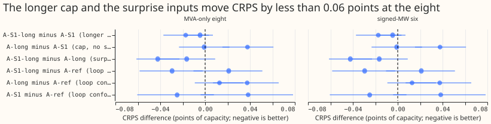
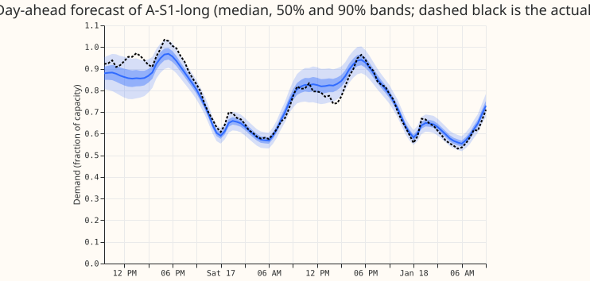
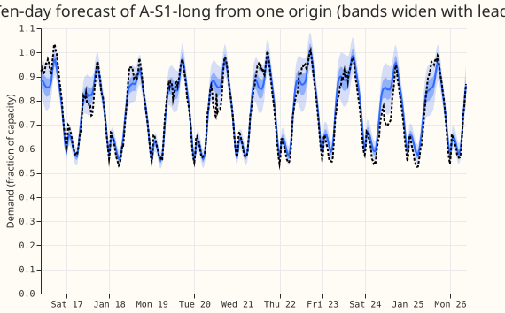

## Take-home

**A longer pretraining cap and the surprise inputs together do not beat experiment 425's arm A.**
The 150-epoch cap lowered the pooled CRPS of the five-seed quantile average by 0.017 points at the
MVA-only eight and 0.005 at the signed-MW six, against minimum detectable effects of 0.056 and
0.057. The surprise inputs helped at the six only (-0.042, Bonferroni interval -0.061 to -0.023,
still below 0.057) and made no difference at the eight. Neither new arm beats A-ref at the eight
(+0.021 and +0.037), so A-ref stays the demand candidate. The A-ref comparisons are confounded with
the fit loop. A-ref (experiment 397's loop) and the new arms (experiment 428's loop) differ in more
than the cap.

Pretraining stopped on patience in 47 of the 50 runs (median 104 epochs, range 78 to 150), so
150 epochs bound in 3 runs, all A-S1-long. The 60-epoch cap of experiment 449 did bind in every run. The timed fit (2026-06, seed 0)
lowered pretraining validation loss from 0.2722 to 0.2533, and the fine-tuned scores still differ by
less than the noise.

## Figures

Figures 2 and 3 show A-S1-long for the first Primary in the 2026-01 fold at one forecast origin.
The horizon of every stored forecast is 10 days (240 hours), so the "full horizon" example is 10 days.

## Arms

- **A-ref (stored).** Experiment 425's arm A, seeds 0 to 4, run in experiment 397's fit loop.
- **A-S1 (stored).** Experiment 449's `PT1`, 60-epoch cap, seeds 0 to 4, scored alone and as a
  five-seed quantile average.
- **A-S1-long (new).** `PT1`'s recipe with a 150-epoch pretraining cap (`AS1L`).
- **A-long (new).** The same cap without the surprise inputs (`AL`). A-long has 8,393 parameters
  against 8,585, because the surprise channels are absent.
- **Common.** Experiment 428's fit loop (0.2 of the rows per epoch, patience 8), pretraining on
  ERA5-and-CAMS rows from 2019-09, fine-tuning at learning rate 2e-4 with the 60-epoch cap, 1.15
  widening, monthly refits (cadence not under test; the contrasts could depend on it only through
  the fold windows). ERA5 weather appears only in pretraining, so no past-weather caveat applies
  at forecast time.
- **Compute.** 50 neural networks (25 per arm), about 1 GPU-hour on 3 processes. The stored lagless
  tables of experiment 449 (25) and experiment 404 (seeds 0 to 5) were reused.
- **Cleaning.** Rows are the cleaned shared half-hours (579,044 on four folds, 713,323 on five).
  The D15 and D18 cut before 2025-03-01 is applied, as in experiments 428 and 449.

## Headline numbers (four folds, days 1 to 10, 579,044 shared rows, five-seed quantile averages)

| Arm | Signed-MW six | MVA-only eight | D15 and D18 | All 16 |
|---|---|---|---|---|
| A-S1-long | 2.733 | 3.394 | 8.733 | 3.739 |
| A-long | 2.775 | 3.411 | 8.720 | 3.762 |
| A-S1 (`PT1`) | 2.738 | 3.411 | 8.818 | 3.759 |
| A-ref (425 arm A) | 2.763 | 3.373 | 8.283 | 3.690 |
| BG2 | 2.845 | 3.543 | 7.687 | 3.746 |

- **Minimum detectable effects (single-seed arms, printed before any contrast was read):** 0.057 at
  the six, 0.056 at the eight, 0.76 at D15 and D18 (scorer's clean row set, 83,458 rows, 62,738 of them shared with the
  references; the plan quoted 1.18 from experiment 449's real-row set, and 1.05 applies to
  real-event rows).
  Five-fold contrasts at the six have a minimum detectable effect of 0.34 and are not read.
- **Cap only (A-S1-long minus A-S1).** Eight -0.017 (Bonferroni -0.037 to +0.003), six -0.005
  (-0.016 to +0.007), D15 and D18 -0.111 (-0.190 to -0.038), all 16 -0.024 (-0.043 to -0.006).
- **Cap, no surprise inputs (A-long minus A-S1).** Eight -0.001 (-0.023 to +0.022), six +0.038
  (+0.015 to +0.061).
- **Surprise inputs (A-S1-long minus A-long).** Eight -0.016 (-0.041 to +0.009), six -0.042
  (-0.061 to -0.023), D15 and D18 -0.013 (-0.184 to +0.139).
- **Against A-ref (loop confounded).** A-S1-long minus A-ref: eight +0.021 (-0.010 to +0.051), six
  -0.029 (-0.058 to -0.002), D15 and D18 +0.410 (+0.170 to +0.645), all 16 +0.048 (+0.008 to
  +0.088). A-long minus A-ref: eight +0.037 (+0.007 to +0.066), six +0.013, D15 and D18 +0.423.
- **Against BG2.** A-ref minus BG2: eight -0.170 (-0.243 to -0.100), six -0.082 (-0.169 to +0.008),
  D15 and D18 +0.509 (-0.051 to +1.124). BG2 scores lower at D15 and D18, but the interval spans zero.
- **Cold winter nights (CRPS).** Eight: A-ref 2.656, A-S1-long 2.679, A-long 2.706, A-S1 2.691.
  Six: A-S1-long 2.590, A-S1 2.535, A-ref 2.636, BG2 2.405 (BG2 leads at the six; the A-ref minus
  BG2 interval spans zero, +0.231, -0.032 to +0.550).
- **Christmas week (22 to 31 December, fold 2025-12, report-only).** Eight: A-S1-long minus A-ref
  +0.005 (-0.176 to +0.129). Six: A-S1-long minus A-ref +0.138 (+0.069 to +0.219), and A-S1-long
  minus A-S1 -0.068 (-0.109 to -0.048).

## Decision rule

- **Adopt A-S1-long over A-S1?** No. Its eight-Primary gain (0.017) is below the minimum
  detectable effect (0.056).
- **Adopt A-S1-long or A-long over A-ref?** No. A-S1-long is not better than A-ref at the eight
  (+0.021, interval spans zero) and is worse over all 16 and at D15 and D18. A-long is worse at the
  eight (+0.037). A-S1-long is better at the six by 0.029, below the minimum detectable effect.
- **Does the cap, rather than the surprise inputs, do the work?** Neither exceeds the minimum detectable
  effect at the eight. At the six, A-S1-long beats A-long by 0.042, but A-long is also worse than
  A-S1 by 0.038, so the surprise inputs recover a loss from dropping them rather than adding to
  A-S1. No short-cap arm without the surprise inputs exists in this loop, so their effect cannot
  be isolated further.
- **Cold-night, Christmas-week, and q99 gates.** A-S1-long minus A-ref on cold nights at the eight
  is +0.023 (-0.081 to +0.102) and A-S1-long minus A-S1 is -0.013, so neither worsens by more than
  0.02 against A-S1. Against A-ref the gate is not met on Christmas week at the six (+0.138). The
  q99 gate is met at the six and the eight.
- **Predictions.** P1 fails (the cap gain at the eight is -0.017, below the predicted 0.02 to
  0.08). P2 holds at the eight (A-long and A-S1-long differ by 0.016) and fails at the six
  (0.042). P3 holds.
- **Five folds.** The cap-only contrast at the eight is -0.019 (-0.036 to -0.001) over days 1 to
  10, and the gains stay below the minimum detectable effect. The five-fold six is not read
  (minimum detectable effect 0.34).
- **Outcome.** A-ref stays the demand candidate on this evidence.

## Tails and calibration (four folds, 1.15 widening, shared clean rows)

| Group, arm | q05 coverage | q95 coverage | q99 coverage | q99 pinball |
|---|---|---|---|---|
| Six, A-S1-long | 0.011 | 0.924 | 0.986 | 0.185 |
| Six, A-ref | 0.011 | 0.920 | 0.983 | 0.188 |
| Eight, A-S1-long | 0.021 | 0.947 | 0.989 | 0.244 |
| Eight, A-ref | 0.019 | 0.946 | 0.989 | 0.238 |
| Eight, A-S1 | 0.020 | 0.946 | 0.989 | 0.244 |

- **The lower tail is over-wide for every arm** (q05 coverage 0.011 to 0.021 against 0.05).
- **The widening sweep favours a smaller factor.** Five-seed averages at the six score best at
  1.10 (A-S1-long 2.737, A-S1 2.741, A-long 2.782) and at the eight at 1.05 (3.387, 3.405, 3.404);
  1.15 is slightly too wide for an average of five seeds. The sweep covers each arm's own clean
  rows, not the rows shared with the references.
- **q99 pinball loss** is within 0.007 of A-ref in every arm at the six and the eight, inside the
  0.02 gate. At D15 and D18 the gap is 0.017 (A-S1-long) to 0.053 (A-long). The per-Primary tails
  are in `metrics_four_months.csv`.

## Avoidable-curtailment cost (signed-MW six, 12 to 36 hours, four folds, millions of pounds)

The intervals quoted below are 95% bootstrap intervals over the 24 series-by-month cells, not
Bonferroni intervals.

| Arm | f = 0.9 | f = 0.75 | f = 0.5 |
|---|---|---|---|
| A-S1 (`PT1`) | 1.42 | 5.03 | 16.54 |
| A-S1-long | 1.44 | 5.13 | 16.68 |
| A-long | 1.54 | 5.50 | 17.48 |
| A-ref | 1.70 | 5.81 | 17.38 |
| BG2 | 1.28 | 6.40 | 19.31 |
| `manual_heuristic` | 1.83 | 10.28 | 29.92 |

- **A-S1-long minus A-S1:** +0.02 (-0.02 to +0.07), +0.10, +0.14; the cap changes the cost by no
  measurable amount.
- **A-S1-long minus A-ref:** -0.25 (-0.73 to -0.01), -0.68 (-2.33 to +0.27), -0.70 (-2.92 to
  +0.68). Cheaper at f = 0.9 only, and a loop-confounded contrast.
- **A-S1-long minus BG2:** +0.16 (-0.06 to +0.58), -1.27 (-2.66 to -0.31), -2.64 (-3.99 to -1.39).

## Production cost

- **A-S1-long:** 5 neural networks and 5 lagless modules at serving, and about 75 fits per monthly refit
  (5 ERA5 tables of 6 lagless modules, 5 of experiment 404's ensemble tables of 7, 5 pretraining
  runs, 5 fine-tunes). The pretraining run is about 2.5 times longer than 60 epochs when it runs to
  the cap.
- **A-long:** 5 neural networks per refit and no lagless modules at serving.

## Checks

- **Reviews.** A fresh Sonnet reviewer read the run script before the first fit (no leakage; three
  minor fixes applied). A fresh Sonnet reviewer then re-derived the numbers and checked the prose;
  the PR body lists the findings.
- **Audit triggers.** The mean-forecast check (median minus mean forecast per site) was not re-run
  for this experiment; the new arms differ from experiment 449's `PT1` only in the cap and the
  surprise inputs.
- **Quantile average.** The five-seed average of the stored `PT1` forecasts is a quantile-space mean
  like experiment 425's seed average. The pool of experiment 449 was a mixture and is not used.
- **Past-weather.** No weather is used at lag times beyond the pretraining years.

## Caveats

- **Loop confound.** A-ref was fitted in experiment 397's loop, so differences against A-ref mix
  loop, cap, and surprise inputs.
- **Row sets.** D15 and D18 are scored on real rows (83,458) with a minimum detectable effect far
  above the contrasts, so they carry no gate.
- **Unlogged events.** Not applicable (no load-shift analysis).
- **Fits stopped on patience.** The 150-epoch cap bound in 3 of 50 runs, so a cap above 150 would
  affect at most a few runs.

## What to try next

- **Evidence for the roadmap.** The 60-to-150 epoch cap and the surprise inputs both fall inside
  the fit-to-fit noise at the eight.
- **If the loop confound matters,** refit A-ref in experiment 428's loop (25 neural networks) before
  deciding between A-ref and the new arms for a release.
