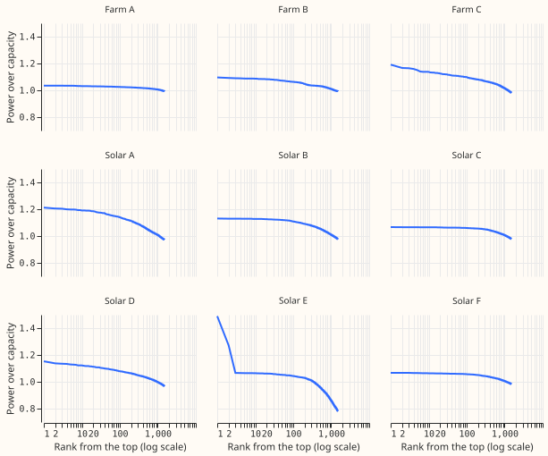
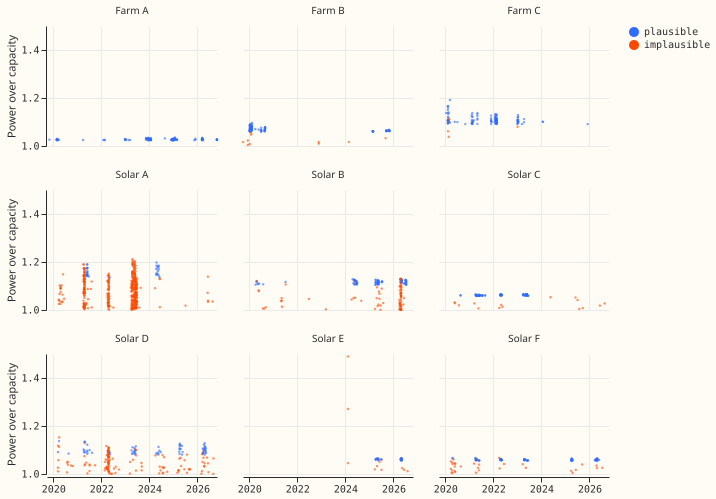
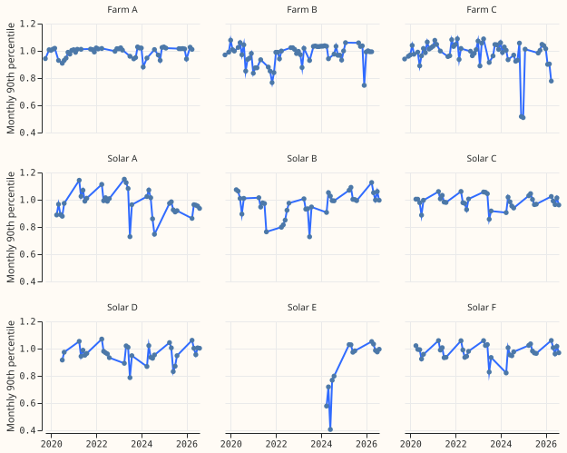
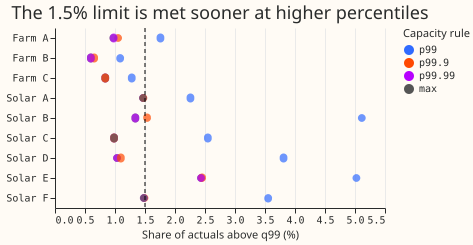

**Take-home (interim, unaudited): the wind farms hold no implausible high values, and the 99.9th
percentile is a safer effective capacity than the 99th for both wind and solar.** At Farm A, Farm B,
and Farm C, 98% to 100% of half-hours above p99.9 are plausible, and the three maxima are plausible
too. For solar, the maximum is unsafe: Solar E's maximum is a two-half-hour start-up spike, and
Solar A, Solar B, and Solar D produced more in 2021 to 2023 than they do now. Capacity at p99.9 of
the power before each test month takes the pooled share of actuals above q99 (after table P) from
1.38% to 0.85% for wind and from 3.67% to 1.48% for solar, and lowers solar's score in MW by 0.31%.
Farm A's operator check no longer decides the rule.

**Terms.** *Effective capacity* is the divisor that turns a series' power into a fraction of
capacity; the current rule sets it to the 99th percentile of the series' whole cleaned record. *p99.9*
and *p99.99* are the 99.9th and 99.99th percentiles. *Power over capacity* above 1.0 means the
series produced more than the current capacity. *Table P* is experiment 435's recalibration of each
tail quantile, per series and lead band, fitted on earlier months. *q99* is the forecast's 0.99
quantile, and 1.5% is the limit on the share of actuals above it. Farm A, Farm B, and Farm C are
experiment 429's wind farms; Solar A to Solar F are experiment 430's solar series (the brief names
Solar A and Solar B). The solar `member` arm of experiment 430 and the wind `member_plain` arm of
experiment 429 are the stored forecasts.

The wind half of the hypothesis is supported and the solar half is supported only for p99.9, so the
verdict is partly supported.

## Results

- **The tail is smooth for wind.** Maximum over capacity: Farm A 1.035, Farm B 1.096, Farm C 1.191.
  Above p99.9 there are about 125 half-hours per series (23 to 44 days). The half-hours above 1.0
  occur at a median ERA5 100 m wind speed of 16.0 m/s (Farm A), 16.2 m/s (Farm B), and 17.8 m/s
  (Farm C), against 11.0, 11.5, and 12.5 m/s at which each farm's median output reaches half of
  capacity. Farm A has 37 of 1,257 such half-hours without ERA5 wind.
- **Solar has larger tails and level changes.** Maximum over capacity: Solar A 1.21, Solar B 1.13,
  Solar C 1.07, Solar D 1.15, Solar E 1.49, Solar F 1.07. Solar E's 1.49 and its 1.27 neighbour are
  two half-hours on 2024-02-08 at clear-sky irradiance of 322 and 337 W/m2, against a 99th
  percentile of 878 W/m2 over daylight.

- **Classification of the half-hours above 1.0 (plausible / total).** Farm A 1,257 / 1,257, Farm B
  1,208 / 1,218, Farm C 1,211 / 1,216, Solar A 676 / 1,097, Solar B 1,038 / 1,141, Solar C 1,091 /
  1,106, Solar D 820 / 957, Solar E 328 / 339, Solar F 1,069 / 1,101. No series has a stuck run of 4
  or more equal readings. The implausible half-hours are single-half-hour spikes (0 to 93 per
  series), weather mismatches (Farm B 7, Solar D 4, Solar E 3), and, for Solar A (380), Solar B
  (71), and Solar D (46), half-hours in months whose output level is more than 0.10 above the
  median month.

- **Solar A, Solar B, and Solar D changed output level between years.** At strong clear-sky
  irradiance, Solar A's monthly 90th percentile was mostly 1.0 to 1.15 of capacity in 2021 to 2023 and
  0.86 to 0.98 in 2025 to 2026. A static whole-record capacity does not describe those series.
- **Plausible share above each percentile (level-shift flag ignored).** Above p99.9: 100% at Farm A
  and Farm B, 98% at Farm C, 97% to 100% at Solar A, Solar B, Solar C, and Solar F, and 87% at Solar
  D and 91% at Solar E. The maximum is one half-hour per series; it is flagged at Solar A, Solar B,
  Solar D, Solar E, and Solar F (Solar E's by weather) and plausible at the other series.

- **Share of actuals above q99 after table P (11 test months, true days 1 to 10).**

| Series | p99 | p99.9 | p99.99 | maximum |
|---|---|---|---|---|
| Farm A | 1.76% | 1.05% | 0.98% | 0.97% |
| Farm B | 1.09% | 0.65% | 0.60% | 0.60% |
| Farm C | 1.28% | 0.84% | 0.84% | 0.84% |
| Solar A | 2.26% | 1.47% | 1.47% | 1.47% |
| Solar B | 5.11% | 1.53% | 1.34% | 1.34% |
| Solar C | 2.55% | 0.98% | 0.98% | 0.98% |
| Solar D | 3.81% | 1.10% | 1.03% | 1.03% |
| Solar E | 5.02% | 2.45% | 2.43% | 2.43% |
| Solar F | 3.55% | 1.49% | 1.48% | 1.48% |

- **Share of actuals above 1.** Farm A 1.15% at p99, 0.14% at p99.9; Solar B 4.60% at p99, 0.79% at
  p99.9. Every series is at or under 0.8% at p99.9 and 0.3% at p99.99.
- **Score.** In MW, the pooled score against the p99 rule (month-block bootstrap, 1,000 draws): wind
  +0.01% (+0.01 to +0.02) at p99.9 and +0.02% at the maximum; solar -0.31% (-0.60 to -0.08) at
  p99.9 and -0.31% at the maximum. No rule changes the score by 1% in either technology.

## Recommendation

- **Wind: p99.9 of the series' earlier power.** The highest percentile that passes the plan's rule
  is the maximum, whose single half-hour is plausible at all three farms. p99.9 is preferred (post
  hoc) because it does not depend on one reading and loses nothing: every wind series is under 1.5%
  above q99 at p99.9, and the score in MW is unchanged.
- **Solar: p99.9 of the series' earlier power, and not the maximum.** The plan's rule
  (at least 90% plausible, no more than 1% worse) is not met above p99.9 at Solar A (29%) or Solar
  D (71% with all flags), because of spikes and level-shift months, so the choice is a judgement:
  p99.9 gives the pooled 1.48% and is no more affected by the Solar E spike than p99.
- **Still above 1.5% at p99.9:** Solar B (1.53%) and Solar E (2.45%).
- **Farm A's operator check.** Farm A's top half-hours are smooth, at wind speeds of 13.8 m/s or
  more (10th percentile), and reach 1.035 of the p99 capacity. They read as a capacity figure a few
  per cent too low, not as bad data. The check would confirm the figure but no longer decides the
  rule.

## Caveats

- **No model was refitted.** Stored forecasts were rescaled to each capacity and recalibrated with
  table P. A network trained on a power-over-capacity target at another capacity could behave
  differently.
- **Spikes and level shifts are labelled by rules, not by hand.** A single-half-hour solar spike is
  also what cloud-edge brightening looks like, so the 0 to 93 spikes per solar series are
  "possibly artefacts". The level-shift flag marks months whose output level is above the median
  month, which may be real output at an earlier, higher capacity; it flags only upward steps.
- **The stored wind quantiles reach at most 1.0 of the old capacity**, so the raw variant (without
  table P) shows no change for wind. Table P is what lets the upper quantiles use the extra room.
- **Interval and scope.** 11 test months; the bootstrap resamples months and assumes they are
  independent. Every number is interim until the maintainer has read this page.
- **Effective capacity is one static number per rule and month.** The experiment does not test a
  rolling or yearly capacity.

## Checks

- **Reviews.** A fresh Sonnet reviewed the code and classification: no leakage or rescaling bugs.
  Accepted: the level-shift flag marks whole months, so the plausible share is reported with and
  without it; the print of the share at the maximum; and the bootstrap draw count (now 1,000).
  Not changed: the spike flag on solar (kept as a "possible artefact" in the caveats); the stuck-run
  rule (no hits).
- **Audit triggers.** No model was fitted and no stored forecast was changed.

## Problems caused by the move

The wind scripts import `torch` through experiment 347's data module, so the worktree needed
`uv sync --all-packages --group gpu` for a job that needs no GPU.
