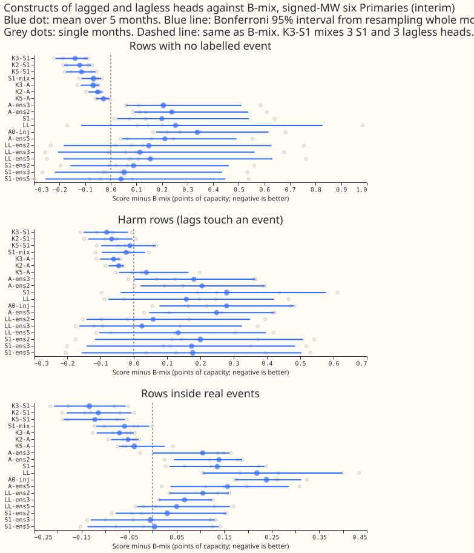
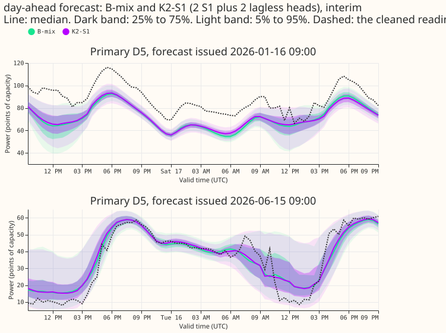
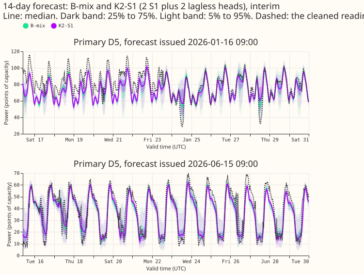
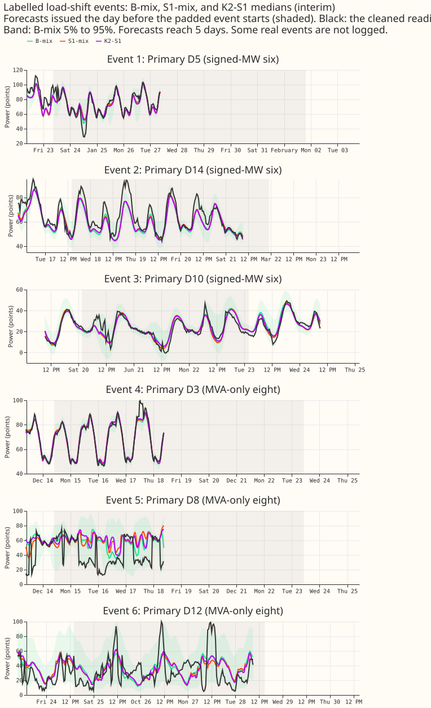

## What this experiment found

**Mixing a lagged and a lagless forecast beats averaging several lagged forecasts.**
S1 also improves the lagged half.
We asked which combination of lagged and lagless neural-network forecasts scores best for the
demand at 16 Primary substations, and whether any combination beats B-mix, a fixed 50/50 mixture
of one lagged network (A0-inj) and one lagless forecast. A lagged network sees the power measured
over the last three recent days and weeks, and a lagless network does not. We scored 22 constructs
(equal-weight mixtures of 1 to 10 networks) on five test months with experiment 404's rows, and
compared each with B-mix on identical rows.

**Answer.** Averaging two A0-inj networks closes 30% of the gap between one A0-inj network and
B-mix, so most of B-mix's gain is the lagged-plus-lagless diversity. Replacing A0-inj by S1 gives
a better mixture on rows with no labelled event (S1-mix, 0.067 points of capacity better than
B-mix at the signed-MW six), and a mixture of two S1 and two lagless heads (K2-S1) is 0.121 better.
Inside real events, scored against normal-running-arrangement (NRA) actuals, no construct beats
B-mix with an interval that excludes zero at the six. The adoption rule picks K2-S1 as the
construct to port (below), and it costs 4 networks per forecast against 2 for B-mix.

**Units and terms.** Scores are the continuous ranked probability score (CRPS) in points of
capacity, 11 quantiles, lower is better, on forecasts up to 10 days ahead. "No labelled event"
means rows whose target and recent power readings lie outside every logged load-shift event; NGED's
event logs are incomplete, so unlabelled events remain in these rows. The signed-MW six are the six
Primaries metered in signed megawatts (D5, D9, D10, D11, D14, D16); the MVA-only eight are metered
in megavolt-amperes and are never pooled with the six. A construct named `K2-S1` mixes 2 S1 and 2
lagless heads; `A-ens2` averages 2 A0-inj heads. Interim, five months, no 99% claim.

## Headline numbers

Signed-MW six, mean over 5 months, construct minus B-mix (points of capacity; negative is better),
Bonferroni 95% interval over 63 headline contrasts (month-block; with 5 months this is close to the
range of the monthly contrasts), months better out of 5, absolute score beside it. B-mix scores 3.508
(clean), 3.546 (harm), 5.872 (inside real events, metered actuals).

| Construct | Networks | Clean | Harm rows | Inside events (metered) | Inside events (NRA) |
|---|---|---|---|---|---|
| A0-inj (3.846 clean) | 1 | +0.338 [+0.176, +0.616] 0/5 | +0.279 [+0.077, +0.480] | +0.239 [+0.173, +0.312] | +0.317 [+0.185, +0.510] |
| A-ens2 (3.746) | 2 | +0.238 [+0.092, +0.537] 0/5 | +0.205 [+0.020, +0.394] | +0.139 [+0.044, +0.188] | +0.214 [+0.117, +0.370] |
| S1 (3.708) | 1 | +0.200 [+0.024, +0.540] 0/5 | +0.279 [-0.039, +0.577] | +0.136 [+0.035, +0.235] | +0.363 [+0.064, +0.695] |
| S1-mix (3.441) | 2 | -0.067 [-0.115, -0.037] 5/5 | -0.023 [-0.096, +0.034] | -0.060 [-0.119, -0.007] | +0.019 [-0.068, +0.189] |
| K2-S1 (3.387) | 4 | -0.121 [-0.182, -0.076] 5/5 | -0.067 [-0.137, -0.004] | -0.115 [-0.181, -0.045] | -0.034 [-0.127, +0.102] |
| K3-S1 (3.369) | 6 | -0.139 [-0.215, -0.089] 5/5 | -0.081 [-0.151, -0.017] | -0.133 [-0.208, -0.057] | -0.052 [-0.147, +0.073] |
| K5-S1 (3.394) | 10 | -0.114 [-0.175, -0.060] 5/5 | -0.012 [-0.098, +0.066] | -0.122 [-0.187, -0.059] | -0.139 [-0.298, +0.016] |
| K3-A (3.439) | 6 | -0.069 [-0.117, -0.046] 5/5 | -0.061 [-0.102, -0.041] | -0.070 [-0.118, -0.040] | -0.067 [-0.111, -0.040] |

- **Minimum detectable effect** (single fit against single fit, from the spread of B-mix across
  fit seeds 0 to 2): 0.24 on clean rows, 0.53 on harm rows, 0.38 inside events at the six;
  0.12, 0.28, and 0.80
  at the eight. The monthly contrasts above are paired on identical rows and are far tighter than
  these figures suggest, but a contrast inside events is not established unless its interval
  excludes zero.
- **MVA-only eight, clean rows:** S1-mix -0.079, K2-S1 -0.139, K3-S1 -0.160, K5-S1 -0.170 against B-mix
  4.355, each better in 5 of 5 months. Harm rows: K2-S1 -0.050 (3 of 5), S1-mix +0.035 (2 of 5), with
  intervals including zero. Inside NRA events: K2-S1 -0.108 [-0.206, +0.054].
- **How much is ensembling.** A-ens2 closes (0.338 - 0.238) / 0.338 = 30% of the A0-inj-to-B-mix
  gap on
  clean rows at the six, and A-ens3 closes 39%, matching experiment 445 (0.29 and 0.39). A-ens2
  stays 0.238 behind B-mix, far outside the 0.03 bar, so the gain is not ensembling alone and the
  lagless head is worth its serving cost.
- **Tails, signed-MW six** (pinball loss of the q99 quantile, difference against B-mix in points of
  capacity; the 0.02 limit is the pre-registered one): S1-mix raw clean -0.01, harm +0.01, events
  -0.01; K2-S1 raw -0.03, -0.04, -0.11; after table P S1-mix -0.00, -0.00, -0.00 and K2-S1 -0.02,
  -0.02, +0.01 (K3-S1 +0.02 inside events). All are within +0.02. Coverage of the q95 quantile on
  clean rows is 0.864 (S1-mix), 0.875 (K2-S1), and 0.858 (B-mix) raw against 0.95 nominal; after
  the 1.15 widening 0.901, 0.911, and 0.895; after table P 0.913, 0.911, and 0.913. Coverage of
  q99: 0.954, 0.961, 0.951 raw; 0.972, 0.978, 0.970 widened. Coverage of q01 and q05 on clean
  rows is below nominal for every construct before widening (0.004 to 0.006 at q01 and 0.022 to
  0.026 at q05).
- **Widening sweep (1.0, 1.05, 1.10, 1.15).** Every multi-head construct still gains from the
  widest setting on q99 pinball loss (K2-S1 0.00226, 0.00212, 0.00206, 0.00202; B-mix 0.00258,
  0.00242, 0.00230, 0.00220), so a mixture of many heads does not need less widening than 1.15.
  CRPS is flat from 1.05 to 1.15 (K2-S1 3.386, 3.386, 3.386).
- **Production cost** per forecast pass: B-mix 2 networks (1 lagged, 1 lagless); S1-mix 2; K2-S1 4;
  K3-S1 6; K5-S1 10. Per monthly refit the same number of fits per Primary-month, and S1 variants
  need the lagless table and a store of past lagless forecasts at each of the three lag times.

## Decision rule

- **Adopt the smallest construct within 0.03 of the best on clean rows at the six.** The best is
  K3-S1 (3.369). K2-S1 (+0.018 from the best) and K5-S1 (+0.025) are within 0.03; S1-mix (+0.072)
  is not. The smallest within the margin is K2-S1. It is no worse than B-mix on harm rows (-0.067)
  or on NRA event rows (-0.034, interval includes zero), and its q99 loss is within +0.02 in every
  slice. So K2-S1 is the construct to carry forward.
- **S1-mix replaces B-mix only if at least 0.03 better on clean rows, not worse on harm or NRA
  event rows, and within the q99 limit.** It is 0.067 better on clean rows and within the q99
  limit, but its NRA event contrast is +0.019 (interval -0.068 to +0.189, 3 of 5 months), so
  "not worse" is not established and the rule is not met. The minimum detectable effect inside
  events (0.38) is far larger than 0.019, so the experiment cannot tell.
- **If two-seed A0-inj ensembles match B-mix within 0.03.** They do not (+0.238), so the gain is
  not just ensembling.
- **Predictions.** P1 held (30% recovered, A-ens2 does not reach B-mix). P2 held for the size
  (S1-mix is 0.067 better) but not for "usually below the 0.03 bar". P3 held (K = 5 is 0.025 worse
  than K = 3, not better). P4 failed (multi-head constructs still gain from the widest setting).

## Checks

- **Median minus mean forecast per site** (points of capacity, clean rows at the six, seed cell 0): -0.39,
  -0.15, -0.66, -0.77, -0.02, -0.29 for B-mix at Primary indices 3, 5, 6, 7, 9, and 11; the other
  constructs are within 0.7 of these, and none is larger than 0.9 in size.
- **Mean forecast error beside the quantile score** (mean absolute error of the mean forecast, six,
  clean rows, cell 0): B-mix 4.931, S1-mix 4.881, K2-S1 4.778, K3-S1 4.793, A-ens2 5.237, A0-inj
  5.300. The median forecast gives the same order. The error of the mean and the quantile score
  agree in direction for every construct.
- **Triggers.** Trigger 7 (a later experiment's design depends on this result: the
  genuine-level-change experiment is ordered behind this one) fires; the manager decides on an
  audit. Triggers 1 to 6 did not fire: there was no control or placebo, the results match
  the predictions except P4, no nested construct beats the one that contains it (K5-S1 loses to
  K3-S1 by 0.025, inside the minimum detectable effect), and no sister experiment on the same rows
  reports intervals to compare. A fresh Sonnet agent re-derived the headline contrasts from the
  stored forecasts and matched every figure to 4 decimals.

## Caveats

- **Five months, one real world.** The month-block interval has 5 values, so it is close to the
  range of the monthly contrasts. Inside real events at the six the sample is 18 harm, 25 event,
  and 37 clean bootstrap clusters (experiment 455's reconciled counts, 46 corrected events in the
  five months, 21 at the six). Two months (2026-03, 2026-06) hold few event rows.
- **Rows with no labelled event may hold unlabelled events** (NGED's logs are incomplete). The 0.03
  bars are read against possibly contaminated rows. The second row set (rows a label-free step scan
  finds step-free) is not reported: that scan had not reported when this page was written.
- **Seeds 3 and 4 share training worlds with seeds 0 and 1.** Experiment 404 built injected training
  worlds for seeds 100 to 102 only, so fit seeds 3 and 4 reuse worlds 100 and 101 and differ in
  initialisation and batch order. The 5-head constructs (K5, A-ens5, S1-ens5) are therefore less
  independent than five full draws, and K = 5 is shown beside K = 3, which has independent worlds.
  The seed spread and the minimum detectable effect are computed from seeds 0 to 2 only.
- **Experiment 439's seeds were not reused.** For 2026-06 on the real world, experiment 404 holds
  259,166 rows and experiment 439 holds 192,056, the keys differ, and 439 trains with early
  stopping (setting g09) where 404 trains six epochs of Adam on stride-2 rows. All 36 additional
  networks were fitted in the 404 harness (about 20 s each on the GPU, 0.17 GPU-hours).
- **Not done.** The avoidable-curtailment cost (experiment 449's metric, f = 0.9, 0.75, 0.5) is not
  computed: it needs the 425 scoring context and series table, which do not share
  rows with the 404 harness, and an adapter was out of scope for this page. Event-weighted pooling
  and the largest-event-removed row sets are not computed; per-month contrasts are shown in
  Figure 1 instead. The injected worlds are not rescored. Forecasts are not widened beyond the
  variants listed.
- **Schedule.** Monthly refits (404's schedule), not weekly; a candidate that wins here is re-checked
  weekly before any release claim. Cleaned data and the D15 and D18 cut are inherited from 404's
  rows.

## Compute and code

- Scripts: `ml-experiments/00454-*/e00454_fit.py` (extra fit seeds), `e00454_build.py` (heads,
  constructs, exact mixture quantiles, recomputed heads checked against stored 404 forecasts to
  within 5e-4 of capacity), `e00454_score.py`, `e00454_report.py`, `e00454_checks.py`,
  `e00454_figures.py`. They import experiment 404's modules (folder
  `ml-experiments/00404-mdn-lagless-and-calibration-module-trust-weights`), experiment 435's tail
  helpers, and experiment 445's figure helpers.
- Stored: 36 networks in experiment 404's model folder (`work/models/{A0-inj,S1}/<month>_s<seed>.pt`),
  cached heads and constructs under this experiment's `work/` folder (private, not in git), one
  forecast table per construct, month, and cell.

## What to try next

- Port K2-S1 only after re-testing inside real events with the label-free step scan's step-free row
  set and with more labelled events.
- Generate training worlds for seeds 3 and 4 (cheap, the 404 world generator) to make the 5-head
  constructs independent draws.
- Score the avoidable-curtailment cost for B-mix, S1-mix, and K2-S1 on the 449 row set.
