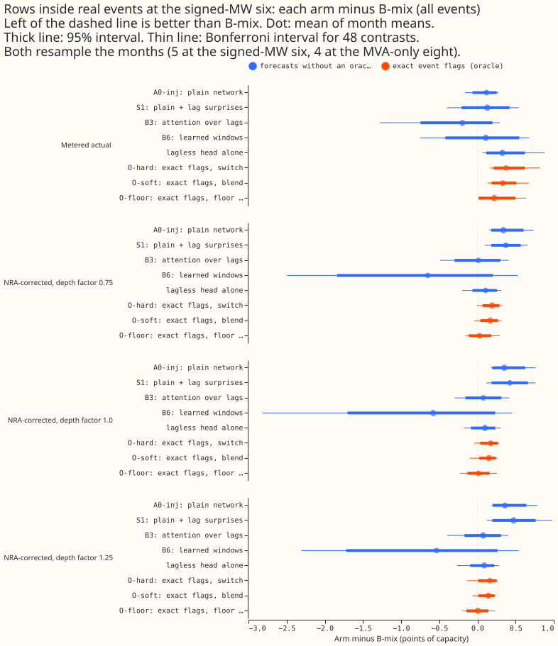
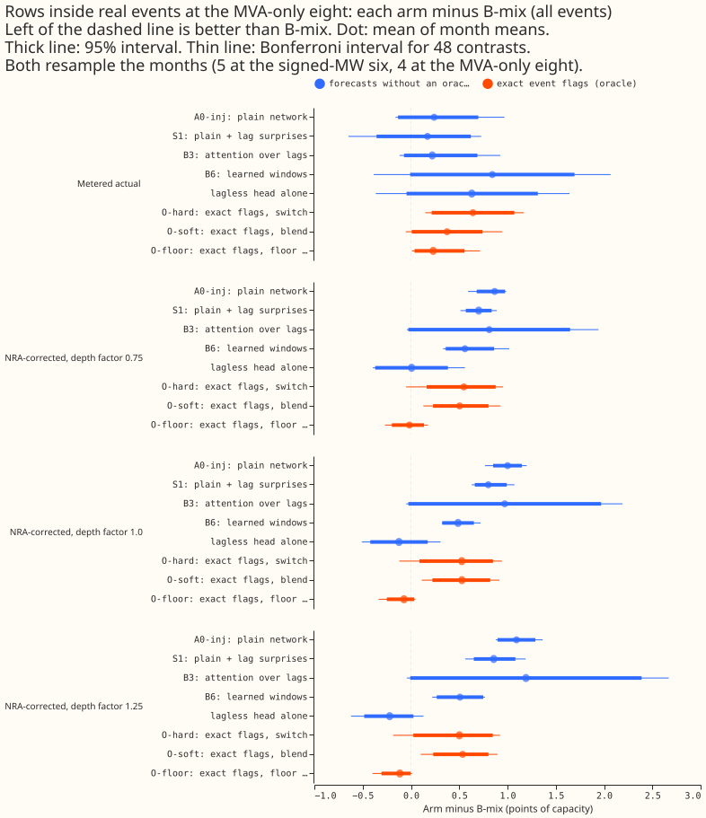
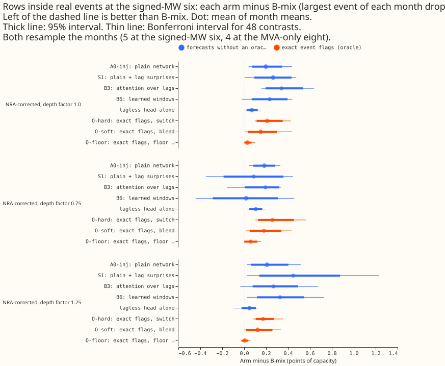

**Knowing exactly which recent readings lie inside a load-shift event still does not make a mixture
beat B-mix, even when forecasts are scored against the normal running arrangement (NRA).** B-mix is
the fixed 50/50 mixture of the plain network and the lagless forecast. At the six Primaries metered
in signed megawatts (the signed-MW six), O-hard (which switches to the lagless forecast whenever an
exact flag marks a lag) scores 0.16 to 0.19 points of capacity worse than B-mix at the three depth
factors of experiment 435's NRA correction, against 0.38 worse on metered actuals. The numbers are
interim and unaudited.

This experiment fits nothing. It rescores forecasts stored by experiments 404 and 445 on the rows
inside real events, adding the lagless head and the three flag-oracle mixtures of experiment 445 to
the rescore that experiment 404's audit ran for its own arms.

- **Row 1 of the review is answered by experiment 404's audit**, not here: `e00404_audit.py` and the
  files `cells.parquet`, `pooled_event_weighted.csv`, and `event_counts.csv` in 404's `work/audit/`
  folder. It found B3 and B6 behind B-mix when months are weighted by events (+0.13 and +0.15), and
  that the 1.15 widening and table P move every entry by 0.03 or less, so B-mix minus A0-inj on
  clean rows stays near +0.29.
- **Harm row.** The scoring code (experiment 428's window flags) calls a row a harm row when its
  target lies outside every padded real event and outside the 96 half-hours after one, but any
  observed half-hour of the three day-windows of its lags lies inside a padded event. The 404 plan
  wrote the definition on the three origin lags only. A clean row has no real event near it. A row
  "inside real events" has its target inside a padded event or in the 96 half-hours after one; this
  page scores those rows.
- **Event counts.** The five scored months overlap 46 corrected events (21 at the signed-MW six, 16
  at the MVA-only eight, 9 at D15 and D18) and 42 padded runs. Experiment 445 counts 49 and
  experiment 435 counts 41 with different windows. At the six the bootstrap clusters are 18 on harm
  rows, 25 inside events, and 37 on clean rows. The whole history holds 184 corrected events (170
  padded runs).
- **Unlogged-event caveat.** NGED says load-shift events may be missing from its logs. The 46 events
  are a lower bound, so rows called clean may hold unlabelled real events, and the harm and
  inside-event rows undercount. The NRA-corrected actuals correct only labelled events (a measured
  deviation for 34 of 184, the labelled depth for the other 150).

## Results

- **Rows and scores.** Rows are the real-event rows of forecasts with leads of 0 to 240 hours, as in
  404's audit. The score is the mass-weighted pinball loss in points of capacity from 11 quantiles.
  A contrast is the arm's score minus B-mix's on the same rows, mean of month means (seeds within a
  month averaged first), so negative is better than B-mix. B-mix scores 13.13 at the signed-MW six
  and 9.36 at the MVA-only eight at depth 1.0 (5.94 and 7.76 on metered actuals). B6 has fit seed 0
  only; the other arms have seeds 0 to 2 in 2026-06.
- **Intervals.** Resampling the months gives a 95% interval and a Bonferroni interval for 48
  contrasts (8 arms against B-mix, at 3 depth factors, in 2 groups; the metered column and the
  drop-largest variants repeat contrasts and are not counted again). Five months (four at the
  MVA-only eight, which has no 2026-06 real-event rows) cannot resolve the Bonferroni tail beyond
  the smallest and largest resampled mean, so a Bonferroni interval is nearly the range of the
  monthly values and is conservative. The minimum detectable effect (2.8 times the standard error of
  the monthly differences) is in the last column.

Signed-MW six, depth factor 1.0, inside real events (25 events, 5 months):

| Arm | Arm score | Arm minus B-mix [95%] (Bonferroni) | Largest event of each month dropped (Bonferroni) | Minimum detectable effect |
|---|---|---|---|---|
| A0-inj | 13.48 | +0.35 [+0.19, +0.62] (+0.17, +0.76) | +0.20 (+0.04, +0.44) | 0.38 |
| S1 | 13.55 | +0.42 [+0.19, +0.66] (+0.12, +0.76) | +0.26 (+0.01, +0.47) | 0.38 |
| B3 | 13.21 | +0.08 [-0.16, +0.31] (-0.30, +0.42) | +0.34 (+0.16, +0.64) | 0.40 |
| B6 | 12.56 | -0.58 [-1.70, +0.23] (-2.82, +0.45) | +0.23 (-0.02, +0.44) | 1.64 |
| lagless | 13.22 | +0.10 [-0.09, +0.23] (-0.18, +0.30) | +0.07 (+0.01, +0.15) | 0.26 |
| O-hard | 13.30 | +0.17 [+0.04, +0.27] (-0.04, +0.28) | +0.21 (+0.10, +0.43) | 0.20 |
| O-soft | 13.28 | +0.15 [+0.02, +0.24] (-0.10, +0.26) | +0.15 (+0.01, +0.44) | 0.18 |
| O-floor | 13.14 | +0.01 [-0.13, +0.16] (-0.23, +0.26) | +0.03 (+0.00, +0.10) | 0.21 |

MVA-only eight, depth factor 1.0 (26 events, 4 months):

| Arm | Arm score | Arm minus B-mix [95%] (Bonferroni) | Largest event of each month dropped (Bonferroni) | Minimum detectable effect |
|---|---|---|---|---|
| A0-inj | 10.36 | +1.00 [+0.85, +1.15] (+0.77, +1.20) | +0.63 (+0.38, +0.89) | 0.27 |
| S1 | 10.16 | +0.80 [+0.66, +0.99] (+0.63, +1.07) | +0.57 (+0.42, +0.77) | 0.27 |
| B3 | 10.33 | +0.97 [-0.03, +1.97] (-0.05, +2.19) | +0.91 (+0.25, +1.73) | 1.63 |
| B6 | 9.85 | +0.49 [+0.32, +0.65] (+0.32, +0.72) | +0.27 (+0.00, +0.49) | 0.28 |
| lagless | 9.24 | -0.12 [-0.42, +0.17] (-0.51, +0.31) | -0.02 (-0.15, +0.19) | 0.51 |
| O-hard | 9.89 | +0.53 [+0.09, +0.85] (-0.12, +0.94) | +0.33 (+0.22, +0.39) | 0.64 |
| O-soft | 9.89 | +0.53 [+0.22, +0.82] (+0.11, +0.92) | +0.20 (-0.01, +0.34) | 0.46 |
| O-floor | 9.29 | -0.07 [-0.25, +0.03] (-0.34, +0.05) | -0.01 (-0.06, +0.02) | 0.25 |

- **O-hard minus B-mix at the signed-MW six** is +0.19 [+0.07, +0.29] at depth 0.75, +0.17 [+0.04,
  +0.27] at 1.0, and +0.16 [+0.01, +0.25] at 1.25 (95% intervals, positive means B-mix is better).
  With the largest event of each month dropped it is +0.26, +0.21, and +0.17, with Bonferroni
  intervals above zero at all three (+0.10 to +0.56, +0.10 to +0.43, +0.08 to +0.35). The rule for
  "detection matters" needs a negative contrast, so it is not met at any depth.
- **Metered actuals** give O-hard +0.38 [+0.21, +0.62] at the six. The NRA correction therefore
  removes about half of the gap but not the sign.
- **At the MVA-only eight** O-hard is +0.50 to +0.55 behind at the three depths (Bonferroni
  intervals include zero for O-hard and exclude it for A0-inj, S1, and B6). The lagless head and
  O-floor are the only arms ahead of B-mix there (-0.12 to -0.22 and -0.07 to -0.12), and no
  interval excludes zero.
- **Against the predictions.** P1 holds (the O-hard contrast stays above zero, moving from +0.38 to
  +0.16 to +0.19). P2 holds at the six (the lagless head is +0.08 to +0.11 behind at every depth,
  with intervals that include zero). P3 fails: dropping the largest event of each month never
  changes the sign of an O-hard contrast.
- **Checks.** No new forecast is written, so the median-minus-mean and mean-forecast-error checks do
  not apply. None of the audit triggers fired: the numbers for A0-inj, S1, B3, and B6 reproduce
  404's audit tables (+0.35, +0.42, +0.08 at depth 1.0 at the six).

## Caveats

- **Few months and events.** Five months and 25 events at the six cannot detect a difference below
  about 0.2 points of capacity for the oracle arms and 0.4 or more for the others, and the MVA-only
  eight has four months.
- **Depth.** The NRA correction uses the labelled depth for 150 of 184 events, so its error is
  repeated by the three depth factors, which scale the same correction.
- **Tails.** This page scores CRPS only. The tails and the avoidable-curtailment cost are not
  rescored; experiment 445 found B-mix's q99 covers 71.8% inside real events at the six.
- **Row set.** Rows with leads above 240 hours are excluded to match 404's audit; experiment 445's
  +0.465 includes them, which is why the metered figure here is +0.38.
- **Unlogged events** may sit in clean rows and make every event slice an undercount (see above).

## What to try next

- **Stop work on event detection for the mixture rule.** Exact flags lose to B-mix under both
  targets.
- **Row 3 of the review** (a mixture and ensemble family) and the ambiguous-world test are the live
  lines; this page changes neither.
