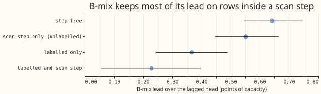
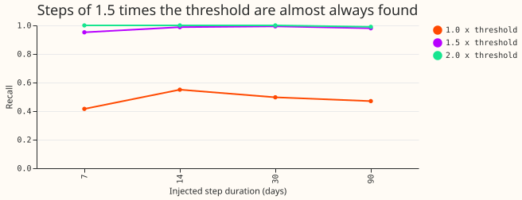
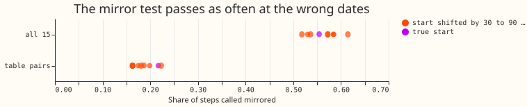
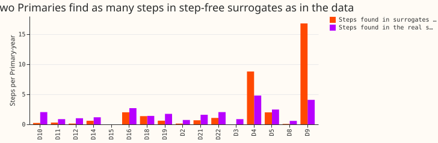
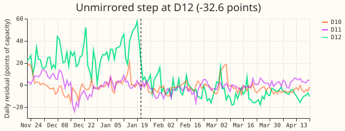
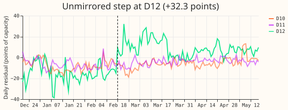
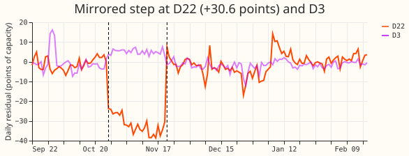

**Take-home: the label-free scan cannot yet tell genuine level changes from noise.** It finds 166
sustained steps in 93.6 Primary-years (1.77 per Primary-year), but step-free surrogates of the same
residuals give 1.74 per Primary-year, and the mirror test passes about as often at the wrong dates
as at the true dates. The unmirrored rate (0.75 per Primary-year) is therefore an upper bound that
the data do not separate from noise, and row 4 should keep its 2% and 5% placeholders. For the
forecast, rows inside an unlabelled scan step keep most of B-mix's lead over the lagged head, so
the scan does not find rows where B-mix fails.

## Setup

- **Data.** The 16 Primaries of experiment 87's loader, 2019-09 to 2026-07, flagged exact-zero
  half-hours already removed. 4,717 half-hours are missing between the first and last reading of
  the 16 Primaries (flagged zeros and any other gaps). D15 and
  D18 drop rows before 2025-03-01. 93.6 Primary-years of valid daily levels.
- **Residual.** Method (b): a lagless XGBoost median forecast (13 calendar and ERA5 features,
  absolute-error objective, 300 rounds), cross-fitted in 6-month blocks, boosters saved as `.ubj`
  under the experiment's data folder. Method (a), the stored cross-fitted lagless tables of
  experiment 449, agrees with method (b) on the five stored months (median daily-level correlation
  0.90, 80 Primary-months; the lowest is -0.28). ERA5 weather is a lab condition, not available at
  forecast time. Cadence: not applicable.
- **Scan.** Optimal partitioning of the daily level (squared-error cost, penalty 3 times
  `ln(n)` times a lag-7 noise variance, segments of 7 days or more). A step counts at 3 times the
  Primary's spread and 2 points. The scan on one Primary takes 0.05 s; the whole experiment took
  about 5 minutes after the block fits (about 13 minutes).
- **Compute.** CPU only, 2 threads. Reviews: Sonnet plan review, Sonnet code review before the first
  run (its findings changed the injection sizes and the surrogate scan), Sonnet results review
  (re-derived the headline numbers; no discrepancy), prose reviews as the PR body records.

## Results

- **Counts (baseline).** 36 mirrored, 70 unmirrored, 60 temporary, 0 unassessable. Rates per
  Primary-year: 0.39, 0.75, and 0.64. 66 of the 70 unmirrored steps match no labelled event, so
  0.71 per Primary-year are unlabelled. The median step is 14.6 points of effective capacity
  (1.1 MW). Dropping 5 unmirrored steps that start within 3 days of a block boundary gives 0.69.
- **Sensitivity of the unmirrored rate.** Spread multiple 2: 1.27; 4: 0.43. Floor of 1 or 4
  points: 0.75 (the spread sets the threshold at every Primary). Segment of 14 days: 0.52.
  Penalty 2 times or 5 times: 0.80 and 0.74. Mirror start within 3 days: 0.69. All 15 other
  Primaries as neighbours: 0.49. The rate moves by a factor of three across the grid.
- **Share of days inside an unmirrored step** (first 60 days of each): 5.1% at baseline, 2.7% at
  4 times the spread. P2 (under 2%) failed at baseline.
- **False alarms.** Phase-randomised surrogates keep each residual's power spectrum and remove
  abrupt steps. The scan finds 1.74 steps per Primary-year in them, from 0.0 at D3 and D15 to 8.8
  at D4 and 16.8 at D9. At D4 and D9 the surrogates produce more steps than the real series
  (4.8 and 4.1 per Primary-year). Excluding D4 and D9 the pooled rate is 0.63. Neither meets the
  0.2 limit. Nine Primaries (D2, D3, D8, D10, D11, D12, D14, D19, D21) have under 0.7 false alarms
  per Primary-year.
- **Mirror at chance.** With the table pairs, 0.217 of the 166 steps are called mirrored at their
  true start and 0.163 to 0.223 when the start is shifted by 30 to 90 days. With all 15 other
  Primaries it is 0.554 against 0.518 to 0.614. The tolerance (opposite sign, MW within a factor of
  2, start within 1 day, at any neighbour) is too loose, so the mirrored class is not evidence of
  load shifting.
- **Injection (quiet windows, daily residual).** Steps of 1.0, 1.5, and 2.0 times the detection
  threshold are recalled at 0.48, 0.98, and 1.00 (random windows 0.43, 0.91, 0.97), flat in
  duration from 7 to 90 days. With a mirror injected at a neighbour, 0.91 to 0.97 of detected
  steps are classed mirrored at 1.5 times; for unmirrored injections about 10% are called mirrored
  by chance. A refit of D2 with a 30-day step of 1.5 times the threshold injected into the
  half-hourly power (two windows) recovered 11.4 and 11.8 of the injected 11.8 points, so the
  cross-fit did not absorb it. Recall is high only for large steps; steps of 3 times the spread
  (1.0 times the threshold at the typical Primary) are recalled at under 0.5, so P3 failed.
- **Quiet windows.** The step-free rule leaves a median 41,500 of 120,000 half-hours per Primary
  as injection windows (D18 keeps 3,900 of 24,400) (`quiet_windows.csv`).
- **Recall on labelled events** (experiment 400's corrected table, 184 event-by-Primary rows in 93
  events). 11 rows and 10 events are found (a same-sign step starts within 2 days of the onset);
  of events lasting 7 days or more, 7 of 13 events and 7 of 23 rows. This is a lower bound on
  recall and says nothing about unlabelled events.
- **What the scan changes for the stored forecasts** (experiment 404, A0-inj against B-mix, 5
  months, 1,649,447 rows; a row is "in a scan step" if its origin day or target day lies in the
  first 60 days of any detected step at its Primary, mirrored, unmirrored, or temporary).

| Row set | Share of rows | B-mix lead (lagged minus B-mix, points) |
|---|---|---|
| Step-free | 66% | 0.64 [0.55, 0.75] |
| In a scan step, unlabelled | 14% | 0.55 [0.45, 0.67] |
| Labelled event only | 14% | 0.37 [0.24, 0.49] |
| Labelled event and scan step | 5% | 0.23 [0.05, 0.40] |

- **Reading the table.** Removing the unlabelled scan-step rows would cut 18% of the rows not
  labelled as events and move B-mix's lead on the rest from 0.63 to 0.64, so the scan would not
  change a score. The intervals of the first two rows overlap. The row sets differ by Primary
  (the scan flags 58% of Primary 3's rows and none of three Primaries), so this is not a matched
  comparison.
- **Candidate list.** `candidate_steps.csv` beside this page lists every step (Primary, start day,
  start date, end day, size in points and MW, class, nearest neighbour and its change, labelled,
  near a block boundary). 26 mirrored steps match no labelled event (0.28 per Primary-year); given
  the chance rate, most of them are coincidences. It is a robustness report only for the nine
  Primaries with low false-alarm rates.

## Caveats

- **NGED's event labels are incomplete.** The 184 label rows are a lower bound on events, so the
  recall is a lower bound on recall, and an unlabelled candidate may be a real event. Clean rows
  may hold unlogged events.
- **The scan cannot tell** a genuine level change that a neighbour mirrors by coincidence, a step
  shorter than 7 days, or any cause. Mirrors at BSPs, GSPs, or unmetered Primaries are not seen.
- **Injection is into the daily residual** with the spread and noise scale fixed at the real
  series' values (a lab shortcut, checked by one refit).
- **Neighbour sets** are the pairs in the corrected label table of experiment 395.
- **Post-run change.** The first false-alarm surrogate (14-day block bootstrap) created steps at
  the block joins (5 per Primary-year, three times the real count), so it was replaced by phase
  randomisation after the first run. Injection sizes (multiples of the threshold) and the
  surrogate's spread were fixed after the code review and before the numbers were read.

## What to try next

- **Repeat at the nine low-false-alarm Primaries** with a stricter mirror rule: a mirror must
  beat its own shifted-date distribution.
- **Use a residual with less drift** (a level state or an annual refit) at D4 and D9.
- **Keep row 4's 2% and 5% placeholders** until a repeat separates the unmirrored steps from noise.
