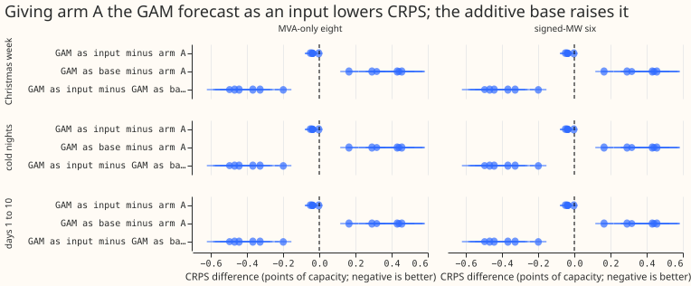
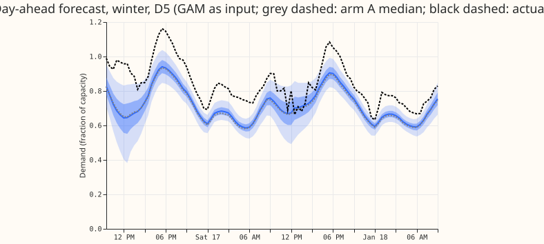
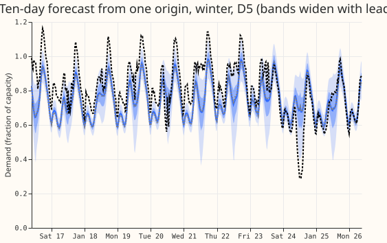
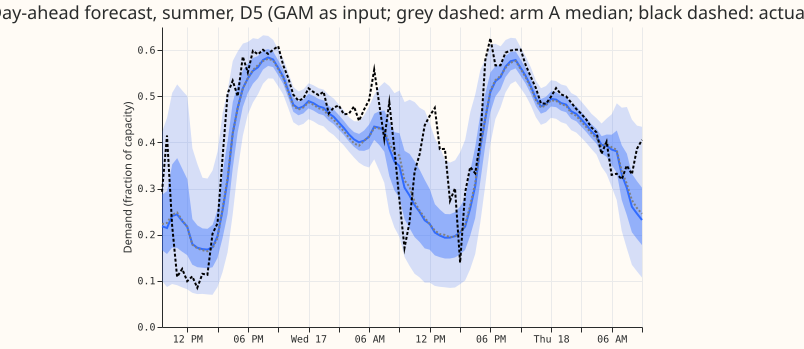
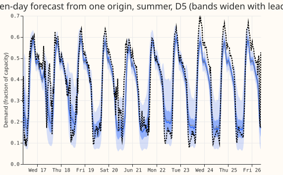

## Take-home

**Giving arm A the GAM's forecast as one extra input lowers CRPS by 0.036 points at the eight
MVA-only Primaries.**
That is 1.1% of the score and equals the minimum detectable effect of 0.0355, so the gain is real
but marginal. At the signed-MW six the gain is 0.035 (Bonferroni interval -0.042 to -0.027), below
that group's minimum detectable effect of 0.070. The tail pinball losses (q01, q05, q95, q99) and
the cold-night scores do not get worse. Using the GAM as an additive base for the network made the
forecast worse by 0.291 at the eight. The GAM's own forecast is worse than the pretrained network's,
and fine-tuning for 8 to 16 epochs does not recover the loss. The pre-registered rule is met
narrowly for the input arm, and the price is a GAM in the serving path with its monthly refit.

All numbers are from experiment 425's arm A recipe on the five folds of experiment 449, rows with no
labelled event (NGED's event labels are incomplete, so these rows may hold unlabelled real events).

## Figures

Example forecasts are GAM-as-input, seed 0, D5, one origin each. The horizon of every stored
forecast is 10 days (240 hours).

## Arms

- **A-ref (stored).** Experiment 425's arm A (folder `ml-experiments/00425-*`), run in experiment
  397's loop with pretraining on ERA5-and-CAMS rows and fine-tuning at learning rate 2e-4, seeds 0
  to 4, scored again and never refitted.
- **A-gam-in (`Gin`).** Two extra input columns, the standardised GAM forecast and a missing flag.
  The new first-layer weights start at zero.
- **A-gam-base (`Gbase`).** The GAM forecast shifts the mixture means by `z_gam` minus the frozen
  pretrained network's mixture mean, so training starts at the GAM forecast with the pretrained
  component offsets, weights, and spreads. Rows without a GAM value are the pretrained network.
- **Both arms start from experiment 425's stored pretrained arm A weights** (no new pretraining), so
  the GAM input is learned in fine-tuning only and arm A is the matched reference. ERA5 pretraining
  years have no out-of-fold GAM.
- **Stage 0 (the GAM).** Stored monthly per-site T-all GAM fits of experiment 136 (six signed-MW
  Primaries) and experiment 252 arm A1 (eight MVA-only Primaries), no Kalman filter and no lagged-error
  input, driven by the calibrated ensemble mean to 240 h. The 14 Primaries are fitted per site, not
  pooled. Stage 0 took 2 min 10 s on CPU for every ensemble run from 2024-04. D15 and D18 have no
  fit, and D8 has none before 2025-07, so their rows carry the missing flag. Leads above 240 h train
  as "GAM missing" (experiment 425's rows run to 351 h).
- **Common.** Monthly refits, five-seed quantile averages, 1.15 widening, five folds (2025-10,
  2025-12, 2026-01, 2026-03, 2026-06), D15 and D18 cut before 2025-03-01, flagged zero half-hours
  dropped. 713,323 shared half-hours; 385,855 at the eight. 50 fine-tunes took about 90 s each on
  one GPU process, about 1.5 GPU-hours in total.

## Headline numbers (CRPS in points of effective capacity, days 1 to 10; negative is a gain)

- **Minimum detectable effect:** 0.0355 at the eight, 0.070 at the six, 0.517 at D15 and D18, 0.061 at
  all 16 (arm A's five single seeds, experiment 428's formula; printed before any contrast).
- **Absolute CRPS at the eight:** arm A 3.363, GAM-as-input 3.327, GAM-as-base 3.654, BG2 3.563,
  manual heuristic 4.163, climatology 4.564. At the six: 2.734, 2.699, 2.898, 2.856, 3.760, 4.091.
- **Gin minus A at the eight:** -0.036 (Bonferroni -0.045 to -0.028; 95% -0.042 to -0.030). Cold
  nights -0.050 (-0.080 to -0.012). Christmas week -0.003 (-0.021 to +0.019; one year, report-only).
- **Gbase minus A at the eight:** +0.291 (+0.219 to +0.366). Cold nights +0.317, Christmas week +0.441.
- **Per fold, Gin minus A at the eight:** June -0.001, October -0.044, December -0.052, January
  -0.029, March -0.052. The gain is absent in the June fold.
- **Per Primary (leave-one-site-out):** the Gin gain stays between -0.027 and -0.043; it is largest
  at D19 (-0.092), D4 (-0.079), and D8 (-0.058) and about zero or positive at D12, D22, and D3.
- **D15 and D18 (report-only):** Gin minus A +0.021 (+0.013 to +0.030), so the GAM input slightly
  hurts where the GAM is missing.
- **Tails, Gin minus A at the eight (pinball, upper one-sided 95% bound):** q01 -0.004 (-0.003), q05
  -0.011 (-0.009), q95 -0.010 (-0.008), q99 -0.004 (-0.003). Coverage at the eight: q95 0.946 and q99
  0.990 for Gin against 0.949 and 0.991 for A. Gbase raises q05 pinball by 0.127 and q95 by 0.045.
- **Decision rule for Gin at the eight:** CRPS gain 0.036 against the minimum detectable effect 0.0355
  (met by 0.0005); cold nights and Christmas week do not worsen; no tail pinball loss worsens. The
  rule is met. Gbase fails it (CRPS +0.291).
- **Avoidable-curtailment cost, signed-MW six, lead 12 to 36 h, millions of pounds (cells: month by
  series, bootstrap):** at f = 0.9 arm A 1.89, Gin 1.88, Gbase 1.25, BG2 1.37, manual heuristic 2.02;
  Gin minus A -0.012 (-0.044 to +0.015). At f = 0.5 arm A 21.6, Gin 21.3, Gbase 21.5, BG2 25.9, manual
  heuristic 37.8; Gin minus A -0.323 (-0.690 to +0.035). Gbase has the lowest cost at f = 0.9 although
  its CRPS is worst; its difference from arm A at f = 0.9 is -0.641 (-1.854 to +0.063).
- **Widening sweep 1.0 to 1.15 (eight, q95 coverage):** Gin 0.918 to 0.946, arm A 0.922 to 0.949;
  the Gin-minus-A CRPS gap stays about -0.035 at every factor. These rows exclude BG2, so they differ
  slightly from the shared-row figures above.
- **The GAM alone:** its median absolute error at the eight is 6.75 points of capacity against 6.09
  for arm A's median and 6.02 for Gin's. The GAM's error is a diagnostic only; the result is the
  effect on the forecast scores above.
- **Bonferroni count:** 6 tests (two arms times three gating row sets: the eight, cold nights at the
  eight, and Christmas week at the eight). Other rows are reported with the same level but are not
  counted as tests.
- **Production cost:** the GAM must run in the serving path with its monthly refit, and the network
  needs the GAM forecast for every forecast origin.

## Checks

- **Reviews.** A fresh Sonnet reviewer read the code before the first fit (no leakage; the GAM-as-base
  mixture collapse, a missing Primary-join assertion, a broad exception handler, and an unclipped
  input were fixed). A fresh Sonnet reviewer then re-derived the 2026-01 and five-fold differences
  (identical to the files) and found no bug. A write-up review follows in the PR.
- **Leakage.** Every GAM value comes from the latest fit whose cut is at or before the forecast origin
  (3.5 hours earlier, checked by `choose_fit`), and stage 0 additionally requires the cut to be on or
  before the first day of the origin's month. Cuts are the first day of each month at 00:00 UTC
  (`gam_cuts_*.json`). The ensemble calibration comes from the odd months 2024-07 to 2025-05.
- **Audit triggers.** Mean-forecast check: the change in the mean forecast's absolute error against
  arm A is -0.063 points for Gin and +0.440 for Gbase, with the same signs as the CRPS contrast, so
  that trigger does not fire. Median minus mean forecast on 2026-01 is -0.49 for A, -0.47 for Gin, and
  -0.59 for Gbase points (largest at D12 and D8). No leave-one-site-out sign flip. The
  prediction-contradiction trigger fires for Gbase (predicted a gain of 0.05 to 0.15, found a loss of
  0.29). Cause, checked numerically: at the start of fine-tuning the Gbase mixture mean equals the GAM
  forecast to 2.4e-7, but on validation rows the GAM's mean absolute error is 0.353 (z units) against
  0.304 for the pretrained mean, so Gbase starts at a validation negative log-likelihood of about 0.67
  against 0.52, and its final value (0.496 for 2026-01 seed 0) stays far above Gin's (0.364).
- **Past-weather.** The GAM is driven by the calibrated ensemble mean at forecast time, so no
  past-weather caveat applies. The ERA5 pretraining years carry no GAM value.

## Caveats

- The Gin gain equals the minimum detectable effect, so it could be noise-level; the interval
  excludes zero, but the gain is absent in the June fold and concentrated at three Primaries.
- Fits are per site, not pooled, and cover 14 of 16 Primaries; D15 and D18 are report-only.
- Rows with no labelled event may hold unlabelled real events (NGED's event labels are incomplete).
- Christmas week is one year (22 to 31 December 2025), report-only.
- The sweep rows exclude BG2 and so cover more half-hours than the shared set.

## What to try next

- Port the GAM input only if the serving path already runs the GAM; the gain does not pay for a new
  GAM service alone.
- Test the GAM's partial effects (not only its forecast) as inputs, and a GAM input fitted pooled
  across Primaries, which would also cover D15 and D18.
