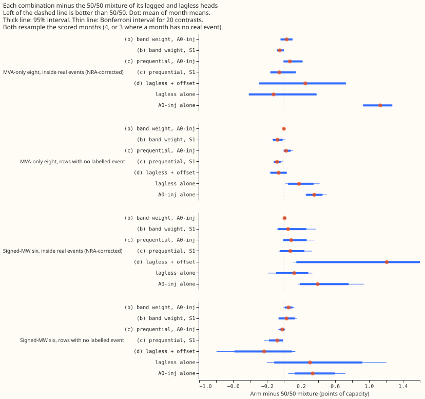
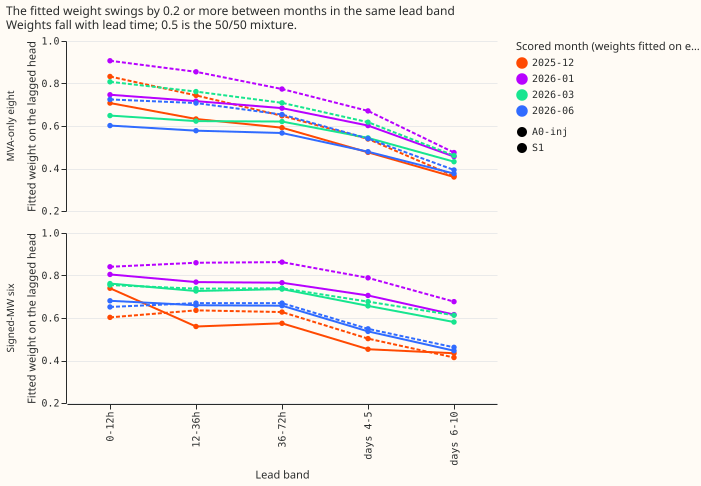
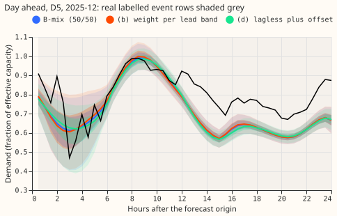
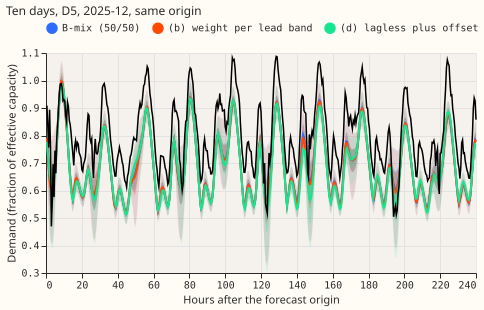
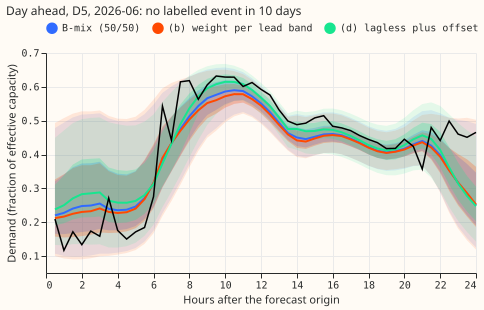
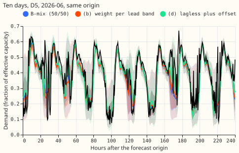

**No combination rule beat the fixed 50/50 mixture of the lagged and lagless forecasts (B-mix).**
The lagged weight that fits best falls with lead time, but the fitted weight moves by 0.2 or more
between months, so weights fitted on earlier months do not generalise. A shrunk recent-level offset
on the lagless forecast (arm d) is better on rows with no labelled event and much worse inside real
events. NGED's event labels are incomplete, so "rows with no labelled event" may hold real events
that nobody logged, and every real-event slice undercounts. Every number is interim and unaudited.
It bears on the forecast scores and, through the inside-event rows, on robustness to bad inputs.

## Results

Scores are points of effective capacity; a contrast is the arm minus the 50/50 mixture of the same
lagged head and the lagless head, so negative is better. Months are the resampling unit (4 scored
months; seeds averaged within 2026-06; the warm-up month 2025-10 is excluded for every arm).
Intervals are 95% month-block intervals; the Bonferroni interval for 20 contrasts is in the tables
of the experiment's private folder and in the figure.

- **Arms.** (a) B-mix. (b) one lagged weight per group and lead band, fitted by minimum exact CRPS on
  earlier months. (c) prequential weight from each head's 7-day loss, floor 0.2, softmax temperature
  fitted on earlier months. (d) lagless forecast plus k times its median residual over the last 24
  hours of delivered actuals. Lagged heads: A0-inj and S1 of experiment 404; lagless head: the
  frozen table of experiment 445. Arm (d) uses no lagged head.
- **Reference.** The stored B-mix mixes Gaussian-mixture heads; the arms mix the stored 11-quantile
  heads. A recomputed 50/50 mixture ("half") scores within 0.001 to 0.02 points of the stored
  B-mix, so contrasts use the recomputed 50/50 (same algebra). Contrasts against the stored B-mix
  are in `contrasts.csv`.
- **Signed-MW six, inside real events (NRA depth 1.0; 50/50 scores 14.262 with A0-inj, 14.267 with
  S1; minimum detectable effect 0.51 and 0.63).** (b) A0-inj +0.006 [-0.005, +0.023]; (b) S1
  +0.043 [-0.000, +0.119]; (c) A0-inj +0.085 [-0.009, +0.267]; (c) S1 +0.069 [-0.004, +0.142]; (d)
  +1.210 [+0.145, +2.276]. A0-inj alone is +0.396 and the lagless head alone +0.120.
- **Signed-MW six, rows with no labelled event (50/50 scores 3.680 and 3.638; minimum detectable
  effect 0.40 and 0.36).** (b) A0-inj +0.054 [+0.010, +0.099]; (b) S1 +0.072 [+0.000, +0.144]; (c)
  A0-inj -0.019 [-0.052, +0.006]; (c) S1 -0.037 [-0.117, +0.013]; (d) -0.234 [-0.584, +0.091], with
  2 of 4 months negative. The lagless head alone is +0.306.
- **MVA-only eight.** Inside real events (3 months with events): (b) +0.031 and +0.070, (c) +0.069
  and +0.066, (d) +0.251 (all intervals include zero except (b) S1, +0.024 to +0.118). Rows with no
  labelled event: every arm within 0.065 of 50/50 and every interval of (b), (c), and (d) includes
  zero.
- **Candidate rule.** No arm is a candidate: none lowers the inside-event score by more than the
  larger of 0.03 and the minimum detectable effect (0.51 at the six). (b) is also 0.054 and 0.072
  worse than 50/50 on rows with no labelled event, over the 0.03 allowance.
- **Stop rules.** The fitted weights of (b) at the six lie between 0.36 and 0.95 (within 0.05 of 0.5
  in none of the lead bands in every month), so the "50/50 is near-optimal" rule does not fire
  literally. Held out, however, they score no better than 50/50. The prequential weights stay
  within 0.05 of 0.5 on 18% to 82% of rows at the six (below 90%). k in (d) is 0.5 to 0.95 at the
  six (not near 0), so the lagless forecast does not already do the work.
- **Weight stability.** Arm (b) at the six: 0-12 h weight 0.68 to 0.81 and days 6-10 weight 0.43 to
  0.62 across the four fitted months; the same lead band moves by 0.2 or more between 2025-12 and
  2026-01 (figure 2). Rows in 2025-12 are fitted on 2025-10 alone, so that fit is thin.
- **Tails at the six, rows with no labelled event.** q95 coverage is 0.860 for B-mix and 0.863 and
  0.863 for (b) and (c); table P lifts it to about 0.944. q99 coverage 0.952, then 0.985 to 0.986
  after table P. Arm (d) covers q01 at 0.017 and q05 at 0.060 raw, above the nominal 0.01 and 0.05.
  Inside real events q99 coverage is 0.84 for 50/50, (b), and (c), and 0.866 for (d); q99 pinball
  loss differs from 50/50 by under 0.001 for (b) and (c).
- **Production cost.** Arm (d) needs only the lagless head and 24 hours of delivered actuals, so it
  costs less than two neural networks; it does not match 50/50 inside real events.
- **Checks.** A recomputed 50/50 reproduces the stored B-mix score to 0.001 (2026-06) and about 0.01
  elsewhere. A fresh reviewer re-derived the 2026-01 B-mix score (3.9628, 59,530 rows) and found no
  leakage in (d): moving its offset window back 0, 2, 4, and 14 days raises the score 3.160, 3.308,
  3.484, and 4.100, so the gain is a persistent bias of the lagless table, and it is not uniform
  (worse than B-mix in 2025-12 and 2026-06). Rows already omit half-hours that the cleaned power
  table lacks, so flagged zeros are dropped; experiment 399's start cut falls before every scored
  month. No new forecast is a trained model, so the median-minus-mean check does not apply.
- **Predictions.** P1 partly holds: the weight falls from about 0.75 at 0-12 h to about 0.5 at days
  6-10, but (b) is 0.054 worse than 50/50 on rows with no labelled event, not better. P2 fails (18%
  to 82% of rows within 0.05). P3 fails: k is 0.5 to 0.95, and (d) is better, not worse, on rows
  with no labelled event. P4 holds.

## Caveats

- **Four scored months and 3 to 4 months with events**, so the minimum detectable effect is 0.4 to
  0.6 points at the six and the Bonferroni intervals are nearly the range of the monthly values.
- **Unlogged events.** Rows with no labelled event may hold unlabelled real events, so the (d) gain
  on those rows may be partly a level offset that follows an unlogged event.
- **Not run.** Avoidable-curtailment cost at f = 0.9, 0.75, and 0.5, cold-night rows, the rows that
  the label-free step scan (experiment 456) finds step-free, months with a single real event shown
  apart, the XGBoost R0 pair, and the encroachment sweep. The curtailment and cold-night code reads
  frames of experiments 448 and 449's harness, which these stored forecasts do not share.
- **Seeds.** Seeds 0 to 2 only in 2026-06 and seed 0 in the other months; experiment 454's new
  seeds are not yet scored.
- **Fit objective.** Weights minimise the exact CRPS of the piecewise-linear mixture, not a
  likelihood, because the stored heads are 11 quantiles.

## What to try next

- Re-score on experiment 454's seeds 0 to 4 when its heads land, and add the curtailment cost.
- If a combination is wanted, test arm (d)'s offset on the lagged head's forecast as well; a
  persistent bias in the lagless table is what it corrects.
