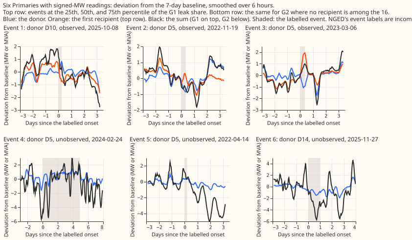
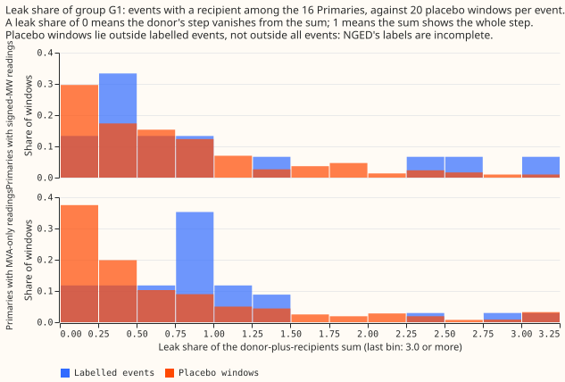
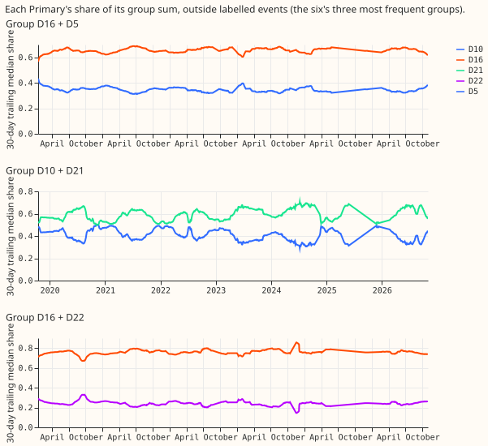

# Experiment 459: does a load shift leave the sum over the donor and its recipients unchanged?

**The sum over a donor Primary and its labelled recipients is not conserved through a labelled load
shift, so a group-sum forecast split by a slowly changing share is closed.** At the six Primaries
with signed-MW readings, a median of 0.53 of the donor's step is still visible in the G1 sum (the
donor plus its labelled recipients among the 16 Primaries), and windows outside the labelled events
show 0.54. The stop rule fired on both of its tests, and the oracle share-split forecast is no more
accurate than experiment 392's R0 lagged XGBoost forecast, even on harm rows. NGED's event labels
are incomplete, so every count below is a lower bound and every placebo window may hold an unlogged
event.

The question was whether moving load between Primaries leaves the group's sum unchanged. If it did,
a forecast of the group sum, split by each Primary's trailing share, would be immune to transfers
between members. The check costs no fit: it measures each labelled event's step, compares it with
placebo windows, and measures how well the true group sum times a trailing share predicts a member.
Nothing was fitted. The 112 labelled events of the corrected label table of experiment 395 gave
75 events after exclusions (31 donated by the six, 38 by the eight, 6 by D15 or D18).

## Figures

## Results

- **Stop rule (fires).** The median G2 leak share at the six is 1.73 (28 valid of 31 events;
  the limit is 0.5), and 13% of the 15 observed-recipient events have a G1 leak share of 0.25 or
  less (the limit is 50%). G2 is G1 plus all graph neighbours of the donor. A leak share above 1
  means the sum moves more than the donor alone.
- **P1 (fails).** At the six, observed-recipient events (15): median G1 leak share 0.53 against a
  placebo median of 0.54; 13% at or below 0.25 against 30% for the placebo.
- **P2 (holds in its letter).** 31 of the 112 events (28%) name no recipient at all, so no recipient
  is among the 16 Primaries. All unobserved events in the table are of that kind. The split by
  donor group is 24 of 46 at the six (52%), 4 of 54 at the eight (7%), and 3 of 12 for D15 and
  D18 (25%). The median G2 leak share of unobserved events at the six is 1.21 (14 valid of 16),
  above 0.5.
- **P3 (fails).** The oracle share-split error (true group sum times the trailing 30-day median
  share) has a median of 3.91 points of effective capacity at the six, against 3.31 for the R0
  lagged forecast on the same rows (30 group-and-Primary pairs; 1 pair has the ratio under 0.5).
- **Harm-row ceiling (fails).** On harm rows (a lag at 1, 2, or 7 days in a labelled event, the
  target outside), the median paired gain of the oracle over the R0 lagged forecast at the six is
  −0.10 points (18 pairs, 26,786 rows), below the 0.1 point threshold. Only D10, D11, and D14 have
  harm rows, because the R0 forecast covers 4 test months. The oracle knows the target's true
  group sum, so this is a ceiling.
- **Pre-registered contrasts (G1, observed recipient; 98.75% intervals, k = 4).**

| Group | Contrast | Events | Estimate | Interval |
|---|---|---|---|---|
| Six | Median leak minus placebo median | 15 | −0.01 | −0.27 to 0.91 |
| Six | Share at most 0.25 minus placebo share | 15 | −0.16 | −0.38 to 0.14 |
| Eight | Median leak minus placebo median | 34 | 0.49 | 0.23 to 0.65 |
| Eight | Share at most 0.25 minus placebo share | 34 | −0.26 | −0.39 to −0.11 |

- **Minimum detectable effect, from the placebo spread (stated before the headline).** 0.18 at the
  six and 0.16 at the eight, for the median-leak contrast (2.8 times the bootstrap standard
  deviation of the placebo median). The six's interval is much wider because it has 15 events.
- **Robustness.** Leaving out one donor Primary moves the six's median-leak contrast between
  −0.21 and 0.34 and the share contrast between −0.35 and −0.06. Dropping the largest event gives
  0.07 and −0.15. At the eight, the contrasts stay between 0.37 and 0.52 and between −0.30 and
  −0.23.
- **Eight.** The eight's G1 median leak share is 0.89 against 0.40 for the placebo, and only 12% of
  events reach 0.25 or lower (placebo 38%). MVA magnitudes are not conserved when flow reverses,
  and 19 of the 34 observed events at the eight mix MW and MVA readings, so expect worse results.
- **G3 (all 16 Primaries).** Median leak share 5.1 at the six, with 16 of 31 events valid, because
  the sum needs all 16 readings at the same time. The whole system is not conserved either.
- **Allocation stability.** The trailing share moves slowly (figure 3), but the one-day-ahead error
  of the share, multiplied by the group sum, has 80% band edges between −14 and +11 points at the six
  (per-Primary medians over groups, in `table_allocation.csv`). The R0 lagged forecast's median
  absolute error at the six is 2.9 to 4.2 points.
- **Robustness to a dead meter.** Placebo windows where more than 5% of the group's half-hours are
  missing (a proxy for a flagged or dead meter; 11 windows at the six) have a median G1 leak share
  of 0.85 against 0.59 for the rest. A dead meter on one member breaks the sum, so the group sum
  gives no shield.
- **Explainability.** An operator would read the forecast as "this Primary's demand is the group's
  demand times its usual share". The group sum is not smooth through logged events: in figure 1 the
  black sum swings as much as, or more than, the donor.

## Caveats

- **Incomplete labels.** NGED's event labels miss events, so placebo windows may contain unlogged
  events and the placebo is "windows outside labelled events", not clean windows. Event counts are
  lower bounds.
- **Unobserved recipients.** All 31 unobserved events name no recipient; none names a recipient
  outside the 16.
- **Event baselines.** 52 of the 75 included events (24 of 31 at the six) have a 7-day baseline that
  overlaps an earlier labelled event or its 7-day tail, because the same donors repeat. Placebo
  baselines never overlap an event.
- **Season.** Placebo onsets are uniform over the record, not matched in season.
- **Excluded events.** 37 events: 22 with a donor step under 0.3 MW, 8 with no measurable donor
  step, and 7 whose measured sign disagrees with the corrected sign.
- **Mixed units.** Groups that mix signed MW with MVA magnitudes are summed as they are
  (`mixed_units_g1`, `mixed_units_g2` in the event table).
- **Unlogged-event set.** Experiment 456 had not reported when this page was written, so the
  candidate-step set is left out.
- **Allocation share.** The 12 to 36 hour band is not reported: the oracle does not depend on lead,
  so the band repeats the all-lead number.
- **Share sums near zero.** Half-hours where the group sum is under 10% of its members' capacity
  are dropped from the share statistics.
- **Standing practices.** No forecast is fitted, so retraining cadence, saved boosters, curtailment
  cost, tail calibration, and the audit's seven triggers do not apply.

## What to try next

- Treat a labelled event as a property of one Primary's own series, as experiments 400 and 402 do,
  and do not pursue a group-sum forecast.
- A forecast that uses the donor's neighbours as a signal (the neighbour surprise already in
  experiment 402's gate) remains open.

## Code and data

- Code: `ml-experiments/00459-load-shift-conservation-check-donor-and-recipient-sum/`
  (`e00459_conservation.py`, `e00459_report.py`, `e00459_charts.py`). Reuses experiment 377's
  series table, experiment 391's neighbour graph, experiment 395's corrected label table, and
  experiment 402's stored R0 lagged forecast.
- Tables: `table_groups.csv`, `table_contrasts.csv`, `table_allocation.csv`. Per-event and placebo
  rows are in the private work folder.
