**Take-home message.** When one neural network hides its power lags, its forecast barely changes,
so the disagreement between its five forecasts (all lags, each lag alone, no lags) cannot show which
lags are wrong. The disagreement did not widen the bands or choose a mixture weight better than a
fixed rule. Training with random lag dropout also made the neural network slightly worse. The next
step is a forecast that depends more on its lags, or more diverse members such as a three-seed
ensemble, not a disagreement signal from one network.

We asked whether a neural network that has learned to forecast with or without each of its three
recent power readings (lags) can tell when those readings are wrong. We trained such a network,
scored each forecast five times (all lags, each lag alone, no lags), and measured how far the five
medians disagree. We then tested whether that disagreement picks out the half-hours whose lags lie
inside a load-shift event while the target does not (harm rows), and whether it can widen the
bands or set a mixture weight. It cannot: the area under the curve (AUC) is 0.51 at the signed-MW
six Primaries, and no arm that uses the disagreement beats a fixed 50/50 mixture of a lagged and a
lagless network (B-mix). NGED's event labels are incomplete, so rows are called "rows with no
labelled event"; the label-free step scan has not reported, so that second row set is not used.
Every number is interim and unaudited by the maintainer.

## Figures

- Figure 1 and Figure 2: each arm minus B-mix at the signed-MW six and the MVA-only eight.
- Figure 3: AUC of the spread signals.
- Figure 4: absolute scores.
- Figures 5 and 6: example forecasts. Figures 7 to 12: six real events.

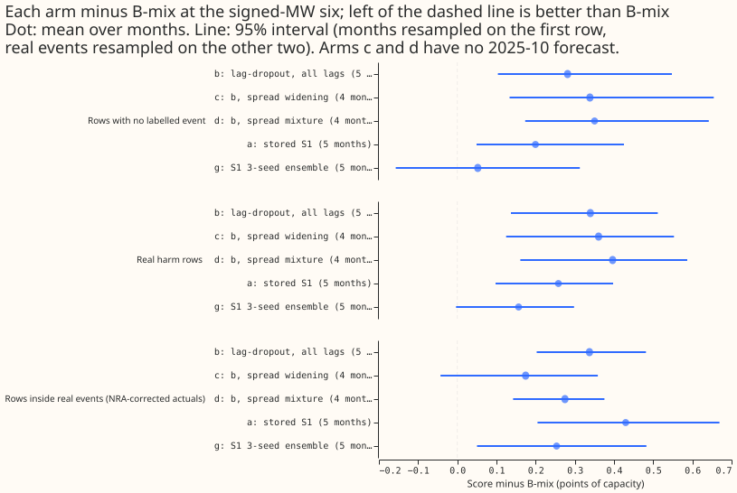

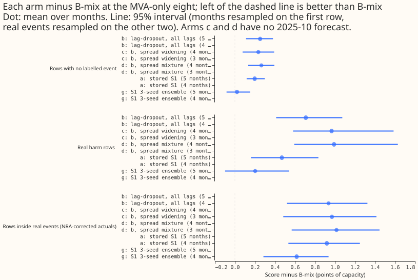

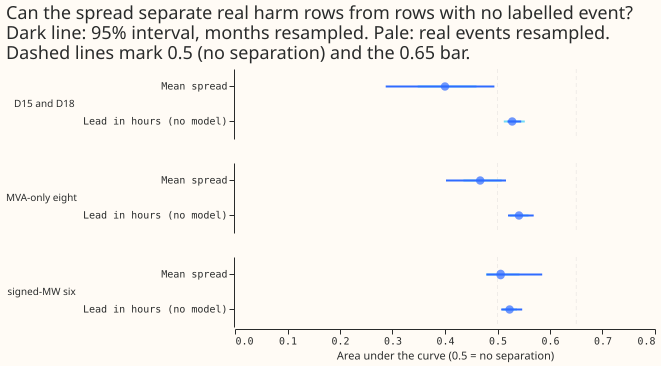

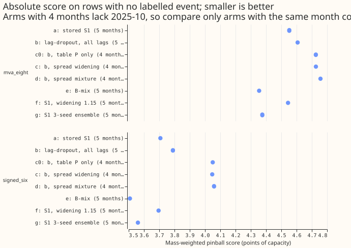

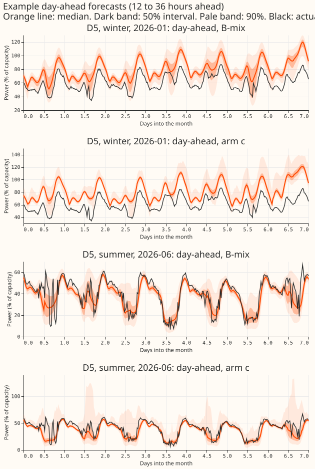

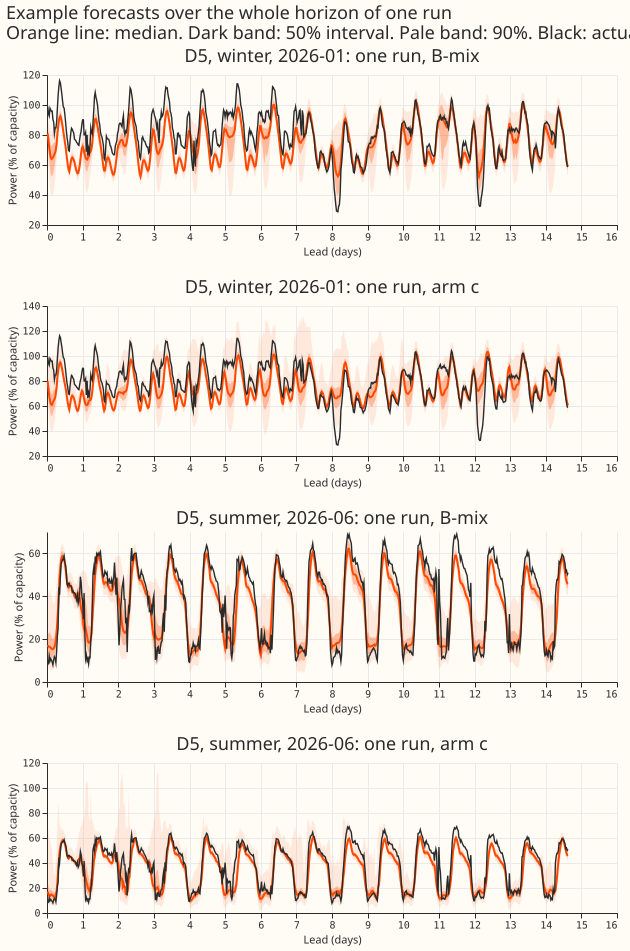

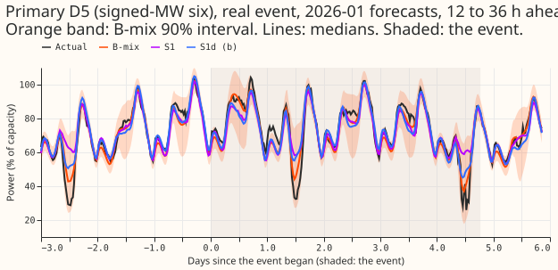

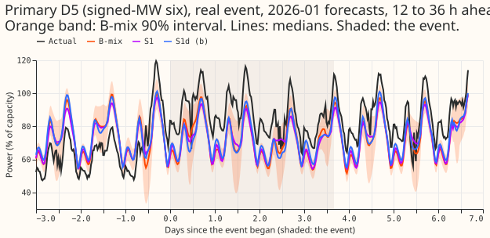

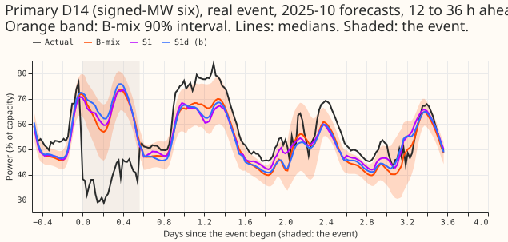

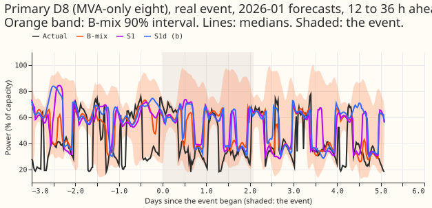

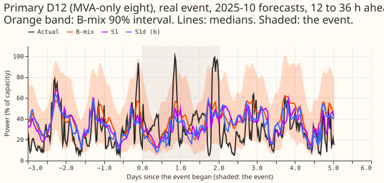

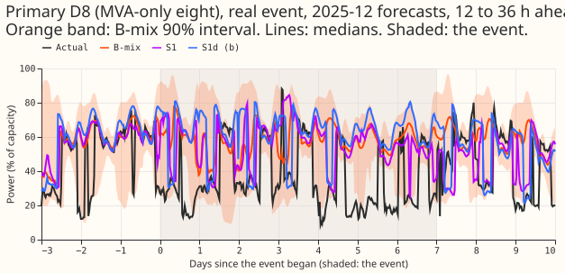

## Results

Scores are the mass-weighted pinball loss (CRPS-like) in points of capacity, seeds averaged within
a row, rows with leads of 0 to 240 hours, a mean over months. Arms c and d have no 2025-10
forecast (nothing earlier to fit on), so their contrasts use four months. Arm letters are those of
the design below. Intervals are unadjusted 95% intervals (Bonferroni count 42 for the
pre-registered contrasts), and no 99% claim is made.

- **Spread signal (diagnostic, AUC).** Harm rows against rows with no labelled event, pooled over
  months and averaged over the 3 seeds. Signed-MW six: AUC 0.51 (months resampled 0.48 to 0.59; real
  events resampled 0.48 to 0.54). MVA-only eight: 0.47 (0.40 to 0.52; 0.44 to 0.51), so the spread
  is slightly lower on harm rows. D15 and D18: 0.40 (report-only). The maximum-over-pairs signal
  gives 0.52, 0.46, and 0.40. Lead in hours alone, with no neural network, gives 0.52 at the six and
  0.54 at the eight, so the spread separates harm rows no better than the lead does. Within lead
  bands the mean AUC is 0.49 (six) and 0.47 (eight). Month by month the six's mean-spread AUC is
  0.48 (2025-10), 0.48 (2025-12), 0.63 (2026-01), 0.58 (2026-03), and 0.52 (2026-06), so the pooled
  null hides two months with some separation. The 0.65 bar is still missed. This diagnostic is read
  beside its effect on forecast scores (arms c and d below).
- **Known-answer control missed its prediction.** On the injected scoring worlds the AUC for the
  spread is 0.53 (six) and 0.55 (eight) for rows with an injected event anywhere in the three day
  windows; prediction P2 was above 0.75. Post hoc, with only rows whose three origin lags lie inside
  an injected event as positives, the AUC is 0.60 (six) and 0.62 (eight) for the mean spread, and
  0.63 and 0.65 for the maximum. The five-pass medians move little even under exact lag corruption:
  across all rows the median of the mean spread is 0.037 of the band width, and the all-lags and
  no-lags medians differ by 0.016 of capacity on average (2026-01, seed 0).
- **The lag-dropout network (b) against stored S1 (a).** On rows with no labelled event at the six,
  b minus a is +0.08 [+0.01, +0.14] (3.86 against 3.77 row-pooled; b is worse in 4 of 5 months;
  leaving out one month gives +0.06 to +0.11) and +0.05 [-0.06, +0.16] at the eight. The stop rule
  (a loss above 0.03 at the six) fires. The loss is below the minimum detectable effect of 0.16, so
  the sign is the information, not the size. Month by month the difference is -0.03 (2025-10),
  +0.18 (2025-12), +0.01 (2026-01), +0.14 (2026-03), and +0.12 (2026-06), so the exceedance of 0.03
  is a point estimate that two months do not show. The `score_a` and `score_b` columns of
  `contrasts.csv` pool rows, while `diff` is the mean of the month means, so the columns need not
  subtract to `diff`. The absolute scores quoted in this section are the row-pooled values;
  `absolute.csv` and Figure 4 give the mean over month means, which differ by 0.07 to 0.2 (for
  example 3.79 against 3.71 for b and a), while the contrasts agree.
- **Arms c and d against B-mix (rows with no labelled event, six).** Arm c (b widened by spread)
  4.09 against B-mix 3.72, +0.34 [+0.13, +0.65], worse in 4 of 4 months. Arm d (b mixed by spread)
  4.10, +0.35 [+0.17, +0.64]. At the eight: +0.23 and +0.26. Both exceed the 0.03 non-inferiority
  bar, so neither is a candidate under rule 2. On real harm rows the gaps are +0.36 and +0.40
  (six), +0.97 and +0.99 (eight); inside real events (NRA-corrected actuals) +0.17 and +0.27
  (six), +0.97 and +1.02 (eight).
- **Spread adds nothing over the controls.** Arm c minus c0 (table P with no spread) is -0.003
  [-0.006, -0.000] (C6); arm c minus b is -0.003 [-0.036, +0.027] and arm d minus b is +0.009
  [+0.001, +0.021] (post hoc, C9 and C10);
  the fitted mixture weights are flat across the four spread bins (for example 0.4 in every bin
  at the six for 2026-06). Arm c against f (S1 with a constant 1.15 widening) is +0.12 [+0.03,
  +0.18], and arm d against g (the three-seed S1 ensemble) is +0.28 [+0.19, +0.41].
- **12 to 36 hours (post hoc contrast C7).** The three-seed S1 ensemble (g) beats B-mix by 0.21
  [0.07, 0.38] at the six and 0.22 [0.10, 0.34] at the eight, but across all leads it trails B-mix
  by +0.05 [-0.16, +0.31] and +0.02. One possible reason is that the lags matter most at short lead,
  where a diverse ensemble does best; no experiment here tests that.
- **Tails.** See the table. Recalibration with table P lifts q99 coverage inside real events
  at the six from 0.970 (b) to 0.996 (c and c0), the same for the spread-conditioned and the plain
  version.

| Six, NRA-corrected actuals inside events | q99 coverage inside events | q99 coverage, rows with no labelled event | q99 pinball loss, rows with no labelled event (fraction of capacity) |
|---|---|---|---|
| e: B-mix | 0.979 | 0.951 | 0.0026 |
| a: stored S1 | 0.973 | 0.917 | 0.0035 |
| b: lag-dropout network | 0.970 | 0.913 | 0.0036 |
| c: b, spread widening (4 months) | 0.996 | 0.976 | 0.0036 |
| d: b, spread mixture (4 months) | 0.968 | 0.896 | 0.0041 |
| f: S1 widened by 1.15 | 0.982 | 0.944 | 0.0028 |
| g: three-seed S1 ensemble | 0.980 | 0.940 | 0.0027 |
| c0: b, table P only (4 months) | 0.996 | 0.974 | 0.0038 |

  The q01, q05, and q95 coverages, the MVA-only eight, and the table-P tails of the other arms are
  in `work/score/tails.csv`. At the eight, q99 coverage inside events is 0.925 (B-mix), 0.895 (b),
  0.940 (c), and 0.904 (d).

- **Avoidable-curtailment cost: not computed.** The measure needs forecasts for each grid supply
  node and its generators; this harness forecasts 16 Primaries only (as in experiment 445).
- **Serving cost.** Five passes of one neural network per forecast, against B-mix's two neural
  networks.
- **Minimum detectable effect** (read before any contrast, from the spread between seeds of
  B-mix on rows with no labelled event): 0.16 at the six, 0.08 at the eight, 1.65 at D15 and D18.
- **Fits.** 15 fits (3 seeds times 5 months), 36 seconds each on the GPU (about 0.15 GPU-hours).
  Networks are saved under the experiment's data folder (`work/models/S1d/`).
- **Reuse.** Experiment 404's rows, S1 and A0-inj networks (fit seeds 0 to 2) and lagless tables;
  experiment 435's table P and NRA-corrected actuals; experiment 454's mixture code. Recomputed S1
  and B-mix forecasts match experiment 404's stored seed 0 tables to within 2.2e-5 (capacity
  fraction).
- **Rows dropped.** The flagged `substation_zero` half-hours and the D15 and D18 cut are those of
  experiment 404's rows; their count was not re-derived here.

## Checks

- **Median minus mean forecast, per Primary** (rows with no labelled event, points of capacity):
  the median lies below the mean at every Primary for b, from -0.02 (D14) to -0.81 (D5) at the six
  and -0.00 (D22) to -1.30 (D12) at the eight (D15 -1.28, D18 -0.27). B-mix has the same sign (D5
  -0.35), so the skew is in the weather-driven demand forecast, not in the spread arms.
- **Error of the mean forecast beside the quantile contrasts** (mean absolute error, points of
  capacity, metered actuals, six): rows with no labelled event B-mix 4.99, a 5.21, b 5.33; harm
  rows 4.70, 4.96, 5.11; inside events 9.68, 9.65, 9.79. The ordering agrees with the quantile
  score on the first two row sets. Inside events, a is marginally better than B-mix on the mean
  forecast, and its metered quantile contrast is +0.13 [-0.11, +0.32], so the two do not
  contradict each other.
- **Triggers that fired.** Trigger 1 (a control failed): the injected-world control (P2) fell short,
  and the post hoc explanation test above (exact lag corruption gives an AUC of 0.60 to 0.65)
  supports "the network barely uses its lags". Trigger 2 (result contradicts its prediction): P3
  predicted a loss of 0.00 to 0.05 against S1 and observed +0.08; P1 expected 0.52 to 0.62 at the
  six and observed 0.51, and 0.47 at the eight. Triggers 3 to 7 did not fire (leaving one month out
  does not change the sign of C1, C2, or C3). A fresh Sonnet audit re-derived the headline numbers;
  its findings are triaged in the pull request.

## Caveats

- **NGED's event labels are incomplete.** Rows with no labelled event may hold events no label
  covers, so the harm table is optimistic and the real-event rows undercount.
- The experiment covers five months and 18 harm-row events at the six (19 at the eight), which is
  few; the MVA-only eight has four months with a row inside an event.
- Arms c and d are fitted on 1 to 4 earlier months and score four months; the fit for the summer
  month rests on winter months. About 650 half-hours of January targets also appear as actuals in
  the December fitting rows, which can only favour arms c and d, and they still lose.
- Arm g is a single ensemble with no seed spread, so C5 and C7 compare it with a 3-seed average of
  single networks; comparing a single ensemble with a 3-seed average does not bias the sign of the
  contrast, but hides the ensemble's seed noise.
- Arms c, c0, and the table-P rows use a floor of 1.0 on every factor (no narrowing), unlike
  experiment 435's table P, and fit on all real rows of earlier months, not only rows with no
  labelled event.
- The no-lags pass appears in only 2.7% of training rows, so it is the least trained pass.
- The AUC subsamples the rows with no labelled event to 40,000 per month and seed.
- The extra contrasts C8 to C12 are post hoc and not among the 42.

## What to try next

- **The result gives no reason to continue with disagreement as a trust signal** for neural
  networks that hide lags, because the forecast does not depend on the lags enough.
- Test the three-seed S1 ensemble against B-mix at 12 to 36 hours in a held-out year, because that
  post hoc contrast is the only positive contrast among those we ran.
- If a lag-trust signal is still wanted, use a network whose forecast moves with its lags (for
  example, one trained without a lagless input) and check the injected-world control first.

## Design

- **Harness.** Experiment 404's: its rows, its five months (2025-10, 2025-12, 2026-01, 2026-03,
  2026-06), six epochs of Adam on stride-2 rows, training on the injected worlds of seeds 100 to 102
  (one per fit seed 0 to 2), the frozen cross-fitted lagless tables, and the same fit seeds as
  experiments 404 and 454. Rows are equal to experiment 454's. A fit was estimated at about 20
  seconds on the GPU (36 seconds measured), so 15 fits (3 seeds times 5 months) cost minutes of GPU;
  the first fit is timed and reported before the rest.
- **Network.** S1 (the plain network with three origin lags and the surprise at each lag) trained
  with random lag dropout: for each training row each of the three lags is masked independently
  with probability 0.3. A masked lag has its value, age, and surprise set to 0 and its missing flag
  set to 1; the missing flag is the mask flag, so a lag that is really missing and a lag that is
  masked look the same to the network. Experiment 404's `PlainLagMdn` and `fit_arm` are reused,
  but its `drop_lags` cannot handle the 12 columns of S1, so a subclass in this folder has new
  masking code (`mask_lags`). Training and the five passes call the same function, so the
  single-lag and no-lags passes are not off-distribution.
- **Passes.** The saved network is scored five times per row: all lags, each single lag alone
  (the other two masked), and no lags. One network, five passes per serving call.
- **Arms.** (a) the stored S1 network; (b) the lag-dropout network with all lags; (c) arm b with
  its tail quantiles widened by a factor that is a monotone function of the mean spread; (d) arm b
  mixed with its no-lags pass, with a mixture weight that is a monotone function of the mean
  spread; (e) B-mix; (f) arm a with a constant 1.15 widening; (g) the three-seed S1 ensemble, an
  equal-weight density mixture of the S1 networks of fit seeds 0 to 2. Control c0: arm b after a
  table P (experiment 435's tail recalibration) with no spread, so a gain from recalibration alone
  is not read as a spread signal.
- **How arms c and d are fitted.** On the real rows of earlier months only, per seed, per group,
  with leads 0 to 240 hours. Arm c: four spread bins whose edges are the quartiles of the fitting
  rows' spread per group; within each bin and lead band, table P's per-tail factors (the
  quantile of the standardised miss, as in experiment 435); the factors are then made
  non-decreasing in the bin with a running maximum. Arm d: the same four bins per group; within
  each bin, the weight on the no-lags pass from the grid 0, 0.1, ..., 1 that minimises the fitting
  rows' mean CRPS (a subsample of up to 60,000 rows per group per earlier month), made
  non-decreasing in the bin with a running maximum. Nothing in the fit uses an event label. The
  fitting rows of each earlier month are that month's
  own out-of-sample forecasts (made by the network trained before that month), so the fit is not
  on rows the scoring network trained on; the earlier months cover other seasons, which limits
  the fit for the summer month. Arm d is a density mixture (log weights shifted by log of the
  weight, as in B-mix), and its fitting CRPS is computed on the mixture's quantiles. Control c0
  uses the same procedure and rows as arm c with one bin, not experiment 435's table.
- **Confounds of the spread.** Lag age grows with lead, and the no-lags pass is seen in only 2.7%
  of training rows. The AUC is therefore also reported within each lead band (mean of the band
  AUCs) and beside a lead-only score (the lead in hours as the signal), and the 12 to 36 hour
  band's CRPS is reported separately.
- **Row classes.** Experiment 404's `report.load` classes with the window flags of experiment 428:
  a harm row has its target outside every padded real event (and outside the 96 half-hours after
  one) and an observed half-hour of its three day-windows inside a padded event; rows inside real
  events have the target inside a padded event or in the 96 half-hours after one; rows with no
  labelled event have neither. The injected scoring worlds (seeds 200 to 202) are used only for the
  AUC known-answer control (P2).
- **Actuals.** Inside real events the headline actual is experiment 435's NRA-corrected value
  (normal running arrangement), the metered value secondary, each with and without the largest
  event of each month; months with a single event are shown apart.
- **Tails and cost.** q01, q05, q95, q99 coverage and pinball loss, raw and after table P, per
  group and lead band, and the 12 to 36 hour band separately. The avoidable-curtailment cost is
  not computed: it needs forecasts for each grid supply node and its generators, and this
  harness forecasts the 16 Primaries only (the same reason experiment 445 gives).
- **Absolute scores** are printed beside every contrast. Serving cost: five passes of one network
  per forecast against B-mix's two networks.
- **Standing practices followed.** Monthly refits (not a cadence question, so no weekly gate),
  cleaned data with the flagged `substation_zero` half-hours dropped by experiment 404's rows, the
  D15 and D18 cut at 2025-03-01 (report-only), every fitted network saved under this experiment's
  data folder, stored forecasts reused as references, a fresh Sonnet code review before the first
  scored number, the five-month screen of experiment 404 rather than four folds (so rows equal
  experiments 404 and 454), tails reported beside CRPS, draft pull request.
- **Unlogged-event caveat.** NGED says load-shift events may be missing from its logs. Rows with no
  labelled event may therefore hold events no label covers, the harm table is optimistic, and the
  real-event rows undercount.
- **Earlier advice followed.** Experiment 445: score against both metered and NRA-corrected
  actuals. Experiment 404: report single-event months apart, and weight by event. Departure: the
  curtailment cost is not computed (above).
