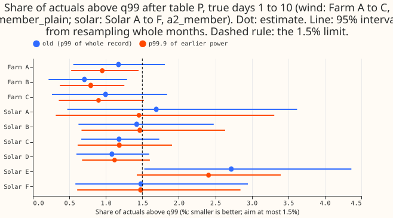
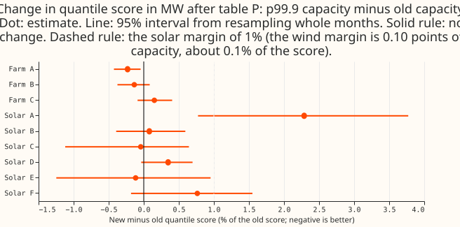
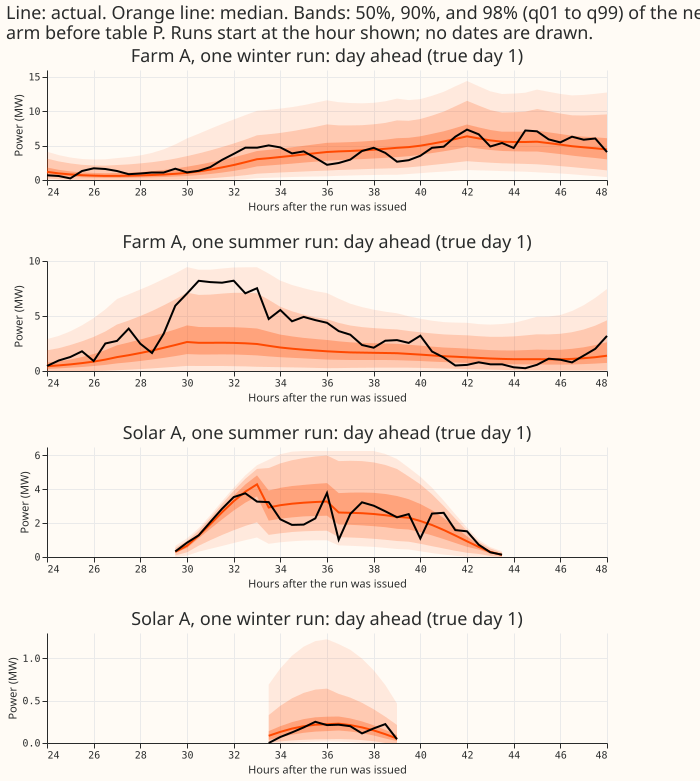
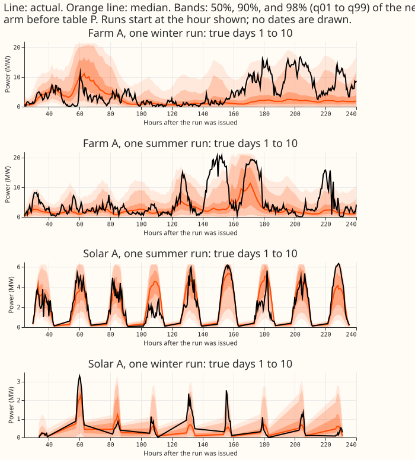

**Take-home: p99.9 capacity is safe and slightly helpful for wind, and a marginal, fragile pooled
pass for solar that hurts Solar A.** Retraining `member_plain` with capacity at the 99.9th percentile of each
farm's earlier power leaves the score in MW unchanged and lowers the pooled share of actuals above
q99 (after table P) from 0.96% to 0.88%, with Farm A at 0.95% (1.17% before). For solar's
`a2_member`, the pooled share falls from 1.57% to 1.50% and the pooled score is 0.4% worse, so both
pooled checks pass with almost no room. Solar A's score is 2.3% worse, and Solar E's share is 2.4%,
against the 1.5% limit.

**Terms.** *Old capacity* is the 99th percentile of a series' whole cleaned record (experiments 429
and 430). *New capacity* is the 99.9th percentile of the series' cleaned power before the end of the
fit's training (wind: before 2025-04-16; solar: before each refit's cutoff). *Table P* is experiment
435's per-series, per-lead-band tail recalibration, fitted on earlier months, with experiment
451's upper clip. Farm A to C are experiment 429's wind farms and Solar A to F are experiment 430's
solar series. The wind network is `member_plain` (5 seeds, one fit per seed). The solar headline
network is `a2_member` (3 seeds, 4 quarterly refits). Rows are true days 1 to 10.

## Figures

## Results

- **Verdict by the pre-registered rule.** Wind passes: the upper bound of the 95% interval of the
  score change is 0.0000 MW against a margin of about 0.011 MW, and the pooled share is 0.88%.
  Solar `a2_member` passes on both counts by a hair: the upper bound is +0.0064 MW (+0.97% of the old
  score, against 1%), and the pooled share is 1.496% (against 1.5%). Both solar numbers sit on their
  thresholds, so the solar verdict is not robust: over six bootstrap seeds the upper bound ranges
  from 0.96% to 1.01%, and dropping any one of the six series fails the rule (below). The solar change is the opposite sign to the
  prediction (predicted 0.3% better, measured 0.4% worse, within noise).
- **Wind score.** Pooled 1.1765 MW (old) and 1.1744 MW (new), a change of -0.0020 MW (-0.17%; 95%
  interval -0.0040 to -0.0000 MW). Farm A -0.23%, Farm B -0.13%, Farm C +0.15%, all inside the
  margin. The minimum detectable effect is 0.0034 MW (0.29%), the mean gap between two old
  single-seed fits; the new seeds differ by 0.0077 MW, so the change is inside fit-to-fit spread.
- **Wind share above q99 after table P (old to new).** Pooled 0.96% to 0.88%; Farm A 1.17% to 0.95%;
  Farm B 0.71% to 0.79%; Farm C 1.00% to 0.90%. Before table P the pooled share is 2.36% (old) and
  1.75% (new). Every farm is under 1.5% in both arms.
- **Solar score and share (`a2_member`).** Pooled 0.6601 MW (old) and 0.6627 MW (new), +0.0026 MW
  (+0.39%; 95% interval -0.0029 to +0.0064 MW). Solar A +2.29% (+0.77% to +3.77%), Solar F +0.76%,
  the other four within 0.4%. The minimum detectable effect is 0.0017 MW (0.26%). Shares after
  table P, old to new: Solar A 1.69% to 1.45%, B 1.42% to 1.47%, C 1.18% to 1.18%, D 1.08% to
  1.12%, E 2.72% to 2.41%, F 1.48% to 1.48%. **Solar E is the only series above the 1.5% limit**
  (95% interval 1.42% to 3.39%).
- **Tails after table P, pooled (share at or below the quantile, nominal 1%, 5%, 95%, 99%).** Wind,
  old to new: q01 1.36% to 1.35%, q05 5.47% to 5.44%, q95 95.13% to 95.13%, q99 99.04% to 99.12%;
  q99 pinball loss 0.0647 to 0.0641 MW. Solar `a2_member`: q01 3.33% to 3.29%, q05 7.05% to 6.69%,
  q95 94.61% to 94.45%, q99 98.43% to 98.50%; q99 pinball loss 0.0248 to 0.0248 MW. Solar D's
  q01 coverage is 12.3% in both arms, so the capacity rule does not cause it.
- **Other solar arms (exploratory).** `g0_onepass`: pooled share 1.64% to 1.41%, score +0.41% (upper
  bound +0.78%), so it passes. `a5_plain`: share 1.60% to 1.50%, score +0.72% (95% interval
  +0.16% to +1.1%), so it fails the 1% rule. Solar A is 2.2% to 2.8% worse in all three arms.
- **Refit against the re-scoring of experiment 453.** That page's re-scoring gave wind +0.01% and
  solar -0.31% (against p99 of earlier power). The refit gives wind -0.17% and solar +0.39%. The
  solar gap of 0.7 points is under the 1% margin, so the re-scoring did not mis-state the
  effect beyond the margin. The refit's new capacity also uses only earlier data, while the old
  capacity used the whole record, so the contrast includes that difference.
- **Capacities.** New over old capacity: Farm A 1.024, Farm B 1.061, Farm C 1.098. Solar, over the
  four refits: A 1.135 to 1.142, B 1.095 to 1.103, C 1.059 to 1.060, D 1.076 to 1.079, E 1.051 to
  1.057, F 1.054 to 1.056. Solar E's earlier history holds only 21,852 to 31,278 half-hours
  (the others 83,000 to 110,000), so its p99.9 is the noisiest.
- **Rows and seeds.** Rows are equal across arms: wind 54,899 half-hours (Farm A 18,831, B
  18,403, C 17,665); solar 345,510 (A 60,210, B 60,039, C 60,885, D 54,864, E 49,770, F 59,742). Seeds: 5 wind, 3 solar. The bootstrap resamples months and is
  conditional on the fitted seeds, and the old and new seeds are not paired fits.
- **Leave-one-out on solar `a2_member`.** Dropping one series at a time (score change, upper 95%
  bound, new share): A +0.09%, +0.68%, 1.505%; B +0.45%, +1.11%, 1.503%; C +0.48%, +1.08%, 1.563%;
  D +0.39%, +0.99%, 1.568%; E +0.67%, +1.18%, 1.343%; F +0.33%, +0.97%, 1.501%. No drop changes the
  sign of the score change, and every drop fails the rule on the share, the bound, or both.
- **Bonferroni count.** 11 intervals are reported for the headline arms (2 pooled, 3 wind, 6 solar
  series); the adjusted level is 99.55%. At that level only Solar A's score change excludes zero
  (+0.0011 to +0.0217 MW).

## Caveats

- **Reproduction gates.** Fits with the ratio set to 1 reproduce experiments 429 (wind, seed 0) and
  430 (solar `a2_member`, seed 0, refit 2025-09) bit for bit.
- **Capacity is fixed per fit, not per scored month.** The old and new arms therefore differ in the
  training-target scale and in using later data, not only in the divisor.
- **Wind rows.** The kept rows of experiment 210's mask. The cleaned-zero row set of experiment 432
  was not scored.
- **Solar A, B, and D produced more in 2021 to 2023 than now.** This level shift in the training
  history is not removed by a capacity rule, and Solar A's loss may reflect it. That is a
  hypothesis; no experiment here tests it.
- **The avoidable-curtailment cost does not apply to wind and solar farms,** and none is reported.
- **Production cost.** The rule is one number per series, recomputed at each refit.
- **Scored range.** Wind and solar rows stop at true day 10 (lead 240 hours), so the "full horizon"
  example is 10 days, not 14.
- **The network head clips its quantiles to 0 to 1 of the capacity in use,** so the new arm's head
  reaches the new capacity.

## Checks

- **Reviews.** A fresh Sonnet reviewed the plan (decision rule and pooling defined, clip
  restated, bootstrap described as conditional on seeds: all accepted) and the code before the first
  fit (no defect; two minor points accepted: serial fits, a dead call removed). A fresh Sonnet
  re-derived the headline numbers from the stored predictions and ran the audit triggers (below).
- **Median minus actual per series (not mean forecast).** Pooled mean of q50 minus actual after table
  P: wind -0.64 MW (old) and -0.61 MW (new); solar `a2_member` +0.089 MW and +0.078 MW. The stored
  forecasts hold quantiles only, so no mean forecast error is available. The wind bias and score
  move together. For solar the signed bias shrinks while the score worsens, but the median's mean
  absolute error also worsens (0.9662 to 0.9687 MW, +0.26%), so the two agree.
- **Results review and audit.** A fresh Sonnet re-derived every headline number above from the
  stored predictions with its own code and found no mismatch and no unit error. This page's first
  draft doubled the row counts by summing the raw and table-P variants, which that review caught.
- **Audit triggers.** Trigger 1 (a control fails): the ratio-1 gates passed bit for bit. Trigger 2
  fires for solar: the score moved the opposite way from the prediction and from experiment 453's
  re-scoring, and the explanation that the capacity enters the training target is not tested here.
  Trigger 4 fires: the leave-one-out result above. Trigger 7 may apply to wind, which the advice
  recommends adopting without replication. Triggers 3, 5, and 6 do not fire.

## Next steps

- Test a rolling capacity (for example the p99.9 of the last 12 months) for Solar A, Solar B, and
  Solar D.
- Re-check wind at p99.9 with a weekly refit before any release claim.
