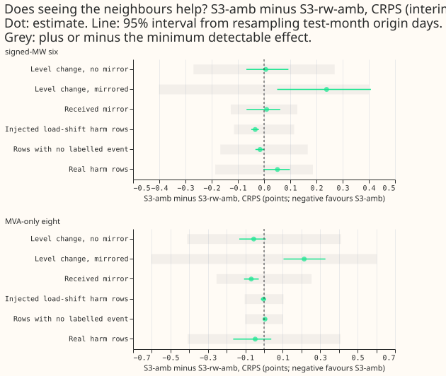
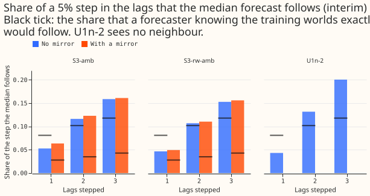
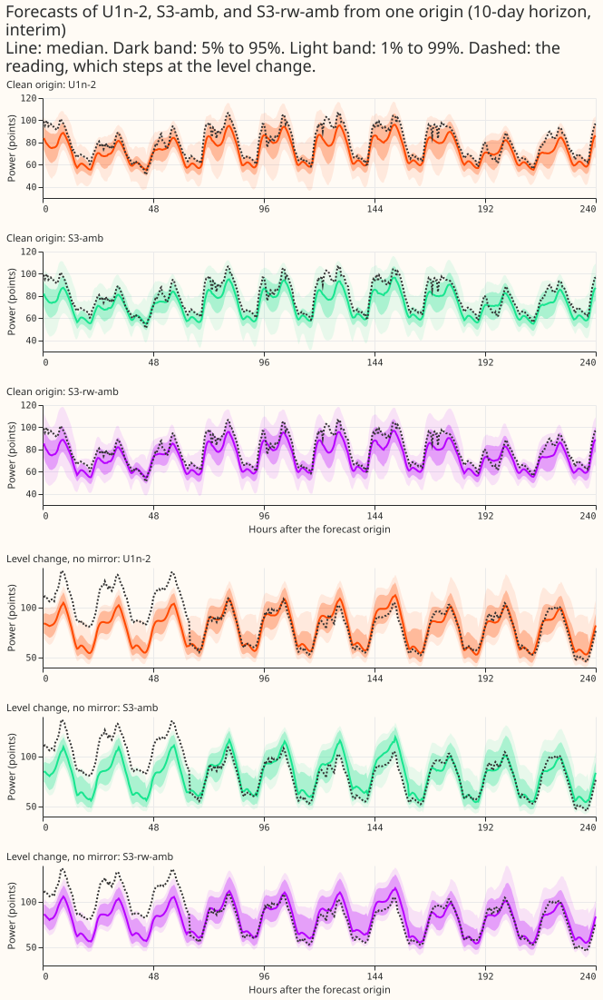
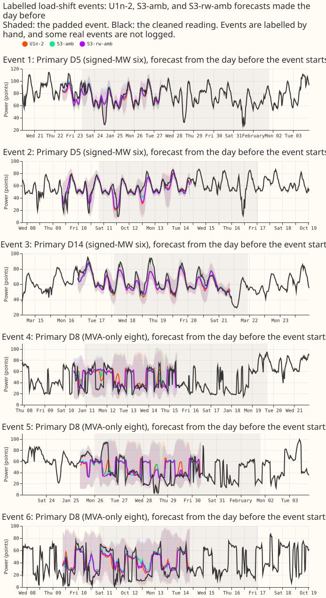

**Take-home message: the lag network that sees its neighbours (S3-amb) did not learn to follow a
level change that no neighbour mirrors any better than the same network given random neighbours
(S3-rw-amb), but the training worlds of this experiment could hardly have shown it. Even a perfect
forecaster would follow only 0.05 to 0.08 more of a step without a mirror than with one, so the
result is inconclusive by design and is not a refutation of attention over the lags. S3-amb loses
nothing on rows with no labelled event against U1n-2, so the real-row checks pass, and it shows no
gain that would justify adopting it. Every number is interim, from four test months and two
seeds.**

**The experiment tests one hope: that a neural network given the neighbouring Primaries' surprise
can learn to tell a genuine level change from a load shift.** A load shift moves power from one
Primary to its neighbours, so a jump in recent power that a neighbour mirrors with an opposite sign
is a load shift, and the forecast target stays at the normal running arrangement. A jump that no
neighbour mirrors may be a genuine level change, such as a new connection, and the target moves with
it. In all earlier training worlds (experiments 402, 404, 440, and 446) the target stayed clean
under every injected jump, so discounting every jump was optimal and a neighbour mirror carried no
information. This experiment adds genuine level changes to the training worlds, where the lags and
the target move together and no neighbour changes, and keeps every mirror in training a load shift.
S3-amb is experiment 440's S3 network (the S1 lag network plus 24 own window statistics and 30
neighbour columns) trained on those worlds. S3-rw-amb is the same network with random neighbours
that keep each Primary's number of neighbours. A pass would show only that a network can use a
mirror when the training world makes the mirror informative. It would not be evidence about real
Primaries, since no labelled genuine level change exists in the real data.

## How to read the numbers

**Unless a column says otherwise, every number is a score at days 1 to 10 after the 1.15 widening of
the bands, in points of effective capacity, and a negative contrast favours the first arm.**
CRPS is the continuous ranked probability score from the 11 quantiles. The signed-MW six are the
Primaries metered in signed megawatts, and the MVA-only eight are metered in unsigned
megavolt-amperes. The four test months are 2025-10, 2026-01, 2026-03, and 2026-06, with seeds 0 and
1 and monthly refits. The Primaries D15 and D18 are cut before 2025-03-01, and every score is on
cleaned power. S1-amb of the plan is the stored U1n-2 of experiment 446, because the training worlds
here are exactly U1n-2's (the generator reuses its events, and the checks in
`e00462_worlds.py selftest` confirm that the training shifts are equal).

**Row sets.** Rows with no labelled event have recent power and target outside every logged event.
They may still hold events that NGED never logged, so each such number is a lower bound on the
effect of events. An injected harm row holds a simulated load shift (the target stays clean). A
level-change row has a genuine level change in force at the newest lag, in held-out worlds 7 to 9
(seeds 500 to 502, drawn from the 3% held-out rate of experiment 446) that no training world shares.
**The level-change rows split by what a neighbour shows.** No mirror: nothing changes at a
neighbour. Mirrored: the Primary's change is mirrored at 1 or 2 neighbours with the load-conserving
signature of experiment 402, so a neighbour sees what a load shift looks like. Received mirror: the
Primary is itself the recipient of a neighbour's level change. A real harm row has a target outside
every logged event but recent power inside one. Real event rows have their targets inside a logged
event, scored against actuals corrected to the normal running arrangement.

**Interim contrasts carry intervals from resampling test-month origin days.** The registered pass
needs more than the larger of 0.03 and the minimum detectable effect, which comes from the
seed-0-against-seed-1 spread of S3-amb and S3-rw-amb (the table below). Six contrasts were
registered (the Bonferroni count), so no single 95% interval here is a stand-alone claim.

## Results

**Figure 1 shows the registered pair contrast on every row set.** S3-amb minus S3-rw-amb on
level-change rows with no mirror is -0.055 (-0.133 to 0.010) at the MVA-only eight and +0.006
(-0.068 to 0.093) at the signed-MW six. The minimum detectable effects are 0.411 and 0.270, so both
differences are far inside the margin of rule (a). On injected harm rows the difference is -0.003
(-0.017 to 0.011) at the eight and -0.034 (-0.049 to -0.020) at the six, and the minimum detectable
effects are 0.104 and 0.114, so the six's gain is also inside the margin. Rule (a) fails.

**Mirrored level changes are where S3-amb differs from S3-rw-amb, and S3-amb is worse there, but the
difference is below the minimum detectable effect.** On
level changes mirrored at a neighbour, S3-amb scores 0.215 (0.104 to 0.328) points worse than
S3-rw-amb at the eight and 0.239 (0.050 to 0.408) worse at the six, and 0.106 and 0.256 worse than
U1n-2. A mirrored level change looks exactly like a load shift to the neighbours, and in training
every mirror meant a load shift with a clean target. The minimum detectable effects for that row set
are 0.603 (eight) and 0.401 (six), so the difference is suggestive and not detectable, and the
interval ignores seed and fold variance. At the signed-MW six, three of four folds favour S3-amb
(-0.013, -0.300, and -0.051), and the fold 2026-01 (+0.597) drives the sign. At the eight, the fold
2026-06 (+0.440) drives it. The reading that S3-amb discounts a mirrored jump as it was trained to,
and misses a genuine step that happened to be mirrored, is a hypothesis these rows cannot confirm.
On a received mirror, S3-amb beats S3-rw-amb by 0.069 (0.028 to 0.107) at the eight, below that row
set's minimum detectable effect of 0.254, and differs by +0.010 (-0.067 to 0.062) at the six, so the
direction does not repeat across the two metering groups. On level changes with no mirror, S3-amb
beats U1n-2 by 0.128 (0.014 to 0.272) at the six, and S3-rw-amb beats it by 0.134, so that gain
comes from having neighbour inputs, not from using a mirror. On real events at the signed-MW six,
S3-rw-amb scores 0.211 lower than S3-amb (5.246 against 5.457).

**Table 1: absolute CRPS (points of effective capacity, 1.15 widening, seeds 0 and 1).**

| Row set | Group | R-inj | S1 | U1n-2 | S3-amb | S3-rw-amb |
|---|---|---|---|---|---|---|
| Rows with no labelled event | signed-MW six | 2.962 | 2.874 | 2.943 | 2.921 | 2.936 |
| Rows with no labelled event | MVA-only eight | 3.654 | 3.574 | 3.582 | 3.564 | 3.559 |
| Level change, no mirror | signed-MW six | 3.980 | 3.880 | 4.009 | 3.882 | 3.875 |
| Level change, no mirror | MVA-only eight | 6.332 | 6.309 | 6.203 | 6.204 | 6.259 |
| Level change, mirrored | signed-MW six | 5.561 | 5.607 | 5.329 | 5.585 | 5.346 |
| Level change, mirrored | MVA-only eight | 6.761 | 6.983 | 6.703 | 6.810 | 6.595 |
| Received mirror | signed-MW six | 4.039 | 4.086 | 4.013 | 4.089 | 4.080 |
| Received mirror | MVA-only eight | 4.588 | 4.632 | 4.532 | 4.478 | 4.546 |
| Injected harm rows | signed-MW six | 2.971 | 2.912 | 2.980 | 2.950 | 2.984 |
| Injected harm rows | MVA-only eight | 4.159 | 4.094 | 4.113 | 4.092 | 4.094 |
| Real harm rows | signed-MW six | 2.954 | 2.955 | 2.953 | 2.940 | 2.889 |
| Real harm rows | MVA-only eight | 5.473 | 5.421 | 5.552 | 5.461 | 5.508 |
| Real events (NRA actuals) | signed-MW six | 5.843 | 5.740 | 5.664 | 5.457 | 5.246 |
| Real events (NRA actuals) | MVA-only eight | 7.479 | 7.238 | 7.289 | 7.133 | 7.009 |

**Table 2: minimum detectable effect and the Bayes-optimal shares of the training worlds.** The
minimum detectable effect of the pair (1.96 times the square root of 2, times the seed standard
deviation, divided by the square root of 2) is 0.101 (rows with no labelled event, MVA-only eight)
and 0.167 (signed-MW six), 0.411 and 0.270 on level-change rows with no mirror, 0.603 and 0.401 on
mirrored level changes, and 0.104 and 0.114 on injected harm rows. A forecaster that knows only
whether the newest lag has a mirror should follow the shares below (target moved over rows, in
400,000 sampled fold rows of each training world, month 2026-01).

| Lags in a jump (k) | No mirror | With a mirror | Gap |
|---|---|---|---|
| 1 | 0.081 | 0.028 | 0.054 |
| 2 | 0.102 | 0.035 | 0.067 |
| 3 | 0.118 | 0.043 | 0.075 |

**The optimal gap is small because few jumps in the training worlds are genuine.** A genuine level
change covers about 2% of a Primary's half-hours, and most mirrors in these worlds are coincident
load shifts of experiment 428's worlds at neighbours, not mirrors of a genuine change. A perfect
learner would therefore follow only 0.054 to 0.075 more of a step without a mirror. **The registered
predictions.** P1 fails (S3-amb gains 0.006 in the wrong direction against the 0.03 asked, at the
signed-MW six). P2 fails (the share followed is not lower with a mirror). P3 is half right: the
shares without a mirror lie below 0.5, but the shares with a mirror are 0.028 to 0.043, below the
0.05 predicted. P4 fails: S3-amb does not cost 0.03 against U1n-2.

## Paired encroachment sweep

**The sweep shows no lower share followed with a mirror for S3-amb, and a small gap of the wrong
sign
that its random-neighbour control shares.** The sweep adds a step of 5% of the Primary's effective
capacity to the first k lags of every row with no labelled event (k = 1, 2, 3: the newest reading,
then the daily lag, then the weekly lag), once without a mirror and once with the load-conserving
mirror at the Primary's first neighbour, and measures the share of the step that the median follows.
The gap is the share without a mirror minus the share with one. The interval resamples the 8 (month,
seed) blocks, so it is crude.

| Arm | k | No mirror | With mirror | Gap (95% interval) |
|---|---|---|---|---|
| S3-amb | 1 | 0.053 | 0.064 | -0.011 (-0.016 to -0.006) |
| S3-amb | 2 | 0.116 | 0.123 | -0.007 (-0.014 to -0.000) |
| S3-amb | 3 | 0.159 | 0.161 | -0.003 (-0.011 to 0.005) |
| S3-rw-amb | 1 | 0.047 | 0.049 | -0.003 (-0.004 to -0.002) |
| S3-rw-amb | 2 | 0.107 | 0.110 | -0.003 (-0.004 to -0.002) |
| S3-rw-amb | 3 | 0.153 | 0.156 | -0.003 (-0.004 to -0.003) |
| U1n-2 | 1 / 2 / 3 | 0.043 / 0.132 / 0.201 | no mirror input | |
| S1 | 1 / 2 / 3 | 0.012 / 0.127 / 0.232 | no mirror input | |

**Pass (b) fails on a measure that could have detected it.** Restated pass (b) needs a gap above
0.03
with an interval above zero, and the Bayes-optimal gap is 0.054 to 0.075. The sweep's block-to-block
spread of S3-amb's gap is about 0.01 (individual blocks range from -0.026 to +0.014), so a learned
gap of the optimal size would have shown. S3-amb's gap averages -0.011, -0.007, and -0.003 at k = 1,
2, and 3. S3-rw-amb, which a mirror cannot move in principle, shows -0.003 in every block, so about
-0.003 is a floor from the sweep itself (possibly random neighbours that include the first
neighbour). S3-amb's gaps at k = 2 and 3 are about that size. The part of (b) that asks each learned
share to lie within 0.15 of its Bayes-optimal value holds but is nearly vacuous, since every learned
share is between 0.01 and 0.23. The sweep steps only the first neighbour's window statistics and
surprise and keeps the standard deviation and counts unchanged, so it may not reproduce the full
neighbour pattern of the held-out worlds. We did not test that.

## Real-row checks

**S3-amb meets the adoption gate against U1n-2 on rows with no labelled event.** The gate allows a
loss of at most 0.03 CRPS points and 0.02 q99 pinball points. S3-amb minus U1n-2 on rows with no
labelled event is -0.018 (-0.041 to 0.005) CRPS at the MVA-only eight and -0.023 (-0.035 to -0.009)
at the signed-MW six, and q99 pinball -0.010 and -0.017. S3-rw-amb minus U1n-2 is -0.023 and -0.007
CRPS. On real harm rows S3-amb minus U1n-2 is -0.091 (-0.337 to 0.117) and -0.013 (-0.090 to 0.048),
and the q99 pinball differences are -0.005 and +0.009, all inside the limit. Prediction P4 (a cost
of 0.03 or more against U1n-2) is wrong. Against S1, which was not trained on ambiguous worlds,
S3-amb costs +0.047 (0.034 to 0.061) CRPS and +0.030 q99 pinball at the signed-MW six on rows with
no labelled event, and gains -0.010 (-0.024 to 0.004) CRPS at the eight. That is the stated
production cost of ambiguous-world training, which experiment 446 measured.

**Table 3: tails on rows with no labelled event (1.15 widening).**

| Group | Arm | q01 coverage | q05 coverage | q95 coverage | q99 coverage | q01 pinball | q05 pinball | q95 pinball | q99 pinball |
|---|---|---|---|---|---|---|---|---|---|
| Signed-MW six | S1 | 0.002 | 0.013 | 0.912 | 0.978 | 0.166 | 0.635 | 0.731 | 0.201 |
| Signed-MW six | U1n-2 | 0.001 | 0.011 | 0.936 | 0.994 | 0.201 | 0.665 | 0.751 | 0.247 |
| Signed-MW six | S3-amb | 0.001 | 0.014 | 0.933 | 0.995 | 0.201 | 0.656 | 0.740 | 0.231 |
| Signed-MW six | S3-rw-amb | 0.001 | 0.013 | 0.936 | 0.997 | 0.201 | 0.663 | 0.730 | 0.238 |
| MVA-only eight | S1 | 0.003 | 0.023 | 0.940 | 0.985 | 0.195 | 0.761 | 0.927 | 0.257 |
| MVA-only eight | U1n-2 | 0.001 | 0.021 | 0.946 | 0.993 | 0.210 | 0.771 | 0.919 | 0.261 |
| MVA-only eight | S3-amb | 0.002 | 0.022 | 0.946 | 0.994 | 0.205 | 0.760 | 0.901 | 0.251 |
| MVA-only eight | S3-rw-amb | 0.001 | 0.021 | 0.945 | 0.993 | 0.206 | 0.757 | 0.912 | 0.258 |

**The q95 and q99 coverage on rows with no labelled event is in or above the target range for every
ambiguous-world arm, and q01 and q05 coverage is under target.** The targets are 0.93 to 0.97 at q95
and 0.98 to 0.995 at q99. The raw forecasts (no widening) give q99 coverage of 0.960 to 0.991 at the
signed-MW six and 0.973 to 0.987 at the eight. On level changes with no mirror, q99 coverage is
0.962 for S3-amb, 0.953 for S3-rw-amb, and 0.965 for U1n-2 at the eight, and 0.952, 0.956, and 0.958
at the six, so the upper band is too narrow on a genuine step for every arm.

## Avoidable-curtailment cost

**The cost at the signed-MW six does not separate S3-amb from the other arms, and BG2 has the lowest
point estimate at the headline limit with overlapping intervals.** The table gives the cost in
millions of pounds over the four folds, lead 12 to 36 hours, at the scaled limit f = 0.9, with a 95%
interval from resampling the 24 cells (6 series by 4 test months) 20,000 times, as in experiment
449.

| Arm | Cost at f = 0.9 | Paired difference |
|---|---|---|
| S1 | 1.84 (0.07 to 5.23) | S3-amb minus S1: -0.05 (-0.38 to 0.21) |
| U1n-2 | 1.98 (0.12 to 5.52) | S3-amb minus U1n-2: -0.19 (-0.59 to 0.03) |
| S3-amb | 1.79 (0.11 to 4.95) | S3-amb minus S3-rw-amb: +0.15 (-0.001 to 0.41) |
| S3-rw-amb | 1.64 (0.10 to 4.55) | S3-amb minus BG2: +0.51 (-0.11 to 1.60) |
| BG2 | 1.28 (0.09 to 3.47) | S3-amb minus `manual_heuristic`: -0.03 (-0.26 to 0.21) |
| `manual_heuristic` | 1.83 (0.14 to 4.97) | |

## Example forecasts and real events

**The three arms forecast alike on a clean origin and miss a level change that no neighbour
mirrors.** Figure 3 shows a Primary at the signed-MW six on a clean origin and on an origin whose
newest lags lie inside an injected unmirrored level change. All three medians stay near the
pre-step level while the reading is stepped, for about two days, and the bands do not widen to cover
the step, as the sweep shares (0.04 to 0.14 of a step) predict.

**Figure 4 shows six labelled real events, three at each metering group.** The forecasts were made
the day before each event begins. The three arms are close on every event. The events are labelled
by hand and some real events are not logged.

## Checks

- **Median minus mean forecast, per Primary (rows with no labelled event, seed 0, unwidened).** The
  stored forecasts hold 11 quantiles and no mean, so the mean is the average of the 11 quantiles (a
  proxy). The difference averages -0.48 (S1), -0.97 (U1n-2), -0.70 (S3-amb), and -0.94 (S3-rw-amb)
  points at the signed-MW six, and ranges from -5.58 (D15, S1) to +0.08 (D22, S1). D15 reads -5.26
  for U1n-2, -5.31 for S3-amb, and -6.78 for S3-rw-amb.
- **Error of the mean and median forecast beside the quantile contrasts.** At the signed-MW six the
  mean absolute error of q50 is 5.154 (S1), 5.262 (U1n-2), 5.201 (S3-amb), and 5.354 (S3-rw-amb),
  and of the mean of the 11 quantiles 5.129, 5.170, 5.217, and 5.301. At the MVA-only eight it is
  6.505, 6.497, 6.485, and 6.497 for q50. S3-amb has a lower median error than S3-rw-amb at the six
  (-0.153) and a higher error of the mean than U1n-2, so the median and the mean point in different
  directions there, and the CRPS contrast of -0.015 (-0.033 to 0.001) is small beside the median
  error contrast.
- **Triggers that fired.** Audit trigger 3 (CRPS and median error disagree) fires at the signed-MW
  six for S3-amb against U1n-2 on seed 0 only (CRPS lower by 0.023, q50 error lower by 0.061, but
  the error of the mean higher by 0.047). The equal-row set is asserted across all arms in the
  scorer (key `primary`, `origin_us`, `valid_us`). The other audit triggers were not checked one by
  one.
- **The attention arm was not fitted.** The registered condition (rule (a) holds for the pair by
  half of the margin or more) failed, so S3-attn-amb was not fitted. The Bonferroni count is
  therefore 6.
- **Results review by a fresh reviewer.** The reviewer re-derived the tables from the stored scores.
  It found that the first sweep table used only the first month's sweep files (written before the
  other three finished), which is corrected here, and that the loss on mirrored level changes is
  below the minimum detectable effect, which the page now says. It also noted that S3-amb scores
  worse than U1n-2 on the pooled injected level-change rows at the signed-MW six (4.532 against
  4.430) and on the first 3 days of a level change (6.700 against 6.267). The numbers in Tables 1
  and 3 and the curtailment table matched.
- **Code review before the first fit.** A fresh reviewer checked the generator and the run script.
  It found a wrong numerator in the Bayes shares (the table above is the corrected one), a race
  between two processes taking the same fit, a world file that could be reused with a stale rate, a
  selftest assertion that could not fail, and a dead variable. The fixes are in the code.

## What is still interim

- **Two seeds and four folds.** Intervals resample test-month origin days, and the sweep gap's
  interval rests on 8 (month, seed) blocks, so every interval is crude. The sweep's random-neighbour
  control shows a gap of -0.003 where none is possible.
- **The sweep approximates the mirror.** It steps the first neighbour only, and keeps the standard
  deviation and counts of the neighbour window unchanged.
- **The attention arm is untested.** No fit of S3-attn-amb exists.

## Caveats

- **The genuine share of 2% sets the answer's size.** Even a perfect forecaster follows only 0.028
  to 0.043 of a step with a mirror and 0.081 to 0.118 without. The page therefore reads as
  inconclusive by design, as registered.
- **Training genuine changes carry no mirror.** Every mirror in training means a load shift. A
  mirrored genuine change in held-out worlds is indistinguishable from a load shift at the
  neighbours, so S3-amb discounting it follows the training distribution.
- **Mirror steps at MVA-only recipients clip at zero.** The clipped share is not reported.
- **Unlogged events.** National Grid Electricity Distribution (NGED) says some load-shift events are
  missing from its logs. Rows with no labelled event can hold events no label covers, and the real
  event rows undercount.
- **No labelled genuine level change exists in the real data,** so a pass on injected rows would not
  have been evidence about real Primaries.
- **Horizon.** The forecasts reach 10 days, but the real events are few.
- **Data cuts.** D15 and D18 are cut before 2025-03-01, and the scores use cleaned power.

## What to try next

- **Raise the genuine share to 5%.** That raises the Bayes-optimal gap between a mirror and no
  mirror, and is the one change that could separate S3-amb from S3-rw-amb. It needs the maintainer's
  approval and 16 more fits.
- **Fit the attention arm only after a 5% pair separates.** Attention has little chance to show a
gain
  while the optimal gap is only 0.054 to 0.075.
- **B-mix, or its row-3 successor, stays the production candidate for jump handling.** No
  learned-trust arm passed.

## Problems from the move to nged-ml-research

None so far.

## Plan, as registered before any fit

*The plan below is kept as written, apart from the status line and the amendments registered before
any fit.*

## Question

**The experiment asks whether a lag network can learn to follow a jump in recent power that no
neighbour mirrors, and to discount a jump that a neighbour mirrors.** The lag network (S1) is a
neural network given three earlier readings of a Primary's power and the surprise at each reading.
S3 adds the neighbouring Primaries' surprise at the same times. In every training world so far a
jump never moved the target, so a network learned to discount every jump and the neighbours had
nothing to add. This experiment adds genuine level changes to the training worlds, where the target
moves with the lags, and leaves a mirror at 1 or 2 neighbours on half of them.

**What a pass means.** A pass shows only that a network can use a mirror when the training world
makes the mirror informative. Experiment 456 found that real mirrors are not evidence of a load
shift at the thresholds it tested, and no labelled genuine level change exists in the real data, so
a
pass on injected rows says nothing about real Primaries. The real-row checks are the adoption gate.
NGED's event labels are incomplete: rows with no labelled event may hold unlabelled events, so every
such result is stated as "rows with no labelled event", never "clean rows", and the page repeats the
unlogged-event caveat.

## Design

- **Genuine level change.** The generator reuses experiment 446's `draw_events` (so the own events
  are the same events as U1n-2's: seeds 300 to 303, 2% of each Primary's observed half-hours, depths
  and durations from the corrected label table). It then flips a fair coin per event. On a heads
  event it chooses 1 or 2 of the Primary's neighbours at random and adds
  `-step × capacity_p / k / capacity_q` to each neighbour `q` over the same half-hours, exactly the
  signature of a donor and its recipients in experiment 402's load-shift generator. On a tails
  event no neighbour changes. Lags and target move together at the Primary and at every recipient.
  MVA-only Primaries clip at zero in the lags and the target alike.
- **Why that mirror.** The mirror is the load-conserving one. A load shift in the experiment 428
  worlds (a donor with 1 or 2 recipients in 70% of events, none in 30%) leaves the same signature,
  so a mirrored genuine change is indistinguishable from a load shift by its neighbours and differs
  only in what the target does. That is the case in which the mirror carries information only
  through base rates, which is what the maintainer's hope needs to test. It is a design choice taken
  here; the neural Discuss session has not confirmed the reading of "a mirror at the recipients".
- **Base rates are printed.** The generator's test prints, for the realised training worlds, the
  share of jump rows (a lag inside a jump) whose target moved with a mirror and without one. Those
  are the Bayes-optimal shares followed, and the sweep thresholds of the brief are compared with
  them.
- **Placeholder rate.** The genuine share stays at the brief's 2% placeholder, the rate of
  U1n-2. Experiment 456's scan cannot set a rate. The realised share of half-hours inside a genuine
  change at a Primary or a recipient is printed and is higher than 2% (about 2% plus the recipients'
  half-hours). S1-amb is therefore U1n-2 only approximately: U1n-2 trains on worlds with fewer
  genuine-change half-hours. The cost of an exact S1 on these worlds is 8 fits, and the plan asks
  the
  manager whether to add them.
- **Held-out worlds.** Three worlds on the real clean series (the real rows of worlds 7 to 9), drawn
  with seeds 500 to 502 and the 3% held-out rate of experiment 446, with the same mirror rule.
  Their events are never seen in training. They hold level-change rows with a mirror, level-change
  rows without one, and (from the experiment 428 worlds 4 to 6) load-shift harm rows.
- **Arms.**
    - **S3-amb:** S3 of experiment 440 (S1 plus 24 window statistics per Primary and 30
      neighbour columns) trained on the ambiguous worlds with experiment 446's recipe: token
      dropout 0.2 on each lag and on each lag's surprise, origin of the lags drawn 0 to 7 hours
      before the usual one. A dropped lag also zeroes its window and neighbour columns.
    - **S3-rw-amb:** the same with random neighbours that keep each Primary's degree, in the
      features only. The mirror in the worlds still reaches the real neighbours.
    - **S3-attn-amb (conditional):** a single multi-head attention layer over the 3 lag tokens and a
      lagless token (the non-lag inputs). Each lag token carries the lag, its missing flag and age,
      the surprise, the own window statistics, and the neighbour columns of that lag. No
      down-weight-only constraint. Fitted only if the pair separates (rule above).
    - **References, no fits:** U1n-2 (forecast only on the new held-out worlds, from experiment
    446's
      stored networks), S1 and R-inj (forecast only on the new held-out worlds, from experiment
      428's), B-mix, S1, R-inj, and 440's S3 and S3-rw (stored forecasts on the real rows).
- **Recipe.** Experiment 428's rows, folds, fit loop, and frozen cross-fitted lagless tables of
  experiment 404 (seeds 0 and 1). Monthly refits, as always in research. The Primaries D15 and D18
  are cut before 2025-03-01 as in experiment 428's rows (stated in the write-up). Fitted
  networks are saved in this experiment's data folder.
- **Paired sweep.** On the new held-out worlds' clean real rows, a step of k times the lag standard
  deviation (k = 1, 2, 3) is added to the lags of the first k lags with a mirror (the
  load-conserving
  signature at 1 or 2 neighbours, which shifts the neighbour window columns and neighbour-relative
  surprise) and without one, and the share of the step the median moves is measured, as in
  experiment 440's sweep.
- **Scored rows.** Experiment 446's row sets on the real rows (world 0: rows with no labelled event,
  real harm, real events against NRA-corrected actuals as the headline and metered actuals as
  secondary, each with and without the longest event) and on the held-out worlds (gen rows with a
  level change in force at a lag, split by mirror and no mirror, plus the load-shift harm rows of
  worlds 4 to 6). Equal-row set across arms, checked in code.

## Compute

Fit count: 2 arms × 4 folds × 2 seeds = **16 fits** for the first stage, about 4
graphics-processing-
unit hours at 0.25 h per fit (to be timed on one fit first; the brief's "8 fits, about 2
graphics-processing-unit hours" reads as one arm). S3-attn-amb adds 8 fits only if the pair
separates. S1-amb is the stored U1n-2 (12 fits saved). One process under 8 GB (`MemoryMax=8G`,
`OMP_NUM_THREADS=1`, 1 feeder core).

## Standing practices

Monthly refits (not weekly); cleaned data; the D15 and D18 cut; saved networks; stored forecasts
reused as references; screen not used (a mechanism test with four folds); tails reported at q01,
q05, q95, q99; example forecasts and event plots on the page; draft pull request. Reviews: a fresh
Sonnet reviews this plan, the code before the first fit, the results, and the write-up.

## Amendments after the neural Discuss session's answers and the plan review (2026-11-01)

- **Training worlds.** Genuine changes carry no mirror in training (probability 0), so the own
events
  and the worlds are exactly those of U1n-2 and S1-amb is U1n-2 with no approximation. Every
  mirrored
  jump in training is a load shift with a clean target, as in experiment 402. This replaces the
  "mirror on half the genuine changes" text above and removes the exact-S1 question.
- **Held-out worlds.** Genuine changes are mirrored with probability 0.5 (the load-conserving
  signature at 1 or 2 neighbours). Mirrored genuine changes are labelled indistinguishable from load
  shifts by their neighbours and scored apart from unmirrored genuine changes. Donor rows and
  recipient rows are scored separately. Mirror steps that would take an MVA-only recipient below
  zero
  are clipped in lags and target alike (a stated departure from load conservation); the generator's
  test reports the clipped share.
- **Sweep thresholds restated, not kept.** Before any score, the analytic Bayes-optimal share
followed
  with and without a mirror, at k = 1, 2, 3, per lag and for a target inside or outside the event,
  is
  computed from the training worlds and committed (`e00462_worlds.py rates`). The registered pass
  is:
  (a) S3-amb beats S3-rw-amb on held-out level-change rows by the larger of 0.03 and the minimum
  detectable effect, and (b) the learned share followed without a mirror minus the share with a
  mirror
  exceeds 0.1 with a month-block interval above zero, and (c) each learned share lies within 0.15 of
  its Bayes-optimal value. The real-row adoption gate stays (no loss above 0.03 on rows with no
  labelled event, none above 0.02 on tail pinball).
- **Go/no-go on power.** If the Bayes-optimal gap between a forecast that sees the mirror and one
that
  does not is below the larger of 0.03 and the minimum detectable effect, the page says the
  experiment could not test the hypothesis and does not read (a).
- **Bonferroni count.** 6 contrasts without S3-attn-amb (a: two row classes; b: clean-row CRPS and
q99
  pinball for each of S3-amb and S3-rw-amb against U1n-2) and 9 with it. The minimum detectable
  effect
  comes from the seed-0 against seed-1 differences of S3-amb and S3-rw-amb, by month-block
  bootstrap,
  before any contrast is read; if it exceeds 0.03 the larger value is the margin.
- **Also reported.** Absolute scores beside every contrast, q01 and q05 coverage, q99 pinball
against
  both U1n-2 and S1, the avoidable-curtailment cost at the signed-MW six (eight separately) with
  block
  intervals, the equal-row set (key `primary`, `origin_us`, `valid_us`, asserted across all arms),
  and
  the attention weights split by mirror for the attention arm. Mirrored worlds rebuild the neighbour
  surprise stacks from the shifted neighbour series while the lagless tables stay frozen.
- **Compute gate.** 16 fits (about 4 GPU-hours, timed on one fit first). Fits start only after the
  code review.

## Bayes-optimal shares of the training worlds (printed before any fit)

**A forecaster that knows only whether the newest lag has a mirror should follow 0.03 to 0.12 of a
step, and the mirror moves that share by only 0.05 to 0.08.** The table counts, in 400,000 sampled
fold rows per training world, the rows whose first k lags all lie in a jump and the share of them
whose newest lag lies in a genuine level change that the target still carries
(`e00462_run.py rates`, month 2026-01, Bayes share = target moved / rows).
A mirror here means any neighbour differs from the clean series at the newest lag's time, so load
shifts of experiment 428's worlds that happen to overlap in time count as mirrors.

| Lags in a jump (k) | Mirror | Rows | Target moved | Bayes-optimal share followed |
|---|---|---|---|---|
| 1 | no | 83,995 | 6,841 | 0.081 |
| 1 | yes | 122,377 | 3,411 | 0.028 |
| 2 | no | 61,467 | 6,265 | 0.102 |
| 2 | yes | 88,383 | 3,064 | 0.035 |
| 3 | no | 32,396 | 3,816 | 0.118 |
| 3 | yes | 43,366 | 1,874 | 0.043 |

The gap between the two shares (0.054, 0.067, 0.075 at k = 1, 2, 3) is below the 0.1 that the
registered pass (b) asks of the learned shares, so (b) cannot pass at the 2% genuine share: even a
perfect learner would show a gap of about 0.07.

## Restated pass (b), registered before any fit (neural Discuss session, 2026-11-01)

- **Pass (b) is now:** the learned share followed without a mirror minus the share with a mirror
  exceeds 0.03, with a month-block interval above zero, and each learned share lies within 0.15 of
  its Bayes-optimal value in the table above. Pass (a) and the real-row gate are unchanged.
- **A perfect learner shows a gap of only 0.054 to 0.075, which may sit below the seed noise.** If
  the contrast of S3-amb against S3-rw-amb and the learned gap both lie inside the minimum
  detectable effect, the page reports the result as inconclusive by design and not as a refutation
  of attention over the lags. A 5% genuine share would raise the Bayes-optimal gap and is the
  follow-up; it is not run here.
- **Most mirrors in these worlds are coincident load shifts of experiment 428's worlds at
  neighbours,** not mirrors of a genuine change, which is why the optimal gap is small.

*Correction before any fit: a code review found that the first version of this table counted any
target inside a genuine event; the table above counts only rows whose newest lag and target carry
the same genuine step. The mirror flag is coarser than what the network sees (any neighbour
differing, whatever its sign or size). The share of mirror steps clipped at MVA-only recipients is
not reported.*
