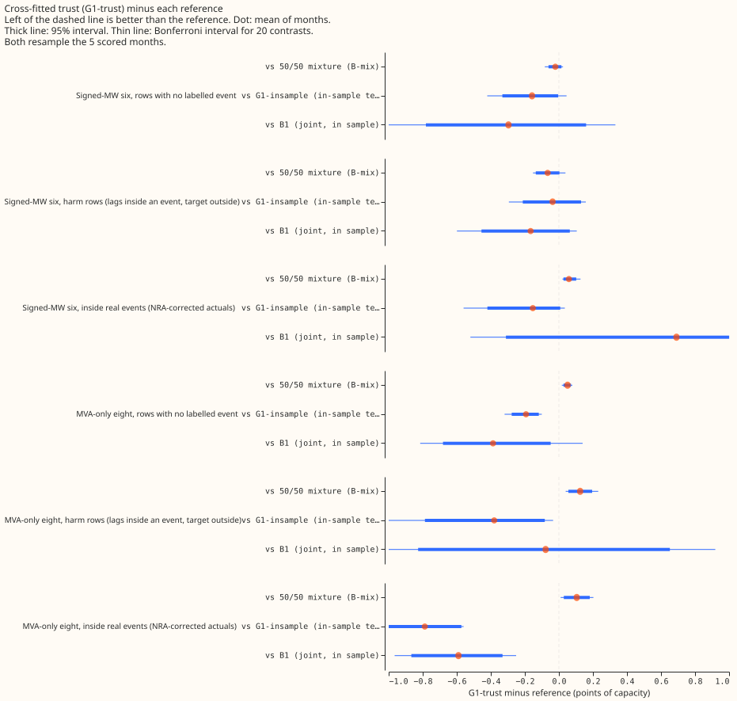
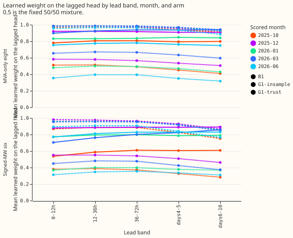
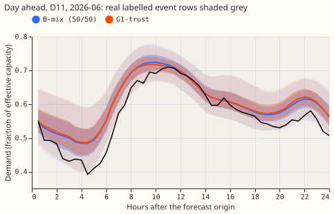
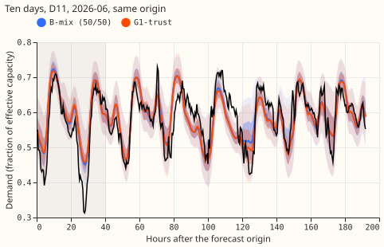
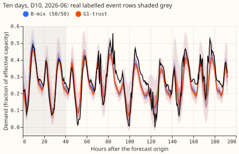
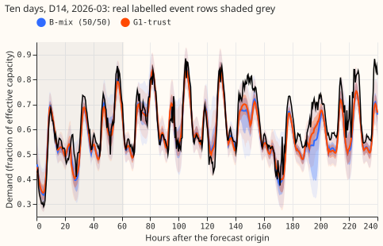
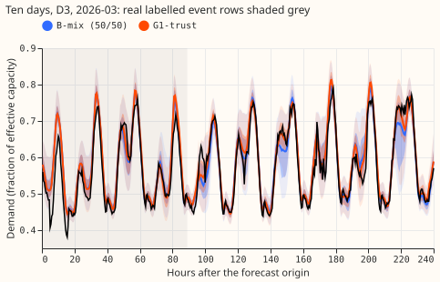
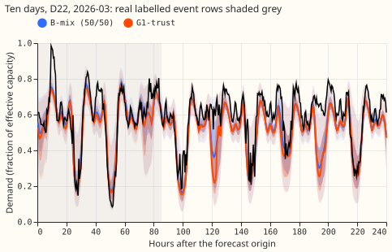
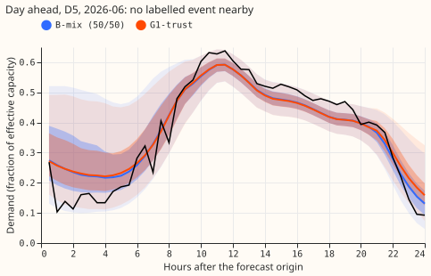
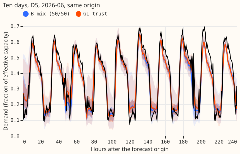

**The fixed 50/50 mixture of the lagged and lagless forecasts stays the reference: a trust weight
fitted on out-of-fold lagged forecasts matches it and does not beat it.** We asked whether the
learned trust weight of experiment 404 lost to 50/50 because the weight was fitted on the same rows
as the lagged forecast it weighs. We trained 6 lag networks per scored month, each leaving out one
block of the training window, so that every training row has a lagged forecast from a network that
did not see it. We then fitted the trust weight on those forecasts and on the lagless table's own
out-of-block forecasts, and scored it on five new months. A copy of the fit on in-sample lagged
forecasts (G1-insample) shows what the mismatch costs. The mismatch explains the earlier loss. It
does not turn the learned weight into an improvement. NGED's event labels are incomplete, so rows
with no labelled event may hold unlogged events and the real-event rows undercount. Every number is
interim and unaudited: five scored months, one seed.

**Verdict, then what it rules out.** The experiment fails its adoption rule: inside real events the
learned weight is worse than 50/50, not better. The mechanism holds: fitting out of fold gains 0.16
points over fitting in sample on rows with no labelled event at the signed-MW six, and 0.19 at the
MVA-only eight. The search narrows to a better-matched lagged head (a finer fold split, so the
out-of-fold network is nearer the full-data network) or to keeping 50/50.

## Results

Scores are points of effective capacity (200 times the mass-weighted pinball loss over 11 quantiles;
leads of 0 to 240 hours, lead days 1 to 10; real-data world). A contrast is the first arm minus the
second on the same rows, so negative is better. The unit of resampling is the month: 5 scored months
(2025-10, 2025-12, 2026-01, 2026-03, 2026-06), 4 where a group has no event. Intervals are 95%
month-resampled intervals; the Bonferroni interval for 20 contrasts is in the experiment's private
folder and in figure 1.

- **Arms.** B-mix (50/50 of A0-inj and the lagless table); B1 (experiment 404's trust learned
  jointly with the lagged head, in sample); G1-insample (the trust head fitted with both heads
  frozen, the lagged head being experiment 404's full-data A0-inj network evaluated on its own
  training rows); G1-trust (the same frozen-head fit on out-of-fold lagged forecasts). The
  G1-insample control was added to the brief's design because B1 differs from G1-trust in three
  ways at once; the neural Discuss session is informed here.
- **Signed-MW six, absolute scores (no label / harm / real event with NRA depth 1.0 / real event
  metered).** B-mix 3.513 / 3.680 / 13.139 / 5.955; B1 3.788 / 3.780 / 12.507 / 6.470; G1-insample
  3.650 / 3.651 / 13.351 / 5.962; G1-trust 3.492 / 3.614 / 13.198 / 6.006; A0-inj alone 3.824 /
  3.811 / 13.487 / 6.078; lagless alone 3.763 / 3.933 / 13.243 / 6.284.
- **Signed-MW six, G1-trust minus B-mix (minimum detectable effect 0.32 / 0.42 / 0.38 / 0.26).** No
  label: -0.021 [-0.061, +0.015]. Harm: -0.066 [-0.136, +0.003]. Real event, NRA depth 1.0: +0.059
  [+0.027, +0.102] (depth 0.75: +0.061; depth 1.25: +0.060; drop the largest event: +0.015). Real
  event, metered: +0.051 [-0.004, +0.106].
- **Signed-MW six, G1-trust minus G1-insample.** No label: -0.158 [-0.332, -0.004] (Bonferroni
  interval -0.421 to +0.045). Harm: -0.037. Real event, NRA depth 1.0: -0.153 [-0.420, +0.008].
- **Signed-MW six, G1-trust minus B1.** No label: -0.296 [-0.781, +0.160]. Real event, NRA depth
  1.0: +0.691 [-0.311, +2.336]; B1 is the only arm better than 50/50 there (-0.632 [-2.281,
  +0.359], 3 of 5 months negative), and its interval spans zero.
- **MVA-only eight, G1-trust minus B-mix.** No label +0.051 [+0.027, +0.071]; harm +0.125 [+0.056,
  +0.195]; real event with NRA depth 1.0 +0.105 [+0.029, +0.181] (4 months). G1-trust minus
  G1-insample: -0.193 [-0.277, -0.118], -0.380 [-0.787, -0.083], -0.788 [-1.003, -0.573].
- **Learned lagged weight (mean over scored months).** Signed-MW six: G1-trust 0.41 at 0-12 h, 0.43,
  0.43, 0.39, then 0.36 at days 6-10; G1-insample 0.93 falling to 0.82; B1 0.73 rising to 0.80. The
  range over months within a lead band is 0.18 to 0.24 for G1-trust (0.31 to 0.55 at 0-12 h), above
  the 0.1 stability rule, so seed 1 was not run. MVA-only eight: G1-trust 0.52 falling to 0.45.
- **Training-row diagnostic.** The lagged head's weighted negative log-likelihood on the training
  rows is 0.83 to 0.92 out of fold and 0.19 to 0.24 in sample, against 0.71 to 0.97 for the
  cross-fitted lagless head. An out-of-fold fit is therefore a much weaker head than the full-data
  head that scores the test month.
- **Tails, signed-MW six, no label (coverage at q01 / q05 / q95 / q99; q99 pinball loss).**
  G1-trust 0.006 / 0.029 / 0.845 / 0.943; 0.0027. B-mix 0.006 / 0.028 / 0.855 / 0.949; 0.0026. Inside
  real events: G1-trust 0.805 at q99 against 0.807 for B-mix. Every arm under-covers the upper tail
  (nominal 0.95 and 0.99) on these rows, and G1-trust is no different from B-mix. Curtailment cost
  does not apply in the 404 harness.
- **Fit count and time.** 40 fits (30 out-of-fold lagged-head fits at about 14 s each, 10 trust fits
  at about 7 to 12 minutes each), about 1 hour 50 minutes in total on one GPU process under 8 GB.
- **Where things are.** Code in `ml-experiments/00463-lag-trust-cross-fitted-trust-fit-seed-zero/`,
  reusing experiment 404's modules (and 87, 48, 397's) and 455's and 458's scoring pattern.
  Forecasts and trust networks in the experiment's private data folder; the 30 out-of-fold networks
  are not kept (their out-of-fold forecasts are, as `oof_<month>_s0.npy`). Retraining: monthly.
  Cleaned data and the D15 and D18 cut: inherited from experiment 404's rows.

## Checks

- **Median forecast minus mean forecast per site.** Not available: the 404 harness stores 11
  quantiles and no mean forecast. The error of the median forecast is reported instead (below).
- **Error of the median beside the score contrasts.** G1-trust minus B-mix, mean absolute error of
  the q50 forecast (fraction of capacity): +0.0002 (no label), -0.0011 (harm), +0.0005 (real event)
  at the signed-MW six, and +0.0008, +0.0019, -0.0008 at the MVA-only eight; all far below the
  score differences' scale. The no-label score contrast is negative (-0.021) while the median error
  is slightly positive (+0.02 points); both lie inside their noise.
- **Triggers.** Trigger 2 fired: the learned weight (0.41 falling to 0.36) contradicts the
  prediction (0.75 falling to 0.5) and experiment 458's fitted weights. A fresh Sonnet audit
  re-derived every headline contrast from the stored forecasts and found no difference to three
  decimals, found no leakage, and found the low weight consistent with a weaker out-of-fold lagged
  head. It qualified the explanation: the best constant weight on the test months is 0.6 falling to
  0.4 at the six, above the learned weights, and the cost of that gap is 0.03 to 0.08 points; "5/6
  of the rows" is only one of three candidate causes (the fold also removes a four-month season;
  the full network memorises its training rows). Triggers 1, 3, 4, 5, 6, and 7 did not fire.
  Leaving D5 out of the signed-MW six real-event contrast reduces it from +0.076 to +0.011 (rows
  pooled) and does not change its sign or the verdict.
- **Caveats the audit adds.** The lagless head has the same cross-fitted-against-full mismatch,
  untested; the trust trains on the injected world (4.6% of half-hours carry an injected event) and
  is scored on real power; the weight is fitted by negative log-likelihood and scored by pinball
  loss, so it need not be the score-optimal weight.

## What it rules out and what to try next

- **Ruled out.** Fitting the trust on in-sample lagged forecasts (the experiment 404 design) as the
  reason a learned trust cannot reach 50/50 on rows with no labelled event; and a learned
  combination weight as an improvement over 50/50 at this harness.
- **Next.** If a learned weight is still wanted, fit it with a finer fold split (12 folds or
  interleaved weeks, so each fold network is nearer the full-data network) and a lagged head
  evaluated on the test month, and pre-register whether the aim is a gain inside events (B1's
  NRA-corrected result, -0.63 with a wide interval, is the only sign of one). Otherwise keep 50/50.
