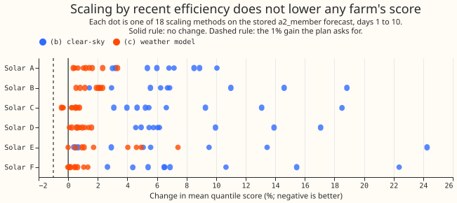
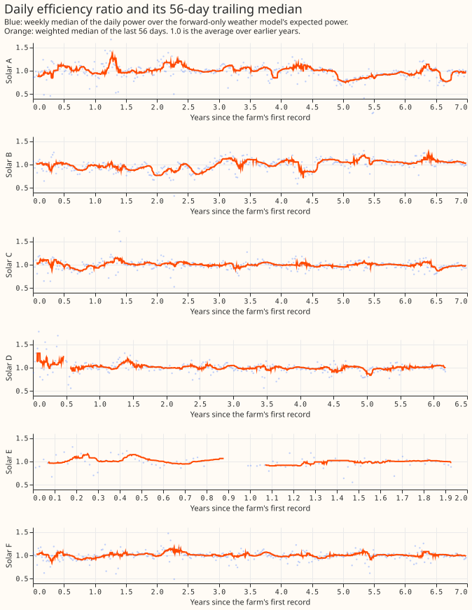
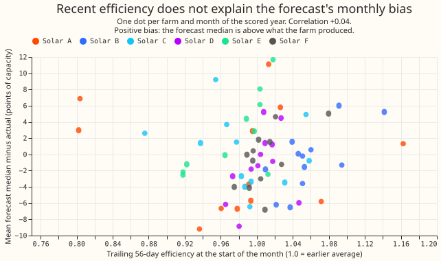
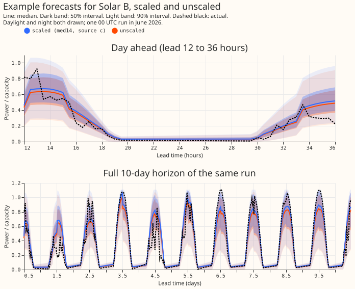

**Scaling the stored solar forecasts by each farm's recent efficiency did not lower the score at any
farm, so slow efficiency change is not what limits the forecast.** The test used the stored
`a2_member` forecasts of experiment 430 only. The best of 18 scaling methods lowered Solar C's mean
quantile score by 0.46% and raised Solar A, B, and D by 0.3% to 2.0%. The efficiency itself does
vary: the 56-day trailing ratio at Solar A fell to about 0.8 of its earlier average for several
months and then recovered (figure 2). The ratio's swings do not line up with the forecast's monthly
bias (correlation +0.04, figure 3). What this narrows: the remaining error is mostly weather error,
and a long history of the ratio is unlikely to add to it.

**Question and method.** National Grid Electricity Distribution (NGED) meters six solar farms,
labelled Solar A to Solar F here. Efficiency is the farm's actual power divided by the power the
observed weather should have produced. This page reports stage 0 of a four-stage line that would
feed the efficiency to the neural network as an input (stages 1 to 4); stage 0 asks the cheapest
version of the question. Each day gets one ratio, and a trailing median, an exponentially weighted
level, or a Kalman filter turns the days into one multiplier at the forecast origin. The multiplier
is normalised: it is divided by the farm's median ratio over all days before the refit, because the
stored neural network already learned the farm's average efficiency. A raw multiplier skips that
division. The experiment multiplied the quantiles of
[experiment 430's](../00430-unified-forecaster-solar-and-pretraining-ablations/result.md) stored
`a2_member` forecast by the multiplier (no neural network refitted) and compared the quantile score
with the unscaled forecast over the 12 scored months. The quantile score is twice the mean pinball
loss over 11 quantile levels, in points of capacity; lower is better.

Three sources of expected power were used. Source (a) is an XGBoost model of power on observed
weather that saw the scored quarter, so it is not causal. Source (b) is a clear-sky proxy: the
farm's clear-sky power times a constant. Source (c) is the same XGBoost model trained on earlier
quarters only. Sources (b) and (c) are causal. Arm names read
`network|source|method|multiplier|lag`: for example `a2_member|c|med14|norm|lag2` is the 14-day
trailing median of source (c), normalised, with the newest day two days before the origin. `ew14` is
an exponentially weighted level with a 14-day half-life, `kalman` is the filter, and `g0_onepass` is
experiment 430's other stored forecast, used as a replication.

## Results

- **The prediction failed and the line stops.** A gain means an interval below zero and a point
  estimate below -1% against the unscaled forecast. The prediction was a gain of more than 1% at
  Solar A, B, and D and under 1% elsewhere. No primary arm gains significantly at any farm, so the
  verdict is not supported.
- **Every point estimate is above -1%.** Lowest change in the mean quantile score per farm over days
  1 to 10 for the 18 primary arms (`a2_member`, sources (b) and (c), 2-day lag, normalised): Solar A
  +0.34%, Solar B +0.54%, Solar C -0.46%, Solar D +0.08%, Solar E -0.01%, and Solar F -0.03%. The
  lowest group means are {Solar A, B, D} +0.85% (`c|ew14`) and {Solar C, E, F} +0.28% (`c|med112`).
  Source (b), the clear-sky proxy, is worse at every farm: +0.4% to +4.6% at the best method per
  farm, and up to +24% at the worst.
- **The intervals are wide because single months dominate.** Two consecutive scored months at Solar
  A change by -18.5% and +18.8% when scaled. The 12 months are resampled as blocks, so Solar A's
  interval swings by about 9 points. Solar C has one month of -8.6%. Both are month-level outliers
  of the multiplier, not a code fault.
- **Only Solar B, D, and F rule out a 1% gain.** The Bonferroni intervals are widened so that all
  108 contrasts hold together at 95%. On `c|med14` their half-widths are 8.4%, 2.7%, 3.0%, 1.9%,
  2.3%, and 1.4% for Solar A to F. An interval rules out a 1% gain when its lower bound is above
  -1%: Solar B (-0.46%), Solar D (-0.94%), and Solar F (-0.40%). At Solar A, C, and E the interval
  is too wide to rule it out, so the verdict rests on every point estimate being above -1%.
- **Secondary arms give the same picture.** The 6-day lag, source (a), the raw multiplier, and the
  `g0_onepass` forecast have lowest changes of -0.05%, -0.18%, -0.33%, and -0.73% (Solar C on
  `g0_onepass|c|med14`).
- **Day 1 (12 to 36 hours) is the one place a later stage could look.** The lowest point estimate is
  at Solar A (-4.8% for `c|med14`), with an interval of -25% to +3%. Day 1 is not a primary contrast
  and is not a finding.
- **The 0.99 quantile gets worse.** On `a2_member|c|med14` the 0.99 pinball loss rises at every farm
  (+0.012 to +0.127 points). It exceeds the 0.02 limit at Solar A (+0.127), Solar C (+0.035), Solar
  D (+0.057), and Solar E (+0.054). The 0.99 coverage falls from 97.5% to 95.7% at Solar A and from
  99.4% to 97.6% at Solar C.

## Checks

- **Missing multipliers.** Source (c) is missing at 0% to 3% of origins at Solar A to D and F and
  20.8% at Solar E. Source (b), averaged over the nine methods, is missing at 25% to 27% of origins
  at Solar A to D and F and 41% at Solar E, and at 48% to 55% (76% at Solar E) for the longest
  window. Missing multipliers bias source (b) toward no effect but cannot explain a loss of up to
  24%.
- **Clipping.** 1% to 11% of scaled 0.99 quantiles hit the cap (the largest q99 of that farm and
  refit).
- **Mean-forecast error beside the quantile score** (`a2_member|c|med14`, mean absolute error in
  points of capacity, unscaled to scaled): Solar A 12.61 to 12.84, B 13.22 to 13.23, C 12.17 to
  12.25, D 14.78 to 14.71, E 14.44 to 14.47, F 12.64 to 12.69.
- **Seeds.** Three seeds, averaged quantile by quantile, in every arm.
- **Cleaning.** Stuck runs, daylight zeros, spikes above 1.5 of capacity, and curtailment-flat days
  are dropped from the ratio; days whose ratio was exactly 0 are treated as missing.

## Caveats

- Source (a) saw the scored quarter's power, so it is not causal; sources (b) and (c) are.
- Source (c)'s XGBoost model for a farm's first four year-quarters is leave-one-quarter-out within
  that year.
- Source (b) takes its ratio from near-clear half-hours and applies it to all-sky forecasts.
- The multiplier assumes observed weather and power reach the service two days after the day ends;
  ERA5 arrives about 5 days late, and the 6-day lag arms are within 0.05% of the best.
- The stored forecasts cover only the scored year, so the efficiency-versus-bias check has 70 farm
  months.

## What to try next

- Look for the forecast's remaining error in the weather forecast itself, for example at the
  irradiance forecast's spread and bias by sky type.
- If stage 1 is ever run, restrict it to Solar A on the day-ahead band, the only place a point
  estimate (-4.8%) was visibly below zero.

## Process

- Plan review: a fresh Sonnet agent made 13 review comments; all were accepted or folded in
  (forward-only source (c), per-farm primary contrasts, Bonferroni correction over 108 contrasts,
  6-day lag arms, defined Kalman multiplier).
- Code review: a fresh Sonnet agent found two critical bugs (zero daily ratios made the exponential
  and Kalman methods NaN at four farms; a duplicate `band` column in the aggregation) and five
  lower-severity points; all were fixed before the scoring run.
- Results review: a fresh Sonnet agent re-derived the headline numbers from the raw forecasts with
  its own code. It averaged six seeds where this page averages three, so per-farm changes differ by
  up to 0.5 points (Solar A +0.9% against +0.3%), and the signs agree for Solar C (-0.6%) and Solar
  E (+0.9%). It found no lookahead and no clipped multiplier.
- Write-up review: a fresh Sonnet agent corrected eight numbers and one logic error (which farms'
  intervals rule out a 1% gain), and asked for terms to be defined earlier; all were applied.
