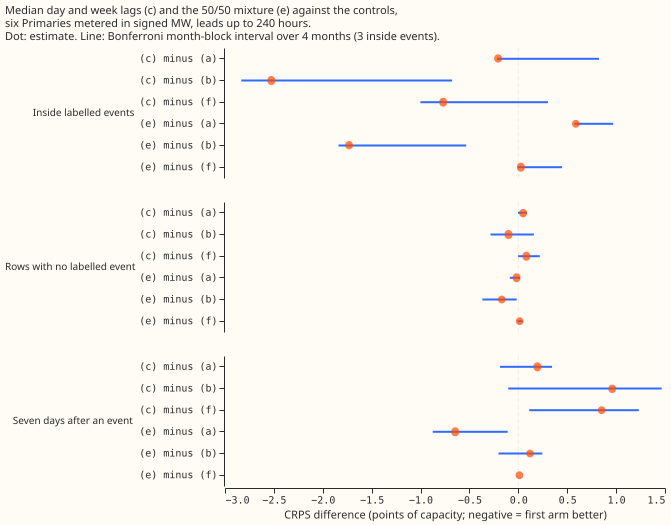
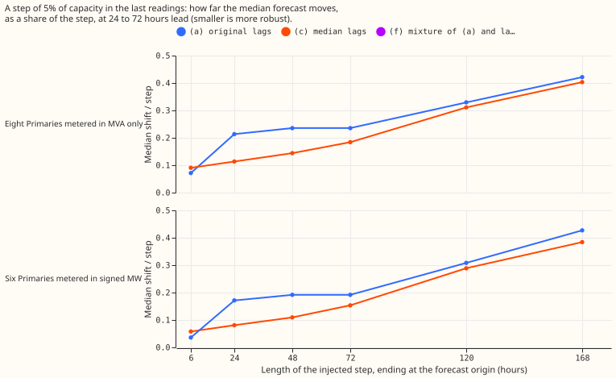
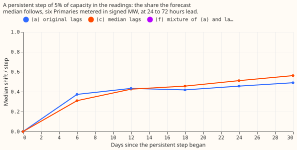
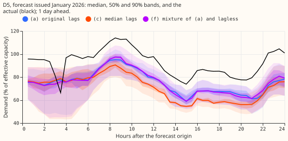
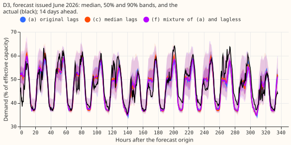
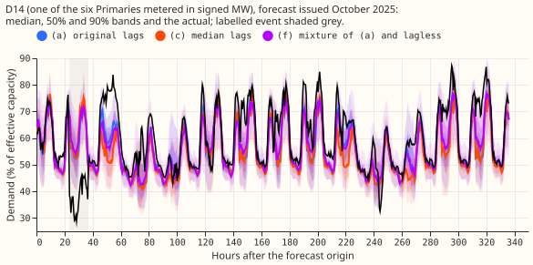
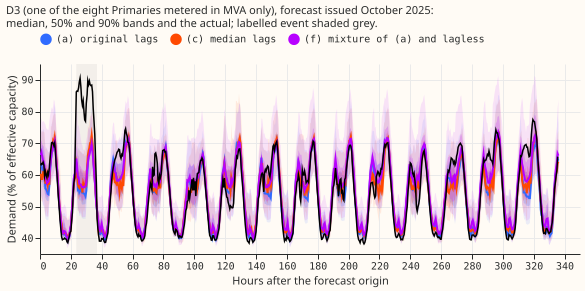
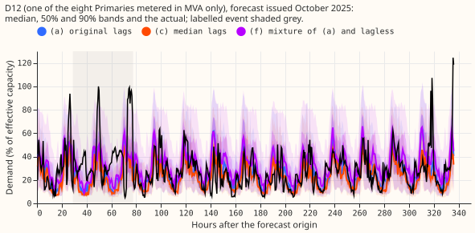
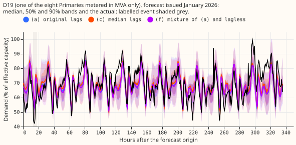

**Median day and week lags make the median forecast about half as sensitive to a step in the last
2 to 3 days of power, but not more accurate.** The shielding shrinks as the event lengthens and is
gone at 7 days. A stuck meter is shielded almost completely, but a dropout to zero and a spike are
not. The clean-row loss against the original lags is +0.050 points of capacity at the six Primaries
metered in signed megawatts, which is inside the 0.06 difference between two fits of the same
recipe. NGED's event labels are incomplete, so "rows with no labelled event" may hold unlogged
events, and every real-event slice undercounts. Every number is interim and unaudited.

## Results

Scores are CRPS-like pinball loss in points of effective capacity; a contrast is the first arm minus
the second, so negative favours the first. Arms: (a) the original lags (experiment 402), (b) the
lagless forecast (experiment 392), (c) the median lags, (e) the 50/50 mixture of the probability
distributions of (c) and (b), (f) the 50/50 mixture of (a) and (b). Months are the resampling unit
(4 scored months, 3 with labelled events). Intervals are 95% month-block intervals; the 99.72%
Bonferroni intervals for the 18 pre-registered contrasts are in `contrasts.csv`.

- **Speed.** The 64 fits of arm (c) took 6,442 s on 6 CPU cores, including the median feature build.
- **Sweep share, signed-MW six, lead 0-240 h, step 5% of capacity.** For an event of 24, 48, and
  72 hours, arm (c) moves the median forecast by 0.068, 0.101, and 0.147 of the step, against 0.172,
  0.217, and 0.241 for (a). At 5 and 7 days the shares are 0.276 and 0.366 for (c), 0.311 and 0.408
  for (a). At the MVA-only eight the shares are 0.097, 0.131, and 0.174 for (c) against 0.201, 0.240,
  and 0.259. The lagless control moves by exactly 0. A step of 2.5% gives the same shares to within
  0.02.
- **Short events leak slightly more.** At an event of 6 hours, (c) leaks 0.042 against 0.021 for (a)
  at the six, because the origin lag, which the median leaves single, carries more weight in (c).
  Moving the origin lag alone by 5% moves the median by 0.038 of the step in (c) against -0.013 in
  (a) at the six, and 0.068 against 0.023 at the MVA-only eight.
- **Band width and coverage.** The 5% to 95% band width does not change with the injected step in
  any arm (ratio 0.996 to 1.003). Clean-row coverage of the 5-95 band is 0.853 for (c) and 0.863 for
  (a) at the six for an event of 48 hours, and 0.898 and 0.906 at a widening of 1.15. Event-row
  coverage is 0.722 for (c) and 0.764 for (a) at 48 hours, and 0.785 and 0.825 at 1.15.
- **Bad data, mean shift of the median, signed-MW six, lead 24-72 h (points of capacity).** Stuck
  24 h: -0.036 for (c), -2.308 for (a). Dropout to zero for 6 h: +1.141 for (c), +0.926 for (a).
  Spike x20: +4.340 and +3.192. Spike x4: +2.706 and +1.616. The median shields a stuck meter but
  not a dropout or a spike, because a single bad reading at the origin lag passes straight through.
- **Level change (5% of capacity for 30 days).** The median forecast follows the new level slowly at
  first and further later: 0.310 of the step by day 6, 0.511 by day 24, 0.562 by day 30 for (c) at
  the six, against 0.373, 0.456, and 0.490 for (a).
- **Clean rows, signed-MW six (rows with no labelled event, lead 0-240 h).** (c) minus (a) is
  +0.050 [-0.004, +0.087], with 3 of 4 months worse. (c) minus (b) is -0.101 [-0.285, +0.159]. (c)
  minus (f) is +0.082 [-0.002, +0.220]. (e) minus (f) is +0.014 [-0.008, +0.045]. The early stop
  rule (clean-row loss of 0.10 or more) does not fire.
- **Noise floor.** Refitting arm (a) on CPU with this experiment's settings and scoring it against
  experiment 402's stored forecast on the 2026-01 refit month gives a difference of -0.060 at the
  six and +0.002 at the MVA-only eight. The +0.050 clean-row loss of (c) is therefore inside the
  noise of a single refit at the six.
- **Harm rows (during a labelled event), signed-MW six.** (c) minus (a) is -0.207 [-0.219, +0.827],
  1 of 3 months worse. (c) minus (f) is -0.769 [-1.001, +0.304]. (e) minus (a) is +0.588 [+0.575,
  +0.971], 3 of 3 months worse. No arm beats (a) with an interval that excludes zero (the
  prediction P3 required -0.1 with an interval excluding zero).
- **Harm rows, MVA-only eight.** (c) minus (a) is +0.690 [+0.050, +0.970], 3 of 3 months worse, and
  (e) minus (a) is -1.423 [-1.911, -0.248], 0 of 3 months worse. The groups disagree in sign.
- **After a labelled event ends (days 7 on), signed-MW six.** (c) minus (a) is +0.194 [-0.188,
  +0.345]. (c) minus (f) is +0.852 [+0.111, +1.232], 3 of 3 months worse. At the MVA-only eight, (c)
  minus (a) is -0.123 [-0.358, -0.007].
- **Avoidable curtailment cost (widening 1.15, units of the cost report).** On the three Primaries
  with event rows, (a) 3.394e6, (b) 2.152e6, (c) 3.422e6, (e) 2.374e6, (f) 2.218e6. Over all rows at
  the six, (a) 4.507e7, (b) 5.615e7, (c) 4.660e7, (e) 4.602e7, (f) 4.526e7. Arm (c) costs slightly
  more than (a) in both.
- **12-36 h lead band, (c) minus (a).** Signed-MW six: clean rows +0.030 [-0.006, +0.064],
  harm rows -0.188 [-0.221, +0.814], after the event +0.371 [+0.019, +0.713]. MVA-only eight: clean
  rows +0.015 [-0.040, +0.063], harm rows +0.789 [-0.039, +1.114]. The signs match the 0-240 h
  band.
- **Predictions.** P1 holds: the share for events up to 48 hours is 0.068 to 0.101 at 24 to 72 hour
  leads (under 0.15), and rises towards (a)'s share at 7 days (0.366 against 0.408). P2 holds
  narrowly: +0.0498 against the limit of +0.05, inside the noise. P3 fails: harm rows show no gain
  with an interval excluding zero at the six, and (c) is worse at the MVA-only eight. P4 fails: the
  origin lag alone moves arm (c) by 0.054 at 24 to 72 h at the six (predicted 0.01 to 0.05) and 0.087
  at the MVA-only eight.
- **Checks.** Median minus mean forecast per site was not computed, because the stored tables hold
  quantiles and no mean forecast. The robust lags assert the leakage rule of `origin_lags`. The
  noise-floor difference (-0.060 at the six) exceeds the half-width of the clean-row interval, so
  the clean-row loss is reported as inside the noise. The harm-row contrast changes sign between
  the two groups, so no pooled claim is made. The leave-one-Primary-out check was not run.

## Caveats

- **Events longer than 7 days defeat any 7-day median.** At 7 days the share is 0.37 to 0.40.
- **The median follows a genuine level change more slowly early.** It reaches 0.31 of a persistent
  step by day 6 against 0.37 for (a), then overtakes it.
- **Unlogged events.** NGED's event labels are incomplete, so rows with no labelled event may hold
  events, and harm-row counts are lower bounds.
- **CPU against GPU.** The fits ran on CPU and experiment 402's on CUDA. The noise-floor control
  bounds the difference at 0.06 at the six, one month only.
- **Three event months and 18 contrasts.** The Bonferroni family is 18 contrasts. The (c) minus (e)
  contrasts are descriptive.
- **Not run.** Arm (d) (robust plus original lags, demoted by the brief), the cold-night rows, the
  NRA-corrected actuals of experiment 455, and the CRPS at widenings 1.05 and 1.10.
- **Production options for a missing or stale day.** If a day of power is missing, the 7-reading
  median can use the remaining readings, as the fit does, or fall back to the lagless forecast.
  This page describes the options and leaves the choice to the maintainer.
