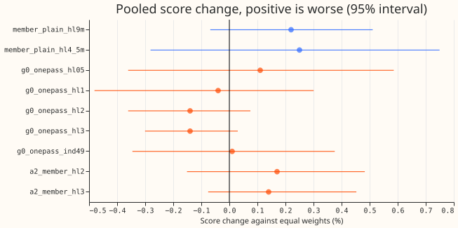
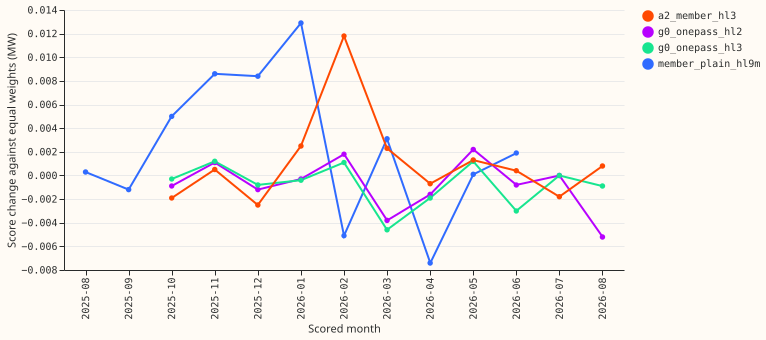

**Take-home: weighting recent training rows more does not improve the wind or solar forecasts, so
the line closes. The wind neural network scores 0.22% to 0.25% worse with half-lives of 9 and 4.5
months.
The best solar arm gains 0.14%, which is less than the difference between two fits of the same
network and a seventh of the 1% margin.**

Farms change efficiency slowly, and each upgrade of the ECMWF ensemble shifts the statistics of the
inputs, so recent rows might train a better network. We multiplied each training row's loss by
`0.5 ** (age / half_life)` and refitted the wind neural network `member_plain` and the solar neural
networks
`g0_onepass` and `a2_member` at the p99.9 capacity of experiment 461. Farm A to C and Solar A to F
are the anonymised series of experiments 429 and 430. The training history is 12.5 months for wind
and 17 to 26 months for solar, so only the shorter half-lives differ much from equal weights.

## Figures

## Results

Contrasts are arm minus the equal-weight reference in MW after table P (a per-series tail
correction) and experiment 451's clip (an upper bound),
pooled over a technology's series, so a positive change is worse. Rows are the half-hours at true
days 1 to 10 (lead 24 to 240 hours) that experiment 210's mask keeps for wind, and all scored
half-hours for solar. Intervals are 95% month-block bootstrap intervals over 11 scored months.

- **No arm passes.** The margin is 1% of the pooled reference score for solar (about 0.0067 MW) and
  0.10 points of capacity for wind. The best arm gains 0.0009 MW.
- **Wind `member_plain`** (5 seeds, reference 1.1744 MW). Half-life 9 months: +0.0026 MW (+0.22%;
  -0.0008 to +0.0060), better in 3 of 11 months. Half-life 4.5 months: +0.0029 MW (+0.25%; -0.0033
  to +0.0088), better in 5 of 11 months. Per farm, 9 months: Farm A +0.15%, Farm B +0.44%, Farm C
  -0.01%.
- **Solar `g0_onepass`** (3 seeds, 4 refits, reference 0.6655 MW). Half-life 0.5 year: +0.11%
  (-0.0024 to +0.0039 MW). At 1 year: -0.04% (-0.0032 to +0.0020). At 2 years: -0.14% (-0.0024 to
  +0.0005), better in 7 of 11 months. At 3 years: -0.14% (-0.0020 to +0.0002), better in 7 of 11
  months. At 2 years, Solar C is the one series whose 95% interval excludes zero in the favourable
  direction (2 years: -0.20%, -0.0028 to
  -0.0001 MW, better in 9 of 11 months), and its adjusted interval does not.
- **Solar `a2_member`** (reference 0.6627 MW). At 2 years: +0.17% (-0.0010 to +0.0032 MW). At 3
  years:
  +0.14% (-0.0005 to +0.0030). Solar B at 2 years is +0.32% worse with an interval that excludes
  zero (+0.0004 to +0.0043 MW).
- **Minimum detectable effect** (mean gap between two single-seed fits of the reference, stated
  before any arm was scored): wind 0.0077 MW, `g0_onepass` 0.0050 MW, `a2_member` 0.0036 MW. Every
  pooled contrast is smaller than the wind and `g0_onepass` values.
- **Cycle 49r1 indicator (diagnostic, `g0_onepass`).** Pooled +0.01% (-0.0023 to +0.0025 MW). Solar
  A improves 0.36% in 9 of 11 months (-0.0036 to +0.0002 MW), and Solar E worsens 0.20%. The
  indicator has no training signal for Cycle 50r1, and the indicator is not adopted.
- **Tails after table P, pooled.** Coverage is the share of actuals at or below the quantile. Wind,
  equal weights to 9 months:
  share above q99 0.88% to 0.86%; q95 coverage 95.13% for both; q99 pinball loss 0.0641 to 0.0643
  MW.
  Wind at 4.5 months: share above q99 0.94%, q99 pinball 0.0646 MW. Solar `g0_onepass`, equal
  weights to 2 years: share above q99 1.41% to 1.37%; q95 coverage 94.58% to 94.82%; q99 pinball
  loss 0.0247 for both. `a2_member` equal weights to 3 years: share above q99 1.50% to 1.48%. No
  half-life arm changes a pooled tail coverage by more than 0.4 points or a pinball loss by more
  than
  0.0009 (wind q95 at 9 months); the Cycle 49r1 indicator moves `g0_onepass` q95 coverage by 0.65
  points.
- **Bonferroni count.** 57 intervals (arms times pooled and per series); at the adjusted level no
  contrast excludes zero in the favourable direction.
- **Rows and seeds.** Equal across arms: wind 54,899 half-hours (Farm A 18,831, B 18,403, C
  17,665); solar 345,510 half-hours per arm (A 60,210, B 60,039, C 60,885, D 54,864, E 49,770,
  F 59,742). Wind 5 seeds; solar 3.
- **The 12 to 36 hour band.** The scored rows start at lead 24 hours, so the band holds only leads
  24 to 36 hours (wind 3,361 half-hours, solar 18,014). The scores for that band were not separated,
  because no
  pooled contrast is near the margin.

## Caveats

- **Reproduction gates.** With all weights 1 the wind fit (seed 0) and the solar `g0_onepass` fit
  (seed 0, refit 2025-09) reproduce experiment 461's stored forecasts bit for bit. The four other
  wind reference seeds are copies of experiment 461's p99.9 fits.
- **Short history.** Wind trains on 12.5 months, so a half-life of 3 years or 1.5 years is nearly
  equal weighting, and those arms were dropped. A training window that starts after Cycle 49r1 was
  not tested, because it leaves 5 months of wind rows and 10 to 19 months of solar rows. Cycle
  50r1 (2026-05-12) falls inside the scored months, and no month's contrast shows a step there
  (figure 2); the figures do not mark it.
- **Scored years.** Wind spans 2025-08 to 2026-06 and solar 2025-10 to 2026-08, so the contrast by
  month stands in for the contrast by year.
- **Experiment 443's p99 forecasts are not reused.** Experiment 443's 0.5-year and 1-year arms were
  refitted at p99.9 here,
  and agree with its p99 result: neither gains.
- **Cleaned-zero rescore.** Experiment 432's cleaned-zero row set was not scored for wind.
- **Production cost.** None for a half-life, which is a training-time weight. An indicator would
  need a retrain at each ECMWF cycle.

## Checks

- **Reviews.** A fresh Sonnet reviewed the code before the first fit and found no defect; it
  asked for three low items (a stale docstring, a check on unknown labels, and an assertion), all
  fixed.
- **Median bias.** The pooled mean of the median forecast minus the actual after table P is -0.614
  MW for wind with equal weights and with 9 months, and +0.115 MW (equal weights) and +0.109 MW (3
  years) for `g0_onepass`, so the bias does not drive any contrast.
- **Audit triggers.** None fired: no contrast is near the margin, so no audit was run.
