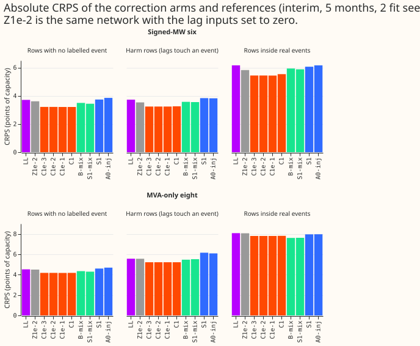
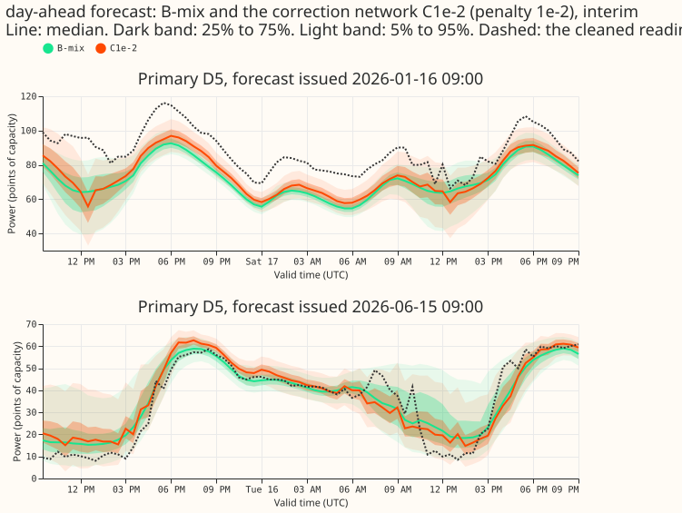
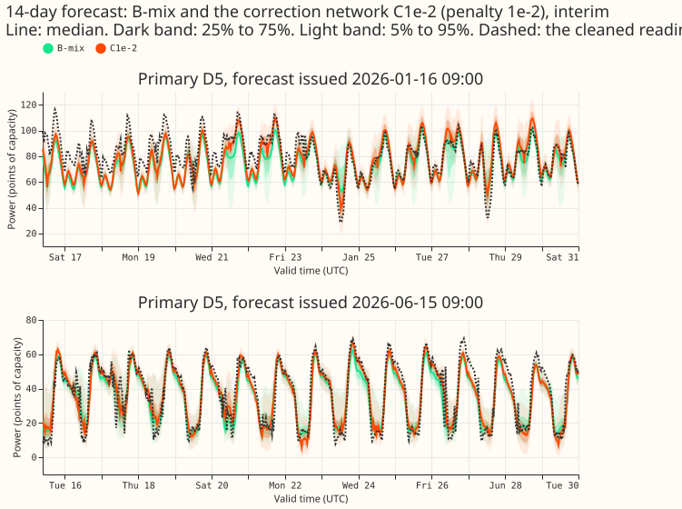
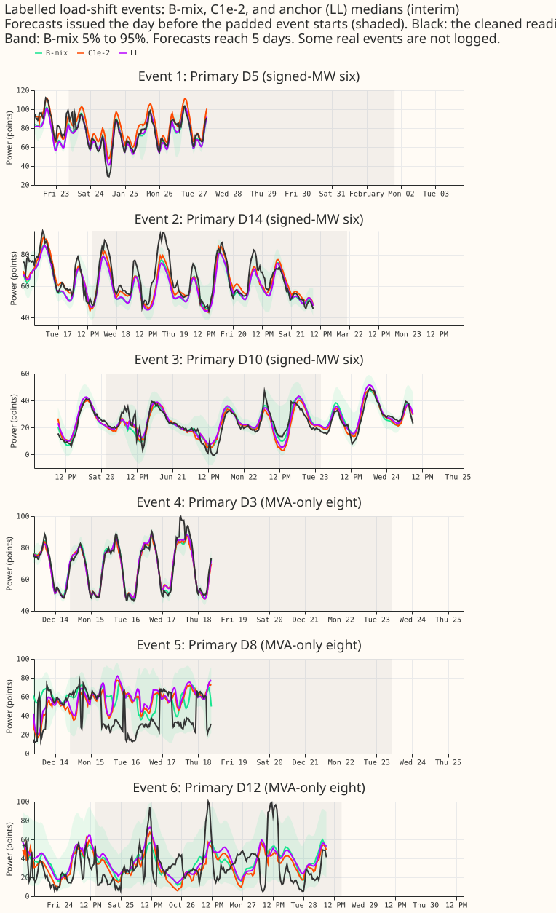

**One frozen lagless forecast plus a 32-unit lag correction beats the lagless forecast and the
two-network B-mix on rows with no labelled event, but it does not help inside real events.** The
correction reads the three origin lags, the surprise at each lag, and the lead time, and shifts and
rescales the lagless mixture. Its last layer starts at zero. The L2 penalty never bound, so all
four penalties give nearly the same forecast. NGED's event labels are incomplete, so "rows with no
labelled event" may hold real events that nobody logged. Every number is interim and unaudited. The
scores bear on forecast quality, and the inside-event rows bear on robustness to bad inputs.

## Results

Scores are points of effective capacity (CRPS, lower is better), raw quantiles, metered actuals
unless stated, and the mean over 5 scored months and fit seeds 0 and 1. Intervals are 95%
month-block intervals. Experiment 454's minimum detectable effect at the signed-MW six is 0.24 on
rows with no labelled event and 0.38 inside events.

- **Arms.** C1e-3, C1e-2, C1e-1 (penalty on the squared outputs), C1 (penalty 1, post hoc), and Z1e-2
  (post hoc control: the same network with the lag and surprise inputs set to zero, leaving the
  lead features). References: LL (the anchor alone), B-mix, S1-mix, S1, A0-inj.
- **Relation to A0-inj.** A0-inj has no lagless input and re-learns the weather response. The
  correction sits on the frozen anchor, which is the only new part.
- **Signed-MW six, rows with no labelled event.**
    - C1e-2 3.212, C1 3.206, C1e-1 3.205, C1e-3 3.212, Z1e-2 3.611, LL 3.708, B-mix 3.498, S1-mix
      3.435, S1 3.736, A0-inj 3.851.
    - C1e-2 minus LL -0.496 (-0.865 to -0.254, 5 of 5 months); minus B-mix -0.286 (-0.807 to +0.195,
      4 of 5 months). By month against B-mix: -0.01, +0.25, -0.87, -0.55, -0.24 (2025-10, 2025-12,
      2026-01, 2026-03, 2026-06). Leaving out 2026-01 leaves -0.15; leaving out 2025-12 leaves -0.42.
    - Z1e-2 minus LL -0.097 (-0.200 to -0.019): recalibrating the spread by lead time gains 0.10, and
      the lags gain a further 0.40.
- **Signed-MW six, inside real events.** On metered actuals C1e-2 is 5.440 against 6.158 for LL and
  5.932 for B-mix. On NRA-corrected actuals (the headline for events) C1e-2 is 14.864 against 14.822
  for LL (+0.042, -0.509 to +0.911), 14.641 for B-mix (+0.223, -0.259 to +1.127), and 14.543 for
  Z1e-2. The lags follow the level shift, so they stop helping once the target is the normal
  arrangement.
- **MVA-only eight.** Rows with no labelled event: C1e-2 4.179, LL 4.523, B-mix 4.349, Z1e-2 4.498.
  Metered inside events: C1e-2 7.800, B-mix 7.607 (+0.194, -0.547 to +0.793). NRA events: C1e-2
  10.101, B-mix 10.603 (-0.502, -0.666 to -0.332).
- **Lead band 12 to 36 hours.** Signed-MW six, no labelled event: C1e-2 2.995, LL 3.654, B-mix 3.392
  (-0.397, -0.812 to -0.139). NRA events: C1e-2 15.423 against LL 15.189 and B-mix 15.081.
- **Tail calibration (signed-MW six, no labelled event, raw).** Coverage at q95 and q99: C1e-2
  0.946 and 0.989, LL 0.839 and 0.943, B-mix 0.858 and 0.951, Z1e-2 0.926 and 0.986. Pinball loss at
  q95 and q99: C1e-2 0.00698 and 0.00204, B-mix 0.00842 and 0.00254. After table P the CRPS is
  3.327 (C1e-2), 3.674 (B-mix), 3.878 (LL), 3.769 (Z1e-2). Much of the gain over B-mix is the upper
  tail of the anchor being under-dispersed, which Z1e-2 also fixes in part.
- **Stop rule.** The stop rule did not fire: the share of rows with a shift below 0.01 of capacity
  is 0.29 at the signed-MW six for penalties 1e-3 to 1e-1 and 0.32 at penalty 1. The mean log-scale
  change is +0.16 to +0.26, so the correction widens the anchor.
- **Avoidable-curtailment cost** (experiment 449's cost, millions of pounds, signed-MW six, fit seeds
  0 and 1, widened by 1.15; interval from resampling month-by-Primary cells). At f = 0.9, 0.75, and
  0.5: C1e-2 2.23, 8.08, 24.4; B-mix 2.08, 9.20, 28.7; LL 2.34, 10.15, 30.2; manual_heuristic 2.02,
  12.9, 37.8; BG2 1.37, 8.24, 25.9. C1e-2 minus manual_heuristic is -13.4 (-26.6 to -3.0) at
  f = 0.5, and the other contrasts at f = 0.9 and 0.75 include zero.
- **Decision rule.** C1e-2 passes the first two parts at the signed-MW six: it beats the anchor on
  rows with no labelled event by more than the larger of 0.03 and the minimum detectable effect
  (0.24). It fails the real-event gate on NRA-corrected actuals: +0.042 against LL (limit 0.03) and
  +0.223 against B-mix (limit 0.03). Verdict: partly supported.
- **Fits.** 50 correction fits of 16 to 28 s each (30 pre-registered, 20 post hoc), one GPU process
  under 8 GB, monthly retraining, about 25 minutes in total. The networks are saved under
  `data/ml-experiments/00467-*/work/models/`.
- **Rows and reuse.** Experiment 404's rows and injected worlds (training worlds 100 and 101);
  scoring on the real world only (stored B-mix, LL, S1, S1-mix, and A0-inj of experiment 454 exist
  for it). Flagged exact-zero half-hours are dropped; the start cut applies to D15 and D18, which
  are report-only.
- **Reviews.** A fresh Sonnet reviewer found no leakage in the code and corrected the plan's seed
  notes. A second fresh Sonnet reviewer reproduced the headline numbers independently and asked for
  the control with the lag inputs zeroed (Z1e-2) and for a penalty that binds (C1), both added and
  labelled post hoc.

## Caveats and next steps

- **The penalty sweep is uninformative.** At 1e-3 to 1 the L2 penalty shrinks the outputs by under
  5%, so it does not separate the arms. A penalty of 10 or more, or a per-row penalty that is larger
  inside events, is the next test.
- **The Bonferroni count is 15** per reference in the contrast tables (5 arms times 3 row classes);
  the pre-registered count was 9 (3 penalties times 3 row classes). No gain in this page is
  claimed at the 99% level.
- **Not done:** the drop-largest-event interval, leave-one-Primary-out (infeasible with 21 events
  at the six), and the wind and solar versions (they need the stored `member_plain` and `g0_onepass`
  heads in their own harnesses). The demand version passes the no-labelled-event gate only, so the
  manager decides whether to run them.
- **Production cost.** One network plus a 32-unit correction, against two networks for B-mix.
