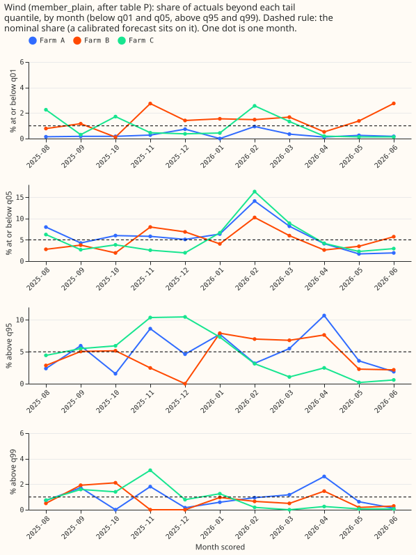
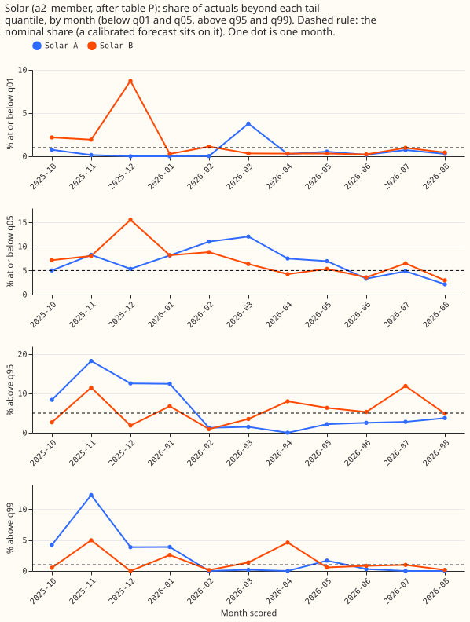
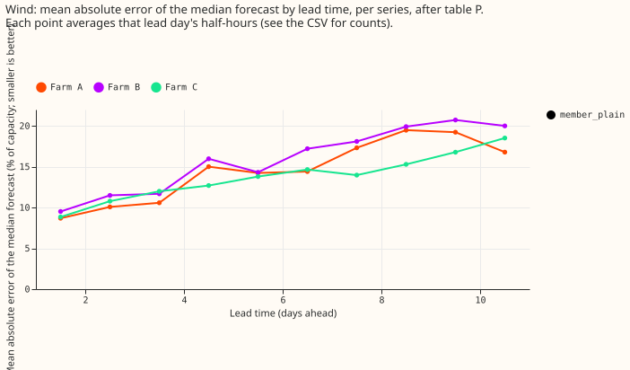
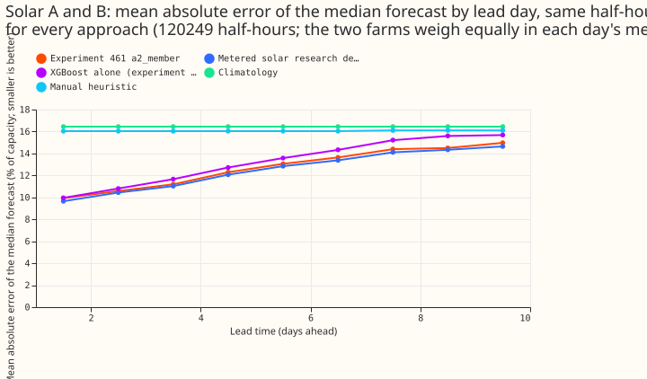
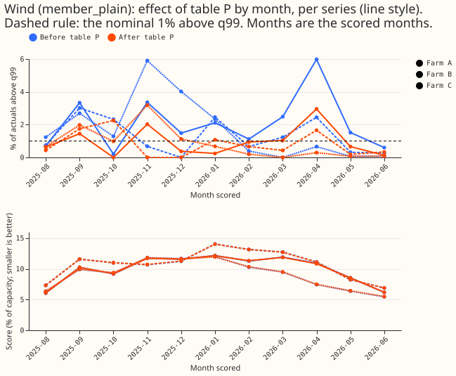
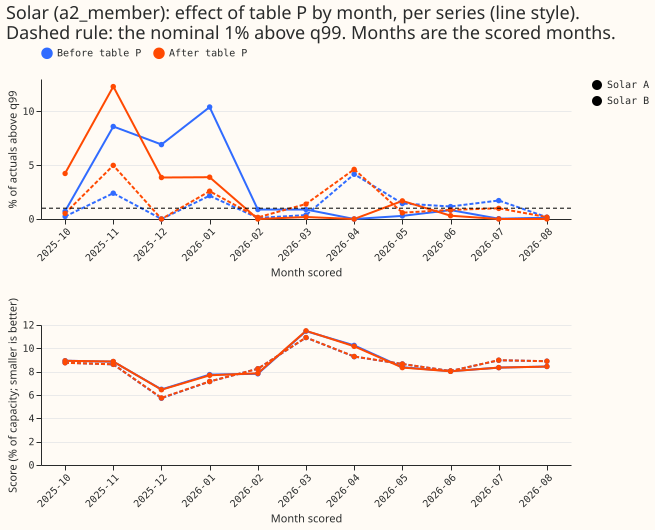
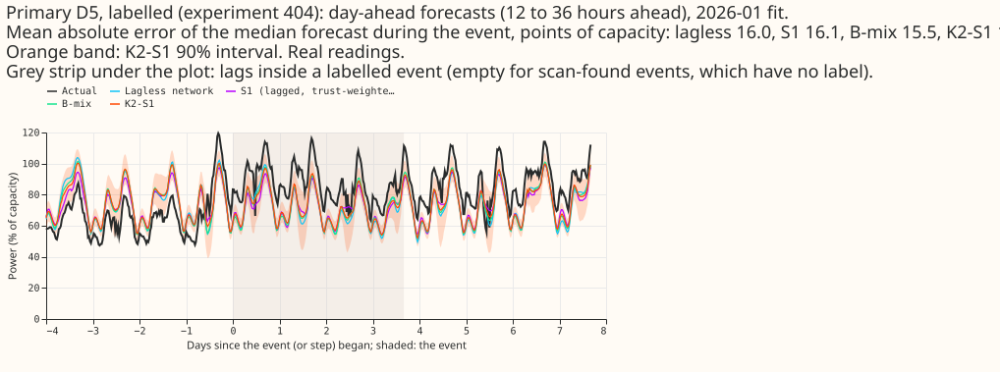
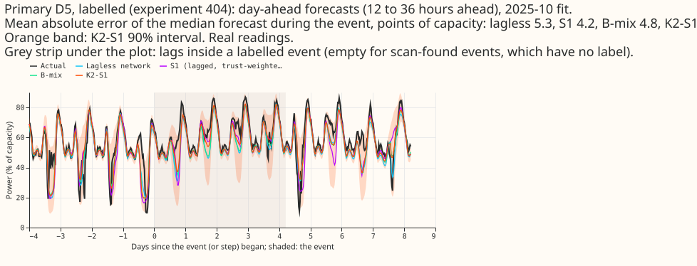
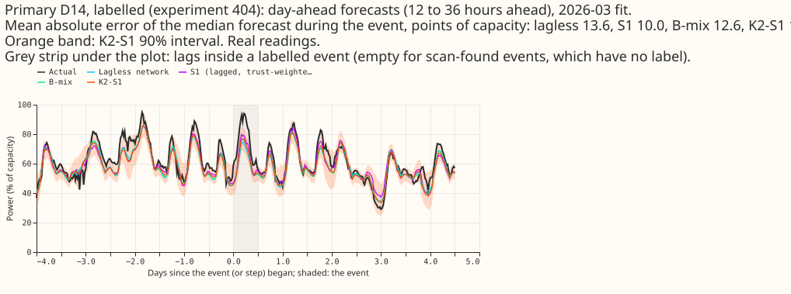
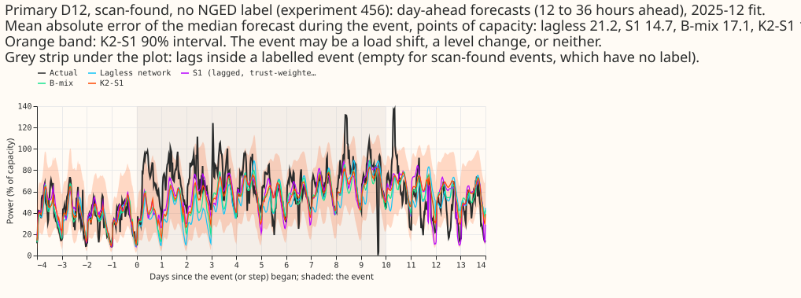

**Take-home.** Over a year, the wind and solar forecasts that experiment 461 selected have tails
close to the shares expected of a perfectly calibrated forecast. Single months miss, and the demand
forecasts that read lagged power are not reliably better than the forecast that does not during
real events.

We asked where the selected wind, solar, and demand forecasts fail, by plotting stored forecasts
against what happened. Nothing was fitted. Part A covers wind and solar. Part B covers Primary
substation demand during real events, where an event is a labelled load shift or a level step found
by a scan. The injected-shift half of Part B is not done.

**Part A uses experiment 461's stored forecasts.** Wind is `member_plain`, a neural network whose
effective capacity is the 99.9th percentile of earlier power, at the three metered wind farms Farm A,
B, and C. Solar is `a2_member` at the two metered solar farms Solar A and B, at the old capacity rule
(the 99th percentile of the whole power record). Experiment 461 did not adopt the new capacity rule
for Solar A. Table P is a table of factors, one per farm, lead band, and tail level, that moves the
tail quantiles towards or away from the median. The factors are fitted on earlier months only. The
time-series charts of these generators carry megawatts and stay in the private store
(`data/ml-experiments/00468-.../part_a/`). This page shows only charts without a generator time
series.

**Part B uses experiment 454's stored demand forecasts.** All four are neural networks. The lagless
forecast does not read recent power. S1 reads three lagged power readings and their distance from the
lagless forecast. B-mix is a fixed 50/50 mixture of a lagged forecast and a lagless forecast. K2-S1
mixes two S1 forecasts with two lagless forecasts. Quantile names such as q99 mean the forecast
quantile at that level; the share above q99 is the share of actuals above it, and 1% is the share a
calibrated forecast gives.

## Part A: wind and solar

- **Pooled over the year the tails are near nominal.** After table P, the share above q99 is 0.95%
  at Farm A, 0.79% at Farm B, 0.90% at Farm C, 1.69% at Solar A, and 1.42% at Solar B. The share
  below q01 is 0.31%, 1.41%, 0.86%, 0.65%, and 1.10% in the same order.
- **Single months miss.** In the worst month the share below q05 is 14.1%, 10.3%, and 16.3% at the
  three wind farms (nominal 5%), and the share above q99 is 2.6%, 2.1%, and 3.1% (nominal 1%).
  Solar A's worst month above q99 is 12.3%.
- **Prediction P1 did not hold.** It said the q05 and q95 shares would sit within 3 points of
  nominal in every month, and that the share above q99 would stay under 1.5% in every month. Only
  the pooled share above q99 at the wind farms stayed under 1.5%.
- **Error rises with lead time.** For wind, the mean absolute error of the median forecast rises
  from about 9% of capacity at day 1 to 17% to 21% at days 9 to 10 at Farm A and B and to 19% at
  Farm C. For solar, it rises from 9% to 10% at day 1 to 15% at days 9 to 10.
- **Solar contrasts.** Each is `a2_member` minus a reference, in points of capacity (negative
  means `a2_member` has the smaller error). The interval is a month-block bootstrap at 98.75% (a
  Bonferroni correction for 4 contrasts) over 11 scored months and 120,249 half-hours of Solar A and
  B together. The minimum detectable effect is in brackets. Blend +0.23 (-0.18 to +0.74; 0.60).
  XGBoost model alone -0.56 (-1.05 to -0.03; 0.69). Climatology -3.71 (-4.29 to -2.94; 0.92).
  Manual heuristic -3.32 (-4.23 to -2.34; 1.27). Absolute errors: `a2_member` 12.7% of capacity,
  blend 12.5%, XGBoost 13.3%, climatology 16.4%, manual heuristic 16.1%. The gain over the XGBoost
  model is smaller than its minimum detectable effect.
- **Table P cuts the share above q99 at the wind farms without changing the score.** At Farm A the
  share falls from 2.10% to 0.95%, and the score changes by under 0.1% of its value at every wind
  farm.
- **Prediction P2 (the worst half-hours sit in a few storm days) is not tested.** The 20 worst q99
  half-hours at each wind farm fall in 5, 7, and 6 different months at Farm A, B, and C, and 12 of
  Farm A's fall in two months. The stored table records months, not days, so a day-level check was
  not run. The tables are private.

## Part B: demand in real events

**Seven events fit inside one stored month.** Six are labelled events from experiment 404. One is
a step that experiment 456's scan for level steps found and that NGED has not labelled; the scan
found six more that did not fit. NGED's labels are incomplete, so the scan-found event may be a load
shift, a level step, or neither. The columns of the table give the mean absolute error of the
day-ahead median forecast (12 to under 36 hours ahead) during the event, in points of effective
capacity. D5, D12, D14, and D16 are Primary substations.

| Event | Substation | Lagless | S1 | B-mix | K2-S1 |
|---|---|---|---|---|---|
| 1 | D5 | 3.9 | 5.2 | 3.7 | 3.7 |
| 2 | D5 | 16.0 | 16.1 | 15.5 | 15.2 |
| 3 | D5 | 5.3 | 4.2 | 4.8 | 3.9 |
| 4 | D14 | 24.8 | 26.8 | 26.3 | 25.8 |
| 5 | D16 | 4.0 | 3.4 | 3.7 | 3.5 |
| 6 | D14 | 13.6 | 10.0 | 12.6 | 12.0 |
| 7 | D12 (scan) | 21.2 | 14.7 | 17.1 | 15.8 |

- **S1 was less accurate than the lagless forecast in 3 of 7 events, and K2-S1 was more accurate
  in 6 of 7.** Prediction P3 said the lagged forecasts would be worse in at least half the
  events. That did not hold. P3 also said the lagged forecasts would follow the shifted power
  within one day, and that the lagless forecast would stay near the pre-event level. Neither delay
  nor pre-event level was computed, so those two parts are not tested.
- **Two events are large for every forecast.** Events 2 and 4 have errors of 15 to 27 points for all
  four forecasts, so the lagged power does not explain them.
- **These numbers are interim and unaudited.** With 7 events no interval is reported.

## Not done

- Wind reference contrasts against research defaults 1 and 2, climatology, and the manual heuristic.
  The stored wind references load through code that needs PyTorch, which this CPU-only session does
  not install.
- The 14-day wind chart. Experiment 429 holds one.
- The solar q01 contrast, and a curtailment week (no label exists for wind or solar).
- For demand: the normal-running-arrangement (NRA) corrected actual, the surprise inputs, the
  injected-shift scenarios, and the avoidable-curtailment cost.

## Checks

- **Median minus mean forecast:** not computed, because this page scores no mean forecast.
- **Triggers fired:** none. No control or nested arm exists.
- **Reviews:** one fresh Sonnet agent reviewed the code, and its findings were applied.
- **Caveats:** NGED's event labels are incomplete, so rows with no labelled event may hold events.
  The wind rows cover true days 1 to 10 only. Solar `a2_member` is at the old capacity rule.
