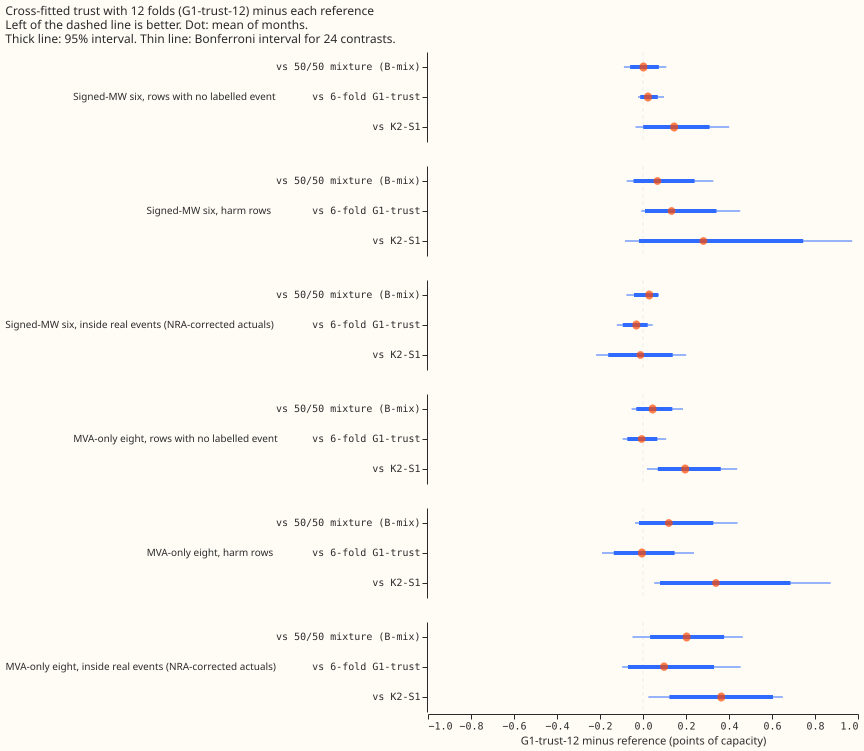
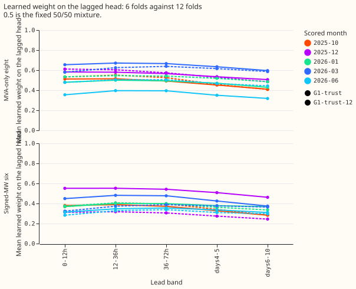

**Doubling the number of cross-fit folds from 6 to 12 does not make the learned trust weight beat
the fixed 50/50 mixture, so the weaker-fold-head explanation is not supported.** Experiment 463
fitted a trust weight, which sets how far to trust the lagged forecast (the one that reads recent
power readings), on lagged forecasts from neural networks that did not see the fitting rows.
Experiment 463's learned weight sat near 0.4 and did not beat 50/50. We asked whether those networks
were too weak because each trained on only 5/6 of the rows. Here each lagged-head network trains on
11/12. The pre-registered prediction failed: the contrast against 50/50 on rows with no labelled
event stayed within the 0.03 stop band (+0.002), and the learned weight at the six signed-megawatt
substations fell (0.34 against 0.41). Both conditions of the stop rule hold (the contrast is within
+-0.03, and the learned weight is below 0.45). On this evidence the trust line closes. The intervals
are wide (minimum detectable effect 0.32 points): the point estimate is far from the predicted
-0.06, but the lower bound of the 95% interval is -0.060, so an effect that size is not excluded.
This result is interim: five months were scored with one seed. NGED's event labels are incomplete,
so rows with no labelled event may hold unlogged events.

**The score of G1-trust-12 is indistinguishable from the score of the 6-fold G1-trust, and its point
estimate is slightly worse.** Against 50/50 on rows with no labelled event at the six
signed-megawatt substations, G1-trust-12 is +0.002 points of capacity (95% interval -0.060 to
+0.074, Bonferroni interval -0.089 to +0.108, minimum detectable effect 0.32; Bonferroni count 24).
The paired contrast against the 6-fold G1-trust is +0.023 (-0.013 to +0.069), so the 12-fold fit is
no better and is, by its point estimate, slightly worse.

- **Harm rows (a lag inside an event, the target outside).** Against 50/50 at the six: +0.067
  (-0.044 to +0.240, minimum detectable effect 0.42). At the eight MVA-only substations: +0.120
  (-0.019 to +0.327, minimum detectable effect 0.68).
- **Real-event rows (actuals corrected to the normal running arrangement, depth factor 1.0).**
  Against 50/50 at the six: +0.029 (-0.042 to +0.071, minimum detectable effect 0.38; +0.013
  without the largest event). At the eight: +0.203 (+0.033 to +0.377, minimum detectable effect
0.27), so G1-trust-12 scores worse than 50/50 there at the 95% level only (the Bonferroni interval
is -0.049 to +0.464).
- **Eight MVA-only substations, rows with no labelled event.** +0.045 against 50/50 (-0.031 to
  +0.136).
- **Absolute scores (rows with no labelled event, six; points of capacity).** 50/50 3.513, G1-trust
  3.492, G1-trust-12 3.515, K2-S1 3.369, A0-inj 3.824.
- **Tails (rows with no labelled event, six).** Coverage at q01, q05, q95, q99: G1-trust-12 0.006,
  0.030, 0.849, 0.947; 50/50 0.006, 0.028, 0.855, 0.949. The upper tail is under-covered by about
  5 percentage points at q95 in both arms.
- **Median forecast.** The mean absolute error of the median differs from 50/50's by +0.0004 on
  rows with no labelled event at the six; the median is not the cause of any score gap.

**The learned weight does not approach 0.5 at the six signed-megawatt substations.** The mean
learned lagged weight is 0.34 at 12 folds and 0.41 at 6 folds there, and 0.53 against 0.50 at the
eight MVA-only substations. Across the five scored months the weight at the six ranges from 0.29 to
0.38 (a swing of about 0.08, under the 0.1 that experiment 463's rule treats as a reason to run seed
1). The weight is lowest in the 6 to 10 day band (0.31). The out-of-fold negative log-likelihood of
the lagged head is 0.71 to 0.86 per month, against 0.24 in sample, so the head is still far weaker
on a held-out block than on rows it saw.

**K2-S1 beats G1-trust-12 and needs no cross-fit table.** Against K2-S1 on rows with no labelled
event at the six, G1-trust-12 is +0.145 points worse (+0.001 to +0.310). On real-event rows at
depth 1.0 the two are level (-0.012, -0.162 to +0.138). The adoption rule (beat K2-S1 on rows with
no labelled event, real events, and curtailment cost) fails.

**Avoidable-curtailment cost (six signed-megawatt substations, widening 1.15, from experiment
454's costing).** G1-trust-12 minus 50/50: +0.023 (f = 0.9; -0.235 to +0.268), +0.127 (f = 0.75;
-0.552 to +0.949), and +0.253 (f = 0.5; -1.331 to +1.810). G1-trust-12 minus K2-S1 is +0.204,
+1.352, and +3.420, and the intervals exclude zero at all three. Costs are in the units of
experiment 454's table.

**Compute needed per refit with 12 folds.** Each refit needs 12 out-of-fold lagged fits, 1 trust
fit, and 13 lagless fits, against 6, 1, and 7 at 6 folds, plus a stored past-forecast table. K2-S1
needs 4 networks and no cross-fit.

## Method

- **Lagged head and fit loop.** Experiment 404's A0-inj lagged head, with experiment 463's fit loop
  (`e00463_crossfit.py`) at 12 folds. The scored month is forecast with 404's stored full-data
  A0-inj network and the new trust head.
- **Lagless table.** Rebuilt at 12 folds in this experiment's folder (65 module fits). The scored
  month's lagless forecast comes from a module refitted for this table, so the comparison against
  experiment 463's G1-trust differs in more than the fold count: the module's fitted weights differ,
  though its recipe is the same.
- **Reused, not refitted.** 404's B-mix and A0-inj, 454's K2-S1 (mean of its 3 stored cells in
  quantile space, no widening), 463's G1-trust and G1-insample. There is no 12-fold G1-insample
  control; 463's 6-fold one is the reference.
- **Compute.** 60 out-of-fold fits (6 to 11 s each) and 5 trust fits (about 7 minutes each) plus the
  table rebuild (70 s per month): about 1 GPU-hour in all, one process.
- **Scoring.** `e00469_score.py` reuses `e00463_score.py`; `e00469_curtailment.py` reuses
  experiment 454's costing. Months are the resampling unit.
- **Audit triggers.** The median-error check above is the only trigger run on this free re-score.
