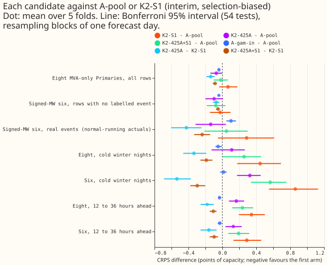
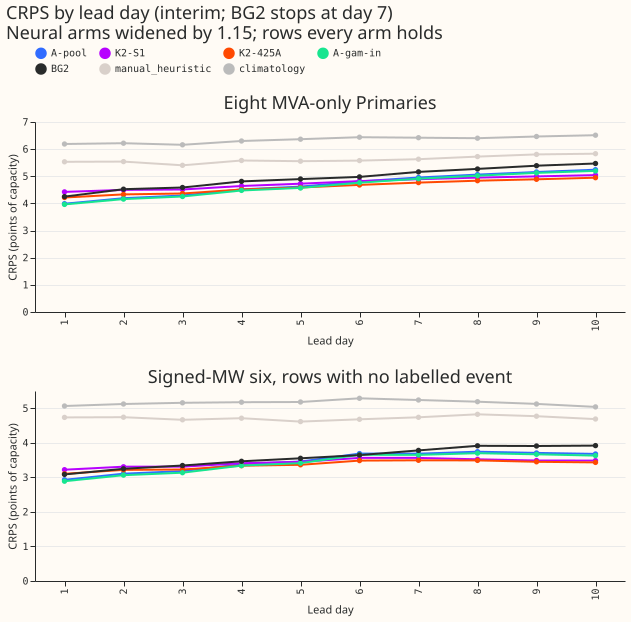
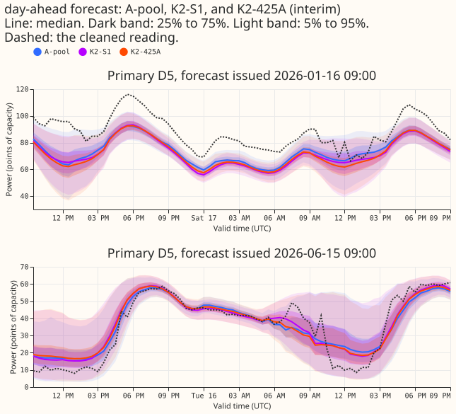
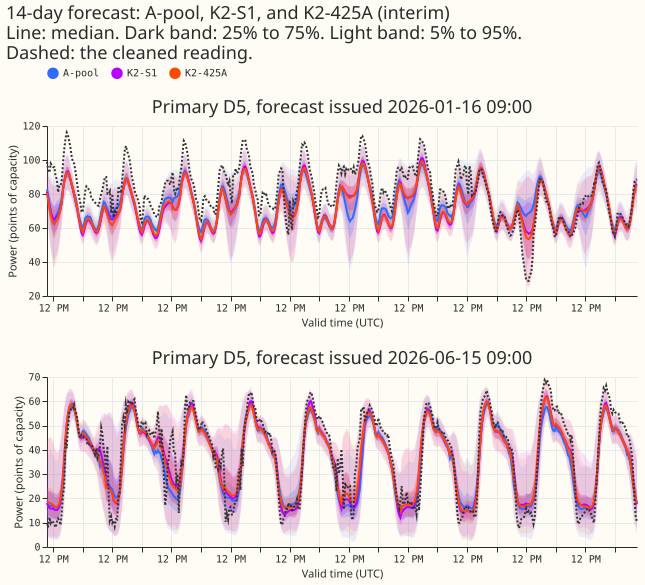
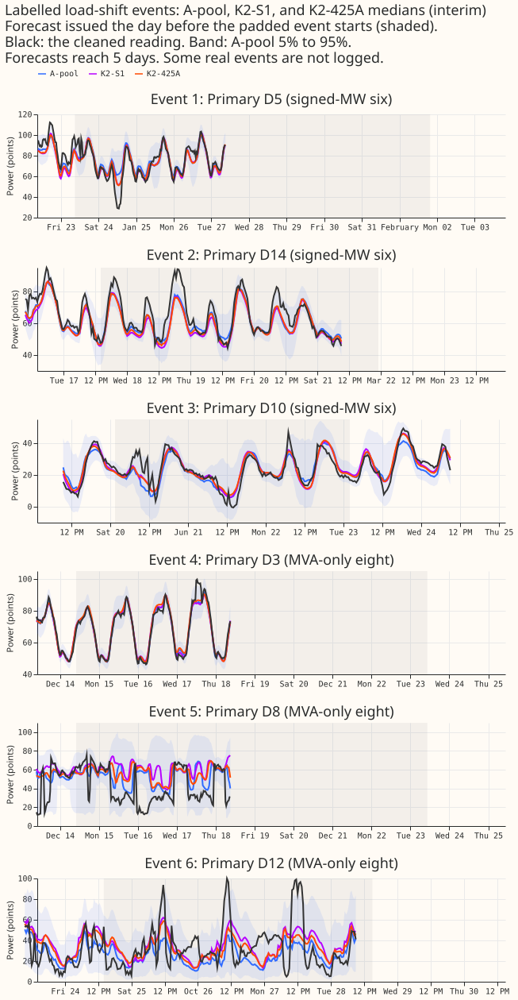

## Which assembled demand forecaster should be the first release?

**Take-home message.** The pretrained network scores almost as well as the best mixture and holds up
better on cold winter nights and 12 to 36 hours ahead, so the lagged-plus-lagless design adds
nothing the 5 months of data can confirm. **Recommendation: release A-pool, the five-seed pretrained
network, unless the maintainer prefers A-gam-in, the same network with the GAM forecast as an extra
input.** The lowest scores are K2-425A's (4.608 at the eight MVA-only Primaries and 3.353 at the six
signed-MW Primaries, on rows with no labelled event). They are only 0.072 and 0.098 points of
capacity below A-pool, against a minimum detectable effect of 0.065 and 0.100 points. The
pre-registered rule does not give one robust answer. The plan's tie clause for A-pool and K2-S1
recommends A-pool. The rule's clause-by-clause admissibility test, read literally, leaves only
A-gam-in. The choice between those two is the maintainer's. Every score is selection-biased.

We asked which demand forecaster to release first for the 14 Primary substations with a generalised
additive model (GAM) forecast: the eight that report in megavolt-amperes (MVA) only, and the six
that report in signed megawatts (MW). We took 5 candidates that earlier experiments built, put all
of them on the same half-hours (1,145,256 half-hours over 5 test months, 1,003,611 of them at the 14
Primaries), and scored them with the same code. Scores are the continuous ranked probability score
(CRPS) in points of capacity, so lower is better. A lagless forecast uses no recent power readings
as inputs, and a mixture averages the density of lagged networks and lagless networks. The
candidates are the pretrained network alone (A-pool, five seeds averaged; pretrained on ERA5 and
CAMS weather and fine-tuned on ensemble weather), three mixtures of lagged and lagless networks
(K2-S1, K2-425A, and K2-425A+S1), and A-gam-in. No neural network was refitted. Experiment 425
stored only quantiles for the pretrained network, so a forward pass of its saved networks recovered
the mixture parameters. The recovered parameters reproduced the stored quantiles to within 4e-5.

**Figure 1 shows the gaps that matter: the mixtures lose on cold nights and 12 to 36 hours ahead.**

### Results

- **Arms.** A-pool is experiment 425's arm A, seeds 0 to 4, quantile-averaged. K2-S1 is experiment
  454's mixture of 2 S1 networks and 2 lagless networks. K2-425A mixes 2 arm A seeds with 2 lagless
  networks, and K2-425A+S1 mixes 1 arm A seed, 1 S1 network, and 2 lagless networks, with the
  lagless seeds `(c, (c+1) mod 3)` in cell `c`. A-gam-in is experiment 457's `Gin` (five seeds).
  Controls are A-ens2 (2 arm A seeds as a density mixture), B-mix, and the S1 three-seed ensemble.
  Reuse: experiments 425, 454, and 457 for stored forecasts, experiment 404 for the lagless tables,
  experiment 449 for the XGBoost forecast, and experiment 472 for the descriptive row. Fits: 0. -
  **Rows.** The key is (Primary, forecast origin, target half-hour) on experiment 404's grid.
  Experiment 454's rows lie inside experiment 425's rows; the 1,520 rows that 425 holds and 454 does
  not are at D15 and D18 (the two Primaries with no GAM forecast), after the 2025-03-01 start cut.
  Row sets are `gam14` (every candidate holds the row, 1,003,611 half-hours at 14 Primaries),
  `main16` (all 16 Primaries without A-gam-in, 1,145,256), and `ref14` (`gam14` rows that BG2,
  `manual_heuristic`, climatology, and the XGBoost forecast also hold, 802,838, which cuts days 8 to
  10 because BG2 stops at 168 hours). Each month's size is printed by `e00470_score.py rows`.
  Scoring actuals dropped for flagged exact zeros: 1,179 in the scoring context.
- **Scale.** CRPS is mass-weighted pinball loss in points of capacity (experiment 404's definition),
  so absolute values differ from experiments 454 and 457, which scored other row sets and an
  equal-weight definition. The four tail quantiles of every neural arm are widened by 1.15 about the
  median; BG2, `manual_heuristic`, and climatology are not.
- **Minimum detectable effect.** Arm A's five single seeds give 0.065 points at the eight and 0.100
  points at the six, and 0.652 at D15 and D18. The seed spread of the mixtures uses three cells
  built from overlapping seed pairs, so the values (eight: 0.049 for K2-425A, 0.059 for K2-S1, 0.084
  for K2-425A+S1; six: 0.117, 0.104, 0.134) are lower bounds.
- **Absolute scores, rows with no labelled event** (CRPS in points; the eight on `gam14`, the six on
  `gam14`):

| Candidate | Eight | Six | Six, real events | Eight, cold nights | Six, cold nights |
|---|---|---|---|---|---|
| A-pool | 4.680 | 3.451 | 22.327 | 4.161 | 5.931 |
| A-gam-in | 4.640 | 3.410 | 22.428 | 4.111 | 5.945 |
| K2-425A | 4.608 | 3.353 | 22.188 | 4.272 | 6.255 |
| K2-425A+S1 | 4.659 | 3.374 | 22.375 | 4.418 | 6.495 |
| K2-S1 | 4.746 | 3.425 | 22.613 | 4.607 | 6.791 |
| A-ens2 | 4.711 | 3.472 | 22.268 | 4.212 | 5.870 |
| B-mix | 4.875 | 3.543 | 22.629 | 4.804 | 6.998 |
| S1-ens3 | 4.910 | 3.616 | 22.952 | 4.752 | 6.799 |

- **References on `ref14` rows** (days 1 to 7 for BG2): at the eight, BG2 4.928, XGBoost 5.045,
  `manual_heuristic` 5.616, climatology 6.345, against A-pool 4.676 and K2-425A 4.609; at the six
  (no labelled event), BG2 3.578, XGBoost 3.792, `manual_heuristic` 4.717, climatology 5.159,
  against A-pool 3.449 and K2-425A 3.357.
- **Headline contrasts** (difference in CRPS, points; negative favours the first arm; Bonferroni 95%
  interval over 54 tests, block bootstrap of one forecast day):

| Contrast | Eight | Six, no labelled event | Six, real events | Eight, cold | Six, cold | Six, 12 to 36 h |
|---|---|---|---|---|---|---|
| K2-425A minus A-pool | -0.072 (-0.139, -0.003) | -0.098 (-0.201, 0.012) | -0.138 (-0.332, 0.039) | +0.110 (-0.115, 0.270) | +0.324 (0.179, 0.458) | +0.129 (0.037, 0.219) |
| K2-S1 minus A-pool | +0.066 (-0.040, 0.180) | -0.026 (-0.143, 0.101) | +0.286 (-0.050, 0.611) | +0.446 (0.182, 0.699) | +0.860 (0.549, 1.136) | +0.288 (0.131, 0.458) |
| K2-425A+S1 minus A-pool | -0.020 (-0.105, 0.064) | -0.077 (-0.183, 0.034) | +0.048 (-0.220, 0.290) | +0.257 (0.015, 0.462) | +0.564 (0.342, 0.752) | +0.191 (0.072, 0.325) |
| A-gam-in minus A-pool | -0.040 (-0.052, -0.029) | -0.041 (-0.052, -0.031) | +0.101 (0.047, 0.163) | -0.050 (-0.083, -0.005) | +0.014 (-0.023, 0.050) | -0.031 (-0.054, -0.008) |
| K2-425A minus K2-S1 | -0.138 (-0.188, -0.093) | -0.072 (-0.117, -0.034) | -0.424 (-0.601, -0.239) | -0.335 (-0.462, -0.197) | -0.536 (-0.692, -0.364) | -0.159 (-0.259, -0.070) |

- **Tails** (coverage at q05, q95, q99 after the 1.15 widening, rows with no labelled event; nominal
  0.05, 0.95, 0.99). At the eight: A-pool 0.019, 0.949, 0.991; K2-425A 0.014, 0.962, 0.994; K2-S1
  0.020, 0.948, 0.989. At the six: A-pool 0.010, 0.923, 0.985; K2-425A 0.007, 0.934, 0.989; K2-S1
  0.012, 0.911, 0.979; B-mix 0.013, 0.895, 0.971. At the six, the q95 coverage of A-pool, K2-S1, and
  B-mix falls short of 0.95, and the lower tails of every candidate are over-wide (coverage 0.007 to
  0.020 against 0.05). q99 pinball loss at the eight is 0.251 for A-pool, 0.247 for A-gam-in, 0.268
  for K2-425A, 0.269 for K2-425A+S1, and 0.273 for K2-S1. Table P (experiment 435) raises q05
  coverage to 0.038 to 0.052 and lowers q95 to 0.91 to 0.95; per-cell figures are in
  `tails_summary.csv`.
- **Curtailment** (avoidable-curtailment cost in millions of pounds over the six Primaries and five
  months, rows with no labelled event; plain 95% bootstrap over month-by-Primary cells). At f = 0.9:
  A-pool 1.893, K2-S1 1.847, K2-425A 1.865, K2-425A+S1 1.842, A-gam-in 1.881, BG2 1.366, and
  `manual_heuristic` 2.017. At f = 0.75: 7.048, 8.222, 7.602, 7.708, 6.959, 8.237, and 12.883. At f
  = 0.5: 21.629, 26.634, 23.771, 24.543, 21.306, 25.918, and 37.789. At f = 0.5 K2-S1 costs 5.0 more
  than A-pool (0.85 to 10.5), while K2-425A (2.1, -0.4 to 6.3) is not conclusively different. The
  saving against `manual_heuristic` at f = 0.75 is 601 pounds per MW per day for A-pool (288 to 992,
  six Primaries, 49.82 MW, 195 days) and 480 for K2-S1; at f = 0.5 it is 1,663 and 1,148. Our
  understanding of `manual_heuristic` as NGED's baseline is unconfirmed.

- **AvgAnchor** (experiment 472; descriptive and unreplicated, outside every count): 4.586 at the
  eight, 3.131 at the six (0.32 below A-pool, the lowest score of any arm), 23.231 on real-event
  rows (worse than every candidate), 6.193 on cold winter nights at the six, and q99 pinball 0.293
  at the eight, which is worse than A-pool's. It serves four networks. Experiment 472's own page
  reports that it fails its tail gate and that its real-event result is inconclusive.

### Decision rule

- **Pre-registered tie clause applies.** A-pool and K2-S1 tie at the eight and the six (both
  Bonferroni intervals include zero; at the eight the gap of 0.066 sits 0.002 above the minimum
  detectable effect of 0.065), so the plan says the lag design adds nothing over pretraining and
  recommends A-pool. K2-S1 is also conclusively worse than A-pool on cold winter nights and 12 to 36
  hours ahead.
- **Admissibility test read literally leaves A-gam-in only** (`decision.csv`). K2-425A has the
  lowest CRPS and makes A-pool inadmissible at the eight (gap 0.072 against a minimum detectable
  effect of 0.065, interval -0.139 to -0.003), but K2-425A fails the q99 clause by 0.0008 (excess
  0.0208 against 0.02, measured against the arm with the lowest q99 loss, A-gam-in). K2-425A+S1
  fails by 0.0017. A-gam-in passes every clause through the inconclusive route, but it needs the GAM
  at serving time.
- **Three margins decide which candidate the rule selects.** The audit found three: A-pool's
  conclusiveness at the eight (0.0715 against 0.0645, interval edge -0.003), A-gam-in's gaps (0.032
  and 0.057, over the 0.03 tolerance, admissible only because they are inconclusive), and the q99
  margin of K2-425A. Measuring the q99 excess against A-pool makes K2-425A and K2-425A+S1 pass, and
  then the rule picks K2-425A.
- **Production requirements.** A-pool: 5 neural networks per forecast, 5 pretrained and 5 fine-tuned
  fits per monthly refit, no lagless table. K2-S1 and K2-425A+S1: 4 networks, the lagless table and,
  for S1, the store of past lagless forecasts that S1's surprise inputs read. K2-425A: 4 networks
  and the lagless table but no store. A-gam-in: 5 networks plus the GAM forecast in the serving path
  with its own monthly refit.

### Checks

- **Median minus mean forecast per Primary** (points of capacity, mean-forecast from the quantile
  masses): at the eight, A-pool -1.70 to -0.03, K2-425A -2.23 to +0.23, K2-S1 -1.91 to +0.32; at the
  six, A-pool -0.67 to -0.07 and K2-S1 -0.75 to -0.01. No candidate's median sits far from its mean.

- **Mean-forecast error beside the contrasts.** Mean absolute error of the mean forecast at the
  eight: A-pool 6.833, K2-425A 6.779, K2-S1 6.940, A-gam-in 6.774; at the six (no labelled event):
  A-pool 4.895, K2-425A 4.805, K2-S1 4.855, A-gam-in 4.827. Every sign matches the CRPS contrast.
  Trigger 3 (the mean-forecast error contradicting the CRPS contrast) did not fire.
- **Triggers that fired.** Trigger 2 (the result contradicts prediction P3: K2-425A and K2-425A+S1
  are 0.24 to 0.42 points better than K2-S1 on real-event rows, where they were predicted to be no
  better) and trigger 4 (leaving one Primary out flips K2-425A+S1 minus A-pool at the eight and
  K2-S1 minus A-pool at the six). A fresh Sonnet audit re-derived the absolute scores, the
  contrasts, and the intervals from the raw stored forecasts (agreement to 4 decimals; intervals
  within 0.002) and found no artefact in P3's contradiction: one Primary holds 29,436 of the 50,168
  real-event rows, and there K2-425A beats K2-S1 by 0.75 points. The audit also found that two
  Primaries drive each leave-one-out flip. The audit's margins are in "Decision rule".

### Caveats

- **Selection bias.** The five folds (2025-10, 2025-12, 2026-01, 2026-03, 2026-06) both choose and
  score the candidate. The first month in none of the folds of experiments 404, 425, 435, 448, 454,
  and 457 is July 2026, which is held back for a finalist. Scoring July 2026 needs the monthly refit
  with 24 months of training, the arm A pipeline of experiment 425 (`e00425_fit.py`), and the scorer
  of this experiment on the new rows. The maintainer can run it when July 2026 lands. That scoring
  is not a gate here.
- **Interval width.** The bootstrap resamples one forecast day per block. Each target half-hour
  appears under up to 10 consecutive origin days, so neighbouring blocks share weather and actuals.
  The intervals are therefore probably too narrow.
- **Unlogged events.** NGED says its load-shift logs miss events, so rows with no labelled event may
  hold unlabelled events, and the real-event slice undercounts.
- **Scope.** The 5 months and 14 Primaries with a GAM scored here; D15 and D18 are report-only
  (minimum detectable effect 0.65), where A-pool scores 10.648, A-gam-in 10.680, K2-425A 11.163, and
  K2-S1 11.319. The curtailment intervals are plain 95% intervals, not Bonferroni, and cover six
  Primaries.

### What to try next

- Score the winner on July 2026 when it lands, with the same scorer.
- Decide whether the 0.001 q99 margin or the tie clause governs, and whether the 0.9% CRPS gain
  at the eight justifies running the GAM at serving time.
- Test arm A and K2-425A with a lagless head trained on ERA5 weather, to see
  whether the cold-night gap closes.
