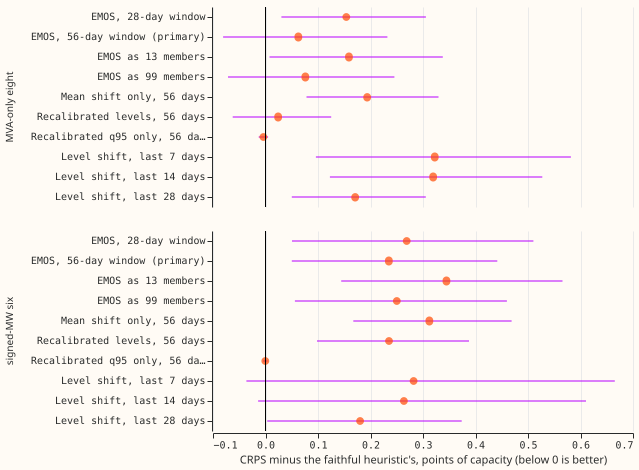
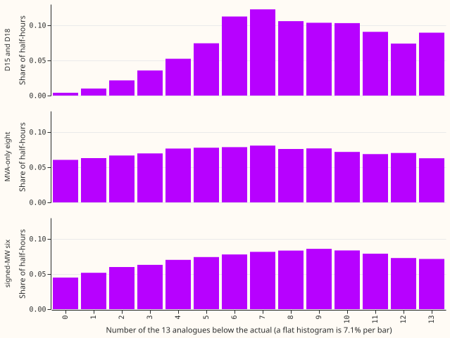
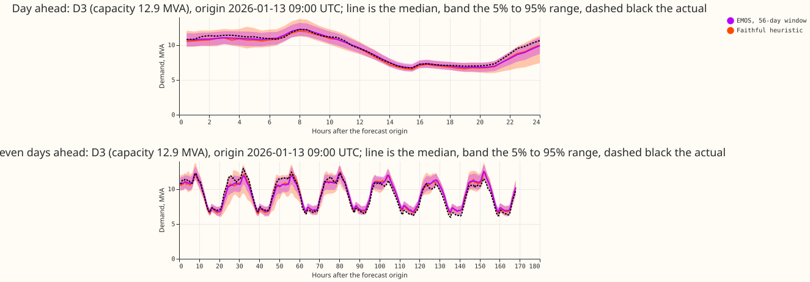

NGED's manual heuristic reads one number from 13 equally weighted historical analogues, their 95th
percentile. We asked whether cheap changes to that rule, with no trained neural network, lower its
quantile score. We tested calibration fitted on the last 28 to 112 days of errors (ensemble model
output statistics, [Gneiting et al. (2005)](https://doi.org/10.1175/MWR2904.1)), a recalibration of
the quantile levels, and a shift by the recent error, and scored each beside the unchanged heuristic.
None of them lowered the whole-year score at both groups of substations.

**Take-home: the faithful heuristic is already about as well calibrated as a cheap fit can make it,
so it stays the bar.** The analogues' rank histogram is nearly flat, and the 95th percentile is
exceeded in 9.5% of half-hours at the eight MVA-only Primaries and 10.6% at the signed-MW six, at or
just below the 11.4% that perfectly calibrated analogues give with 13 members. A fit on a trailing
window therefore has little to correct, and it adds noise. Verdict: not supported. What it narrows:
the remaining gap between the heuristic and BG2 is not a calibration problem.

## Figures

## Results

- **Rows.** Experiment 457's row set (`fold_a_daily_gap_v1`), five months (2025-10, 2025-12,
  2026-01, 2026-03, 2026-06), 709,353 shared half-hours: 385,855 at the eight, 258,993 at the six.
  The row set ends at 168 hours, so leads of 168 to 240 hours are not scored (stage 0 covers them).
- **Faithful heuristic, absolute scores (CRPS, points of capacity).** Eight: 4.163; six: 3.760.
  References on the same rows: BG2 3.563 and 2.856, arm A-avg5 3.363 and 2.734, monthly XGBoost
  3.655 and 3.051, climatology 4.564 and 4.091.
- **Primary variant, EMOS (56-day window, weekly refit).** CRPS difference from the faithful
  heuristic +0.063 at the eight (Bonferroni interval -0.081 to +0.232) and +0.235 at the six (+0.050
  to +0.442). It does not clear the pre-registered rule.
- **Every gating contrast** (10 variants, 2 groups, 20 tests; CRPS, all rows):
    - No variant lowers CRPS at both groups.
    - The recalibrated q95 alone (`Tau95_56`) is neutral: -0.004 at the eight and -0.0004 at the six,
      because the recalibrated level is the maximum member in 1,696 of 3,154 fits.
    - The remaining variants raise CRPS by 0.02 to 0.34 points.
- **Cold winter nights (secondary, interval uncorrected for the wider family).** EMOS lowers CRPS by
  0.90 at the eight (-1.21 to -0.36) and 0.36 at the six (-0.58 to -0.03), and lowers the 0.99
  pinball loss at both.
- **Where EMOS loses.** Christmas week at the six (+2.28), the 0.01 pinball loss at the six
  (+0.148), and the median forecast's mean absolute error (7.04 against 6.69 points at the six).
- **Tail coverage, eight and six (EMOS against faithful).** q95 0.891 and 0.916 against 0.881 and
  0.880; q99 0.946 and 0.966 against 0.912 and 0.911.
- **Avoidable-curtailment cost, signed-MW six, millions of pounds over the five months** (faithful
  heuristic against EMOS; difference with 95% interval over month-by-series cells). At f = 0.9: 2.02
  against 1.71 (-0.31, -1.54 to +0.45). At f = 0.75: 12.88 against 10.92 (-1.97, -7.07 to +1.24). At
  f = 0.5: 37.79 against 33.68 (-4.11, -13.21 to +1.95). BG2 gives 1.37, 8.24, and 25.92. No
  interval excludes zero.
- **Emitting a distribution as members.** 13 equiprobable members raise CRPS by 0.10 to 0.11 over
  the exact Gaussian; 99 members are within 0.015.

## Checks

- **Median minus mean forecast, per Primary.** The analogue median sits 0.0005 to 0.06 MW from the
  analogue mean (`work/scores/checks.csv`); no spread-driven shift.
- **Error of the median forecast beside the CRPS contrasts.** Median mean absolute error, eight and
  six: faithful 7.27 and 6.69 points; EMOS 7.40 and 7.04. The
  median and the CRPS point the same way.
- **Triggers fired.** None of the seven. The experiment's prediction (P2, exceedance moving towards
  5%) failed against the stage 0 measurement, and the write-up tests the explanation: the analogues
  were not under-covering at q95 to begin with.
- **Reviews.** A fresh Sonnet agent reviewed the code before the first scored run. It found no
  lookahead or alignment bug, and its findings were accepted: the Bonferroni count covers only the
  gating cells, every variant is floored at zero at the eight MVA-only Primaries, rows with fewer than
  6 members take the faithful quantiles, and the check against experiment 87 asserts. It also noted
  that the PIT recalibration cannot extend the tails beyond the member range, which explains
  `Tau95_56`.

## Plan, as run

- **Stage 0 (done).** Rebuilt from the stored members (`data/power_forecasts/experiment_name=manual_heuristic`),
  the 11 quantiles equal experiment 87's stored reference to 4e-15 MW. Rows hold 13 or 12 members at
  92% of half-hours; the rest hold 3 to 11 because observed power is missing. The Spearman
  correlation of analogue spread with the absolute error of the analogue mean is 0.54 to 0.57, so the
  spread carries information, yet EMOS's spread term did not pay off on the whole year.
- **Stage 1 and the level adjustment (done).** Variants `E28`, `E56`, `E56m13`, `E56m99`, `MeanLS56`,
  `Q56`, `Tau95_56`, `Lvl7`, `Lvl14`, `Lvl28`. Fits are per Primary and lead band (0 to 24, 24 to 72,
  72 to 120, 120 to 168 hours), weekly refits, pairs whose valid time is at least 24 hours before the
  refit. A 112-day window (`E112`) was written but not scored, because 2025-10 lacks the history.
- **Not run, by the stop rule.** Holiday-aligned analogues, the clock-change arm, 7 and 26 analogues,
  and the load-growth arm, because no stage 1 variant beat the faithful heuristic. Per-Primary results,
  Economy 7 and sunny slices, the largest-event-removed sensitivity, and the D15 and D18 report-only
  rows were not produced.
- **Selection bias.** Windows were chosen and scored on the same five months, so every variant's
  result is, if anything, optimistic.
- **Cadence and cleaning.** Weekly refits of the calibration, not of a model. Actuals are the cleaned
  scoring actuals (1,179 flagged exact-zero half-hours removed). The D15 and D18 cut does not apply
  because those Primaries are not scored.
- **Code.** `ml-experiments/00471-manual-heuristic-calibration-and-analogue-upgrades/`, importing the
  folders of experiments 448, 452, 457, 449, and 425.
- **Predictions.** `data/ml-experiments/00471-manual-heuristic-calibration-and-analogue-upgrades/work/predictions/<variant>.parquet`.

## What to try next

A correction fitted only on cold winter nights, since that is where EMOS gained, and a scoring row
set that reaches 240 hours.
