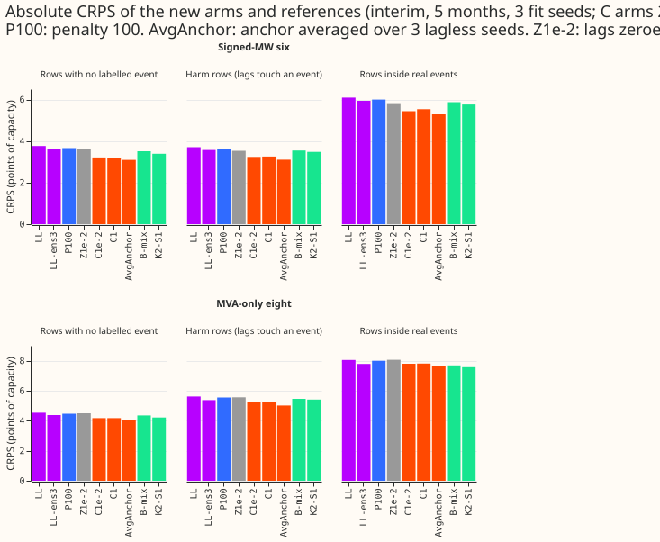
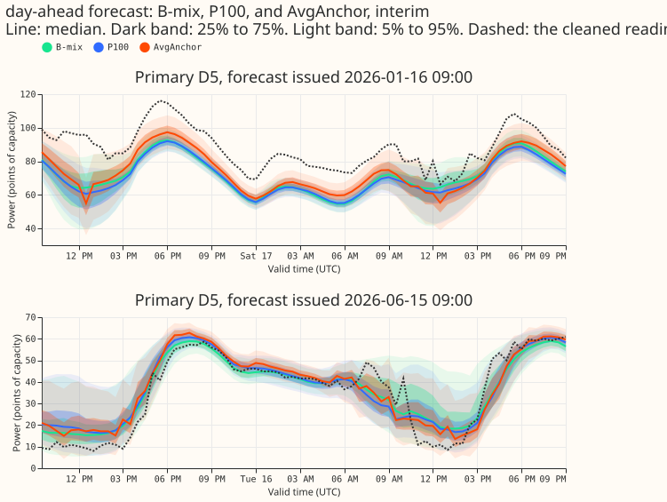
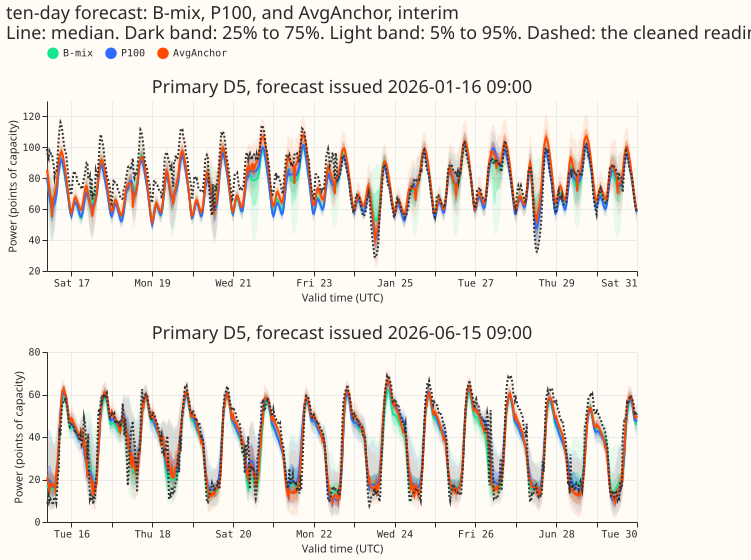
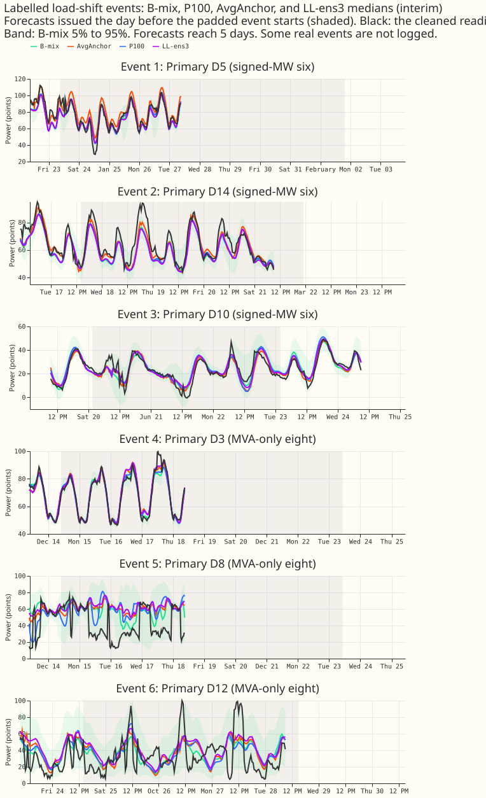
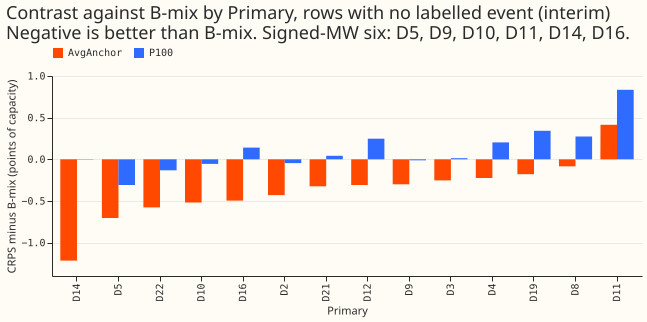

**A stronger penalty does not make the lag correction safe, and an anchor averaged over three
lagless seeds makes the correction score better than K2-S1.** The correction is experiment 467's
32-unit network on a frozen lagless forecast. The neural network reads the three lags, the surprise
at each lag, and
the lead time. A penalty of 100 on its outputs (P100) shrinks the shift to under 0.01 of capacity on
99.9% of rows and keeps 18% of the gain over the lagless head, so the stop rule for the penalty
fires. The averaged-anchor arm (AvgAnchor) replaces the single lagless seed with the equal-weight
mixture of seeds 0 to 2, nine components, and scores 3.094 points of capacity at the signed-MW six
on
rows with no labelled event. Its anchor LL-ens3 scores 3.622, K2-S1 3.387, B-mix 3.508, and
experiment 467's C1e-2 3.212 (seeds 0 and 1). NGED's event labels are incomplete, so "rows with no
labelled event" may hold real events that nobody logged. NRA means normal running arrangement. Every
number is interim and unaudited by an Opus agent.

## Results

Scores are points of effective capacity (CRPS, lower is better), raw quantiles, metered actuals
unless stated, leads up to 240 hours, and the mean over 5 scored months and the stored cells (fit
seeds 0 to 2; LL-ens3 has one cell; C1e-2, C1, and Z1e-2 have seeds 0 and 1 only). Intervals are 95%
month-block intervals, except where the Bonferroni count of 27 is named. Experiment 454's minimum
detectable effect at the signed-MW six is 0.237 on rows with no labelled event and 0.382 inside
events (0.124 and 0.798 at the MVA-only eight), read before any contrast. A contrast inside it is
inconclusive. Nothing here is claimed at the 99.8% level that 27 contrasts need.

- **Arms and predictions.** P100 uses a penalty of 100, a single-seed anchor, two serving neural
  networks, and 7 fits per monthly refit. AvgAnchor uses a penalty of 1e-2, a nine-component anchor,
  four serving neural networks, 21 lagless fits
  plus 1 correction per monthly refit). Predictions written before any fit: P1 (P100 keeps at least
  half of the gain over the lagless head) failed, with 18% kept. P2 (AvgAnchor within 0.05 of K2-S1)
  failed in the favourable direction: AvgAnchor is 0.29 points better. P3 (the shift share below
  0.01 of capacity
  goes to 1) held: 0.999 at the six.
- **Signed-MW six, rows with no labelled event.**
    - AvgAnchor 3.094, C1e-2 3.212, C1 3.206, Z1e-2 3.611, P100 3.664, LL-ens3 3.622, LL 3.761,
      B-mix 3.508, K2-S1 3.387.
    - P100 minus LL -0.098 (-0.147 to -0.048, 5 of 5 months), inside the minimum detectable effect,
      so inconclusive in size.
    - AvgAnchor minus LL-ens3 -0.528 (-0.939 to -0.221, 5 of 5 months, above 0.237); minus K2-S1
      -0.293 (-0.766 to +0.093, 3 of 5 months); minus B-mix -0.414 (-0.919 to -0.073, 5 of 5
      months).
    - P100 minus Z1e-2 +0.053: the penalty removes the spread recalibration that the lag-free
      control keeps.
- **MVA-only eight, rows with no labelled event.** AvgAnchor 4.048, K2-S1 4.215, B-mix 4.355,
  LL-ens3 4.377, P100 4.471, LL 4.535. AvgAnchor minus LL-ens3 -0.329 (-0.381 to -0.223); minus
  K2-S1 -0.167 (-0.297 to -0.054); P100 minus LL -0.064 (-0.083 to -0.040).
- **Gate 1 (diagnostic): the contrast against B-mix by Primary, with D14 and D11 removed.** The
  minimum detectable effect is 0.237 with all six, 0.218 without D14, and 0.176 without both.
    - AvgAnchor minus B-mix, with absolute scores (AvgAnchor against B-mix): -0.414 (3.094 against
      3.508, all six), -0.238 (-0.548 to +0.102; 3.142 against 3.380, no D14, inconclusive), -0.611
      (2.876 against 3.487, no D11), -0.406 (-0.771 to -0.067; 2.856 against 3.262, no D14 and D11).
    - AvgAnchor beats B-mix at five of the six signed Primaries (D11 is the exception, 4.08 against
      3.67)
      and at all eight MVA-only Primaries. D14 carries the largest share (2.83 against 4.04).
    - Against LL-ens3 the gain stays above the minimum detectable effect without D14 (-0.36, -0.60
      to -0.23) and without both (-0.33, -0.64 to +0.02).
    - P100 minus B-mix is +0.155 (-0.231 to +0.737; 3.664 against 3.508) and +0.006 without D14 and
      D11 (3.268 against 3.262): P100 is no better than B-mix.
- **Gate 2, held-out injected load shifts (worlds 200 to 202), signed-MW six, against the anchor.**
  AvgAnchor minus LL-ens3, with absolute scores (AvgAnchor against LL-ens3): -0.303 on target rows
  (-0.497 to -0.156; 3.104 against 3.406), -0.393 on harm rows (-0.693 to -0.120; 3.619 against
  4.012), -0.442 on clean rows (4.083 against 4.525). P100 minus LL (P100 against LL): -0.074 (3.479
  against 3.553), -0.078 (4.075 against 4.152), -0.080 (4.593 against 4.673), all intervals
  excluding zero.
  Both arms pass the 0.03 limit on injected rows. The neural networks trained on injected worlds of
  the
  same kind, so the comparison measures robustness to the injected load shifts and not to every real
  event.
- **Real events (gate 2 reading, inconclusive).** The resolution of the real-event rows is about
  0.38 at the six, so none of these contrasts can test a 0.03 limit.
    - Month-block, NRA-corrected actuals, six: AvgAnchor minus LL-ens3 +0.295 (-0.426 to +1.720;
      14.943 against 14.647); P100 minus LL -0.003 (-0.099 to +0.143; 14.793 against 14.796). On
      metered actuals: AvgAnchor -0.654 (-1.628 to +0.045; 5.285 against 5.939); P100 -0.095 (-0.152
      to -0.014; 5.995 against 6.091).
    - Event-cluster pooling (rows, 5,000 resamples of events; contrasts only, the absolute scores
      are the month-block ones above), NRA: AvgAnchor minus LL-ens3 +0.662
      (+0.045 to +1.088) over all events and +0.473 (-0.028 to +1.182) with the largest event
      removed. P100 minus LL +0.034 (-0.039 to +0.086) and +0.013 (-0.050 to +0.098). The two
      poolings give the same sign and different sizes.
    - MVA-only eight (the eight Primaries metered in MVA only), NRA: AvgAnchor minus LL-ens3 -0.140
      (-0.276 to +0.109; 10.005 against 10.145); P100 minus LL -0.041 (-0.075 to -0.008; 10.377
      against 10.418).
    - AvgAnchor on harm rows (lags touch an event, metered): -0.470 against LL-ens3 (-1.051 to
      +0.015; 3.100 against 3.571).
- **Definition of the gain.** The gain of a correction is its score subtracted from the score of the
  single-seed lagless head LL on the same rows: 0.549 for C1e-2 (seeds 0 and 1, interval -0.976 to
  -0.204) and 0.098 for P100, which is 18% (about 9% to 27% from the interval of P100's gain).
  Prediction P1 quoted 0.50 from experiment 467's seeds.
- **Gate 3, tails (signed-MW six, rows with no labelled event, raw).** Pinball loss is in fractions
  of capacity.

    | Arm | q01 cov | q05 cov | q95 cov | q99 cov | q01 pin | q05 pin | q95 pin | q99 pin |
    |---|---|---|---|---|---|---|---|---|
    | AvgAnchor | 0.005 | 0.027 | 0.945 | 0.991 | 0.00160 | 0.00568 | 0.00648 | 0.00184 |
    | LL-ens3 | 0.005 | 0.028 | 0.865 | 0.961 | 0.00155 | 0.00581 | 0.00820 | 0.00232 |
    | K2-S1 | 0.004 | 0.022 | 0.875 | 0.961 | 0.00152 | 0.00579 | 0.00777 | 0.00225 |
    | B-mix | 0.005 | 0.024 | 0.858 | 0.951 | 0.00152 | 0.00584 | 0.00840 | 0.00256 |
    | P100 | 0.008 | 0.037 | 0.851 | 0.949 | 0.00156 | 0.00588 | 0.00872 | 0.00270 |
    | LL | 0.009 | 0.038 | 0.838 | 0.943 | 0.00158 | 0.00596 | 0.00917 | 0.00290 |

    - AvgAnchor's q99 pinball loss is 21% below LL-ens3's, and P100's is 7% below LL's, so the loss
      limit (no more than 5% worse) holds for both.
    - The coverage limit (q99 and q95 within 0.01 of the anchor's) fails as written for AvgAnchor,
      whose q95 coverage is 0.945 against 0.865 for LL-ens3. The anchor under-covers, and AvgAnchor
      moves towards the nominal 0.95. P100 sits within 0.013 at q95 and 0.006 at q99. The widening
      by 1.15 and table P (4 months, fitted on earlier months) leave the order of the arms
      unchanged, and AvgAnchor gains nothing from 1.15 (3.102 against 3.094).
- **Cold winter nights (sun below -5 degrees, ERA5 at most 3 C, rows with no labelled event).**
  Signed-MW six, 20,416 half-hours: AvgAnchor 3.185, C1e-2 3.263, K2-S1 3.578, B-mix 3.710, LL-ens3
  3.870, P100 3.928, LL 4.059. MVA-only eight, 24,311 half-hours: AvgAnchor 3.520, K2-S1 3.806,
  LL-ens3 4.018, P100 4.151, LL 4.243. The ranking matches the all-rows ranking.
- **Lead band 12 to 36 hours (rows with no labelled event).** Signed-MW six: AvgAnchor 2.871, K2-S1
  3.234, B-mix 3.391, LL-ens3 3.558, P100 3.572, LL 3.692. MVA-only eight: AvgAnchor 3.775, K2-S1
  3.942, B-mix 4.107, LL-ens3 4.221, P100 4.293, LL 4.374.
- **Bias and error (signed-MW six, rows with no labelled event, points of capacity, mean over
  Primaries).** Mean absolute error of the median: AvgAnchor 4.5, K2-S1 4.9, B-mix 5.0, P100 5.1, LL
  5.2, LL-ens3 5.3. Mean of actual minus median: AvgAnchor 0.6, P100 1.8, LL-ens3 2.0, K2-S1 2.3,
  B-mix 2.5. The forecasts of every arm are low on average, and AvgAnchor corrects most of that
  level offset.
- **Shift share.** The share of rows with a shift below 0.01 of capacity at the six: P100 0.999,
  Z1e-2 1.000, C1 0.317, C1e-2 0.289, AvgAnchor 0.285. The mean log-scale change is +0.007 for P100,
  +0.119 for AvgAnchor, +0.259 for C1e-2, and +0.356 for Z1e-2.
- **Avoidable-curtailment cost** (experiment 449's cost, millions of pounds, signed-MW six, widened
  by 1.15, cells averaged, interval from resampling month-by-Primary cells). At f = 0.9, 0.75, and
  0.5: AvgAnchor 1.83, 7.25, 22.9; K2-S1 1.85, 8.22, 26.6; B-mix 1.96, 9.00, 28.5; LL-ens3 2.11,
  9.30, 28.5; P100 2.07, 9.04, 27.8; LL 2.19, 9.62, 29.4; BG2 1.37, 8.24, 25.9; manual_heuristic
  2.02, 12.9, 37.8.
    - AvgAnchor minus manual_heuristic at f = 0.5: -14.8 (-28.1 to -4.7). P100 minus LL: -1.63
      (-3.68 to -0.40) at f = 0.5 and -0.58 (-1.57 to -0.02) at f = 0.75.
    - AvgAnchor minus LL-ens3, K2-S1, and B-mix include zero at all three fractions. The scaled
      limit is the headline and the real thermal limit is not used.
- **Serving load.** P100 serves two neural networks per pass and needs 7 fits per monthly refit.
  AvgAnchor serves four
  neural networks (3 lagless seeds and a correction), 21 lagless fits and 1 correction fit per
  refit. K2-S1
  also serves four neural networks.
- **Fits.** The experiment ran 30 correction fits (23 s for P100, 39 s for AvgAnchor on one GPU
  process each), two
  processes under 8 GB, about 60 minutes in all with the four-world forecasts. The networks are
  saved under `data/ml-experiments/00472-*/work/models/`. Monthly retraining.
- **Rows and reuse.** Experiment 404's rows and injected worlds (training worlds 100 to 102, scoring
  worlds 200 to 202); real-world rows equal experiment 454's `experiment_404_scoring_rows` (346,672
  to 259,166 rows per month). Stored references from experiments 454 and 467. Flagged exact-zero
  half-hours are dropped, and D15 and D18 are report-only. Code reused: experiment 404's modules,
  experiment 454's mixture builder and scorer, and copies of experiment 467's `e00467_arm.py`,
  `e00467_score.py`, `e00467_curtailment.py`, and `e00467_figures.py`.
- **Reviews.** A fresh Sonnet reviewer found no bug in the arm script. A second reviewed the scoring
  script and found four faults: a mis-weighted mean approximation, event ids built from lags and not
  from the target, an unguarded cold-night index, and duplicate reference rows. All four were fixed.
  A third re-derived the headline scores from the stored forecasts with its own code, and agreed
  with every printed number to 0.001. The write-up reviews follow in the pull request.

## Checks

- **Median forecast minus mean forecast.** At the six, the mean of the mean forecast minus the
  median forecast is +0.2 points for AvgAnchor and LL-ens3, +0.3 for K2-S1, and +0.4 for B-mix. The
  per-Primary table was not produced.
- **Error of the mean and median beside each contrast.** The mean absolute error of the median and
  of the mean forecast move in the same direction as the quantile score for every contrast
  (AvgAnchor 4.5 against LL-ens3 5.3, K2-S1 4.9, and B-mix 5.0; P100 5.1 against LL 5.2).
- **Triggers.** Trigger 2 fired for P1 and P2: the explanations are the tested ones above (P100
  minus Z1e-2 shows the penalty removes the spread recalibration; the correction on an averaged
  anchor scores better than the correction on a single seed, 3.094 against 3.212). Trigger 4 did not
  flip the contrast against the anchor (the gain stays above the minimum detectable effect without
  D14), but the contrast against B-mix with D14 removed has an interval that includes zero, which is
  why gate 1 is a
  diagnostic. Trigger 7 holds, because the demand assembly adds AvgAnchor as a candidate on this
  unreplicated result. Triggers 1, 3, 5, and 6 did not fire. A fresh Sonnet agent re-derived the
  headline from the stored forecasts.

## Caveats and next steps

- **AvgAnchor is a candidate for the assembly's held-out test and not an adopted design.** AvgAnchor
  fails the coverage clause of gate 3 as written and the result is unreplicated, so the demand
  assembly treats it as one unreplicated candidate.
- **Real-event safety of AvgAnchor is unproven.** The point estimate on NRA-corrected actuals is
  0.30 to 0.66 points worse than its anchor, and the evidence is mixed: the month-block interval
  includes zero, and the event-cluster pooling over all events excludes zero (+0.66, +0.05 to
  +1.09).
- **The coverage limit of gate 3 fails as written, so AvgAnchor does not meet the pre-registered
  rule for a candidate as written,** because the anchor under-covers.
  A coverage
  limit relative to the nominal level would pass.
- **AvgAnchor and C1e-2 differ in more than the anchor:** C1e-2 has seeds 0 and 1 only, and the
  networks of AvgAnchor train on the other seeds' tables, so the 0.12 gap between them is not a
  clean test.
- **Unlogged events.** Clean rows may hold events no label covers, so the harm contrasts are
  optimistic and the real-event slices undercount.
- **Next step.** AvgAnchor goes into the demand assembly's held-out test as a further candidate. A
  test of a
  correction that ignores the lags inside events (a gate on the surprise) would address the
  real-event reading.
