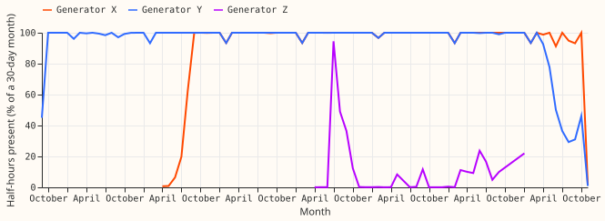
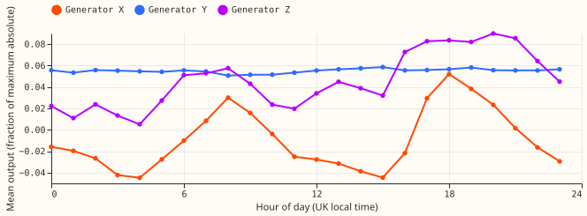
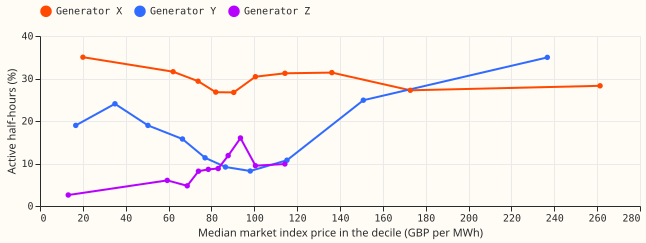
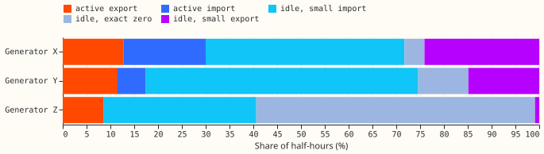

**Generator X is the one candidate for a first forecast, and its output shows only a weak
relationship with price.** The question was what makes NGED's three metered generators hard to
forecast, and whether any of them is forecastable at all. Generator Y has been inactive since
mid-2024, and Generator Z has 400 active half-hours in total. All three series are in MW, none
carries a cleaning flag, and none has duplicate keys, nulls, NaNs, or off-grid timestamps. The
checks narrow the stage 2 candidates to Generator X, plus Generator Y if its folds end in mid-2024.
Stage 2 is the first forecast, fitted only after this look; its gate is 35,040 valid half-hours.

**Generator Y runs in winter-heavy spells, then stops.** Its active share is 22.0% from October to
March and 12.6% from April to September, with 515 active spells (median 11 half-hours, longest 13.6
days). The last active month is 2024-06. After that, Generator Y is idle for 36,367 half-hours with
output at or below 3.9% of its maximum, and its idle level moves from a small import (about -1.5%
to -2.1% of the maximum, until 2024) to about +0.1% from 2025. A level shift of that size could be a
disconnection or a metering change, and the data cannot say which. In 2021, Generator Y has 305
active half-hours and a peak output of 16% of the series' overall maximum, so 2021 is a near-idle
year of unknown cause. Generator Y's record also thins in 2026, with 422 to 525 half-hours per
month in July to September against about 1,400 expected.

**Generator Z is almost absent.** It has 4,643 valid half-hours across a span of 49,008, with 52
gaps over an hour, 37 over 7 days, and a longest gap of 111 days. All 400 of its active half-hours
fall in 2023-07 and 2023-08. After the last active half-hour, it reads exact zero in 94.0% of 2,584
half-hours. Its longest run of exact zeros is 2,384 consecutive recorded half-hours, which spans 881
calendar days because the run crosses gaps. Before that run, the median of its non-zero idle
readings was -0.4% of its maximum (-0.2% counting the exact zeros), so the exact zeros could be a
meter fill, genuine idle, or sparse reporting. The data cannot say which, and the count of
exact-zero half-hours is a lower bound for missing data.

**Generator X is a two-sided series with short spells and a two-peak daily cycle.** It has 91,387
valid half-hours, and 5,236 more are missing in gaps: 117 gaps over an hour, with the 4 gaps over 7
days and the longest gap (28 days) all in 2021. Of its half-hours, 58.9% are negative, 4.2% are
exact zeros, and 30.0% are active. Active spells are short (median 2 half-hours, 90th percentile
5), and about 2,100 begin per year. The active share is 30.2% from October to March and 29.8% from
April to September, so the two half-years do not differ. The daily cycle peaks at +3% of the maximum
at 08:00 and +5% at 18:00 local time, with troughs of -4.5% at 04:00 and 15:00 (Figure 3). That
swing is small against half-hour changes of up to 100% of the maximum. Single half-hours that differ
by more than half the maximum from two otherwise equal neighbours occur 439 times, and the data
cannot say whether they are real dispatch or glitches.

**Generator X's mean output rises with price, but the evidence is weak.** The mean rises from -3.0%
of its maximum in the cheapest price decile to +0.1% in the dearest. The share of negative
half-hours does not fall (63% in the cheapest decile, 67% in the dearest), the rank correlation with
price is only 0.035 (0.046 after removing each hour's mean), and price and hour of day are
entangled. Generator Y is active in 35% of half-hours in the dearest decile and 8% in the decile
with a median price of 98 GBP per MWh. Its rank correlation with price is -0.066, and price cannot
be separated from season here. Generator Z's active share is 3% in the cheapest decile and 9% to
16% from the fifth decile up, on 400 active half-hours.

**National demand and embedded wind generation add little.** Rank correlations with national demand
are 0.175 (X, 0.038 after removing hour means), -0.085 (Y), and -0.280 (Z, -0.002 after removing
hour means). Rank correlation with embedded wind generation stays within 0.03 for X and Y, and is
-0.286 for Z, which rests on 400 active half-hours.

## Verdict and next step

- **H0 fails for Y and Z on data grounds and is untested for X.** The prediction that at least two
  of three series fail H0 holds, and so does the prediction that Generator Z fails the stage 2 gate.
  No weather-and-calendar forecast was fitted, so whether one describes Generator X is open.
- **Gate in half-hours.** Generator X has 91,387 valid half-hours (passes 35,040). Generator Y has
  119,514, of which 83,147 fall up to its last active month; it passes by count and fails by regime
  (Figure 1). Generator Z has 4,643 (fails).
- **Options for stage 2.** (a) Generator X alone, about 36 to 48 fits (1.5 to 2 GPU-hours at 2.5
  minutes per fit). (b) Generators X and Y with Generator Y's four folds placed before 2024-07,
  about 72 to 96 fits and 3 to 4 GPU-hours. The choice belongs to the ML manager.
- **Stop rule.** If the best forecast arm does not beat climatology and persistence, the generators
  are not forecastable from the available inputs.

## Checks

- **Cleaning.** The `substation_zero` rule flagged no half-hour at any of the three series, so no
  flagged exact-zero half-hours were dropped or reported.
- **Idle texture.** Generators X and Y idle at small imports, not zero. The median idle reading is
  -0.13% (X) and -1.5% (Y) of the maximum, like the solar import in
  [experiment 433](../00433-solar-idle-noise-data-look/result.md) and unlike the wind farms' exact
  zeros and repeats in [experiment 210](../00210-wind-idle-noise-mva-artefact/result.md).
- **Unexplained zeros.** Generator Y reads exact zero in 6,151 half-hours of 2020 (43% of its idle
  half-hours that year) and in 4,594 of 2025 (26%); its other years hold under 900 each. Generator X
  has 1,233 exact zeros in 2021 and under 810 in each later year.
- **Stuck runs.** Longest runs of one value, counted in consecutive recorded rows (a run can cross a
  gap): X 278 half-hours of exact zero, Y 156, Z 2,384. The longest non-zero run is 23 half-hours
  (X, at a small import) and 4 (Y). X has 47 non-zero runs over 6 half-hours.
- **Timestamps.** All timestamps are UTC-labelled and fall on the half-hour. Generator Y's
  hour-of-day profile is too flat to test the timestamp convention, and Generator X's peaks do not
  decide it, so the convention rests on the metadata.
- **Sign.** Positive means export, as in experiment 223. Both signs are valid readings.
- **Units and capacity.** The metadata lists all three in MW. No stated capacity is compared with
  the readings, so "above stated capacity" was not checked, and capacity fractions use each series'
  own maximum absolute output.
- **Weather.** No site weather was joined. National demand and embedded wind generation are weak
  weather proxies, and the rank correlations carry no interval because half-hours are
  autocorrelated.
- **Not applicable.** The avoidable-curtailment cost needs an agreed economic story, and none has
  been agreed. A production forecast would need a live price or dispatch feed, and none is available
  to us.
- **Unlogged events.** NGED's event logs may miss outages, so the idle spells of all three series
  may include unlogged outages.

## Files

- **Scripts.** `ml-experiments/00473-three-generators-data-look/` holds `e00473_look.py`,
  `e00473_extra.py`, and `e00473_charts.py`.
- **Tables.** `data/ml-experiments/00473-three-generators-data-look/` (private) holds
  `report.json`, the per-month, per-hour, per-weekday, per-year, and per-price-decile CSVs for each
  series, and `coverage.csv`.
