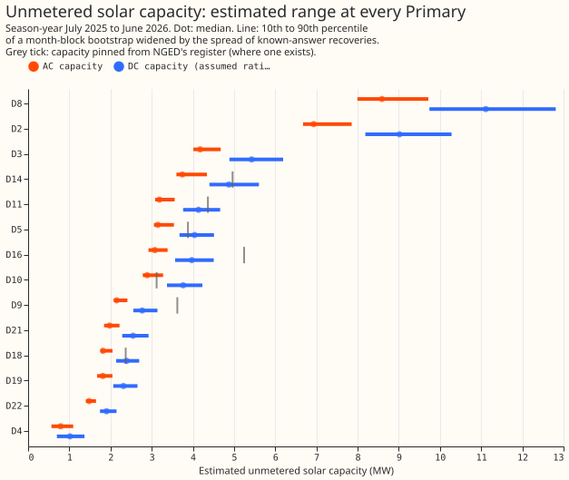
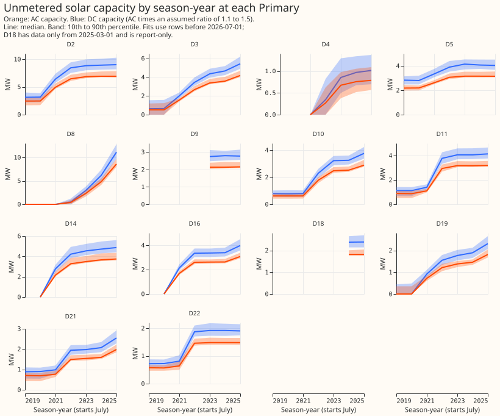

# PV capacity: a placebo-gated ladder and a per-Primary table with intervals

**How to read the NGED table.** The table is in `nged_table.md`, beside this page. Each row is one
Primary, meaning one primary substation. The capacity columns give the 10th, 50th, and 90th
percentile, across bootstrap resamples of the fit, of the estimated solar capacity behind that
substation's meter, in megawatts. AC capacity is what the inverters can export. DC capacity is the
panels' rating, assumed to be 1.1 to 1.5 times the AC capacity. A narrow range does not mean a
certain estimate. The Confidence column says how well the method found a metered solar farm that we
added to a Primary's reading as a test, and the Status column names Primaries that need extra care.
Every row's placebo test failed (the next paragraph explains the test).

**Take-home message (generalised additive model side, interim): no candidate solar shape passes
the placebo test, and a cloud-load term is what makes the capacity ranges honest.** The test of a
candidate method, called a rung, injects a metered solar farm's output into a Primary's reading and
asks the convex fit of experiment 129 to find it again. Recovery is the share of the injected
output the fit finds (1 is all of it). Without the cloud terms, each rung recovers 0.75 to 0.94.
The placebo test injects a fake farm that keeps the season and time of day but not the real daily
weather: the farm's day-of-year profile plus the anomaly of another day of the same month. A rung
passes only if the 95th percentile of the placebo's recovery stays under 0.20. It reaches 0.25 to
0.40 (the maximum over Primaries), because the profile alone recovers 0.13 to 0.26 (0.39 to 0.41
once
the cloud terms are added). A cloud-following load (extra demand on
cloudy days) lowers the 80% interval's coverage of the injected capacity to 0% to 24% at
every rung without the cloud terms. Two smooth cloud terms in the fit (day-mean and half-hour cloud
response)
restore coverage to 73% to 93%, and raise the placebo to 0.49 to 0.51. The table therefore uses the
rung with the best coverage in both cases: the pooled plant table driven by the mean of ERA5 and
CAMS irradiance, with the cloud terms (recovery 0.87).

## Figures

## Ladder results

Raw recovery over 6 Primaries (D5, D9, D10, D11, D14, D16) and 5 farms, with injections of 2 and 4
MW.
Placebo, profile-only, and cloud-load tests use 2 MW. Placebo figures are the 95th percentile over
20
shuffles, taken as the maximum over Primaries. Coverage figures are the 80% interval widened by the
spread of recoveries, except where C0 also gives the bootstrap alone.
Numbers are in the private file `work/rung_summary.parquet`; the main rows follow. CAMS is the
Copernicus Atmosphere Monitoring Service's satellite irradiance, and ERA5 is the European Centre for
Medium-Range Weather Forecasts' reanalysis (an estimate of past weather). A rung is one candidate
solar shape: C rungs come from experiments 129 and 269 (C0 is the mean learned plant response of the
other farms read at the Primary's irradiance, and C1 and C1b are physics shapes at two panel tilts),
and R rungs were added in this experiment.

- **C0, pooled plant table (CAMS sky):** recovery 0.874, placebo 95th percentile 0.36 (maximum over
  Primaries), coverage 27% (bootstrap alone) and 80% (bootstrap plus recovery spread); with a cloud-
  following load 0% and 7%.
- **C1, physics shape, tilt 20 degrees:** 0.823, placebo 0.28, coverage 75%; cloud load 0%.
- **C1b, physics shape, tilt 35 degrees:** 0.752, placebo 0.25, coverage 75%; cloud load 0%.
- **R1, nearest farm's recorded output as the shape (instead of CAMS):** 0.876, placebo 0.35,
  coverage 79%; cloud load 24%.
- **R2, nearest farm's learned plant response:** 0.881, placebo 0.36, coverage 86%.
- **R3, pooled table plus nearest farm's output (as well as CAMS):** 0.938, placebo 0.37, coverage
  79%.
- **R4, pooled table driven by the mean of ERA5 and CAMS irradiance:** 0.940, placebo 0.40, coverage
  85%; cloud load 3%.
- **R5, pooled table driven by ERA5 alone:** 0.814, placebo 0.40, coverage 77%.
- **With the cloud terms:** C0 0.882 (placebo 0.49, coverage 77%, cloud load 73%); C1 1.030 (0.51,
  80%, 80%); R4 0.868 (0.51, 93%, 93%).

## Table for NGED (`nged_table.md`)

The table is in [nged_table.md](nged_table.md) (latest season-year) and in the private file
`work/nged_table.parquet` (every season-year). The table uses rung R4 with the cloud terms. DC
capacity is
AC capacity times an assumed ratio between 1.1 and 1.5 (centre 1.25), because experiment 73 found
that the ratio cannot be fitted.

## Where the neural estimate is reported (experiment 477)

The neural estimate and the pros-and-cons scores are on the page of experiment 477, which also holds
the side-by-side plot of neural and GAM capacities. Experiment 477 reads this experiment's files:
the table
`nged_table.md` (latest season-year), and the private files `work/nged_table.parquet` (every
season-year, with the columns `ac_p10`, `ac_p50`, `ac_p90`, `dc_p10`, `dc_p50`, `dc_p90`,
`pinned_mw`, `status`) and `work/rung_summary.parquet`, under
`data/ml-experiments/00474-pv-capacity-placebo-gated-ladder-and-per-primary-intervals/`.

## Caveats

- No rung passes the placebo gate, so every capacity carries a "gate failed" note.
- D12 uses the physical fleet shape and the fit through the meter; D15 is a generator case with no
  estimate; D18 has data only from 2025-03-01.
- MVA-only Primaries are fitted to apparent power with reactive power assumed zero, which experiment
  370 found fails at a power factor of 0.97.
- The cloud-load test uses one form of load (experiment 129's), and the cloud terms match that form
  exactly, so the restored coverage is an optimistic figure.
- NGED's event labels are incomplete, so the readings may hold unlabelled events.
- Deviations from the plan: 20 placebo shuffles ran at every rung (the plan's metric line said 5 at
  some rungs); the injection test ran at 6 Primaries and the prediction text counts 5; C3 (a rise
  allowed, a fall resisted) was dropped because the fit already boxes every capacity increment to be
  non-negative, so the capacity path cannot fall; C2 was applied after the fit as an assumed ratio.
- The D12 bootstrap ran about 30 resamples (each fit takes about 40 seconds).
